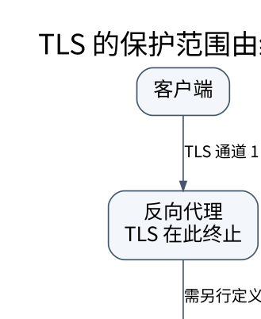

# HTTP、TLS 与 QUIC：把性能、安全和业务语义分开

> **学习位置**：[[计算机知识/00-开始/课程地图/09-计算机网络-课程地图|计算机网络课程地图]] · **适用边界**：分层模型与所引用 RFC；单位、时延及可靠性假设明确给出。

[PNG 备用图](../../_assets/diagrams/round3/tls-boundary.png) · [可编辑图源](../../_assets/diagrams/round3/tls-boundary.dot)

## 请求语义不是方法名的直觉解释

HTTP 请求由方法、目标、字段和可选内容构成；响应有状态码、字段和可选内容。安全方法的预期语义不应请求改变服务器状态；幂等表示多次相同请求的预期效果与一次相同，而不是响应内容和状态码必须逐字一致。DELETE 可以是幂等的，第一次返回成功、第二次返回不存在并不自动否定这一性质。

POST 并非绝对不能重试，但需要应用协议明确重复提交的处理。支付请求应把幂等键、参数绑定、结果保存和重试窗口视为一个设计，不能只在客户端加一次重试循环。

## 缓存与条件请求的完整例子

服务器返回内容及 `ETag: "v7"`，客户端再次请求时发送 `If-None-Match: "v7"`。资源未改变时，可返回 304 让客户端复用已有表示。ETag 是不透明验证器，不必等于文件哈希。`no-cache` 意味着复用前需要验证，并非禁止存储；`no-store` 才针对存储限制，仍不应把它理解为绝对的数据泄漏防护。

写入场景使用条件请求可防止丢失更新：客户端带 `If-Match`，只有版本匹配才接受修改。缓存键还可能受 `Vary` 指定的请求字段影响。缓存私人数据时必须检查共享缓存、授权信息和用户隔离，不能只按 URL 想当然复用。

## 版本改变了承载方式，不应随意改变业务契约

HTTP/1.1 需要明确消息长度或分块等边界；持久连接不等于无队头影响。HTTP/2 使用二进制帧和多路复用，但底层 TCP 丢失造成的字节交付阻塞仍存在。HTTP/3 基于 QUIC，改进流间传输独立性。协议升级不自动优化数据库查询，也不消除跨服务调用的串行依赖。

WebSocket 适合持续双向消息；SSE 面向服务器到浏览器的事件流；RPC 框架在传输之上还定义序列化、错误、截止时间等。选择时先写交互模式、消息大小、代理兼容和故障恢复需求，而非只比较流行度。

## TLS 如何建立可信加密通道

TLS 需要协商参数、验证对端身份、建立会话密钥，再用经过认证的加密保护记录。证书链验证、主机名验证与有效期检查是不同步骤。公钥算法通常不直接承担每个大数据块的加密工作；临时密钥交换与对称加密各司其职。

TLS 保护两个终止点之间的通道。反向代理终止 TLS 后到后端的路径需另行考虑；TLS 不会让终端上的恶意代码失效，也不能保证应用自身没有 SQL 注入。加密、完整性、认证和授权应分别提问。

TLS 1.3 的早期数据可能遭到重放，应用不能不加判断地把有不可重复副作用的操作放入 0-RTT。QUIC 的连接迁移也不是允许任意未验证地址直接无限量发送数据，它需要路径验证等机制。

## 练习：如何解释 504

504 表示网关未及时获得上游所需响应，不直接说明上游一定没有执行操作。一个创建订单请求可能已经在数据库提交，只是响应路径超时。正确恢复应查询幂等键对应状态，或按协议重试；简单生成新订单号重发可能重复扣款。这个例子把 HTTP 状态、传输失败和事务提交清楚分开。

继续核对：[HTTP 缓存 RFC 9111](https://www.rfc-editor.org/rfc/rfc9111.html)、[TLS 1.3 RFC 8446](https://www.rfc-editor.org/rfc/rfc8446.html)、[HTTP/3 RFC 9114](https://www.rfc-editor.org/rfc/rfc9114.html)。

<!-- ROUND4 DEPTH LINKS -->
## 继续推演本页难点

[[计算机知识/35-计算机网络/10-系统课程/11-TLS身份验证重放与信任边界|HTTPS 为什么不能证明业务请求没有重放，也不能替代权限检查？]] 本专题补上协议字段、时间线或可复算的数值条件。

这不是替换本页：先掌握原理，再用补充页核对容易被一句话略过的条件。
<!-- END ROUND4 DEPTH LINKS -->

## 关联阅读

- [[计算机知识/10-编程语言/05-TypeScript/10-系统课程/07-Web边界安全与全栈协议|Web 边界、安全与全栈协议：类型不能跨过网络自动延续]]
- [[计算机知识/55-数据库/10-系统课程/07-恢复复制与分布式事务|恢复、复制与分布式事务：提交成功意味着什么]]
- [[计算机知识/35-计算机网络/10-系统课程/04-传输层状态序号与拥塞|TCP 与 UDP：可靠字节流怎样在不可靠网络上成立]]

## 依据与继续查证

- [RFC 9293：TCP](https://www.rfc-editor.org/rfc/rfc9293.html)
- [RFC 9000：QUIC](https://www.rfc-editor.org/rfc/rfc9000.html)
- [RFC 9110：HTTP Semantics](https://www.rfc-editor.org/rfc/rfc9110.html)

本页的例子、推演与练习为教学构造；语言契约、系统接口和版本相关结论应结合以上原始文档核对。

<!-- COURSE SEQUENCE -->
## 顺序导航与验证

[[计算机知识/35-计算机网络/10-系统课程/00-计算机网络系统课程索引|本课程总索引]] · [[计算机知识/_labs/round3/NET/计算机网络-实验说明|本课程实验]]

上一讲：[[计算机知识/35-计算机网络/10-系统课程/05-DNS命名与应用基础设施|DNS、邮件与服务发现：名字不是地址的简单别名]]

下一讲：[[计算机知识/35-计算机网络/10-系统课程/07-Socket分帧背压与排障|Socket 工程：分帧、背压、超时和可解释的失败]]
<!-- END COURSE SEQUENCE -->

<!-- ORIGINAL DEEP LINKS -->
## 与原有长篇专题衔接

- [[计算机知识/35-计算机网络/06-DNS-TLS-HTTP与端到端请求|06-DNS-TLS-HTTP与端到端请求]]
- [[计算机知识/35-计算机网络/07-安全排障与网络知识全景|07-安全排障与网络知识全景]]

新旧讲解采用的版本与模型可能不同，比较时先核对各自前提，不把教学简化当成实现细节。
<!-- END ORIGINAL DEEP LINKS -->
