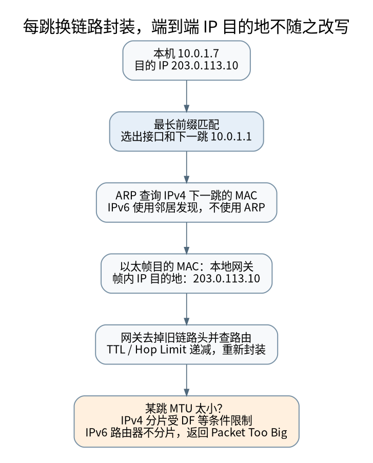

# 一个包怎样找到下一跳：路由、邻居发现与 PMTU

> **本页要解决**：IP 目的地很远，为什么以太网帧却发给本地网关？
>
> **先修**：[[计算机知识/35-计算机网络/10-系统课程/03-IP编址路由与IPv6|IP 编址与路由：从掩码计算到控制平面]]；[[计算机知识/35-计算机网络/10-系统课程/02-链路层交换与差错检测|链路层：从 CRC 到交换机为什么会泛洪]]。
>
> **阅读入口**：[[计算机知识/35-计算机网络/10-系统课程/00-计算机网络系统课程索引|本学科主索引]] · [[计算机知识/00-开始/全局导航/11-难点导读与研究证据|全局难点导读]]。

**版本、模型与证据边界**：以正文所列 RFC 为准；数值模型不是抓包，经典算法不代表每种当前协议栈。

## 先决定下一跳，再寻找链路层地址

主机地址为 `10.0.1.20/24`，默认网关为 `10.0.1.1`，要访问示例目标 `203.0.113.9`。目标不在本地直连前缀中，主机根据路由选择把 IP 包交给网关。以太网帧的目标 MAC 是网关在本链路的 MAC，而 IP 包的目标仍是远端地址。不是先用 ARP 查整个互联网目标的 MAC。

一般目的地址路由在适用的路由表中做最长前缀匹配：更具体的 `/24` 胜过覆盖它的 `/16`，默认路由 `/0` 才是兜底。真实系统还有策略路由、源地址、接口、VRF 与多路径选择，因此“目的地址查一张表”是基础模型，不是完整 Linux 转发实现。[^route]

[矢量图](../../_assets/diagrams/round4/route-mtu.svg) · [可编辑图源](../../_assets/diagrams/round4/route-mtu.dot)

## 每跳改变什么，不改变什么

路由器收到帧，取出 IP 包，减少 TTL 或 Hop Limit，查下一跳，再按出接口重新封装链路层帧。链路层源/目标地址随跳改变。普通转发不改变端到端源/目标 IP；NAT、隧道与其他中间盒是明确的额外处理，而不是每个路由器都默认重写源地址。

IPv4 用 ARP 解析同一链路上下一跳的 IPv4 地址；IPv6 邻居发现使用 ICMPv6 消息，并包含路由器发现等机制。地址解析、路由选择、DNS 名称解析分别回答“本链路怎么交付”“下一跳是谁”“名字对应什么地址”，不能把三者都叫“找 IP”。[^nd]

## IPv4 分片按字节算，片偏移却以八字节为单位

设 IPv4 数据报总长 4000 字节，头长固定 20 字节，无选项，允许分片；出链路 MTU 为 1500。原载荷为 3980 字节，每个非末片最多装 `floor((1500-20)/8)*8=1480` 字节数据。

| 分片 | 数据长度 | 含头总长度 | 片偏移字段 | MF |
| --- | --- | --- | --- | --- |
| 1 | 1480 | 1500 | 0 | 1 |
| 2 | 1480 | 1500 | 185 | 1 |
| 3 | 1020 | 1040 | 370 | 0 |

第二片从原载荷字节 1480 开始，因此偏移为 1480/8=185。第三片从 2960 开始，偏移为 370。片偏移相对原始 IP 载荷，不把每个新分片的头部累计进去。总传输 IP 字节增为 4040，是因为比原来多了两份 20 字节头。[^ipv4]

这个算例不含 IPv4 选项，不处理再分片或重叠分片策略。真正实现必须检查标识、总长度、偏移溢出、资源上限与重组超时。一个片丢失会阻止整个数据报正常重组，分片并不是免费的 MTU 适配。

## IPv6 路由器不负责替源站分片

IPv6 把路由器分片从普通转发路径移除。包过大时，路由器应发送 Packet Too Big，源端调整包大小或在适当场景自行使用 Fragment 扩展头。不能把上面的 IPv4 分片表直接套给 IPv6 路由器。[^ipv6][^pmtu]

路径 MTU 是沿路径各链路可承载上限中的限制值，还会随路由、隧道或封装变化。IPv6 基本头长 40 字节，UDP 头 8 字节，在 MTU=1500 且无扩展头/额外封装的例子里，UDP 载荷上限为 1452；IPv4 固定 20 字节头的对应例子为 1472。它们都不是应用可以不问路径就永久写死的通用常数。

## 为什么小请求成功，大响应却卡住

如果大包需要依赖 PMTU 反馈，而必要 ICMP 消息被错误过滤，发送方可能继续发送过大的包，形成 PMTU 黑洞。现象可能是握手成功、短请求成功、大数据传输失败。此时仅检查“端口能连上”不能证明整条路径适合所需包大小。

Packetization Layer PMTUD 通过分包层的探测与确认判断可用包大小，可降低对 ICMP 反馈的单一路径依赖；仍需区分拥塞丢失与大小导致的失败，并有探测状态机。它不是见到一次超时就随意降低 MTU。[^dplpmtud]

## MTU、MSS 与应用分帧属于不同层

MTU 限制链路承载的网络层包大小。TCP MSS 描述 TCP 数据部分的分段尺度，并需要结合实际 IP/TCP 头与路径限制；应用消息则可以跨多个 TCP 段。一次 recv 不保证恰好等于一条消息或一个网络包。

应用协议应以长度字段、分隔符或其他无歧义机制恢复边界，并限制长度和积压。C 的 [[计算机知识/10-编程语言/03-C语言/10-系统课程/10-对象表示别名与二进制解析|二进制解析]] 负责把不完整字节流安全转换为字段；[[计算机知识/35-计算机网络/10-系统课程/10-TCP窗口RTO与拥塞控制手算|TCP 的确认与窗口]] 负责另一层的传输状态。两者不能互相替代。

## 实验

本轮在离线模型中验证最长前缀选择、IPv4 分片总长度与偏移，以及 IPv4/IPv6 无选项 UDP 载荷预算。不修改你的系统路由、MTU 或防火墙，也不生成真实分片流量。

**自测**：远端 IP 没变，为何抓包中目标 MAC 会变？因为 MAC 服务当前链路交付，IP 服务跨链路寻址。一次隧道封装可能再增加外层 IP，此时应先说明正在观察内层还是外层。

[^route]: Linux man-pages [ip-route](https://man7.org/linux/man-pages/man8/ip-route.8.html)，路由、前缀、下一跳与路由表；本文采用其基础目的地址路由模型。
[^nd]: IETF [RFC 4861](https://www.rfc-editor.org/rfc/rfc4861.html)，IPv6 邻居发现。
[^ipv4]: IETF [RFC 791](https://www.rfc-editor.org/rfc/rfc791.html)，IPv4 总长度、标志与八字节片偏移。
[^ipv6]: IETF [RFC 8200](https://www.rfc-editor.org/rfc/rfc8200.html)，IPv6 转发、基本头与源端分片。
[^pmtu]: IETF [RFC 8201](https://www.rfc-editor.org/rfc/rfc8201.html)，IPv6 路径 MTU 发现。
[^dplpmtud]: IETF [RFC 8899](https://www.rfc-editor.org/rfc/rfc8899.html)，数据报传输的分包层 PMTU 发现。

## 知识连接：下一步应追问什么

包的表示、下一跳选择和传输重试彼此连接，但各自解决的问题不同。

[[计算机知识/10-编程语言/03-C语言/10-系统课程/10-对象表示别名与二进制解析|从字节到对象：对齐、别名、字节序与可靠解析]]：为什么长度够、地址也没越界，强转读取仍可能不合法？

[[计算机知识/35-计算机网络/10-系统课程/10-TCP窗口RTO与拥塞控制手算|从 ACK 到发送决策：TCP 窗口、RTO 与拥塞推演]]：接收窗口、拥塞窗口、在途量与超时分别限制什么？

[[计算机知识/20-操作系统/01-Linux/10-系统课程/09-FD共享epoll与非阻塞状态机|从 FD 到事件循环：共享偏移、epoll 与非阻塞状态机]]：dup 出来的两个 FD 为什么会共享读写位置？

[[计算机知识/35-计算机网络/10-系统课程/11-TLS身份验证重放与信任边界|加密以后还剩哪些风险：TLS 身份验证、重放与信任边界]]：HTTPS 为什么不能证明业务请求没有重放，也不能替代权限检查？

## 本地核验与阅读顺序

[[计算机知识/_labs/round4/README|本轮实验：命令、检查范围与未执行项目]] 提供对应文件和记录。[[计算机知识/90-资源/维护/导入-com/_meta/round4/01-研究证据与版本边界|研究证据索引]] 区分规范、推演和实验；[[计算机知识/90-资源/维护/导入-com/_meta/round4/02-缺口回查与后续验证|仍需进一步验证的边界]] 不把概览或模型标成完整实现。

先完成主干，再按问题选择专题；不要求跳过第 1–8 讲。 下一专题：[[计算机知识/35-计算机网络/10-系统课程/10-TCP窗口RTO与拥塞控制手算|从 ACK 到发送决策：TCP 窗口、RTO 与拥塞推演]]。
