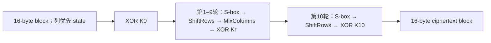

# AES 怎样变一个块，工作模式怎样处理一条消息

[[计算机知识/35-计算机网络/10-系统课程/现代密码学安全目标与组合|安全游戏与 AEAD]] 已区分保密、认证与重放，[[计算机知识/35-计算机网络/10-系统课程/现代密码学DH中间人与认证转录|DH 与认证转录]] 解释怎样得到并认证会话 key。本页补上仍藏在 API 里的机制：AES 对一个 16 字节块做什么，为什么不能把固定置换逐块套在消息上，以及 CBC/CTR 的条件怎样改变泄漏和篡改结果。

本页固定 **AES-128**，即 128 bit key、128 bit block、10 轮；AES-192/256 仍用 128 bit block，但 key 扩展和轮数不同，不在本练习实现。CBC/ECB 只收整块且**不隐式填充**；CTR 收字节消息，可有不足一块的尾部。所有原始 key/IV/消息是公开向量；教学 Python 实现只供逐轮查看，真实密码运算用成熟库，不能把本页复制成生产密码库。[[计算机知识/_labs/modern_crypto_modes/README|实践入口]] 保留 NIST 输入、轮迹、三条实现路线和失败判据。

## 一个 byte 的代数不等于模 256 整数

AES 把 byte 的八个位解释为 $\mathbb F_2$ 上次数小于 8 的多项式，最低位是常数项。例如十六进制 `57` 表示 $x^6+x^4+x^2+x+1$。系数相加模 2，所以域加法是 XOR；域乘法先作多项式乘法，再对

$$m(x)=x^8+x^4+x^3+x+1\quad\text{（十六进制 11b）}$$

取余。这里 $m$ 不可约，商给出 $\operatorname{GF}(2^8)$；不是把普通整数乘积对 256 取模。乘 $x$ 的 `xtime` 操作为：左移一位，若原最高位为1则 XOR `11b`，最后留下低八位。例如 `57 → ae → 47 → 8e → 07` 是接连乘 02；由于 `13=10 XOR 02 XOR 01`，

$$\{57\}\cdot\{13\}=\{07\}\oplus\{ae\}\oplus\{57\}=\{fe\}.$$

FIPS 197 §§4–5 给出运算与轮变换，本页按其 byte/bit 索引解释。[^aes]

为什么非零 byte 都能求逆，可回读 [[数学/25-高等代数/12-环理想商环与同态基本定理#素理想、极大理想的判别|不可约多项式怎样给出商域]]：这里是 $\mathbb F_2[x]/(m)$，不可约性保证域结构。CRC 也取多项式余式，但可约生成式的商可以含零因子，仍可能完成特定检错；不能因为两处都出现 XOR 和取余，就认为都允许对任意非零代表求逆。

### S-box：非线性从哪里进入

对非零 byte $b$ 先求域逆 $\tilde b=b^{-1}=b^{254}$，约定输入0时取 $\tilde b=0$，再做仿射变换。以最低位索引 $i=0$，$c=\texttt{63}$，输出位为

$$S(b)_i=\tilde b_i\oplus\tilde b_{(i+4)\bmod8}\oplus\tilde b_{(i+5)\bmod8}\oplus\tilde b_{(i+6)\bmod8}\oplus\tilde b_{(i+7)\bmod8}\oplus c_i.$$

例如 `53` 的域逆为 `ca`，代入得到 `ed`；`S(00)=63`。程序从这个公式生成全部256项，不靠一张来源不明的表；输出恰有256个不同值，因而可以构造唯一逆表。这是有限映射的可逆性检查，不是计算安全证明。

为什么不能只做 XOR、移位和线性混合？对固定 key，这些操作的复合仍是明文位向量上的仿射映射 $L(P)\oplus v_K$；查询零块与128个基向量就能恢复这条输入输出映射，无须找出原 key。即使 key 扩展本身非线性，固定后轮 key 仍只是常量。S-box 的域逆打破这种结构：仿射映射必有 $S(0)\oplus S(1)\oplus S(2)=S(3)$，实际左边为 `68`，右边为 `7b`。这说明其非仿射，不等于仅凭“非线性”就证明完整 AES 安全。

## 16 字节放进哪一个位置

AES state 是四行四列 byte，**按列填入**：

$$s_{r,c}=\operatorname{input}[r+4c],\qquad0\le r,c<4.$$

NIST 第一明文块为 `6bc1bee22e409f96e93d7e117393172a`，因此 state 是

$$\begin{bmatrix}
6b&2e&e9&73\\c1&40&3d&93\\be&9f&7e&17\\e2&96&11&2a
\end{bmatrix}.$$

这些都是十六进制 byte，不是实数矩阵。回写时同样按列拼回16字节；误用行优先会得到一个自洽但不再是 AES 的“私人版本”。

一轮的各步解决不同结构问题：

- **SubBytes**：每个 byte 单独经过同一个非线性 S-box。
- **ShiftRows**：第 $r$ 行循环左移 $r$ 个位置，即 $s'_{r,c}=s_{r,(c+r)\bmod4}$，将不同列的 byte 重新分配。
- **MixColumns**：对每一列在上述域上作同一线性变换；它不跨列，跨列传播来自与 ShiftRows 的配合。
- **AddRoundKey**：state 与本轮16字节 key 逐 byte XOR，把秘密 key 注入变换；单独重复 XOR 不会自动制造强密码。

MixColumns 的矩阵为

$$\begin{bmatrix}02&03&01&01\\01&02&03&01\\01&01&02&03\\03&01&01&02\end{bmatrix}.$$

例如列 `db 13 53 45` 变成 `8e 4d a1 bc`；第一项是 `02·db XOR 03·13 XOR 53 XOR 45 = ad XOR 35 XOR 53 XOR 45 = 8e`。逆矩阵的第一行为 `0e 0b 0d 09`，以后各行按同样循环方式排列；可在域上相乘核得单位矩阵。可逆线性扩散只是整个结构的一部分，不能把“一个 byte 影响四个”直接当成抗所有密码分析的证明。

### 轮 key 怎样从同一把 key 展开

AES-128 把16字节 key 分为4个 word $w_0,\ldots,w_3$，每 word 为4 byte；扩展到 $w_0,\ldots,w_{43}$，恰够11份轮 key。对 $i=4,\ldots,43$：

$$w_i=\begin{cases}
w_{i-4}\oplus\operatorname{SubWord}(\operatorname{RotWord}(w_{i-1}))\oplus\operatorname{Rcon}_{i/4},&i\equiv0\pmod4,\\
w_{i-4}\oplus w_{i-1},&\text{其他。}
\end{cases}$$

RotWord 左转一个 byte，SubWord 对四项作 S-box，Rcon 的首 byte 依次为 `01 02 04 08 10 20 40 80 1b 36`，其余为0。原始 key 是轮0的 key；扩展增加的是确定的轮材料，不是把128位秘密变成176字节独立秘密熵。公开输入 `2b7e…4f3c` 的轮1 key 为 `a0fafe1788542cb123a339392a6c7605`。

### 初始轮与末轮不能漏

流程是先 AddRoundKey($K_0$)，然后第1–9轮各作 SubBytes→ShiftRows→MixColumns→AddRoundKey，第10轮只作 SubBytes→ShiftRows→AddRoundKey($K_{10}$)。最后一轮没有 MixColumns。每步可逆，所以固定 key 下全流程是 $\{0,1\}^{128}$ 上的置换；解密按逆序用逆变换与反向轮 key，不能只把正向循环倒着读。

NIST AES_Core128 的首块核对能定位“错在何步”：

| 阶段 | 按列拼回的16字节十六进制 |
|---|---|
| 初始 AddRoundKey | `40bfabf406ee4d3042ca6b997a5c5816` |
| 轮1 SubBytes | `090862bf6f28e3042c747feeda4a6a47` |
| 轮1 ShiftRows | `09287f476f746abf2c4a6204da08e3ee` |
| 轮1 MixColumns | `529f16c2978615cae01aae54ba1a2659` |
| 轮1 AddRoundKey | `f265e8d51fd2397bc3b9976d9076505c` |
| 轮10最终输出 | `3ad77bb40d7a3660a89ecaf32466ef97` |

本机保留40个阶段状态与11份轮 key，并与 NIST 上述定位及最终向量核对。最后轮少一步并不使它不可逆；也不能凭这张轮迹、一次差分或“改了大约半数位”证明 AES 是伪随机置换。[^core]

## 好的固定置换为什么仍不够

块密码的 PRP 目标，是随机秘密 key 的置换族在规定查询预算下难以与均匀随机置换区分；它不是随机函数，也不是已经有 nonce、可处理任意长度的认证加密。这里解释目标，**没有证明 AES 的一般 PRP 安全**。

把每块直接作 $C_j=E_K(P_j)$ 是 ECB。同 key 下，$P_i=P_j$ 当且仅当 $C_i=C_j$，这由置换的单射性直接保证。攻击者在左右消息游戏提交两块消息 $(X,X)$ 与 $(X,Y)$，其中 $X\ne Y$，仅看两密文块是否相等就总能猜中。这个失败甚至在底层是完美随机置换时也成立；算法内部再复杂，也没承诺替外层擦除块间关系。

ECB 常用作测试单块 AES 的接口，不是一般消息保密的推荐方式。本实践重复一个 NIST 明文块得到重复密文块，验证的是确定的结构关系，没有对外扫描或图像攻击。

## CBC：把上一密文引入下一块

令 $C_0=IV$，对整块消息

$$C_j=E_K(P_j\oplus C_{j-1}),\qquad P_j=D_K(C_j)\oplus C_{j-1}.$$

IV 是公开的16字节起点。第一块因此不再只由 $P_1$ 决定；后续加密依赖上一密文，解密则可在拿到密文后并行计算各个 $D_K(C_j)$。CBC 不是把所有明文连成一块大 AES，它复用同一16字节置换并引入链状态。[^modes]

### 为什么“每次不同”还不够

CBC 要求 IV 在攻击者**选定本条明文之前不可预测**，不要求保密，并且 IV 的完整性也应受保护。公开发送已生成的 IV 与事先可预测的下一 IV 不是一回事。若只把一个公开计数器直接当 CBC IV，它可唯一却可预测。

具体反例：已知一次消息首块 $P$、IV $V$ 和首密文 $C=E_K(P\oplus V)$。攻击者在选下一条明文前预测其 IV 为 $W$，便选

$$Q=P\oplus V\oplus W.$$

于是新首密文 $E_K(Q\oplus W)=E_K(P\oplus V)=C$。把 $Q$ 与不同的同长首块作为左右挑战，通过是否等于旧 $C$ 可完美区分。在本例 $V=0001…0e0f$，$W=0001…0e10$，$P$ 的最后 byte `2a` 调为 `35`，新首密文与旧首密文确实相等。攻击者没有解出 key。这是“唯一 IV”仍不足的选择明文反例，不是说每次公开 IV 都不安全。

直接重用同一 IV 时，相同明文前缀也会有相同密文前缀；不同首块不会因此一般泄漏明文 XOR。那种确定的 XOR 泄漏是下一节密钥流复用的性质，不要混成一个万能口诀。

### 错误传播不等于篡改拒绝

若攻击者改 $IV'=IV\oplus\Delta$，解密得到 $P_1'=P_1\oplus\Delta$，其余块不变。若改 $C_j'=C_j\oplus\Delta$ 且 $\Delta\ne0$，$P_j$ 因逆置换输入变了而改变，通常难以精确控制；下一块却是

$$P_{j+1}'=P_{j+1}\oplus\Delta,$$

再后的块不变（若 $j$ 已是最后一块，就没有下一块）。这解释既可能造成损坏，也可能精确改下一块某些位。实践对四块消息改 $C_1$ 首 bit，$P_1$ 此次改变68 bit，$P_2$ 首 bit 精确改变，$P_3,P_4$ 不变。**68 是这组输入的观察值**，不是“所有情况必翻一半”的定律。

原始 CBC 解密对此返回字节，没有标签可验证。填充格式若需要，要由单独协议明确；本例不实现填充或 padding oracle，既不把补零当无歧义编码，也不以“填充检查可能失败”充当消息认证。

## CTR：把块密码用作密钥流发生器

CTR 把每个独一的16字节计数输入 $T_j$ 送入**正向** AES：

$$O_j=E_K(T_j),\qquad C_j=P_j\oplus O_j,\qquad P_j=C_j\oplus O_j.$$

解密也只需正向 AES，不用 $D_K$。计数输入与明文无关，可提前或并行生成；尾块若只有 $u$ 个 byte，就只用输出前 $u$ 个 byte，不需为了整块补齐消息。这是由块密码构造的流式处理方式；本身按流设计的 ChaCha20 则不必先由 AES 或另一个块密码生成。两者都要把具体输入与复用合同说清，不能把所有流密码等同于 OTP 的信息论安全。

### 唯一的是每一个计数输入，不只是消息起点

SP800-38A 要求固定 key 下**跨全部消息的所有 $T_j$ 都不同**。本实践选择把完整128位按大端非负整数解释，消息从 start 开始依次使用 $\text{start}+j$，预先检查整个区间，不让它越过 $2^{128}-1$。这是更严格的教学合同；NIST 也允许对指定 $m$ 位作模 $2^m$ 增量，只要规定的消息长度、起点与全局使用满足不重复，不能把本例“不回绕”说成标准普遍禁止任何模增量。[^modes]

消息A从7开始、长32byte，使用计数输入7和8；消息B从8开始、长16byte。两起点不同，仍共享了8。`CTRRangeGuardDemo` 在同一内存实例里保存半开区间 `[7,9)`，因此拒绝 B；它不是持久化 nonce 分配器，重启或另一进程会丢掉历史。

若采用常见的“固定前缀 nonce + 低位块计数”布局，也须声明前缀长度、字节序、首值、可用块数、耗尽/轮换与跨方向/发送者规则。换一个 API 参数名不修复输入复用。这里的128位布局不能直接搬去声称与某个32位计数 AEAD 的边界相同。

### 可塑性与复用是两个直接方程

攻击者改 $C_j'=C_j\oplus\Delta$，则 $P_j'=P_j\oplus\Delta$，同块其他位及其他块不受影响；没有认证失败。若 key 和计数输入在两个位置重用，则输出 $O$ 相同，得到

$$C\oplus C'=P\oplus P'.$$

已知其中一段明文还能恢复另一段相应位置。它只要求两个位置共享密钥流，不要求两条消息从头到尾都用同一个起点。实践固定公开载荷 `amount=0100` 与 `amount=0900`，重用后两种 XOR 都为 `0000000000000000080000`；单独改密文零基索引17处的 byte 的 bit2，只改变解密该位置的 bit2。这里谈的是密文字节出错，改计数输入会改变对应密钥流，是另一种对象变化。

| 对象和改动 | 能从公式确定的后果 | 有无消息认证拒绝 |
|---|---|---|
| ECB 重复相同明文块 | 重复密文块 | 无 |
| CBC 改 IV 中的位 | 首块同位置精确翻位，后块不变 | 无 |
| CBC 改某密文块 | 本块改变、下一块同位置精确翻位、以后不变 | 无 |
| CTR 改密文中的位 | 对应明文同位置精确翻位 | 无 |
| CTR 重用某计数输入 | 两段明文 XOR 泄漏 | 无 |

## 回到 AEAD：缺的保证不是再加几轮

ECB 的模式泄漏、CBC/CTR 的可塑性，不代表 AES 单块置换被逆向破解。把 AES-128 换成 AES-256，也不自动给原始 CBC/CTR 加上认证或防重放。回到 [[计算机知识/35-计算机网络/10-系统课程/现代密码学安全目标与组合#同一套 AEAD 接口，三个不同的问题|AEAD 的三个安全问题]]：保密、密文完整性、选择密文隐私须分别建立，nonce 合同、AAD、编码和独立用途 key 都仍是前提。

有条件 EtM 的意义也更具体了：必须把 IV/nonce 与影响解释的上下文纳入合适的认证输入，先核验再释放明文，并满足底层模式自己的前提。不要用本页的教学 AES、CBC/CTR 再手拼生产封装；成熟 AEAD 已把密码构造与接口约束集中起来，但仍不会替应用生成持久唯一 nonce、固定可信身份或原子去重。[[计算机知识/35-计算机网络/10-系统课程/现代密码学安全目标与组合#真正传给库的是哪些字节|已交 AEAD 的实际字节合同]] 保留原成熟库拒绝实验，本轮不重复那些测试。

再返回 [[计算机知识/35-计算机网络/10-系统课程/现代密码学DH中间人与认证转录#第四阶段：沿已交付的 AEAD 合同发送数据|握手后的数据阶段]]：即使四份会话 key 派生正确，数据处理若改为裸 CTR 并复用计数范围，握手签名也不会替它补救。这是原语条件怎样穿过协议层的返回题，不能只说“握手过了就安全”。

## 改条件后的复算与答案

1. **域与索引**：计算 `57·13`；把 `db 13 53 45` 的 MixColumns 第一项写开。若 state 错按行装入，NIST 中间状态应继续声称匹配吗？
2. **省掉非线性**：若每轮都删去 SubBytes，保留原 key schedule，固定秘密 key 的整个映射是否仍为明文位上的仿射映射？怎样用129个选择输入恢复它？
3. **固定置换**：左右消息是 `(X,X)` 与 `(X,Y)` 且 $X\ne Y$，ECB 输出两块。成功率与上一单元 bit-guess 优势各多少？底层换成理想随机置换是否修复？
4. **CBC IV**：公开计数器作IV每次都不同，攻击者选本条明文前已知下一值。用旧 $P,V,C$ 和新 $W$ 构造一个首块，使新首密文等于 $C$；这是否意味着 IV 必须保密？
5. **传播**：四块 CBC 消息翻 $C_2$ 某 bit，哪几块可改变、哪块精确翻？CTR 在同位置改密文又怎样？
6. **CTR 范围**：消息A从100开始长17byte，消息B从101开始长1byte，是否可同时加密？最后一个整数 $2^{128}-1$ 在本教学合同下可加密16byte还是17byte？零长度调用保留几个计数输入？
7. **协议返回**：AEAD数据阶段换成裸CTR，双方握手签名及Finished都正确，能否由此检测攻击者翻密文 bit？进程内区间guard能否证明重启后的唯一性？

**答案**：① `fe`；第一项 `ad XOR 35 XOR 53 XOR 45=8e`；索引改变就不是同一 state，不能声称匹配。② 是；查询0得常量项，查询128个单位向量并各 XOR $E(0)$ 得线性部分的列，可计算任意输入映射。③ 成功率1、优势1/2；随机置换也保留块相等性，所以不修复。④ 取 $Q=P\oplus V\oplus W$；不要求IV保密，而要在选明文之前不可预测。⑤ $P_2$ 改变、$P_3$ 同位置精确翻，$P_1,P_4$ 不变；CTR仅对应明文 bit 精确翻。⑥ A用100/101，B冲突；最后值可处理16byte，17byte越界先拒；零长度不保留输入。⑦ 不能，裸CTR没有认证拒绝；guard重启即失去历史，不提供持久唯一性。

[[计算机知识/_labs/modern_crypto_modes/data/results.json|本次保留结果]] 支撑有限精确例。公开向量、轮迹、128个线性基变换核查与库互证不证明一般 PRP/IND-CPA/CCA、常数时间、侧信道或生产状态安全，也没有运行真实秘密、远程服务或硬件。具体公钥加密与签名数学继续到 [[计算机知识/35-计算机网络/10-系统课程/现代密码学RSA加密与签名编码|RSA的CRT与OAEP/PSS]]：块密码模式和RSA原始幂都必须区分正确性与完整方案安全。一般多会话AKE与完整协议归约留作扩展，不由本模式实验声称已证。

[^aes]: [NIST FIPS197-upd1](https://nvlpubs.nist.gov/nistpubs/FIPS/NIST.FIPS.197-upd1.pdf)，§§3–5：state/域运算、S-box、轮变换、key扩展与正逆算法。2023更新文本，本页固定AES128，不把其他key长度误称其他block长度。
[^core]: [NIST AES_Core128公开例](https://csrc.nist.gov/CSRC/media/Projects/Cryptographic-Standards-and-Guidelines/documents/examples/AES_Core128.pdf)，首明文块的轮迹；逐字输入与定位在实践向量文件，非从作者积分/同一实现自生成期望。
[^modes]: [NIST SP800-38A](https://nvlpubs.nist.gov/nistpubs/Legacy/SP/nistspecialpublication800-38a.pdf)，§§6.1/6.2/6.5，附录A–D与F.1.1/F.2.1/F.5.1：ECB/CBC/CTR、填充边界、IV时序、计数输入唯一性及错误传播；[官方库接口](https://cryptography.io/en/stable/hazmat/primitives/symmetric-encryption/)说明Cipher/modes及填充由调用者处理。2026-10-17实际读取，库版本与实测边界见README。
