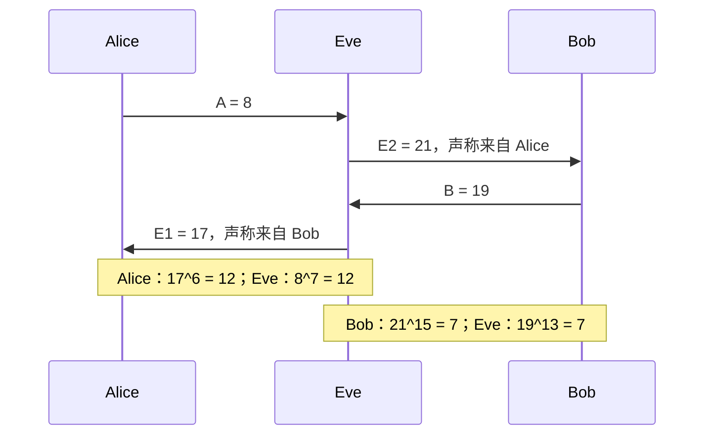
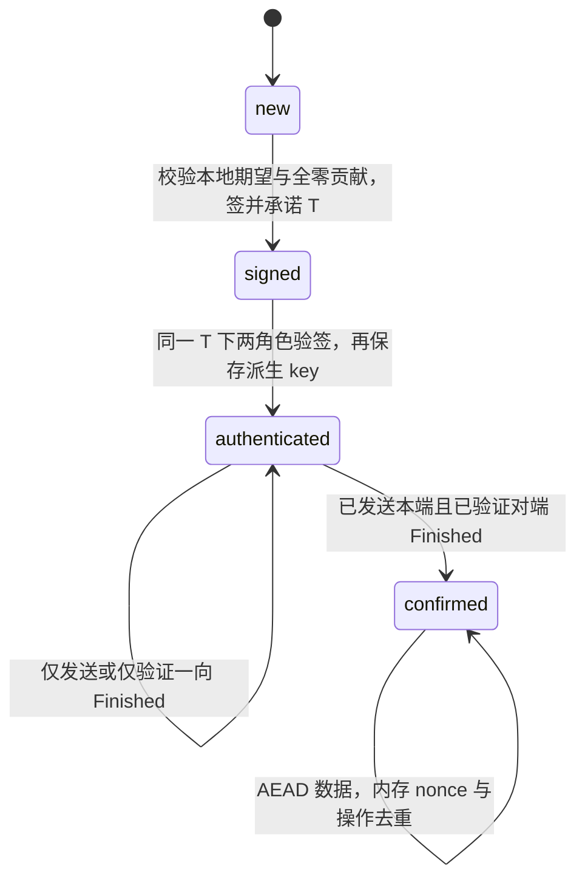

# 算出同一密钥以后，怎么知道对面是谁

[[计算机知识/35-计算机网络/10-系统课程/现代密码学安全目标与组合|上一单元]] 假定双方已经拿到合适的秘密 key。现在拆开这份假定：公开交换怎样得到同一秘密，为什么主动中间人仍能骗过双方，以及签名、可信身份映射和密钥确认各补上了哪一环。

本页交付一条可复算的学习链：手推小群 DH → 替换公开值形成两条秘密 → 用成熟库的 X25519、Ed25519、HKDF/HMAC 和 AEAD 检查固定转录与状态。自选教学握手称为 **WWL-HS/1**；它没有网络解析器或 TLS 互操作性，也没有一般 AKE 安全证明。所有输入密钥均为公开 fixture，不提供真实保密。[[计算机知识/_labs/modern_crypto_handshake/README|实践入口]] 保留公开向量、源码、预测、实际输出和复算命令。

## DH 的共同秘密与未认证对手

复用 [[数学/25-高等代数/11-群同态陪集与商群#群研究可逆操作怎样复合|群的运算与元素阶]]。先取可手算的乘法群 $G=\mathbb F_{23}^{*}$，运算是模 23 乘法，单位元为 1，$|G|=22$。$g=5$ 的阶为 22：$5^{22}=1$，而 $5^2=2\ne1$、$5^{11}=22\ne1$，排除了阶的真因子。它是整个群的生成元，**这里不是素数阶群**。

Alice 取指数 $a=6$，Bob 取 $b=15$，指数按模 22 理解。公开群参数与两个公开值

$$A=g^a\bmod23=8,\qquad B=g^b\bmod23=19.$$

Alice 算 $Z_A=B^a$，Bob 算 $Z_B=A^b$。指数律给出

$$Z_A=(g^b)^a=g^{ab}=(g^a)^b=Z_B.$$

这份证明只依赖同一群里的幂与相同指数乘积，不需要一般群的所有元素可交换。具体复算：$19^2=16$、$19^4=3$，所以 $19^6=3\cdot16=2\pmod{23}$；$8^2=18,8^4=2,8^8=4$，所以 $8^{15}=4\cdot2\cdot18\cdot8=2\pmod{23}$。双方共同值为 **2**。

对手看见 $p,g,A,B$，通常还知道算法和协议。它没有直接收到 $a,b,Z$，但这不代表它算不出来。在此例枚举 $5^0,5^1,\ldots,5^{21}$ 就找到 $A=8$ 对应 6、$B=19$ 对应 15。程序检验全部 $22^2=484$ 个指数对都满足代数一致，也枚举恢复这里的指数；这证明正确性与小参数不安全，不能证明现实参数困难。

### 三种困难问题不能只写一个“逆运算很难”

在合适定义的一族群及随机指数分布里，DL 要从 $g^a$ 求 $a$；CDH 要从 $(g^a,g^b)$ 算 $g^{ab}$；DDH 要区分 $(g^a,g^b,g^{ab})$ 与 $(g^a,g^b,g^c)$（$c$ 独立均匀）。能解 DL 就能算 CDH，能算 CDH 就能判 DDH；所以相应的困难性关系是 DDH 困难蕴含 CDH 困难，后者蕴含 DL 困难，反向不能直接推出。得到某个共同值，还不等于它已是可直接使用的均匀 AEAD key。[^bsdh]

本例偶数阶全群尤其不能冒称 DDH 困难：Legendre 符号 $\chi(x)=x^{11}\bmod23\in\{1,22\}$，用 22 表示 $-1$，而 $\chi(5^a)=(-1)^a$ 泄漏指数奇偶。对真正 DH 三元组，$\chi(Z)=(-1)^{ab}$ 可由 $\chi(A),\chi(B)$ 的奇偶信息预测；随机独立群元素的符号仅一半符合。这与把 23 换成更大的类似全群不是同一项可修补的小数值问题。一般素数阶安全假设与 X25519 的曲线/编码合同要各自陈述，不把小群枚举表直接平移成其证明。

### 中间人不需要解出 Alice 或 Bob 的私有指数

现在只改变攻击者能力：Eve 能替换公开消息。她给 Alice 发 $E_1=5^7=17$，冒充 Bob；给 Bob 发 $E_2=5^{13}=21$，冒充 Alice。

每条腿上都有代数正确的共享值，Alice 与 Eve 为 12，Eve 与 Bob 为 7。Eve 知道自己的 7 和 13，因此能分别解密、改消息、再加密转发。她既不需要恢复 $a=6,b=15$，也不需要从密文强行伪造未知 key 的标签。只把 DH 参数放大不会消掉这个结构性反例。

实际 X25519 公开 fixture 也演示同一攻击：两边各自执行成熟库算法成功，Eve 读到 `amount=0100`，再在另一条合法腿上发送 `amount=0900`。这不是攻破 AEAD；接收方从未认证“谁与我共享这把 key”。两边各自挂了锁，中间人经营两把钥匙的旅馆。

## 公钥、签名与身份各自是什么对象

公钥加密通常让发送者用接收者公钥加密既有消息，接收者用秘密解密；DH 则由双方秘密与公开贡献共同导出值，不是在给定消息外面套一层“公钥加密”。签名使用秘密签名 key 对消息产生签名，任何持有相应验证 key 的人可验证，它不隐藏消息，也不是“把私钥当解密方向反过来用”。

数字签名的基本目标 EUF-CMA 可以写成一个游戏：挑战者生成诚实 $(sk,pk)$，把固定的 $pk$ 给对手；对手可自适应请求任意消息的签名，最后输出 $(m^*,\sigma^*)$。验签通过且 $m^*$ 不属于签名查询消息集合，才算成功，优势为该概率。已有消息上的另一份签名是否算新伪造，是更强的定义，不能混同。[^bssig]

这个游戏不自动把 $pk$ 命名为“Bob 的公钥”，也不使旧消息在今天重新变得新鲜。若攻击者自己带来一把公钥并签一份消息，验签成功只说明它持有那把私钥。本页额外**预先信任**映射 `alice.lab → V_I`、`bob.lab → V_R`，每端还固定自己要找的对端身份与应用上下文。它可以来自安全预置或经过正确证书验证的结果，但本实验只实现固定映射，不生成、验证或测试证书链。

如果把 Bob 的可信映射改为 Eve 的验证 key，Eve 就能以这个错误配置认可的身份产生合法签名；再多跑一次验签也找不回最初丢掉的信任。返回 [[计算机知识/35-计算机网络/10-系统课程/11-TLS身份验证重放与信任边界#证书链通过与目标身份匹配必须分别检查|TLS 名称与信任锚]]，比较“谁给了可信 key”与“谁证明持有对应私钥”的不同责任。

## X25519 的实际字节合同

本机实验调用 `cryptography` 的 X25519，不实现曲线运算。RFC 7748 §6.1 的双方 32 字节私有输入，对应公开值分别为 `8520f009…aa9b4e6a` 和 `de9edb7d…6f882b4f`，共同 32 字节值为 `4a5d9d5b…1e161742`；完整字节在 [[计算机知识/_labs/modern_crypto_handshake/public-vectors.json|原始向量]]。这个公开测试能核对库接口与字节序，不证明从公开值恢复真实私有输入很难。[^7748]

X25519 输入不是这里整数幂例的直接字节化：RFC 定义小端 u 坐标和标量处理，接收的最后字节最高位要忽略，某些非规范 u 编码须按模 $p=2^{255}-19$ 处理。因此把一个合法公钥最高位翻转，或比较 $u=9$ 与 $u=p+9$，可以得到同一共享值；不能把这些统称为“无效点并一律拒绝”。本实验保留并测试这个接受行为。

另一方面，选定的 $u\in\{0,1,p-1,p,p+1\}$ 都导致全零贡献，实际库的 `exchange` 拒绝；包装再拒绝全零结果，且在端点承诺转录之前完成此检查。这里是五个具体负例及本库合同，不是完整曲线点分类或手写验点算法。RFC 7748 特别提醒共同值不天然证明双方都作出了秘密贡献，也提醒等价公钥可能产生相同共同值。**实际传递的公钥字节仍要进入转录和 KDF**；它们不能因为同一个 $Z$ 就被省略。[^7748]

X25519 的私有输入、Ed25519 的种子与公钥虽各有 32 字节的常见接口，也不应互换。同一曲线家族不等于同一 key 类型、编码或用途。签名测试单独匹配 RFC 8032 §7.1 Test 1 与 Test 2 的公钥和 64 字节签名；转录采用普通 Ed25519 签名实际消息字节，不是 Ed25519ph，也没有实现签名底层数学。[^8032]

## WWL-HS/1：明确签了什么、什么时候确认

这是一份自选离线教学协议。双方先有固定身份映射、预期角色与应用 context；各自持临时 DH 私有输入和长期签名种子，并为本次等待中的握手给出 32 字节挑战值。生产中这些秘密和新鲜性需要安全生成与生命周期管理；本例为可复算而固定公开，不能提供保密或跨重启新鲜性。

### 第一阶段：双方 Hello 形成唯一的转录

完整的 Hello 转录 $T$ 按四个固定顺序的四字段块编码，复用 [[计算机知识/_labs/modern_crypto_aead/源码与验证#aead_lab.py|上一单元的长度前缀编码]] 的实际规范函数 `encode_context`。每块含相同版本前缀，再为四字段各写 2 字节大端长度和内容，固定四块可以逐块唯一拆开：

| 块 | 按顺序的四字段 |
|---|---|
| 1 | `WWL-HS/1`、固定 suite、initiator 身份、responder 身份 |
| 2 | `context/roles`、固定应用 context、角色 `I`、角色 `R` |
| 3 | `I-eph/R-eph/I-nonce`、$X_I$、$X_R$、$n_I$ |
| 4 | `R-nonce/I-sigkey/R-sigkey`、$n_R$、$V_I$、$V_R$ |

suite 恰为 `X25519-Ed25519-HKDFSHA256-ChaCha20Poly1305`，没有未记录的协商；context 为 `public-payments-demo`。身份非空、至多 32 字节且不同，六个公钥/挑战字段各 32 字节，协议/suite/context 字段至多 128 字节；网络文本解析和 Unicode 归一化不在本模型。向量下 $T$ 为 401 字节，SHA-256 为 `49bf6a7efc6f6488c88a344a8d178cf27cbc798ec2487079ec77cac975f211f5`。

每个端点在签名前检查协议与 suite、预期双方身份与角色、可信签名 key 映射、应用 context，尤其检查**自己的**临时公开值和挑战值恰等于本地等待中的值。否则攻击者给它一份别的完整自洽转录，它可能替错误会话签名。第一次合法签名后，端点只承诺这一份 $T$；另一份不再签。固定字段中的角色顺序和实际 key 字节也参与认证，没有靠变量名字暗示这些约束。

### 第二阶段：两份有角色域分离的签名

角色 $r\in\{I,R\}$ 对

$$\operatorname{encode4}(\text{WWL-HS/1 signature},r,\text{full-transcript},\varepsilon)\Vert T$$

产生普通 Ed25519 签名 $\sigma_r$，其中 $\varepsilon$ 是空字节串。相同的 $T$ 也不能把发起方签名直接当响应方签名；二者的角色前缀不同。端点核对两份签名，尤其是对端的可信 key；此后才保存派生会话状态。

对前述 MITM，Alice 认可的是含 $X_{E1}$ 的 $T_I$，Bob 认可的是含 $X_{E2}$ 的 $T_R$，二者不同。Eve 从两端得到的签名只能各自在对应的字节上通过，不能拼成同一 $T$ 下的一对签名。实验确实在混用时得到 `InvalidSignature`；这验证具体替换反例被阻断，不等于证明所有主动、多会话、腐化攻击都不可能。

### 第三阶段：派生 key，再交换 Finished

取 $h_T=\operatorname{SHA256}(T)$。双方把本次非零 X25519 共同值作为 IKM，使用 HKDF-SHA256 与公开固定 salt `WWL-HS/1 public salt`。对每个 purpose 分别令

$$\text{info}=\operatorname{encode4}(\text{WWL-HS/1 keys},\text{purpose},h_T,\text{X25519}),$$

得到 32 字节 key。四个 purpose 是 `i2r-aead`、`r2i-aead`、`I-finished`、`R-finished`。它们区分数据方向与认证确认用途；本例四结果相等于对端对应结果，而不同用途的具体结果不同。一般派生安全仍有相应假设，不能由四次输出比较证明。

角色 $r$ 的 Finished 是对应 key 下的 HMAC-SHA256：

$$F_r=\operatorname{HMAC}_{K_{r\text{-finished}}}\big(\operatorname{encode4}(\text{WWL-HS/1 finished},r,h_T,\text{both-signatures})\Vert\sigma_I\Vert\sigma_R\big).$$

两签名均固定 64 字节、顺序固定，Finished 绑定本次转录与已交换的两份认证证据。Finished 提供这里所绑定的派生 key 的持有确认；连同已认证的转录，它在诚实端点按协议行动、对手未获会话秘密的教学模型中担负对端确认职责。双方都能计算这些确认 key，因此它不是可向第三方证明发送者身份的签名，也不单独证明现实人名、授权、永久在线或业务已执行。

端点只有**发送了自己的 Finished 且验证了对端 Finished**，才从 `authenticated` 变为 `confirmed` 并开放数据接口。坏 token、反射自己的 token、重复收到 token 均拒绝；失败不提前置位。注意这仍是本地状态：Alice 可能已 confirmed，而她的 Finished 被丢弃、Bob 仍 authenticated；Alice 不会因此知道 Bob 已收到最后一条消息。模型没有凭一次确认创造无限层共同知识或保证可用性。

这是同步顺序的离线状态演示；丢包重传、超时、并发竞争与事务均需另外协议。

### 第四阶段：沿已交付的 AEAD 合同发送数据

采用两个方向各自的 AEAD key，AAD 固定为四字段 `(hs-data-v1, h_T, direction, operation_id)`，直接复用上一单元的封装。每方向同一 key 下 nonce 仍须唯一；未 confirmed 不允许发送/接收数据；认证失败不释放明文或污染操作账本；同操作在该内存实例中再次提交拒绝。

没有哪个标签负责重启后的历史。重播旧握手到一个拥有**新本地挑战值**的端点，旧转录先因本地挑战不匹配被拒绝；双方诚实重建新转录后，旧 Finished 也不匹配新 key。反过来，重启后复用所有固定私有输入、挑战与状态初值，就重建同一转录、同一 key 与 Finished，旧 token 可以再次通过。测试保留这两个结果。挑战“长 32 字节”不等于它每次都新鲜；生产防重放、持久 nonce 分配与应用幂等须在 [[计算机知识/85-综合贯通/02-超时重试幂等与事务发件箱|事务与幂等主解释]] 的状态条件下继续。

## 如何带回 TLS，而不把教学协议改名成 TLS

TLS 1.3 的临时密钥交换、证书/服务身份、CertificateVerify 和 Finished 有对应的不同责任。RFC 8446 §4.4.3 中 CertificateVerify 使用角色/上下文分离并认证**截至该阶段**的转录；§4.4.4 的 Finished 也认证各自阶段的转录。某条签名不可能覆盖尚未生成的未来消息。本页先固定双方 Hello，再双签名，再对两签名作 Finished 的阶段安排，是教学选择，不是 TLS 实际消息格式、密钥计划、证书验证或支持模式的复现。[^8446]

回到 [[计算机知识/35-计算机网络/10-系统课程/11-TLS身份验证重放与信任边界#临时密钥交换、CertificateVerify 与 Finished 各做什么|TLS 的三个责任]]，现在分别回答：DH 给出什么共同值；可信验证 key 怎样对应预期服务；签名绑定了哪些字节及角色；Finished 确认哪一阶段的 key。再返回同页 [[计算机知识/35-计算机网络/10-系统课程/11-TLS身份验证重放与信任边界#0-RTT 为什么必须谈重放|0-RTT]]：本页禁止确认前应用数据，不能据此宣称实现了 TLS 0-RTT 或消除了它的部署重放问题。

### 前向保密看秘密何时泄露

若只在会话结束后泄漏长期**签名**私钥，而临时 DH 私有值可靠擦除、群问题在相应攻击模型下仍困难，历史公开转录不直接提供计算旧 $Z$ 所需的临时秘密。这是使用临时 DH 期待的前向保密机制；要得出完整协议安全还须给出腐化时机、会话匹配、随机源、生命周期与组合证明，不能由本页有限例宣称已证。

若保留的某一端临时 DH 私有输入后来也泄漏，记录中的对端公开值即可重算 $Z$，公开 KDF 信息又能重算会话 key；签名仍正确也救不回该历史机密性。固定公开 fixture 从一开始就没有这种保密性。攻击者在会话进行时已拿到长期签名 key，或可信身份映射错误，又是不同信任条件。传输 key、签名 key、口令和 HKDF 的职责也不能合并，参见 [[计算机知识/35-计算机网络/10-系统课程/现代密码学安全目标与组合#HKDF 的域分离与口令成本各守哪一关|派生用途与口令成本]]。

## 改一个条件，先给出判断

1. **代数**：改 $b=13$，其公开值与 Alice 的共同值是多少？不运行程序也用重复平方算出，再说明小群枚举怎样恢复 $b$。
2. **主动对手**：Eve 只会选择自己的 DH 私有值，完全不会解 DL。她能否完成原始 MITM？给两条腿的共同值并指出 AEAD 为什么仍能各自验过。
3. **签名目标**：原转录上已有合法签名，攻击者原样再交一次，是否赢 EUF-CMA？若把 Bob 的验证 key 完全由包自带并直接相信，验签能否证明预期 Bob？
4. **编码和角色**：翻转 $X_R$ 最后字节最高位，库可能仍给相同 $Z$。旧签名和本页转录/KDF是否应该据此视为同一会话？将 I 签名放进 R 位置会怎样？
5. **确认与丢包**：Alice 收到 Bob 的 Finished，但她发给 Bob 的 Finished 丢了。她可已 confirmed 吗？Bob 此时可处理应用数据吗？
6. **生命周期**：重启复用全部公开 fixture 与空账本，能否重放旧 Finished？若只换 Bob 挑战、重新合法签名，旧 Finished 在新会话应否通过？若后来公开 Alice 的临时私有输入，旧流量是否还可重算？

**答案**：① $B=5^{13}=21$；$21^2=4,21^4=16$，所以 $21^6=16\cdot4=18\pmod{23}$，枚举第13项得到21。② 能；Alice/Eve 为12、Eve/Bob 为7，Eve掌握各自key而非伪造未知key标签。③ 不算新消息伪造；不可信自带key只证明自带私钥持有者签了字节。④ 共享值等价不等于实际公钥字节相同，旧签名在改字节后的转录上失败，转录hash也变化；角色前缀使反射失败。⑤ Alice 若也已发送可confirmed，但不证明对端收到了；Bob未验证对端Finished仍拒数据。⑥ 可以重播固定输入的会话；新挑战下旧Finished失败；泄漏临时输入及公开转录可重算旧共享值和派生key，实际保密失效。

本机 [[计算机知识/_labs/modern_crypto_handshake/data/results.json|保留结果]] 和 [[计算机知识/_labs/modern_crypto_handshake/README|复算/核查边界]] 支撑这里的有限断言。没有运行远程攻击、真实 TLS 服务、证书部署、HSM 或硬件侧信道，没有把八个测试当成一般 AKE/EUF-CMA/前向保密证明，也没有观测真人学习结果。更广分组工作模式、具体签名数学、公钥加密及一般多会话认证密钥交换理论仍须独立课程，不能因本页握手完成就关闭全部密码学范围。

[^bsdh]: [Boneh–Shoup 0.6](https://crypto.stanford.edu/~dabo/cryptobook/BonehShoup_0_6.pdf) §10.4–10.5，书页408–411：DL/CDH/DDH游戏、适用群与困难性关系；实际读原文，未把素数阶假设挪给阶22全群。
[^bssig]: 同书 §13.1.1，书页529–530：固定诚实验证key、选择消息查询、新消息伪造及强不可伪造的区别。此处复述定义，不报告为对Ed25519的一般安全归约。
[^7748]: [RFC 7748](https://www.rfc-editor.org/rfc/rfc7748.html) §5、§6.1、§7：X25519字节合同、公开向量、全零贡献及等价公开值；[官方X25519接口](https://cryptography.io/en/stable/hazmat/primitives/asymmetric/x25519/) 说明成熟库exchange与KDF接口。
[^8032]: [RFC 8032](https://www.rfc-editor.org/rfc/rfc8032.html) §7.1 Test1/2；[官方Ed25519接口](https://cryptography.io/en/stable/hazmat/primitives/asymmetric/ed25519/)：32字节seed/public与64字节签名、verify/InvalidSignature。来源于2026-10-16实际读取。
[^8446]: [RFC 8446](https://www.rfc-editor.org/rfc/rfc8446.html) §4.4.1、§4.4.3–4：转录、角色上下文、CertificateVerify/Finished的阶段范围；这里仅对照机制，不宣称复现TLS字节或完整协议。
