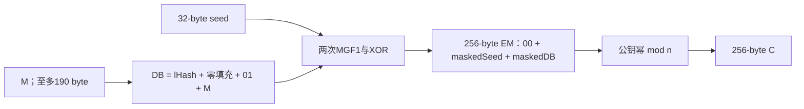

# 同一个 RSA 幂运算，为什么加密与签名需要不同编码

[[计算机知识/35-计算机网络/10-系统课程/现代密码学DH中间人与认证转录|DH 单元]] 已区分密钥协商、签名和可信身份。本页补齐具体公钥加密与签名数学：RSA 为什么连非互素消息也能还原，裸幂运算为何不满足安全游戏，以及 OAEP/PSS 怎样把字节、随机量、结构检查和幂运算组合起来。

教学小模数只作有限证明；实际接口使用 RFC 7520 **已经公开私有参数**的两把2048bit示例 key，不生成新凭据，也不能部署或保密。[[计算机知识/_labs/modern_crypto_publickey/README|本机实践]] 明确分开外部公开向量、自建固定 seed/salt 的编码证据、成熟库随机样本；固定教学编码不是生产密码实现。

## RSA 正确性不能只证明互素消息

取不同的奇素数 $p,q$，$n=pq$，取正整数 $e,d$，并令

$$\lambda(n)=\operatorname{lcm}(p-1,q-1),\qquad\gcd(e,\lambda(n))=1,\qquad ed\equiv1\pmod{\lambda(n)}.$$

公钥是 $(n,e)$；私有参数包含 $d$，实际常保留 $p,q$ 与 CRT 参数。代表元域是整数 $0\le m<n$，基本运算为

$$c=m^e\bmod n,\qquad m'=c^d\bmod n.$$

**这是 primitive，不是完整安全加密方案**。先证明 $m'=m$，而且不把 $\gcd(m,n)=1$ 偷加为前提。由 $ed=1+k\lambda(n)$，分别看模 $p$：

- 若 $m\equiv0\pmod p$，正整数指数下 $m^{ed}\equiv0\equiv m$。
- 若 $m\not\equiv0\pmod p$，在 $\mathbb F_p^*$ 用 Fermat 定理，且 $p-1$ 整除 $ed-1$，故 $m^{ed}\equiv m\pmod p$。

模 $q$ 同理。复用 [[数学/25-高等代数/12-环理想商环与同态基本定理#环版本中国剩余定理|已有 CRT 主解释]]：因为 $p,q$ 互素，两个剩余类共同决定唯一模 $n$ 的剩余类；$m',m$ 又都在 $[0,n)$ 中，因此整数相等。这里 $\mathbb Z/n\mathbb Z$ 通常不是域，存在零因子；不能为了套 Euler 定理就假装所有非零消息都可逆。

取 $p=5,q=11,n=55$，$\lambda=20,e=3,d=7$，有 $ed=21\equiv1\pmod{20}$。消息5与55不互素，却有 $c=5^3\bmod55=15$、$15^7\bmod55=5$。程序核全部55个代表元，包括15个非单位（含0），没有把失败例排除。若按 $\varphi(n)=40$ 求逆会得到 $d=27$，也可正确还原；$d=7$ 使用的是较弱而足够的 $\lambda$ 条件，两者不矛盾。

### 私有运算为什么常用 CRT

令 $d_P=d\bmod(p-1)$、$d_Q=d\bmod(q-1)$、$q_{\rm inv}=q^{-1}\bmod p$。对合法代表元 $c$，算

$$m_1=c^{d_P}\bmod p,\quad m_2=c^{d_Q}\bmod q,\quad h=q_{\rm inv}(m_1-m_2)\bmod p,\quad m=m_2+qh.$$

它在模 $p$ 为 $m_1$、模 $q$ 为 $m_2$，且 $0\le m<n$，所以是同一私有幂运算的 CRT 重建。对上例 $c=15$，有 $m_1=0,m_2=5,h=0$，重建5。小于 $p$ 的零不是例外错误，而是正确分量。

这段推导说明算法正确，不证明运行时、故障或缓存安全。实际私有 RSA 需要成熟实现的防护；本实践 Python `pow`/CRT 只运算已经公开的 fixture，不能用于真实秘密。数学 CRT 的一般定理继续由原主文维护，不在此另建一套商环课程。

## 正确可逆不等于安全

RSA inversion 假设粗略要求：对按指定过程生成的 RSA key 与规定分布的随机代表元（常在单位群中表述），给定 $(n,e,c=m^e\bmod n)$，有效攻击者难以还原 $m$。这不是说每个具体消息都难，例如0、1立即可识别。分解 $n$ 能算 $\lambda,d$，从而能反演 RSA；不能反过来把“一般 RSA 反演”写成已证与分解等价。正确性、困难假设、编码方案安全是三层命题。[^pkcs]

### 裸 RSA 没有随机性，公开 key 就能作字典

textbook RSA 对固定消息确定：$c=m^e\bmod n$。公钥本来公开，攻击者选等长的不同 $m_0,m_1$，自己计算两密文，再对比挑战 $c$，就能猜出是哪一个。公钥加密的选择明文隐私不能靠“对手没有加密 oracle”挽救，因为它自己就能加密。

小指数还有直接算术反例：$n=55,e=3,m=3$，$m^3=27<n$，没有模回绕；普通整数立方根即可还原3。小参数当然能分解，但这个反例连分解都不需要。它说明不经编码的小消息与小指数会暴露额外结构，不是说把所有参数放大后仍对每条消息同样直接开根。

### 裸 RSA 的乘法结构给解密 oracle 一条捷径

由乘法性

$$\operatorname{RSAEP}(m)\operatorname{RSAEP}(r)\equiv\operatorname{RSAEP}(mr)\pmod n.$$

对手拿到挑战 $c$，选可逆 $r$，提交不同的 $c'=cr^e\bmod n$ 给允许的解密 oracle，得到 $m'=mr\bmod n$，再乘 $r^{-1}$ 还原 $m$。本例 $m=12,c=23,r=2$，改密文为19，oracle返回24；$2^{-1}\bmod55=28$，$24\cdot28\bmod55=12$。这里 $c'\ne c$，并未偷问被禁止的原挑战。

这是有限教学 oracle，不是对外调用解密服务。它把上一单元的 CCA 能力具体化：算法可逆不表示主动对手只能硬解 RSA。若给所有格式错误不同耗时或错误细节，也会形成额外 oracle；本地返回同一个异常类别并不证明这些通道不存在。

## OAEP：先形成有结构的随机编码，再作 RSA

本单元固定 RSAES-OAEP：2048bit key、$k=256$ byte、SHA-256、MGF1-SHA256、**空 label**。RFC 8017 本版 §7.1 的 label 是空串，其他用法在该文档范围外；库虽接受非空 label，本例只用它作错误参数负例，不把扩展称为本版推荐合同。参数应随该 key 固定。[^oaep]

OAEP 最多接

$$|M|\le k-2hLen-2=256-64-2=190\text{ byte}.$$

因此不能直接把任意大文件塞给 RSA；较大的内容需要适当的混合加密协议，以公钥机制处理会话材料，再按对称 AEAD 合同处理内容。这个协议还要解决上下文与身份，不由大小限制自动给出一个可安全部署的拼装方案。

令 $lHash=\operatorname{SHA256}(\varepsilon)$，其中 $\varepsilon$ 为空串。构造

$$DB=lHash\Vert PS\Vert01\Vert M,$$

其中 $PS$ 为 $190-|M|$ 个零byte，$|DB|=223$。抽32byte seed，用 MGF1 得到掩码：

$$\begin{aligned}
maskedDB&=DB\oplus\operatorname{MGF1}(seed,223),\\
maskedSeed&=seed\oplus\operatorname{MGF1}(maskedDB,32),\\
EM&=00\Vert maskedSeed\Vert maskedDB.
\end{aligned}$$

MGF1 按顺序拼接 $H(seed\Vert\operatorname{I2OSP}(i,4))$ 并截取所需长度，计数 $i$ 从0开始，四byte为大端。它是规范化的掩码扩展，不是给消息增加密码学秘密的魔法。最后把256byte的 $EM$ 按**无符号大端整数**解释、作公钥幂，再以固定256byte输出密文；前导零不能随意丢掉。OAEP 的前导00保证本例代表元小于模数。

解密逆幂后要恢复 seed、DB，检查首00、$lHash$、零填充与01分隔，再返回消息。幂运算的乘法关系仍存在，但任意改出的代表元一般不再是合法 OAEP 编码，也不再让应用消息直接乘 $r$。实践中对一个固定合法密文乘 $2^e$，成熟库拒绝该选定变式；这是一条有限反例核查，不是 CCA 安全证明。

### 随机编码改变了什么，没有证明什么

OAEP 的常规加密每次生成新 seed，阻断“公开 key 对低熵消息算一次密文就匹配”的确定性比较。实践自建 seed `00..1f` 的**公开固定编码**只用于逐字复算与库解密互证；固定、可预测 seed 不满足生产随机性合同。库另外真实加密两次并各自成功解密，本次两个输出不同；有限不同不证明随机源、熵或一般隐私。

公钥加密的 IND-CCA 游戏固定诚实生成的 key，给攻击者 $pk$；挑战对等长 $M_0,M_1$ 随机选一条并随机加密，攻击者还能查询其他密文的解密，但不能提交原挑战密文。这里没有前单元 nonce 型 AEAD 的外部 $N,A$ 输入，不能不加说明地搬其完整三元组禁令；我们固定 OAEP 参数，禁止的是该 key 下的挑战密文字节。

RFC 8017 的 RSAES-OAEP CCA2 结论依赖 RSA 反演困难与随机 oracle 模型等条件，而且其归约对具体参数有显著损失。一般 OAEP 套在任意陷门置换上，并不能从“难反演”直接得到同一 CCA2 结论。固定 SHA-256 是具体实现选择，不是把真实散列与理想随机 oracle 证明为相同。本机跑测不证明这些假设。[^oaep]

## 签名不是把明文作一次“私钥加密”

先看裸签名 $s=m^d\bmod n$，验证 $s^e\bmod n=m$。攻击者先选 $s=2$，再定义 $m=s^e\bmod55=8$，就得到不用私钥也验过的消息—签名对。它未必能为任意预先指定的消息签名，但 EUF-CMA 只要求产生一个未查询过的新消息，因此已经足够破坏这个裸整数消息方案。

[[计算机知识/35-计算机网络/10-系统课程/现代密码学DH中间人与认证转录#公钥、签名与身份各自是什么对象|签名安全游戏主解释]] 继续负责固定诚实验证key、选择消息签名查询与“新消息”的定义。签名可以公开核验，不提供机密性；同一个签名再次验过也不证明消息今天才产生。把 `hash(M)` 随手替代 $m$ 不是对 PSS 证明的复用，必须说明完整编码和安全模型。

### PSS 具体编码了哪些内容

本例用 RSASSA-PSS 的 SHA-384、MGF1-SHA384、48byte salt，与 RFC 7520 的 **PS384** 公开签名一致。签名key与OAEP key是不同的公开fixture。令

$$emBits=\operatorname{bitlen}(n)-1=2047,\qquad emLen=\lceil emBits/8\rceil=256.$$

对消息 $M$：

$$\begin{aligned}
mHash&=\operatorname{SHA384}(M),\\
H&=\operatorname{SHA384}(00^8\Vert mHash\Vert salt),\\
DB&=00^{158}\Vert01\Vert salt,\\
maskedDB&=DB\oplus\operatorname{MGF1}(H,207),\\
EM&=maskedDB\Vert H\Vert bc.
\end{aligned}$$

这里 $00^8$ 表示8个零byte，$00^{158}$ 表示158个零byte。形成 $EM$ 前，把 maskedDB 最左的 $8emLen-emBits=1$ 个 bit清零，使代表元严格小于 $2^{2047}\le n$；不能把 $emBits$ 错写成模数bit长。私有幂得到 $s=EM^d\bmod n$，以256byte输出。验证用公开幂还原 $EM$，核trailer `bc`、高位、零区与分隔符，取出 salt，重算 $H$ 再比较。salt 不是事先共享的秘密，也不是口令KDF的成本参数。

PSS 标准允许其他明确的 salt长度，包括0；本练习选48是具体策略，不宣称所有PSS必须取hash长度或必须每次随机才可能安全。成熟接口签名时仍按本策略生成随机salt，验证端显式固定48，不能用“库会自动猜”替代参数合同。安全说明依赖 RSA 与相应 hash/MGF 的模型假设，并不由本例推导出一般 EUF-CMA 定理。[^pss]

本机首先验证 RFC 7520 §4.2 Figure20 的现成PS384签名；这是外部向量，不要求重新随机签出相同bytes。再给教学编码固定公开salt `00..2f`，私有CRT生成一个固定签名，成熟库验过；库另签两次，原始随机样本单独保留。本例裸 $s=2$ 在 PSS 验证中失败，错误消息、错误验证key与47byte salt策略也失败。这些准确说明本次接口和格式行为，不将有限失败数当不可伪造性证明。

## 用途分离与认证不能靠函数名字

RFC 8017 §6 不建议新应用把同一RSA key对交给多种方案；某一路较弱的解密/签名接口可能破坏另一方案的安全假设。我们因此固定两把不同key、两套参数、两种用途；教学包装拒绝把sig fixture用于OAEP或把enc fixture用于PSS。包装只是防误用的本地合同，私有对象仍公开可见，它不是HSM权限或密钥管理证明。

消息编码复用 [[计算机知识/_labs/modern_crypto_aead/源码与验证#aead_lab.py|已有四字段长度前缀规范函数]]：加密载荷的版本/用途为 `WWL-PKE/1` 与 `payload`，签名消息为 `WWL-SIG/1` 与 `authorization`，并明确身份/业务上下文。两套key和域标签不能互相替代：域标签控制字节解释，不让共享的私有数学操作天然变成独立安全oracle。

尤其是 **OAEP成功解密不证明发送者是谁**。任何知道接收者公钥的人都能产生一个合法OAEP密文，即便明文写着 `alice-to-bob`。公钥加密的CCA隐私不等于前单元共享秘密key下的密文完整性；如果把“任何人都能生成一条新合法密文”算成PKE失败，就把目标定义错了。需要发送方认证时要有合适签名/认证协议，并绑定预期身份、接收者、协议和业务语义；本页不声称任意“签一下再加密”顺序都自动满足完整组合安全。

返回 [[计算机知识/35-计算机网络/10-系统课程/11-TLS身份验证重放与信任边界#临时密钥交换、CertificateVerify 与 Finished 各做什么|TLS 的证明责任]]：TLS 1.3 中证书可以承载RSA签名key，但这不表示它用RSA-OAEP传送会话key，或用RSA加密全部数据。本页任意消息的PS384也不等于TLS CertificateVerify的阶段转录格式。临时DH、证书与名称、角色转录签名、Finished、AEAD记录和业务授权仍各有边界。

若采用静态RSA公钥加密会话材料，后来泄漏相应RSA私钥，保存的密文就能被解密；随机OAEP seed不阻止私钥持有者正常解码。它不同于临时DH秘密擦除后、只泄漏长期签名key的条件性前向保密机制。这个生命周期比较应带回 [[计算机知识/35-计算机网络/10-系统课程/现代密码学DH中间人与认证转录#前向保密看秘密何时泄露|前向保密主解释]]，而非见到公钥加密就勾“前向安全”。

## 变式与完整答案

1. **非互素**：$n=55,e=3,d=7,m=5$。为什么直接写 $m^{40}\equiv1\pmod{55}$ 是错证明？用模5/11分别证明，写出加密与CRT重建。
2. **两种逆指数**：$d=7$ 不满足 $3d\equiv1\pmod{40}$，为何仍正确？$d=27$ 是否也正确？
3. **CCA**：原密文23，选择 $r=2$。计算新密文、oracle回复和还原值；指出哪里用到 $r$ 可逆，以及为什么不是原挑战查询。
4. **OAEP长度与随机量**：2048bit、SHA256下能否加密191byte？固定seed只看起来复杂，能否抵抗公开key字典比较？空label能否直接说是发送者身份？
5. **PSS位数**：$n$ 长2048bit，SHA384/salt48时emBits、emLen、高位清零数与PS长度各多少？验证者只改salt策略为47应怎样？
6. **游戏不同**：$s=2,m=8$ 为什么已破坏裸RSA签名而非必须伪造一个事先指定消息？原签名重复验证又算不算EUF-CMA新伪造？任何人公开加密一条新OAEP消息为何不算破坏隐私？
7. **迁移**：握手后长期RSA解密key泄漏，旧OAEP密文还有保密性吗？只把它换成长密钥是否自动提供前向保密？若预置信任映射把Bob的key换成Eve的，成功解密/验签是否能找回真实Bob？

**答案**：① $\gcd(5,55)\ne1$，不能直接用Euler单位群结论；模5为0，模11用非零元素指数律；$c=15,m_1=0,m_2=5,h=0$，重建5。② $\lambda=20$，$3\cdot7=21$已满足两素数分量的条件；27同时满足更强的模40条件，也正确。③ 新密文19、回复24，乘 $2^{-1}=28\pmod{55}$ 得12；可逆性用于最后消掉$r$，19不等23。④ 最大190，191先拒；固定seed使同输入确定，公开key可比较；label也不是可信身份来源，况且此处固定空。⑤ 2047、256、1bit、158byte；正确48byte盐生成的此签名在47策略下应拒绝。⑥ EUF-CMA只要求未查询过的新消息，原包重复不是新消息；公钥加密本就允许任何人加密，隐私关心对手区分/还原挑战消息。⑦ 旧RSA私钥可正常解旧密文，增大位数不改变此结构；错误可信映射仍是错误对象，密码运算通过不能逆转最初信任错误。

## 四个单元的课程出口

现在可以从同一个公开载荷连续回答下列问题，而不把工具名当解释：

| 能力 | 返回的主解释与具体检验 |
|---|---|
| 观察/篡改/重放改变了什么安全目标 | [[计算机知识/35-计算机网络/10-系统课程/现代密码学安全目标与组合\|OTP→CPA/INT/CCA→AEAD/HKDF]]；条件概率、复用/翻位、nonce/AAD与组合条件 |
| 块与流机制为何受IV/计数条件约束 | [[计算机知识/35-计算机网络/10-系统课程/现代密码学AES与分组工作模式\|AES→ECB/CBC/CTR]]；轮迹、可预测IV、重叠计数范围、可塑性 |
| 得到同一秘密为什么还不足以认证 | [[计算机知识/35-计算机网络/10-系统课程/现代密码学DH中间人与认证转录\|有限群→DH/MITM→签名与Finished]]；8/19/2、两条中间人链路、角色与信任迁移 |
| 公开加密与具体签名分别依赖什么 | 本页RSA/CRT、OAEP/PSS；非互素正确性、结构攻击、编码与用途分离、静态key泄漏反例 |

已有 [[计算机知识/Kali/05-密码无线与专门领域/01-哈希口令KDF与估算|盐、口令KDF与猜测预算]] 和 [[计算机知识/35-计算机网络/10-系统课程/11-TLS身份验证重放与信任边界|证书、名称、握手与业务边界]] 保持各自真源。这条核心课程链不要求读者已经掌握完整TLS或一般多会话AKE形式证明；进一步做会话匹配、腐化模型与完整组合归约是有价值的扩展，也不能反过来把它们谎称为本地实验已证。

[[计算机知识/_labs/modern_crypto_publickey/data/results.json|本次固定结果]]、[[计算机知识/_labs/modern_crypto_publickey/data/randomized-samples.json|真实随机样本]] 和 [[计算机知识/_labs/modern_crypto_publickey/README|命令/预期/失败接口]] 支撑有限行为。未验证真实凭据生命周期、生产侧信道/常数时间、远程TLS、证书部署、HSM/硬件、并发持久状态或真人学习；它们是各自的实现/部署证据层，不应被泛称为本页数学仍未完成，也不由课程完成自动得到认证。

[^pkcs]: [RFC8017](https://www.rfc-editor.org/rfc/rfc8017.html) §§3–6：RSA key、代表元/字节转换、基础运算与用途分离。正确性证明为本页对既有CRT的具体应用；不是RSA反演与分解等价的证明。
[^oaep]: 同RFC §7.1及§7.1.1–2：长度、空label、OAEP编码/解码与RSAES-OAEP的RSA/随机oracle条件；原文特别区分一般OAEP、RSA特定CCA2结论及归约损失。
[^pss]: 同RFC §8.1、§9.1、B.2.1：PSS的emBits、盐、Hash/MGF与编码/验证；[RFC7520](https://www.rfc-editor.org/rfc/rfc7520.html) §3.4 Figure4与§5.1.1 Figure73的公开key、§4.2 Figure20的PS384向量。Figure73原应用为旧RSA1_5，本页只消费key数字，未运行该旧方案。[官方RSA接口](https://cryptography.io/en/stable/hazmat/primitives/asymmetric/rsa/)提供OAEP/PSS的成熟调用与拒绝接口。2026-10-17实际读取。
