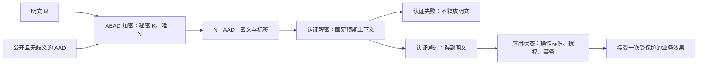

# 现代密码学：先写攻击者能做什么，再谈安全组合

TLS 页已经区分机密性、完整性、身份与权限。本页补上中间的论证：一个方案究竟向哪种攻击者、在什么查询限制下承诺了什么？读完应能从四行 XOR 表算出保密与篡改的区别，写出 nonce 型认证加密的安全游戏，并判断“标签验过了”为什么仍不足以证明请求新鲜、字段解释正确或调用者有权限。

本单元完成对称加密的有限起点、安全游戏与 AEAD 接口；未覆盖 Diffie–Hellman 群与中间人逐值例、签名安全、证书认证归约，也未完成现代密码学全课。[[计算机知识/_labs/modern_crypto_aead/README|公开输入实验]] 使用成熟库，保留输入、结果与复算命令。两位密钥只供穷举，不是生产密码；程序通过不构成一般计算安全或常数时间证明。

## 四行表能证明什么

先固定对象：$M,K,C\in\{00,01,10,11\}$，加解密均为逐位 XOR：$C=M\oplus K$、$M=C\oplus K$。密钥 $K$ **均匀、与消息独立，而且只用于这一次加密**。行是消息、列是密钥：

| $M\backslash K$ | 00 | 01 | 10 | 11 |
|---|---|---|---|---|
| 00 | 00 | 01 | 10 | 11 |
| 01 | 01 | 00 | 11 | 10 |
| 10 | 10 | 11 | 00 | 01 |
| 11 | 11 | 10 | 01 | 00 |

每一行里每个密文恰出现一次，所以 $P(C=c\mid M=m)=1/4$。对**任意消息先验** $P(M=m)$，都有 $P(C=c)=1/4$，再由 Bayes 得

$$P(M=m\mid C=c)=P(M=m).$$

这就是此有限模型的完全保密：看到密文不改变消息分布。它不要求消息均匀；实验另用先验 $(1,2,3,4)/10$ 检查后验。若密钥分布改成 $(1/2,1/4,1/4,0)$，等概率选择消息 $00$ 或 $11$，观察密文后最优猜测成功率为 $3/4$，而均匀密钥时为 $1/2$。例如前一分布下，两条消息对应的密文分布分别是 $(1/2,1/4,1/4,0)$ 与 $(0,1/4,1/4,1/2)$；把每个密文处较大的半先验概率相加，正好 $3/4$。位数相同不等于分布满足安全条件。

代价也明确：要传 $n$ 位任意消息并保持这种一次性完全保密，需要相应秘密随机材料及安全交付；这里没有解释如何让远方双方先共享它。现代流密码改用短密钥产生长密钥流，节省秘密材料，代价是转向有计算假设和资源预算的安全，而不是继承这张表的信息论保证。

### 重用没有增加密钥长度，只增加了关系泄漏

同一个 $K$ 加密两条消息时，$C_1\oplus C_2=M_1\oplus M_2$。例如 $M_1=00,M_2=11,K=10$，得到 $C_1=10,C_2=01$，旁观者立即知道两条消息 XOR 为 $11$。这不必立即唯一恢复每条未知消息，已足够破坏“两条消息的关系也应隐藏”的目标。

更严格地，挑战者等概率选 $b\in\{0,1\}$，加密消息对 $(00,00)$ 或 $(00,11)$。重用密钥时，两密文相等恰对应 $b=0$，成功率 $1$；使用两个独立均匀密钥时，两种挑战均为均匀的十六种密文对，成功率回到 $1/2$。所以“单条看不出消息”不能自动升级成多条安全。

### 完全保密没有附赠完整性

攻击者把 $C$ 改成 $C'=C\oplus\Delta$，接收者得到 $M'=M\oplus\Delta$。取 $M=10,K=11,C=01,\Delta=01$，篡改后 $C'=00$，解出 $11$，没有任何验错信号。攻击者不必知道密钥就能精确翻转选定的位。把这张完全保密表拿去认证转账，是让保险柜兼任公证员；柜子并没答应这份工作。

[[计算机知识/60-数据编码与媒体系统/03-二进制文件格式魔数字节序对齐与校验#5. 校验和、哈希与认证各能证明什么|CRC、摘要与认证的原边界]] 保留 `1101 → 1101001` 的 CRC 例。CRC 的公开可重算检错不提供秘密密钥认证；未经认证地与文件同源发布的摘要也不独立证明发布者。由可信独立渠道固定的摘要仍有价值，不能把“公开哈希”一概判为无用。本实验的 `b'1101'` 是四个 ASCII 字节，与该页的四位多项式输入不是同一对象。

## 把“难破解”改成一个可提问的游戏

计算安全不要求数学上不存在攻击，而要求在规定资源内攻击优势很小。渐近论述针对一族由安全参数 $\lambda$ 参数化的方案，考虑随机化多项式时间攻击者，优势随 $\lambda$ 可忽略；具体算法还要给时间 $t$、加密/解密查询数 $q_e,q_d$、总字节数与密钥生命周期等预算。固定的 32 字节密钥、12 字节 nonce 是下文库实例的合同，不会因为写上 $\lambda$ 就变成已经证明的一族方案。有限 nonce 空间也限制可用查询数。

统一记挑战位 $b$ 等概率，攻击者输出 $b'$，本页的区分优势定义为

$$\operatorname{Adv}=\left|P(b'=b)-\frac12\right|.$$

完全随机猜测优势 $0$，总能猜中优势 $1/2$。有些文献用两倍这个值或用两世界输出概率之差；比较定理前先对齐定义。伪随机性是假设攻击者不能有效区分相应分布，不是说一组测试“看起来随机”就已证明。

## 同一套 AEAD 接口，三个不同的问题

令 $K$ 为秘密密钥，$N$ 为公开 nonce，$A$ 为公开关联数据 AAD，$M$ 为明文。写

$$S=E_K(N,A,M),\qquad D_K(N,A,S)\in\{M,\bot\}.$$

$S$ 是完整受保护输出，例如密文 $C$ 与标签 $T$ 的拼接；$\bot$ 表示认证失败。正确性要求合法加密输出能在相同 $K,N,A$ 下还原消息。AAD 参与认证但不被加密，公开长度、nonce 与业务选择的公开字段也没有被隐去。RFC 5116 规定接口与约束，并明确 AEAD 本身不提供访问控制或防重放。[^5116]

图中最后两个框不由 AEAD 标签自动完成。下面三个游戏都把算法、长度规则与公开信息告诉攻击者，只把密钥留给挑战者。

### nonce 遵约的选择明文隐私

挑战者选 $K$ 与全局位 $b$。攻击者可自适应查询 $(N,A,M_0,M_1)$，其中 $|M_0|=|M_1|$，且每个加密查询的 $N$ 在此密钥下从未用过；回答 $E_K(N,A,M_b)$。攻击者观察 nonce、AAD、长度与所有输出，再猜 $b$。我们称此处的左右消息游戏为 nonce 型 IND-CPA；不把它与随机化加密无需调用者管理 nonce 的同名游戏混用。

“遵约”限制的是加密查询：换 AAD、换方向标志都不能让同一密钥下重复的 nonce 合法。攻击者可自行选择 nonce，仍须互不重复；因此不能靠“nonce 很难猜”解释安全。如果实际系统违约，定理的前提已经失效。一次性密码的单挑战表是更小的模型，不能用同一密钥回答此处任意多个查询。

### 密文完整性 INT-CTXT

挑战者选 $K$，攻击者有遵约加密 oracle：提交 $(N,A,M)$，得到 $S$，并记录完整回答三元组集合 $Q=\{(N,A,S)\}$。最后攻击者交一个候选 $(N^*,A^*,S^*)$；**不在 $Q$ 中**且解密不为 $\bot$ 才算伪造成功。这个游戏的优势就是该成功概率，不用减 $1/2$。

最终伪造可以使用先前见过的 nonce；只禁止它原样交回已获得的完整三元组。否则“把旧标签改一点”最相关的攻击反而被定义排除了。另一方面，原包重放被排除，正因为完整性定义关注产生新的有效受保护对象；防止旧对象再次执行是另一目标。攻击者不知道 $K$，不能在这个安全游戏中给接收方换一个密钥。

### 选择密文隐私 IND-CCA

在同一个左右消息游戏上，再给攻击者认证解密 oracle。可提交任意 $(N,A,S)$，包括以前见过的 nonce；但禁止提交**任何加密 oracle 已回答的完整三元组**。多次左右挑战时，对所有历史回答都禁，不只禁最后一个。只禁密文字节而忽略 $N,A$ 会错挡或错放查询；只禁某个标签也不是这个定义。

解密 oracle 让攻击者观察篡改后的对象是失败还是得到什么明文。这里假定接口只给规范的 $M/\bot$，没有把耗时、错误堆栈、缓存、功耗或部分明文当成额外 oracle；真实实现若泄漏这些，就需要扩展模型。程序只跑成功/拒绝测试，无法因此认证这些侧信道。

### 隐私与完整性为什么能共同堵住解密 oracle

设一种 nonce 型方案在上述 CPA 游戏优势至多 $\epsilon_p$，在**一次最终候选**的 INT 游戏伪造概率至多 $\epsilon_i$，资源与查询预算要覆盖以下模拟。把 CCA 解密 oracle 临时改为“对所有允许的查询都答 $\bot$”。第一次不同只能发生在攻击者提交了一个未在 $Q$ 中、却有效的三元组；在此前，两种执行给它的历史完全一样。若攻击者最多问 $q_d$ 次，随机挑一个位置作为最终伪造，可把“至少一次首次有效”的概率按至多 $q_d$ 的损失转成单候选 INT 攻击。于是此处的优势约定给出一个足够的界：

$$\operatorname{Adv}_{\rm CCA}\le\epsilon_p+q_d\epsilon_i.$$

这里用的是归约思路与资源相匹配的界；若采用本身允许多个验证尝试的完整性定义，可以直接用那个总成功概率。不能把单次 $2^{-128}$ 无条件当成无限次解密请求的总风险。这个论证也不把 nonce 违约、错误通道或原包重放偷偷纳入已证范围。

[Boneh–Shoup《A Graduate Course in Applied Cryptography》0.6 版 §9.2.2–9.2.3，书页 362–365](https://crypto.stanford.edu/~dabo/cryptobook/BonehShoup_0_6.pdf) 给出 CCA 游戏、拒绝所有新解密查询的混合与随机选择验证位置的归约，式 (9.4) 采用同样的 bit-guess 优势和 $Q_d$ 损失。原文在这里讨论普通 cipher；本页将公开 nonce/AAD 显式带入接口，并以完整 $(N,A,S)$ 作为新鲜对象和禁止解密的回答记录，另行保留加密 nonce 遵约限制，不能仅把普通密文字节的判据照搬过来。

## 算法拼得上，不等于安全定义拼得上

### 一个有条件的 Encrypt-then-MAC 结论

先用 nonce 型隐私加密 $C=\operatorname{Enc}_{K_e}(N,M)$，再计算

$$T=F_{K_a}(\operatorname{encode}(N,A,C)),\qquad S=C\Vert T.$$

接收者先核验 $T$，不通过则失败，通过再解密。要说明这个组合，至少要有：加密在相应 nonce 遵约模型下安全；$F$ 是适当标签长度的安全 PRF；$K_e,K_a$ 独立均匀或由有相应安全假设的派生方案分离；字段编码单射；nonce 使用满足原加密合同；验证和错误接口不泄漏超出模型的信息。

Rogaway 的原始 AEAD 论文 §7 给出这一类 EtM 构造与证明。该文隐私采用与随机串区分的 nonce 型 IND$，比本页左右消息隐私更强，优势约定与资源记账也不同，不能把定理数字原样贴成本页记号。在文中的模型下，将 PRF 替换成随机函数后，新的完整认证输入对应一个未揭示的 $\tau$ 位标签，单次猜中概率为 $2^{-\tau}$；再加回区分 PRF 的损失。隐私部分也同时依赖加密与 PRF 的假设。这里讲条件与证明转折，不建议读者自己拼生产 EtM。[^rogaway]

“独立 key”不是随手把同一串复制给两种算法；也不能用“我试出的两个派生结果不相等”替代派生安全假设。不同组合定理有不同目标和底层假设。该论文还证明其特定模型中的另一种先认证后加密构造；因此“MAC-then-Encrypt 一定不安全”也不是本页的结论。

### 失败组合：密文旁边公开明文的确定性 MAC

考虑 $C=\operatorname{Enc}_{K_e}(N,M)$，却公开附上 $T=F_{K_a}(M)$。即使加密本来安全、$F$ 本来是好 PRF，攻击者也能先请求已知 $M_0$ 得到标签 $T_0$，再以新的 nonce 挑战 $M_0$ 与等长的另一消息 $M_1$。挑战标签等于 $T_0$ 就猜 $0$，否则猜 $1$。

在独立随机函数的理想分析里，$b=0$ 总猜中，$b=1$ 只有标签碰撞时猜错，因此

$$P[\text{猜中}]=1-2^{-\tau-1}.$$

这与“不能伪造标签”并不矛盾：攻击者只比较合法标签，就泄漏消息相等性。实验把 $\tau$ 缩为 2，穷举独立 $T_0,T_1$ 和 $b$ 的 32 种等可能情形，成功率 $7/8$；不是把两位 MAC 当安全算法。这是一个具体失败构造，不是宣判所有名字带 “Encrypt-and-MAC” 的系统都相同。

另一个失败是认证输入漏掉改变语义的公开头。例如只认证密文，不认证它应属于哪个会话或业务操作，攻击者可能把一段合法密文搬到另一解释环境。是否构成实际攻击取决于协议外还有没有可信绑定；AAD 的目的就是让这种绑定成为明确输入，而不是寄希望于调用者心照不宣。

## 真正传给库的是哪些字节

实践选择 RFC 8439 的 ChaCha20-Poly1305：$K$ 为 32 字节，$N$ 为 12 字节，$T$ 为 16 字节，即 128 bit；库 `encrypt(nonce, message, aad)` 返回 $C\Vert T$。RFC 构造用 ChaCha20 的第 0 块派生一次性 Poly1305 密钥，正文加密从计数器 1 开始；认证涵盖带填充的 AAD、密文和两者长度。调用者使用完整 AEAD 接口，不自行实现这些步骤。[^8439] 官方 API 的 `decrypt` 在标签不匹配，包括错误的 key、nonce、AAD 或密文时抛 `InvalidTag`；它不负责替调用者记住所有已用 nonce。[^api]

### nonce 唯一性不靠“这次标签不同”补救

同一密钥下重用 ChaCha20-Poly1305 的 nonce，会重用流密码密钥流及 Poly1305 一次性密钥。至少有 $C_1\oplus C_2=M_1\oplus M_2$ 这一确定关系（这里 $C_i$ 不含标签）；认证安全也受到破坏。本实验只验证前一关系，不尝试把它扩大成实测标签伪造。[^8439]

公开 nonce 不需要保密，但需要在**同一密钥的全部发送者、方向、进程与重启周期**中满足唯一性。固定密钥下的计数器需要考虑持久化、回滚、并发分配与耗尽；每次随机抽 96 位 nonce 也有碰撞风险，$q$ 次独立均匀抽取的碰撞概率至多 $q(q-1)/2^{97}$，这是联合界而非保证为零。换 AAD 不修复 nonce 复用；方向分离若使用不同安全派生的密钥，唯一性约束才分别计数。其他有 nonce 误用抗性的算法有不同合同，不在本次实验范围。

`MemoryNonceGuardDemo` 仅演示同一对象拒绝重复 nonce；新建对象持同一 key 就能重复。它不是持久化 nonce 分配器，也没有网络、随机秘密或密钥轮换服务。用内存 set 给重启后的系统作保，是把便利贴当防火门。

### 认证的是字节，字段含义由协议确定

本实践固定四个公开字段 `(protocol, session, direction, operation_id)`。朴素拼接下，`(lab-v1, AB, C, op7)` 与 `(lab-v1, A, BC, op7)` 得到相同字节；接收方用另一组字段解密也通过。这里没有攻破 MAC，也没有找到哈希碰撞，而是两个语义对象从一开始就被编码为同一对象。

正确的本练习编码为固定前缀 `WWL-AAD` 和版本字节 `01`，之后依次写四次“2 字节大端长度 + 字段字节”，每字段最多 128 字节。接收方按固定字段数与长度从左向右唯一恢复边界，因此编码在此域上单射。例中 `AB` 与 `A` 的长度首先分别为 `0002` 与 `0001`，认证输入不再相同。正式程序不承担通用网络解析器职责：字段 tuple 已由调用方给出，类型、个数与长度先受限。

身份并没有自动从字符串里长出来。接收方必须从可信会话状态确定预期协议、会话与方向；任由包自行声明预期值不能完成身份绑定。即便持有正确 key 的一方生成了合法操作，也仍需业务授权。本实验 `ReplayLedgerDemo` 固定预期前三字段，认证成功后才登记操作标识并向调用者返回明文；认证失败不占用标识，防止未经认证的输入提前污染去重状态。

## AEAD 接受两次，与业务只执行一次

同一个合法 $(N,A,S)$ 连续两次交给无状态 AEAD 解密，都会返回同一消息；它仍然满足前述完整性游戏。实验保留这个结果，再演示一个单进程 ledger 对同一 `operation_id` 拒绝第二次，即使用新 nonce 重新加密相同操作也拒绝。这里的操作标识语义由应用选定，不等价于 nonce。

这个 ledger 没有事务性副作用、持久保存、重启恢复、多服务器共享、乱序窗口、并发竞争或用户授权。把“登记已见”与业务提交正确地接起来，需要 [[计算机知识/85-综合贯通/02-超时重试幂等与事务发件箱|幂等与事务发件箱]] 的原子性和失败处理。一次本地 set 演示不构成已交付的安全信道。

返回 [[计算机知识/35-计算机网络/10-系统课程/11-TLS身份验证重放与信任边界#0-RTT 为什么必须谈重放|TLS 的 0-RTT 边界]]：本页无状态原语接受原包两次，不能推出 TLS 1.3 记录协议也原样接受重复记录；记录状态、握手模式和业务重放是不同层。现在重新解释“加密请求为什么仍可能重复产生业务效果”，答案必须指出是哪一层缺少什么约束，不能只报一个算法名。

## HKDF 的域分离与口令成本各守哪一关

RFC 5869 的 HKDF 由 Extract 和 Expand 组成；`info` 用于绑定应用与上下文，应独立于输入密钥材料的值。以秘密会话材料为 IKM，在适当假设下，给不同协议、方向、用途采用无歧义且不同的 `info`，可用于派生用途分离的密钥。`info` 与 salt 可以公开，它们不是额外秘密熵。HKDF 不提供口令拉伸需要的昂贵猜测成本。[^5869]

实验先匹配 RFC 5869 A.1 的 PRK 和 42 字节 OKM，再用**公开 IKM** `00..1f`、公开 salt 及两个方向的固定上下文演示不同派生输入。结果只说明本次字节合同与公开向量一致、选定的两个结果确实不同；公开 IKM 不产生秘密，本地不相等也不是伪随机独立性的证明。

返回 [[计算机知识/Kali/05-密码无线与专门领域/01-哈希口令KDF与估算#盐把可复用工作拆开，不把弱口令变成强秘密|口令页的盐与成本]]：随机公开 salt 限制跨记录复用，口令 KDF 的成本增加每次猜测负担；HKDF 的用途分离解决派生上下文问题。三者都不能把人选弱口令的先验变成均匀的 256 位秘密。

## 先预测，再复算

1. **保密与翻位**：消息先验改为 $(1,2,3,4)/10$，OTP 密钥仍独立均匀；看到 $C=01$ 后 $P(M=11)$ 是多少？攻击者再翻最低位，接收方能否凭 OTP 检出？
2. **游戏的禁止项**：已见 $(N_0,A_0,S_0)$。完整性伪造可否用旧 $N_0$ 配一个新 $S$？CCA 解密 oracle 可否查询 $(N_0,A_1,S_0)$，其中 $A_1\ne A_0$？原三元组重放算不算 INT 新伪造？
3. **合法 nonce**：固定同一 key，`(N0,A0)` 加密后改成 `(N0,A1)`；另一次改成 `(N1,A0)` 且 N1 未用过。哪次满足本节合同？方向字符串变化是否改变答案？
4. **组合推断**：一个未泄漏 key 的方案从未出现伪造，但每条消息旁公开确定性的明文标签。能否因此判断它 IND-CPA？若 $\tau=2$，标签相等比较的成功率和本页优势各是多少？
5. **边界迁移**：坏标签包携带 `operation_id=op7`，随后真实合法包也为 op7；正确顺序下是否应拒绝真实包？接收者重启后 ledger 为空还能承诺不重复执行吗？
6. **域分离**：把 HKDF `info` 改成 `c2s` 与 `s2c` 得到不同输出，能否由此证明所有输入上两方向密钥计算独立？salt 公开后是否还能阻止所有口令猜测？

**答案与判据**：① $4/10$，后验等于先验；翻位仍无认证失败信号。② 可以用旧 nonce，若新三元组有效就是成功伪造；修改 AAD 的解密查询允许，它通常应失败；原三元组不算新伪造。③ 只第二次合法；换方向字段仍是同一 key，不能复用 nonce。④ 不能，标签比较已泄漏消息相等性；成功率 $7/8$，优势 $3/8$。⑤ 先认证再登记，坏包不占用 op7；重启清空 ledger 无持久防重放承诺。⑥ 不能，观察到的有限不相等不证明 PRF/派生安全；公开 salt 也不阻止逐个验证候选。

复算入口是 [[计算机知识/_labs/modern_crypto_aead/README|本机公开向量与有限游戏]]。正式保留 [[计算机知识/_labs/modern_crypto_aead/data/results.json|本次实测结果]]，复算应写全新库外目录。对有限表与实际接口的预测不符就是失败；解释清楚这些结果仍不覆盖哪些攻击，同样是本单元出口。

## 原始依据与继续学习的接口

- [RFC 5116 §1.2、§2–3](https://www.rfc-editor.org/rfc/rfc5116.html)：AEAD 输入输出与 nonce 管理；不要从 AEAD 名称推断访问控制、防重放或身份认证。
- [Boneh–Shoup 0.6 版 §9.2.2–9.2.3，书页 362–365](https://crypto.stanford.edu/~dabo/cryptobook/BonehShoup_0_6.pdf)：普通 cipher 的 CCA 游戏与 AE→CCA 归约；对应本页混合步骤，nonce/AAD 的显式适配条件已另列。
- [Rogaway，Authenticated-Encryption with Associated-Data（2002），§2–3、§7 Theorem 6](https://www.cs.ucdavis.edu/~rogaway/papers/ad.pdf)：nonce 遵约、隐私/真实性游戏与有条件的 EtM；其 IND$ 与本页左右消息定义有区别。
- [RFC 8439 §2.8、§2.8.2、§4](https://www.rfc-editor.org/rfc/rfc8439.html)：具体构造、公开测试向量、nonce 误用；[官方 AEAD API](https://cryptography.io/en/stable/hazmat/primitives/aead/) 负责所调用库的字节长度与失败接口。
- [RFC 5869 §3、A.1](https://www.rfc-editor.org/rfc/rfc5869.html) 与 [官方 HKDF API](https://cryptography.io/en/stable/hazmat/primitives/key-derivation-functions/#hkdf)：提取/扩展、上下文与公开向量，不能代替口令拉伸。

来源于 2026-10-16 实际读取。后续需在独立单元完成离散对数群、未经认证 DH 的主动中间人反例、签名与密钥认证，再回到 [[计算机知识/35-计算机网络/10-系统课程/11-TLS身份验证重放与信任边界#临时密钥交换、CertificateVerify 与 Finished 各做什么|TLS 握手的不同证明责任]]。本页尚未把这些课程缺口变成已验证结论，也未把 TLS 的整个握手归约到上面的单个 AEAD 游戏。

[^5116]: RFC 5116 §1.2 明确非目标，§2 定义 AEAD 操作，§3 解释 nonce 使用与跨设备管理。
[^8439]: RFC 8439 §2.8 构造、§2.8.2 完整向量、§4 安全注意事项；本页不自行实现底层 ChaCha20/Poly1305。
[^api]: cryptography 官方 AEAD 文档：ChaCha20Poly1305 的 32 字节 key、12 字节 nonce、16 字节附加 tag，以及 InvalidTag 合同。实际安装版本记录于实验结果。
[^rogaway]: Rogaway 原文 §2–3 定义与 §7 构造/证明；独立密钥、PRF、单射编码与 nonce 遵约均为前提。
[^5869]: RFC 5869 §3.2 解释 info，§3.4 说明 HKDF 不以减慢猜测为设计目标；A.1 给出 SHA-256 向量。
