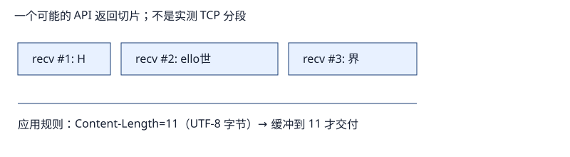

# 真实协议测量：从 TCP 字节流到 HTTP 消息

问题不是“`recv()` 这次读到了多少”，而是“我的协议规则何时证明一条消息已经完整”。本专题在一个临时的 `127.0.0.1` listener 上做最小实验：OS 自动分配端口，测试结束就关闭 listener 和线程。它记录的是 Python socket/API 层返回的字节、EOF 和超时，**不是抓包、不是 TCP segment 观察，也不代表互联网或生产服务器的可靠性。**

| 顺序 | 读什么 | 能回答的问题 |
|---|---|---|
| 1 | [[01-TCP字节流与增量解帧]] | 为什么一次 `recv` 不是一条消息？|
| 2 | [[02-HTTP消息定界Content-Length与chunked]] | HTTP/1.1 怎样决定 body 到哪里结束？|
| 3 | [[03-EOF半关闭截断与超时]] | EOF、截断和超时分别意味着什么？|
| 4 | [[04-实验-只在loopback测HTTP]] | 如何复跑、核对结果与迁移到自己的协议？|

源码镜像：[[./code-sync/loopback_http_lab.py|最小增量解析器]]、[[./code-sync/test_loopback_http_lab.py|可运行测试]]；两幅图由 [[./code-sync/generate_diagrams.py|生成器]] 写入 `_assets/`。

阅读实现的逐字镜像：[[05-最小解析器源码镜像]]。

## 和原课程的关系

[[计算机知识/35-计算机网络/04-UDP-TCP可靠传输与应用分帧|TCP 与应用分帧]]已经给出通用 framing 原理；[[计算机知识/35-计算机网络/10-系统课程/06-HTTP_TLS_QUIC与应用协议|HTTP、TLS 与 QUIC]]解释 HTTP 的语义与连接管理。本专题只把抽象原则落实成 HTTP/1.1 的 body 定界、错误分类和受控本机实验。
