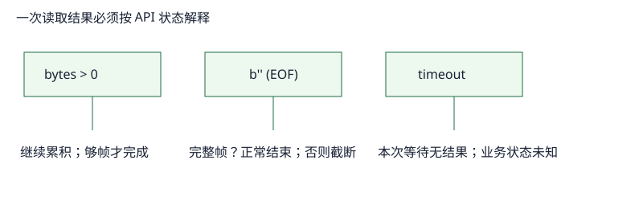

# EOF、半关闭、截断与超时：四个不同的观察

一个 socket 读取调用的结果不是布尔值。特别是“没有更多数据”可能是正常结束、半条消息被切断，或只是当前等得太久。

| 观察到的 API 结果 | 在本实验的解释 | 能否断言消息完整？ |
|---|---|---|
| `bytes > 0` | 继续累积和解析 | 只有 framing 已满足才可以 |
| `b''` | 对方发送方向已结束（EOF） | 仅当已完成当前 framing；否则截断 |
| `socket.timeout` | 这次等待到截止时间仍无数据 | 不可以；请求结果常为未知 |
| `OSError` | 本地 socket 操作失败 | 需按具体错误和协议状态处理 |

Python 文档规定 `recv` 返回空 bytes 表示对端已关闭，`settimeout` 的超时会表现为 `socket.timeout`。[socket 文档](https://docs.python.org/3/library/socket.html#socket.socket.recv) 这里的“关闭”不是“当前 HTTP 消息正常完结”的同义词。

## 半关闭是什么

TCP 是双向字节流。对端可以完成自己的发送方向（你的 `recv` 见 EOF），同时仍可能接收你发送的字节；这常被称为 half-close。是否继续发送要由应用协议和连接状态决定，不能只依据“我见到 EOF”机械推断。TCP FIN/关闭的协议状态见 [RFC 9293 §3.6](https://www.rfc-editor.org/rfc/rfc9293.html#section-3.6)。

## 实验的两条失败账本

1. 服务端声明 `Content-Length: 5` 却只发送 `he` 后关闭。解析器报告 `TruncatedMessage`，账本为“声明需要 5、EOF 时只有 2”；绝不交付 `he` 为完整 body。
2. 服务端在写响应前 sleep 150 ms，客户端为 `read_response(..., total_timeout=0.02)` 给出 20 ms **总**预算。结果是 `socket.timeout`；它没有告诉我们服务端是否后来完成、请求是否被处理，因而不是 EOF 也不是可安全重试的结论。

## deadline 是业务契约，传输结果不是业务确认

`socket.settimeout(0.02)` 原本约束的是每次阻塞操作；若对端每 12 ms 滴入一个 byte，它会不断被刷新，不能充当请求 deadline。这个教学解析器把有限的 socket timeout（或显式 `total_timeout`）固定为读取开始时的单调时钟总预算，每次 `recv` 仅使用剩余时间。生产程序仍需把连接、写入、响应和业务 deadline 分开建模。从 `request()` 写入到总 deadline 发生 timeout，客户端不知道数据是否到达服务端、服务端是否执行，或响应是否仅仅迟到。安全重试须依方法语义、幂等键和应用确认来设计。HTTP 语义与幂等性见 [RFC 9110 §9.2.2](https://www.rfc-editor.org/rfc/rfc9110.html#section-9.2.2)。

**迁移题：**收到 EOF 时 buffer 恰有完整 `Content-Length` body，算不算截断？

**答案：**当前响应可交付，因为 body 的 framing 已满足；EOF 表示连接之后不可复用。若 EOF 发生在 body 未足够前，才把当前响应标为截断。
