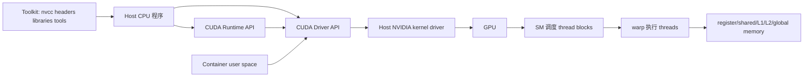

# CUDA · MOC

CUDA 不是“把 C++ 交给显卡跑”的单一开关。它同时涉及 CPU 与 GPU 的异构分工、驱动与 Toolkit 的部署边界、SIMT 执行层级、存储层级、异步依赖，以及用测量证据决定优化方向的方法。

> [!abstract] 学完后的能力
> 你将能从 host 代码追踪一次 kernel 的启动与数据流；解释 grid、block、thread、warp、SM 和各层 memory 的关系；识别 race、分支发散和低效访问；用 stream/event 表达异步依赖；从 reduction、softmax、GEMM 理解常见并行模式；最后用 Roofline 与 Nsight 证据判断瓶颈，并能读懂 PyTorch extension、Triton 和 llama.cpp CUDA backend 的位置。

## 开始前的边界

- **学习概念不要求有 NVIDIA GPU。** 纸上索引推导、代码审阅、接口分层和数值分析都可以离线完成。
- **编译需要 CUDA Toolkit 与受支持的 host toolchain。** `nvidia-smi` 能工作不等于存在 `nvcc`；Python 包里带 CUDA runtime 也不等于存在完整开发 Toolkit。
- **运行需要兼容的 NVIDIA GPU、host 驱动与用户态库。** 编译成功不证明 kernel 在目标 GPU 上正确，更不证明性能好。
- **容器不能替代 host 内核驱动。** 容器可携带用户态 Toolkit/runtime，GPU 设备与驱动能力仍由 host 暴露。
- **本系列写作环境无 CUDA 运行条件。** 2026-09-02 检查到当前为 macOS arm64，且 PATH 中无 `nvcc` 与 `nvidia-smi`；伴随 `.cu` 只完成静态审阅与 `code-sync` 一致性验证，未宣称配置、编译、CTest 或 GPU 运行通过。

## 学习路线

| 顺序 | 课程 | 核心问题 | 完成后你能…… |
| --- | --- | --- | --- |
| 1 | [[计算机知识/40-并行与异构计算/01-CUDA/01-CPU与GPU异构执行模型\|CPU 与 GPU 异构执行模型]] | 哪些工作留在 CPU，哪些工作交给 GPU？ | 用并行度、数据移动和启动开销判断是否值得 offload |
| 2 | [[计算机知识/40-并行与异构计算/01-CUDA/02-CUDA软件栈与Linux部署边界\|CUDA 软件栈与 Linux 部署边界]] | driver、runtime、Toolkit、容器各管什么？ | 读懂 Ubuntu、Arch、容器三种部署的兼容边界 |
| 3 | [[计算机知识/40-并行与异构计算/01-CUDA/03-Kernel与Grid-Block-Thread-Warp\|Kernel 与 Grid、Block、Thread、Warp]] | 一份 kernel 如何映射到大量线程？ | 推导全局索引并避免越界 |
| 4 | [[计算机知识/40-并行与异构计算/01-CUDA/04-内存层级合并访问与BankConflict\|内存层级、合并访问与 Bank Conflict]] | 为什么同样的算术会有巨大速度差？ | 从访问地址判断 coalescing、复用和 bank conflict |
| 5 | [[计算机知识/40-并行与异构计算/01-CUDA/05-同步原子操作与分支发散\|同步、原子操作与分支发散]] | 如何表达正确的并发依赖？ | 区分 barrier、memory ordering、atomic 与控制流问题 |
| 6 | [[计算机知识/40-并行与异构计算/01-CUDA/06-Stream-Event与异步流水线\|Stream、Event 与异步流水线]] | “异步提交”怎样成为真实重叠？ | 用 stream 内顺序、event 跨流依赖和 pinned memory 设计流水线 |
| 7 | [[计算机知识/40-并行与异构计算/01-CUDA/07-FP16-BF16-FP8与Tensor-Core\|FP16、BF16、FP8 与 Tensor Core]] | 低精度为何更快，又会失去什么？ | 区分存储格式、累加精度、动态范围与硬件支持 |
| 8 | [[计算机知识/40-并行与异构计算/01-CUDA/08-Reduction-Softmax与GEMM\|Reduction、Softmax 与 GEMM]] | 常见算子怎样拆成并行模式？ | 识别归约、稳定 softmax 和分块矩阵乘的关键依赖 |
| 9 | [[计算机知识/40-并行与异构计算/01-CUDA/09-Roofline与Nsight性能方法\|Roofline 与 Nsight 性能方法]] | 应该优化算术还是访存？ | 建立可复现基线，用 Roofline、Nsight Systems/Compute 定位瓶颈 |
| 10 | [[计算机知识/40-并行与异构计算/01-CUDA/10-PyTorch扩展-Triton与llama.cpp后端\|PyTorch 扩展、Triton 与 llama.cpp 后端]] | CUDA kernel 怎样进入真实框架？ | 选择原生 CUDA、扩展、DSL 或现成 backend，并验证语义与 offload |

## 三条跳读路线

### 写出第一个正确 kernel

阅读 `01 → 03 → 04 → 05`，然后编译 `vector_add.cu`。先做边界与正确性测试，再谈性能。

### 部署与排错

阅读 `02 → 06 → 09`。把问题先归到 GPU/驱动、Toolkit/编译、runtime/库、容器注入、程序同步或性能测量中的一层。

### AI 算子与推理后端

阅读 `07 → 08 → 09 → 10`，并连接数学权威页：

- [[数学/60-数值计算与量化/01-二进制浮点精度与数值稳定性|二进制浮点精度与数值稳定性]]；
- [[数学/20-线性代数与几何/02-矩阵乘法线性映射与Einsum|矩阵乘法、线性映射与 Einsum]]。

## 一张全链路地图

这张图的关键不是箭头数量，而是责任边界：Toolkit 用来构建和分析；runtime/driver API 提交工作；host 驱动控制设备；GPU 按资源和调度规则执行；容器复用 host 的设备与驱动能力，而不是带进一个新的内核驱动。

## 学习与实验纪律

1. 每个 kernel 先写 CPU 参考实现或可人工计算的小输入。
2. 每次 launch 后检查 CUDA error，并在读取结果前建立正确同步点。
3. 正确性覆盖 `N=0/1`、非 block 整倍数、随机输入、极值和非连续布局等边界。
4. 计时时把初始化、首次 JIT、数据传输和稳定态 kernel 分开。
5. 不从另一张 GPU 的“最佳 block size”抄答案；资源、架构和输入形状会改变结果。
6. 不用峰值 FLOPS、occupancy 或单个 profiler 百分比代替端到端基线。

## 官方资料入口

- [CUDA Programming Guide](https://docs.nvidia.com/cuda/cuda-programming-guide/)
- [CUDA Installation Guide for Linux](https://docs.nvidia.com/cuda/cuda-installation-guide-linux/)
- [CUDA Compatibility](https://docs.nvidia.com/deploy/cuda-compatibility/)
- [CUDA Best Practices Guide](https://docs.nvidia.com/cuda/cuda-c-best-practices-guide/)
- [Nsight Compute documentation](https://docs.nvidia.com/nsight-compute/)

这些是 2026-09-01 的核验入口，不是版本冻结。安装支持矩阵、最低驱动、编译器支持和 profiler 指标都可能变化，实际部署当天必须重新核对目标 Toolkit 的 release notes 和安装指南。

## 完成标准

- [ ] 我能把 driver、runtime、Toolkit、库、容器与框架分开。
- [ ] 我能为任意 `N` 推导一维 kernel 的 grid 大小和边界判断。
- [ ] 我能解释 warp、coalescing、shared-memory bank 和 divergence 的关系。
- [ ] 我知道 `__syncthreads()` 只解决 block 内 barrier，atomic 也不自动解决所有 ordering。
- [ ] 我能用 event 建立跨 stream 依赖，并说出 pinned host memory 的作用与成本。
- [ ] 我能解释 FP16、BF16、FP8 与 accumulation dtype 不是一回事。
- [ ] 我能从 arithmetic intensity 和实测带宽判断 kernel 更像 memory-bound 还是 compute-bound。
- [ ] 我会先验证框架/后端确实加载并 offload，再解释性能结果。

---

**上一站**：[[计算机知识/00-开始/00-计算机知识-首页|计算机知识首页]] · **下一站**：[[计算机知识/40-并行与异构计算/01-CUDA/01-CPU与GPU异构执行模型|CPU 与 GPU 异构执行模型]] · **系统前置**：[[计算机知识/20-操作系统/01-Linux/00-Linux基础-MOC|Linux 基础 MOC]]

<!-- revision-2-navigation -->
## 本轮课程定位与机制补充

课程顺序与原稿入口：[[计算机知识/00-开始/课程地图/07-计算机组成原理-课程地图|计算机组成原理 · 课程地图]]。进一步的机制推演与反例：[[计算机知识/30-计算机系统/22-缓存地址翻译一致性与存储层级推演|组成原理深化：缓存、地址翻译与一致性的定量模型]]。跨学科辨析：[[计算机知识/90-资源/11-跨学科概念辨析|跨学科概念辨析]]。

## 先认出正在追踪的对象

基础读者可先用[[计算机知识/40-并行与异构计算/80-张量跨层执行/01-同一张量从数值到线程|同一张量从数值到线程]]追踪 `3×5` 张量的一个元素，手算其位表示、坐标、地址与示例线程，再回来读索引、访存与同步。该案例的CPU地址/数值复算不证明CUDA设备运行；已经熟悉这些对象的读者直接按本MOC的机制课继续。
