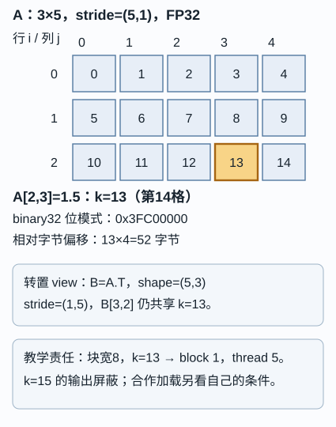

# 从一个张量元素到端到端执行：同一个 1.5 经过哪些合同

读者问题：**我在张量里看到 `A[2,3]=1.5`，为什么还要同时关心二进制、地址、线程、显存和端到端成本？** 因为这些是同一运行中不同层的承诺：每层都保存一部分意义，并新增条件。它们不能互相替代。

图的替代文字：一个 3×5 行主序 FP32 存储连续排成 15 个格；0 起始索引 13（第 14 格）标为 `A[2,3]=1.5`、偏移 13、字节 52。其转置视图读成 `(3,2)`，但箭头回到同一格。块宽 8 时 block 1 的 thread 5 负责线性索引 13；thread 7 对应 15，越界。颜色只帮助分组，文字和箭头给出关系。

## 两条入口，交给同一条主解释

**高中数学与编程新手。** 先把张量当有行列标签的表格。`A[2,3]` 表示第 3 行第 4 列（从 0 数），不是“第 23 个数”；`1.5` 是数学值。程序把表格排进一条连续格带，才需要偏移和字节地址。先做下面的可停检查，再进入机制。

**本科快进。** 直接固定 `storage`、`shape=(3,5)`、`stride=(5,1)`、`dtype=float32` 和 0 起始索引。连续行主序地址为 `base + 4(5i+j)`；view 只改形状/步长，不承诺复制。之后仍要完成联合迁移题，因为梯度、编译和成本的边界不能由熟悉的地址公式免除。

## 一次可检查的交接

设 `A` 是连续行主序、形状 3×5 的 FP32 张量，`A[2,3]=1.5`。行主序元素偏移为 `5×2+3=13`，所以相对字节偏移是 `13×4=52`。`1.5=1.1₂×2⁰`，它在 IEEE binary32 中可精确表示为 `0x3FC00000`。这些五个身份并列如下：

| 问题层 | 这一例的答案 | 不能推得什么 |
| --- | --- | --- |
| 数学值 | `1.5` | 每个实数都能被 FP32 精确表示 |
| 位串 | binary32 `0x3FC00000` | 坐标或线程号 |
| 张量坐标 | `(2,3)` | 自然拥有的物理地址 |
| 存储 | 线性偏移 13、相对字节 52 | 某一线程必然处理它 |
| 程序责任 | block 1、thread 5（块宽 8） | 所有合作加载也由它输出 |

这里 `tid=blockIdx.x*blockDim.x+threadIdx.x`。块宽 8 时 `tid=1×8+5=13`，因此是一个**教学用责任映射**：此 kernel 令 `k=tid` 并仅在 `k<15` 时访问。block 1、thread 7 的 `k=15` 必须屏蔽输出访问。分块 GEMM 中，合法输出为零的线程仍可能参与合作加载；“输出越界”不自动取消其加载责任，加载、同步和输出的条件须分别写出。

若令 `B=A.T`，则 `B` 共享同一 storage，`shape=(5,3)`、`stride=(1,5)`；相同元素读成 `B[3,2]`。它没有因为转置而搬走 `1.5`。地址应按 `base+4(i*stride[0]+j*stride[1])` 读，不能对 view 继续套 `5i+j`。

## 从表示到任务：误差不是一个数字

`1.5` 恰好可表示只是一个幸运例。大多数十进制小数先有**表示误差**；每次加、乘和 FMA 都按目标格式舍入；并行归约改变加法树，浮点加法不满足结合律，所以位模式可能改变。FMA 对 `a*b+c` 只在末尾舍入一次，和先乘后加的两次舍入可能不同。最后仍须问**任务误差**：输出小差异是否改变损失、阈值、排序或安全决策。误差合同要写 dtype、归约顺序、允许比较方式和任务判据，不能只写“FP32”。

## 生命周期账：占用不是一个数

一次训练或推理的峰值由重叠寿命决定，不能把所有名字相加后叫“显存”。至少分列：

| 类别 | 寿命与含义 |
| --- | --- |
| 参数 | 模型权重，训练/推理均长期存活 |
| 激活 | 为反向保存的中间值；可保存或在反向重算 |
| KV cache | 已生成 token 的键值；随请求、层数和上下文增长 |
| workspace | 某个算子临时工作区，通常只在调用窗口活着 |
| reserved | 分配器向设备保留的池，可能大于当前 active 分配 |

两层、`B=1,T=128,hkv=2,dh=12`、FP32 的 KV 若每层存 K 与 V，字节数是 `2 layers × 2(K,V) × 1 × 128 × 2 × 12 × 4 = 49152 B`。这是该形状的存储算术，不是全模型或设备观察值。保存激活降低重算量，却抬高峰值；checkpointing 选择重算时还要保留随机状态、别名和副作用合同。

一个可算的寿命表比名称清单更有用。假定参数 40 B 始终存活，激活 30 B 只在前向末到反向消费前存活，workspace 20 B 只在算子窗口存活：前向末有 `40+30=70 B`，workspace 窗口有 `40+30+20=90 B`，反向消费后回到 40 B。若把激活改为重算，前向末是 40 B；反向重建期间是 `40+20=60 B`，但多了一段计算。这里的 90/60 B 是明确的教学生命周期，不是设备测得峰值；`reserved` 可以高于任何一格的 active 总和。

## 编译器拿到的不是“一个函数”

一个可复用编译产物的边界由实际系统的 guard 与等价性验证决定。shape、dtype、stride、alias/view、是否需要梯度等可能被 guard 区分，也可能由一个正确的通用 kernel 处理；相同数值的不同 stride 不能被想当然地当成同一内存访问。mask 的**语义**必须保持，但同一已声明 mask 形状下的具体取值通常是合法运行输入，不当然要求重编译；random seed 的改变也通常是运行输入。优化只能在保留 RNG 消耗顺序、随机性和副作用语义的条件下成立。是否复用、重新编译或回退，应由实际 guard 命中和已验证等价性决定，不能把每次 mask 值、seed 或梯度模式变化一律当成新的编译边界。

KV 的 token 生命周期是另一件事：对一个请求，已提交 token 是已经接受并写入 K/V 的前缀；已物化表示该前缀的 K/V 已实际分配/填充；下一 token 的候选状态在接受前仍是待定。这个时序描述不能借用旧的 “L+2” 规则，本页未核对那条语义，也不把它用作编译缓存键。

局部 kernel 时间也不是端到端成本。端到端账还要包含排队、准备、传输、编译、同步、回退和校验。一个 kernel 更快，若增加重编译或回退，用户等待可能更长。

> [!note] 可选支线：从位串回到电压与噪声
> 数学值 `1.5` 被编码成一组位，并不意味着门输入接 `1.5 V`。先读本库 [[电子电路/32-组合逻辑/01-CMOS反相器逻辑电平与功耗#静态曲线与噪声容限|CMOS静态曲线与噪声容限]]，对照拓扑图、VTC和保证区间，解释发送器输出怎样满足接收器输入条件。再按需要读 [[电子电路/38-随机噪声与测量/02-热散粒闪烁噪声的物理条件#热平衡电阻的两种等效源|热噪声的物理条件]] 与 [[电子电路/38-随机噪声与测量/04-积分带宽与kT-C#面积先得到V²，再得到RMS|带宽积分与RMS]]，分别带回电压裕量、噪声谱和积分范围；静态裕量与噪声RMS不能直接当成同一种保证。
>
> 这条器件支线可独立返回本页的位串层，不是学习地址或线程的前置。V19 `system_route.tex` 保留为外部来源；本库入口不要求取得该私有材料，也不据教学模型认证某工艺或 GPU 的门级可靠性。

## 联合迁移题（不给方法提示）

某程序把上述 `A` 改为转置 view `B`，用 block 宽 8 的 kernel 做一段归约，并把一个训练步交给编译系统。新请求的 `shape=(5,3), stride=(1,5)`，mask 保持既有语义，但启用梯度并改变随机 seed。团队报告“block 1 thread 7 越界，所以可以跳过它；FP32 一样，所以归约一致；局部 kernel 少 2 ms，所以端到端更快；reserved 比 active 大，所以泄漏”。

请交出：① `B[3,2]` 的 storage 偏移和原元素；② 哪些说法不成立以及各自缺的合同；③ 至少一个保存/重算的峰值权衡；④ 能让“更快”成立所需的端到端测量边界。

答案与等价方案

`B[3,2]` 偏移为 `3*1+2*5=13`，仍读原 `A[2,3]=1.5`。thread 7 是否可跳过取决于它是否承担合作加载；输出越界只否定该输出访问。FP32 不保证归约顺序或 FMA 行为相同。改变 stride 或梯度模式是否跨越编译边界，要检查实际 guard 和等价性；seed 的变化本身不是不安全，关键是优化不能改变声明的 RNG 与副作用语义。保存激活减少反向计算、增加活跃峰值；重算相反。端到端比较至少固定输入合同和正确性证书，并覆盖准备、编译、排队、传输、kernel、同步、回退/校验；也可给出等价的完整成本分解。

## 可复算材料、来源与边界

本页的精确算术与断言由同目录的 `tensor_cross_layer.py` 和 `test_tensor_cross_layer.py` 以 Python 标准库复算。脚本是真源；这里没有新建 `code-sync` 镜像。它不运行 CUDA、PyTorch、编译器或硬件计时，因此只验证教学算术和合同分类，不能证明真实 GPU 性能、allocator 行为、器件噪声或学习效果。

来源：IEEE Std 754-2019；AITextbook V19 `book/tex/v19/system_route.tex` 与 `reading_routes.tex`（本次只读核对，后者把地址/线程、合作分块、保存重算和编译合同列为不同可停点）。进一步读 [[计算机知识/40-并行与异构计算/01-CUDA/03-Kernel与Grid-Block-Thread-Warp|Kernel、Grid、Block、Thread 与 Warp]]（线程责任）和 [[AI/12-PyTorch/09-性能剖析编译动态形状与内存账本|性能、编译与内存账本]]（端到端账本）。
