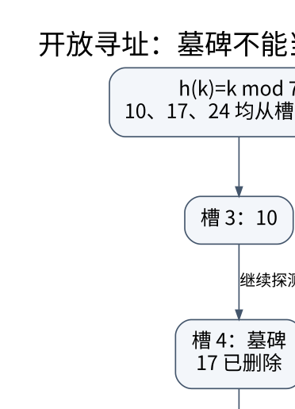

# 顺序、链式与哈希结构：代价来自访问路径

> **学习位置**：[[计算机知识/00-开始/课程地图/06-数据结构-课程地图|数据结构课程地图]] · **适用边界**：RAM 模型为默认；均摊、期望和最坏情况分别说明。

[PNG 备用图](../../_assets/diagrams/round3/hash-probe.png) · [可编辑图源](../../_assets/diagrams/round3/hash-probe.dot)

## 连续内存与指针追踪

数组索引通过起始地址和元素步长计算位置，具有良好的顺序局部性；中间插入通常要移动后缀。链表已知前驱时可以常数次改链，但找到第 $k$ 个位置仍需遍历。每个节点的指针、分配器元数据和缓存未命中都是真实成本，所以“链表插入 $O(1)$”必须写明已经拿到正确位置这个前提。

栈、队列、双端队列可以用数组或链式结构实现。环形队列必须区分满和空：可额外保存长度，也可牺牲一个槽位。若用单调增长的读写计数器再取模，要证明整数回绕下差值仍可解释，不能只在小样例里循环正常。

## 哈希表只在明确假设下快

哈希函数先把键映射到散列值，再定位桶。相等键必须得到兼容散列；不同键允许碰撞。链地址法在均匀分布等假设下，平均查找代价与 $1+\alpha$ 相关，其中 $\alpha=n/m$ 是负载因子。开放定址把元素直接放进表中，负载接近满时探测长度会急剧增加。

线性探测示例：容量 7，使用 `key % 7`。插入 10 到槽 3；17 同样从 3 开始，落在 4；24 落在 5。查找 24 必须沿探测序列经过 3、4、5。若删除 17 后把槽 4 标成“从未使用”，查找会错误地提前停止。

## 删除标记为什么有第三种状态

开放定址通常区分空槽、有效槽和墓碑。查找遇到墓碑继续，遇到真正空槽才能按协议停止；插入可以记住首个墓碑，但仍须继续检查是否已有相等键，避免制造重复键。墓碑积累会使名义负载很低但查找仍慢，需要重建或合适的后移删除算法。

双重散列要保证探测步长与容量配合，使序列有机会遍历整个表；否则表没满也可能插不进去。Robin Hood hashing 通过比较探测距离改善距离分布，但删除和扩容也必须维护相应不变量。Cuckoo hashing 用多个候选位置与搬迁换取查询结构，插入循环需要重建策略。

## 防御性设计与工程选择

字符串键的哈希代价与键长有关，不能把所有字典操作都视为独立于输入大小的常数。攻击者可控制键时，应考虑恶意碰撞、随机化哈希或资源限制；随机种子变化还会影响遍历顺序和可复现性。持久化格式不能使用进程内部不稳定的哈希值作为永久标识。

扩容会使元素地址、迭代器或引用的有效性发生变化，具体取决于语言容器合同。并发哈希表还要处理读者看到迁移中状态的问题；“用原子指针替换表头”不自动保证旧表可以立即释放。

## 练习与答案

手算上述 7 槽表删除 17 后查找 24 的过程，比较空槽与墓碑结果。再构造所有键同余的输入，观察平均性能假设如何失效。为环形队列生成随机入队出队序列，与简单列表模型对照，检查元素顺序、长度、满空状态和边界回绕。测试目标是表示不变量，而不是恰好通过几次 `push/pop`。

## 关联阅读

- [[计算机知识/50-数据结构与算法/10-数据结构系统课程/01-抽象数据类型与均摊分析|抽象数据类型与均摊分析：先规定行为，再计算总账]]
- [[计算机知识/10-编程语言/02-C++/10-系统课程/04-容器迭代器算法与Ranges|标准库容器与算法：复杂度只是选择的一半]]
- [[计算机知识/30-计算机系统/10-组成原理系统课程/05-缓存地址划分与AMAT|缓存地址划分与 AMAT：从一次地址访问算起]]

## 依据与继续查证

- [James Aspnes：Data Structures and Programming Techniques（作者课程笔记）](https://www.cs.yale.edu/homes/aspnes/classes/223/notes.html)
- [MIT 6.006：Introduction to Algorithms（原课程资料）](https://ocw.mit.edu/courses/6-006-introduction-to-algorithms-spring-2020/)

本页的例子、推演与练习为教学构造；语言契约、系统接口和版本相关结论应结合以上原始文档核对。

<!-- COURSE SEQUENCE -->
## 顺序导航与验证

[[计算机知识/50-数据结构与算法/10-数据结构系统课程/00-数据结构系统课程索引|本课程总索引]] · [[计算机知识/_labs/round3/DS/数据结构-实验说明|本课程实验]]

上一讲：[[计算机知识/50-数据结构与算法/10-数据结构系统课程/01-抽象数据类型与均摊分析|抽象数据类型与均摊分析：先规定行为，再计算总账]]

下一讲：[[计算机知识/50-数据结构与算法/10-数据结构系统课程/03-平衡搜索树旋转与增广|平衡搜索树、旋转与增广：改变形状而不改变顺序]]
<!-- END COURSE SEQUENCE -->

<!-- ORIGINAL DEEP LINKS -->
## 与原有长篇专题衔接

- [[计算机知识/50-数据结构与算法/04-哈希表集合与冲突处理|04-哈希表集合与冲突处理]]

新旧讲解采用的版本与模型可能不同，比较时先核对各自前提，不把教学简化当成实现细节。
<!-- END ORIGINAL DEEP LINKS -->
