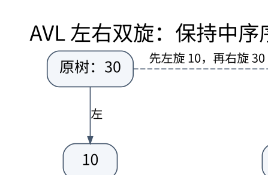

# 平衡搜索树、旋转与增广：改变形状而不改变顺序

> **学习位置**：[[计算机知识/00-开始/课程地图/06-数据结构-课程地图|数据结构课程地图]] · **适用边界**：RAM 模型为默认；均摊、期望和最坏情况分别说明。

[PNG 备用图](../../_assets/diagrams/round3/avl-rotation.png) · [可编辑图源](../../_assets/diagrams/round3/avl-rotation.dot)

## 高度决定路径长度

二叉搜索树要求左子树键小于当前键、右子树键大于当前键；重复键需单独规定计数或稳定次序。有序插入普通 BST 会产生长链，因此查找最坏达到 $O(n)$。平衡树维护额外条件，让高度受 $O(\log n)$ 控制，代价是更新时修复结构。

AVL 为每个节点维护左右高度差不超过 1。若高度为 $h$ 的最少节点数为 $N(h)$，则有类似 Fibonacci 的递推 $N(h)=1+N(h-1)+N(h-2)$，从指数增长反推高度对节点数为对数。这是平衡条件为何有效的机制，不只是“看起来对称”。

## 右旋的三个子树推演

考虑根 y，左孩子 x，x 的左右子树为 A、B，y 的右子树为 C。原来中序顺序是 A、x、B、y、C。对 y 右旋后，x 成为根，y 成为 x 的右孩子，B 变成 y 的左子树，顺序仍是 A、x、B、y、C。因此旋转保留搜索顺序，但改变高度与父子关系。

插入 30、20、10 会使 30 左侧过高，一次右旋得到根 20、左右为 10 和 30。插入 30、10、20 则是左-右形状：先对 10 左旋，再对 30 右旋。修复时先更新下降到下层的旧根，再更新上升的新根，否则高度和聚合值会使用过时数据。

## 删除比插入更容易漏条件

删除 BST 节点时，零或一个孩子可直接替换；两个孩子可用后继或前驱替代，并继续删除对应节点。替换的是逻辑键值还是节点对象，会影响外部引用和迭代器合同。AVL 删除可能沿祖先链反复引发失衡，不能认为修复一次就总能结束。

红黑树用颜色和黑高约束间接限制高度，允许比 AVL 更宽松的局部高度差。学习时先理解“不出现相邻红节点、各根叶路径黑节点数一致”等约束如何限制最长路径，再看插删修复分类；不同实现对空叶与根颜色的约定要一致。

## 增广把树变成新的查询工具

若每个节点保存子树大小 `size = 1 + size(left) + size(right)`，就能按左子树大小选择第 k 小元素，也能计算一个键的排名。旋转后只需按新的子树关系更新局部摘要。这种局部可维护性是增广成功的关键。

区间树可保存子树最大右端点，用它剪去不可能重叠的分支；有序事件树可保存子树聚合。并不是任意信息都适合增广：若更新一个节点会要求全树重算摘要，复杂度保证就消失。

## 随机与自调整方案

Treap 同时满足键的 BST 次序与随机优先级的堆序，在合适独立随机假设下获得期望对数高度；不应把这个期望界写成每次最坏界。Splay tree 按访问把节点旋到根，提供均摊分析并适应某些局部性，但单次访问可能线性。跳表以多层随机捷径换取期望路径长度，结构简单不等于并发回收自动安全。

## 练习与答案

对 30、10、20 逐步画出两次旋转，并标注每个节点的高度和 size。删除根后检查排序、不丢元素、无环、父指针一致与平衡条件，五者缺一不可。随机操作后将中序结果与有序多重集合参考模型比较，同时验证 `select(rank(x))` 在无重复键时返回 x。这样测试的不只是查找结果，还包括将来操作依赖的隐含状态。

## 关联阅读

- [[计算机知识/50-数据结构与算法/10-数据结构系统课程/04-多路树外存与持久化|多路树、外存与持久化：一次访问尽量带回更多信息]]
- [[计算机知识/50-数据结构与算法/10-数据结构系统课程/05-区间聚合Fenwick与线段树|区间聚合、Fenwick 与线段树：摘要必须满足代数条件]]
- [[计算机知识/50-数据结构与算法/20-算法设计系统课程/03-贪心交换论证与结构条件|贪心、交换论证与结构条件：局部选择何时值得相信]]

## 依据与继续查证

- [James Aspnes：Data Structures and Programming Techniques（作者课程笔记）](https://www.cs.yale.edu/homes/aspnes/classes/223/notes.html)
- [MIT 6.006：Introduction to Algorithms（原课程资料）](https://ocw.mit.edu/courses/6-006-introduction-to-algorithms-spring-2020/)

本页的例子、推演与练习为教学构造；语言契约、系统接口和版本相关结论应结合以上原始文档核对。

<!-- COURSE SEQUENCE -->
## 顺序导航与验证

[[计算机知识/50-数据结构与算法/10-数据结构系统课程/00-数据结构系统课程索引|本课程总索引]] · [[计算机知识/_labs/round3/DS/数据结构-实验说明|本课程实验]]

上一讲：[[计算机知识/50-数据结构与算法/10-数据结构系统课程/02-顺序链式结构与哈希设计|顺序、链式与哈希结构：代价来自访问路径]]

下一讲：[[计算机知识/50-数据结构与算法/10-数据结构系统课程/04-多路树外存与持久化|多路树、外存与持久化：一次访问尽量带回更多信息]]
<!-- END COURSE SEQUENCE -->

<!-- ORIGINAL DEEP LINKS -->
## 与原有长篇专题衔接

- [[计算机知识/50-数据结构与算法/22-平衡树区间结构与结构扩展地图|22-平衡树区间结构与结构扩展地图]]
- [[计算机知识/50-数据结构与算法/12-最短路最小生成树与并查集|12-最短路最小生成树与并查集]]

新旧讲解采用的版本与模型可能不同，比较时先核对各自前提，不把教学简化当成实现细节。
<!-- END ORIGINAL DEEP LINKS -->
