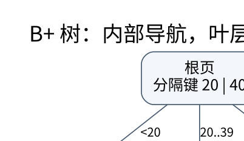

# 多路树、外存与持久化：一次访问尽量带回更多信息

> **学习位置**：[[计算机知识/00-开始/课程地图/06-数据结构-课程地图|数据结构课程地图]] · **适用边界**：RAM 模型为默认；均摊、期望和最坏情况分别说明。

[PNG 备用图](../../_assets/diagrams/round3/bplus-pages.png) · [可编辑图源](../../_assets/diagrams/round3/bplus-pages.dot)

## 为什么磁盘索引不喜欢高瘦二叉树

外存模型把一次搬运的块大小记为 $B$，内存容量记为 $M$。若每个树节点只有一个键，即使比较次数是对数，也可能每层都触发随机 I/O。多路树把大量键放进一个页，用一次页读取判断下一条分支，从而降低 I/O 层数。缓存命中、预读和页填充率仍会影响真实成本。

B 树节点保存有序键与多个孩子，并对最小占用和最大容量作约束。不同教材对“阶”的定义不统一，写算法前要明确参数指的是最大孩子数还是最小度数。例如最小度数 $t$ 的常见定义中，非根节点有 $t-1$ 到 $2t-1$ 个键，内部节点孩子数比键数多一。

## 分裂是把溢出向上转移

在一个最大 3 键的教学节点中插入第四个键，需要按选定算法分裂并把分隔键传给父节点；父节点也可能溢出，最终可能创建新根。B 树与 B+ 树对被提升键的保存方式不同：B+ 树叶子保留数据键，内部使用分隔键导航，不能机械照搬 B 树“把中位键搬走”的步骤。

B+ 树叶子按顺序相连，范围扫描先定位起点，再沿叶链前进。假设每个内部页扇出约 100，三次向下分支就能覆盖约一百万个叶位置；这只是扇出模型，不是某个真实数据库的固定高度。页头、变长键、填充率和记录指针都会改变可容纳数量。

## LSM 把随机写改成批量有序维护

LSM 思路先把更新放入内存结构并配合日志，再形成不可变有序文件，后台合并维护层次。好处是把部分随机更新转成顺序写和批处理；代价是读可能查多个位置、合并会重写数据、删除标记需要保留到安全时机。讨论性能时分别看读放大、写放大和空间放大，不要只写“LSM 写快，B 树读快”的绝对口号。

Bloom filter 可以减少不存在键的无效文件读取，但假阳性仍可能触发查询，且不能替代真实索引。不同层的缓存、压缩和合并策略会显著改变结果。

## 持久化数据结构不是磁盘持久性

算法中的 persistent data structure 指保留旧版本。路径复制只复制从根到被修改位置的路径，其余子树共享；平衡二叉树的一次更新通常复制 $O(\log n)$ 个节点。旧根仍可查询旧版本，新根指向新版本。

这不等于掉电后数据存在。内存中的持久化树仍可能随进程结束消失；数据库持久性还需要日志、同步、恢复协议。反过来，把可变树保存到磁盘也不自动提供任意历史版本访问。两个“持久化”含义必须分开。

## 练习与答案

画一个 B+ 树叶子分裂：左叶保留较小键，右叶保留较大键，父节点增加指向右叶的分隔信息，同时修复叶链。检查范围扫描是否遗漏新叶。再画路径复制更新一棵七节点树，标出旧新版本共享哪些节点；若随后原地修改共享节点，旧版本会被破坏，因此共享节点必须遵守不可变或版本化更新协议。

<!-- ROUND4 DEPTH LINKS -->
## 继续推演本页难点

[[计算机知识/50-数据结构与算法/10-数据结构系统课程/10-可持久化结构与回滚并查集|为什么可持久化不等于落盘，回滚也不能照搬路径压缩？]] 本专题补上数据结构不变量、完整算例与独立参照测试。

这不是替换本页：先掌握原理，再用补充页核对容易被一句话略过的条件。
<!-- END ROUND4 DEPTH LINKS -->

## 关联阅读

- [[计算机知识/55-数据库/10-系统课程/05-页布局索引与查询代价|数据库的物理组织：一条记录怎样落到磁盘页上]]
- [[计算机知识/55-数据库/10-系统课程/07-恢复复制与分布式事务|恢复、复制与分布式事务：提交成功意味着什么]]
- [[计算机知识/50-数据结构与算法/10-数据结构系统课程/08-概率结构空间结构与知识全景|概率结构、空间结构与知识全景：压缩信息就要说明损失]]

## 依据与继续查证

- [James Aspnes：Data Structures and Programming Techniques（作者课程笔记）](https://www.cs.yale.edu/homes/aspnes/classes/223/notes.html)
- [MIT 6.006：Introduction to Algorithms（原课程资料）](https://ocw.mit.edu/courses/6-006-introduction-to-algorithms-spring-2020/)

本页的例子、推演与练习为教学构造；语言契约、系统接口和版本相关结论应结合以上原始文档核对。

<!-- COURSE SEQUENCE -->
## 顺序导航与验证

[[计算机知识/50-数据结构与算法/10-数据结构系统课程/00-数据结构系统课程索引|本课程总索引]] · [[计算机知识/_labs/round3/DS/数据结构-实验说明|本课程实验]]

上一讲：[[计算机知识/50-数据结构与算法/10-数据结构系统课程/03-平衡搜索树旋转与增广|平衡搜索树、旋转与增广：改变形状而不改变顺序]]

下一讲：[[计算机知识/50-数据结构与算法/10-数据结构系统课程/05-区间聚合Fenwick与线段树|区间聚合、Fenwick 与线段树：摘要必须满足代数条件]]
<!-- END COURSE SEQUENCE -->

<!-- ORIGINAL DEEP LINKS -->
## 与原有长篇专题衔接

- [[计算机知识/50-数据结构与算法/22-平衡树区间结构与结构扩展地图|22-平衡树区间结构与结构扩展地图]]
- [[计算机知识/50-数据结构与算法/12-最短路最小生成树与并查集|12-最短路最小生成树与并查集]]

新旧讲解采用的版本与模型可能不同，比较时先核对各自前提，不把教学简化当成实现细节。
<!-- END ORIGINAL DEEP LINKS -->
