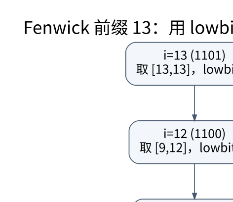

# 区间聚合、Fenwick 与线段树：摘要必须满足代数条件

> **学习位置**：[[计算机知识/00-开始/课程地图/06-数据结构-课程地图|数据结构课程地图]] · **适用边界**：RAM 模型为默认；均摊、期望和最坏情况分别说明。



[PNG 备用图](../../_assets/diagrams/round3/fenwick-blocks.png) · [可编辑图源](../../_assets/diagrams/round3/fenwick-blocks.dot)

## 静态前缀与动态更新

对数组 $a_0,\ldots,a_{n-1}$，定义 $P_0=0$，$P_{i+1}=P_i+a_i$，则半开区间和为 $P_r-P_l$。一次预处理后查询常数时间，但修改一个元素会影响整个后缀。前缀最大值不能像前缀和一样相减恢复任意区间最大值，因为 max 没有这种逆操作。

这提示我们先问摘要运算是否结合、是否有单位元、是否有逆元。线段树聚合通常需要结合律与单位元；通过两个前缀恢复区间还需要适合的可逆结构。浮点加法在实际舍入语义下不严格结合，树形聚合可能与串行求和不同，必须说明误差合同。

## Fenwick 的二进制块

使用 1 起始下标，`tree[i]` 保存长度为 `lowbit(i)=i & -i`、以 i 结尾的区间。查询前 i 项时不断执行 `i -= lowbit(i)`，拆成互不重叠块；单点增加时执行 `i += lowbit(i)`，更新所有包含该位置的相关块。

```python
class Fenwick:
    def __init__(self, n):
        if n < 0:
            raise ValueError('n 必须非负')
        self.n, self.tree = n, [0] * (n + 1)
    def add(self, i, delta):  # 对外使用 0 起始下标
        if not 0 <= i < self.n:
            raise IndexError(i)
        i += 1
        while i <= self.n:
            self.tree[i] += delta
            i += i & -i
    def prefix(self, end):  # [0, end)
        if not 0 <= end <= self.n:
            raise IndexError(end)
        total = 0
        while end:
            total += self.tree[end]
            end -= end & -end
        return total
```

查询前 13 项时访问 13、12、8，对应长度 1、4、8 的块，总计恰好 13。每一步清除最低位的 1，因此访问次数至多与二进制位数同阶。必须拒绝非法更新下标，否则内部 i 为零时 `i += i & -i` 永远不前进。

## 线段树与懒标记

线段树把区间递归分半，父节点摘要由左右摘要合并。点更新和区间查询触及 $O(\log n)$ 层；实现中要正确处理空区间与非二次幂长度。查询非交换运算时，左右合并顺序不能颠倒。

懒标记推迟对子节点的更新，但父节点摘要必须立即反映更新。若维护区间和，对整个长度 L 的区间加 d，应让和增加 $dL$。若同时支持“赋值”和“增加”，标记合成不交换：先设为 5 再加 2 得 7，先加 2 再设为 5 得 5。要把标记看成函数复合，而不是两个互不相关的数字。

## 其他区间工具的位置

差分适合批量区间增量后统一还原；稀疏表适合静态幂等查询，如区间最小值；双栈队列可维护滑动聚合；单调队列适合滑动极值。扫描线把二维几何事件按一维顺序处理，但同坐标事件的开闭端点规则必须明确。持久化线段树保留版本，动态开点树处理稀疏大坐标，坐标压缩保留顺序而不保留原始距离。

## 练习与答案

对 `[2,1,3,4]` 建树，查询 `[1,4)` 得 8；把下标 2 增加 5 后得到 13。用简单数组对照随机更新查询，包含空区间、全区间和最后一个位置。再解释为什么对区间加 d 时只让摘要加 d 是错的：摘要代表 L 个元素，总变化是 d 乘 L。最后为“赋值＋增加”写两种顺序的测试，确保标记合成符合真实操作顺序。


<!-- ROUND4 DEPTH LINKS -->
## 继续推演本页难点

[[计算机知识/50-数据结构与算法/10-数据结构系统课程/09-懒标记的代数与完整实现|区间赋值和区间增加同时存在时，标记到底怎样合成？]] 本专题补上数据结构不变量、完整算例与独立参照测试。

这不是替换本页：先掌握原理，再用补充页核对容易被一句话略过的条件。
<!-- END ROUND4 DEPTH LINKS -->

## 关联阅读

- [[计算机知识/50-数据结构与算法/10-数据结构系统课程/01-抽象数据类型与均摊分析|抽象数据类型与均摊分析：先规定行为，再计算总账]]
- [[计算机知识/50-数据结构与算法/20-算法设计系统课程/04-动态规划状态设计与优化|动态规划状态设计与优化：状态必须保留未来需要的信息]]
- [[计算机知识/30-计算机系统/10-组成原理系统课程/02-整数浮点与算术电路|整数、浮点与算术电路：位模式本身没有唯一含义]]

## 依据与继续查证

- [James Aspnes：Data Structures and Programming Techniques（作者课程笔记）](https://www.cs.yale.edu/homes/aspnes/classes/223/notes.html)
- [MIT 6.006：Introduction to Algorithms（原课程资料）](https://ocw.mit.edu/courses/6-006-introduction-to-algorithms-spring-2020/)

本页的例子、推演与练习为教学构造；语言契约、系统接口和版本相关结论应结合以上原始文档核对。

<!-- COURSE SEQUENCE -->
## 顺序导航与验证

[[计算机知识/50-数据结构与算法/10-数据结构系统课程/00-数据结构系统课程索引|本课程总索引]] · [[计算机知识/_labs/round3/DS/数据结构-实验说明|本课程实验]]

上一讲：[[计算机知识/50-数据结构与算法/10-数据结构系统课程/04-多路树外存与持久化|多路树、外存与持久化：一次访问尽量带回更多信息]]

下一讲：[[计算机知识/50-数据结构与算法/10-数据结构系统课程/06-字符串索引自动机与后缀结构|字符串索引、自动机与后缀结构：复用已经比较过的信息]]
<!-- END COURSE SEQUENCE -->

<!-- ORIGINAL DEEP LINKS -->
## 与原有长篇专题衔接

- [[计算机知识/50-数据结构与算法/22-平衡树区间结构与结构扩展地图|22-平衡树区间结构与结构扩展地图]]
- [[计算机知识/50-数据结构与算法/12-最短路最小生成树与并查集|12-最短路最小生成树与并查集]]

新旧讲解采用的版本与模型可能不同，比较时先核对各自前提，不把教学简化当成实现细节。
<!-- END ORIGINAL DEEP LINKS -->
