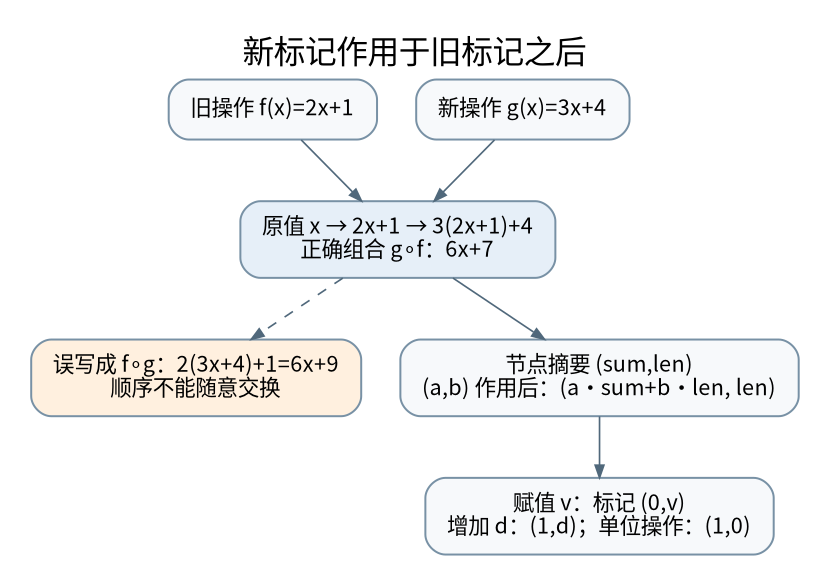

# 懒标记不是延迟更新的借口：区间摘要与函数复合

> **本页要解决**：区间赋值和区间增加同时存在时，标记到底怎样合成？
>
> **先修**：[[计算机知识/50-数据结构与算法/10-数据结构系统课程/05-区间聚合Fenwick与线段树|区间聚合、Fenwick 与线段树：摘要必须满足代数条件]]。
>
> **阅读入口**：[[计算机知识/50-数据结构与算法/10-数据结构系统课程/00-数据结构系统课程索引|本学科主索引]] · [[计算机知识/00-开始/全局导航/11-难点导读与研究证据|全局难点导读]]。

**版本、模型与证据边界**：区间默认左闭右开；教学实现强调不变量、边界与独立参照，不声称性能达到生产库水平。

## 为什么“给结点打个标记”不是解释

区间查询结构存的不是整段数据的完整历史，而是足以回答指定问题的摘要。对区间求和，摘要可写为 `(sum, length)`；两段合并为 `(sum1+sum2, length1+length2)`。空段为 `(0,0)`。加法的结合律保证分段方式不影响结果，但这并不意味着任意修改都能只用一个 sum 更新。[^acl]

例如区间每个元素增加 b，新和为 `sum+b*length`，必须知道长度。区间每个元素平方，则原和与长度通常不够：`[1,3]` 和 `[2,2]` 和相同，平方和却分别为 10 和 8。要么扩充摘要，要么接受这种操作不能按当前摘要懒更新。

## 用仿射函数统一增加、乘法与赋值

把单元素更新表示为 $f(x)=ax+b$。增加 d 是 `(a,b)=(1,d)`，乘以 k 是 `(k,0)`，赋值为 c 是 `(0,c)`。摘要映射为

$$
\operatorname{map}((a,b),(s,n))=(as+bn,n).
$$

旧标记 $g(x)=cx+d$ 已待执行，再来新标记 $f(x)=ax+b$。真实时序是先 g 再 f，因此

$$
(f\circ g)(x)=a(cx+d)+b=(ac)x+(ad+b).
$$

本课约定 `compose(new, old)` 返回 `new ∘ old`。其他库可能用不同参数顺序，不能只凭函数名照搬。AtCoder 的 lazysegtree 接口同样将 `composition(f,g)` 定义为 f 在 g 之后作用，核对接口比记一个模板更重要。[^acl]



[矢量图](../../_assets/diagrams/round4/lazy-compose.svg) · [可编辑图源](../../_assets/diagrams/round4/lazy-compose.dot)

“赋值 5 然后加 3”形成 `(0,8)`；“加 3 然后赋值 5”形成 `(0,5)`。交换律在这里不成立。许多只测试纯加法的代码会隐藏复合顺序错误，因为加法恰好可交换。

## 三条不变量决定 push 与 pull 的位置

结点的 sum 总是已经包含其自身标记的影响。标记描述“对该结点后代尚未展开的变换”，不是描述结点 sum 还没算的工作。访问部分子区间前先 push，把旧标记作用到左右孩子并合成它们的标记；之后清空父标记。修改孩子后再 pull，用孩子最新 sum 更新父结点。

如果完整覆盖结点，就直接更新 sum 与标记，不向下展开。这样一次连续区间操作只沿边界展开 $O(\log n)$ 层，而不是每次走到所有叶子。这里的复杂度按定长算术操作计数；Python 大整数不断增大时，单次乘加的位复杂度不是常数。

## 完整的半开区间实现

以下实现支持空数组和空区间，区间统一为 `[left,right)`。超出边界明确抛错；不把非法区间默默裁剪成另一个问题。

```python
class AffineSumTree:
    def __init__(self, values):
        self.n = len(values)
        size = max(1, 4 * self.n)
        self.total = [0] * size
        self.tag = [(1, 0)] * size
        if self.n:
            self._build(1, 0, self.n, values)

    def _build(self, node, lo, hi, values):
        if hi - lo == 1:
            self.total[node] = values[lo]
            return
        mid = (lo + hi) // 2
        self._build(node * 2, lo, mid, values)
        self._build(node * 2 + 1, mid, hi, values)
        self._pull(node)

    def _pull(self, node):
        self.total[node] = self.total[node * 2] + self.total[node * 2 + 1]

    def _apply(self, node, length, a, b):
        self.total[node] = a * self.total[node] + b * length
        c, d = self.tag[node]
        self.tag[node] = (a * c, a * d + b)

    def _push(self, node, lo, hi):
        a, b = self.tag[node]
        if hi - lo > 1 and (a, b) != (1, 0):
            mid = (lo + hi) // 2
            self._apply(node * 2, mid - lo, a, b)
            self._apply(node * 2 + 1, hi - mid, a, b)
        self.tag[node] = (1, 0)

    def _check(self, left, right):
        if not (0 <= left <= right <= self.n):
            raise ValueError("invalid half-open interval")

    def update(self, left, right, a, b):
        self._check(left, right)
        if left < right:
            self._update(1, 0, self.n, left, right, a, b)

    def _update(self, node, lo, hi, left, right, a, b):
        if right <= lo or hi <= left:
            return
        if left <= lo and hi <= right:
            self._apply(node, hi - lo, a, b)
            return
        self._push(node, lo, hi)
        mid = (lo + hi) // 2
        self._update(node * 2, lo, mid, left, right, a, b)
        self._update(node * 2 + 1, mid, hi, left, right, a, b)
        self._pull(node)

    def query(self, left, right):
        self._check(left, right)
        if left == right:
            return 0
        return self._query(1, 0, self.n, left, right)

    def _query(self, node, lo, hi, left, right):
        if right <= lo or hi <= left:
            return 0
        if left <= lo and hi <= right:
            return self.total[node]
        self._push(node, lo, hi)
        mid = (lo + hi) // 2
        return (self._query(node * 2, lo, mid, left, right)
                + self._query(node * 2 + 1, mid, hi, left, right))
```

从 `[1,2,3,4]` 出发，先给 `[1,4)` 加 2，得到 `[1,4,5,6]`；再把 `[0,3)` 设为 5，得到 `[5,5,5,6]`；再把 `[2,4)` 乘以 -1，得到 `[5,5,-5,-6]`，全和为 -1。负乘数对 sum 没问题，但对“只存最大值”的摘要就不够，因为最大值会来自原最小值。摘要的充分性需要重新证明。

## 从代数性质生成测试，而不是只试几个答案

验证 `map(f, merge(x,y)) == merge(map(f,x),map(f,y))`，验证复合结合律，验证恒等标记 `(1,0)`，再用随机小数组和直接循环逐步比较。测试要混合赋值、负数乘法、加法、重叠区间、单元素与空区间。固定随机种子保证失败可复现，但随机通过不能代替不变量证明。

本轮实验运行上述完整实现，并用朴素数组作为独立基准。这种“先证明摘要足够，再证明状态迁移”也适用于 [[计算机知识/50-数据结构与算法/20-算法设计系统课程/09-动态规划状态充分性与优化前提|动态规划的状态设计]] 和 [[计算机知识/70-编译原理/10-系统课程/10-活跃性不动点与抽象解释|抽象解释的抽象域]]。

**自测**：原 sum=12，长度=3，先乘 2 再加 4，新和为什么是 36 而不是 28？因为加法作用到三个元素，总共增加 12，而不是给整个区间只加一次 4。

[^acl]: AtCoder Library 官方 [Lazy Segtree](https://atcoder.github.io/ac-library/production/document_en/lazysegtree.html)，摘要幺半群、映射兼容性和函数复合合同。上面的代码、数值例子与测试为本库独立实现。

## 知识连接：下一步应追问什么

函数复合的方向、不变量的充分性与区间摘要的代价是接下来比较的三个问题。

[[计算机知识/50-数据结构与算法/20-算法设计系统课程/09-动态规划状态充分性与优化前提|动态规划最难的不是转移式：状态充分性、顺序与优化前提]]：为什么相同的转移式，正序与倒序得到不同问题的答案？

[[计算机知识/50-数据结构与算法/10-数据结构系统课程/10-可持久化结构与回滚并查集|保存历史的两种办法：路径复制与回滚并查集]]：为什么可持久化不等于落盘，回滚也不能照搬路径压缩？

[[计算机知识/55-数据库/10-系统课程/11-连接基数索引选择与优化器误估|执行计划为什么选错：连接基数、索引代价与统计相关性]]：有索引却走全表扫描，是优化器失灵还是更便宜？

## 本地核验与阅读顺序

[[计算机知识/_labs/round4/README|本轮实验：命令、检查范围与未执行项目]] 提供对应文件和记录。[[计算机知识/90-资源/维护/导入-com/_meta/round4/01-研究证据与版本边界|研究证据索引]] 区分规范、推演和实验；[[计算机知识/90-资源/维护/导入-com/_meta/round4/02-缺口回查与后续验证|仍需进一步验证的边界]] 不把概览或模型标成完整实现。

先完成主干，再按问题选择专题；不要求跳过第 1–8 讲。 下一专题：[[计算机知识/50-数据结构与算法/10-数据结构系统课程/10-可持久化结构与回滚并查集|保存历史的两种办法：路径复制与回滚并查集]]。
