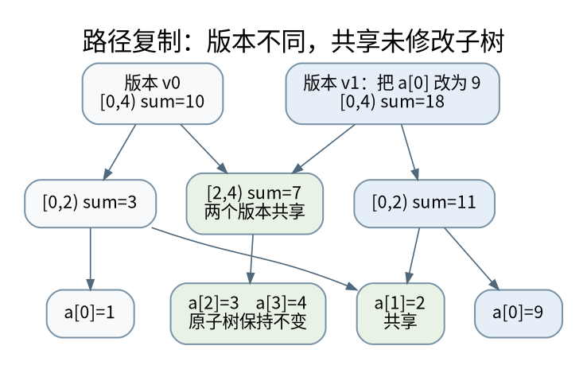

# 保存历史的两种办法：路径复制与回滚并查集

> **本页要解决**：为什么可持久化不等于落盘，回滚也不能照搬路径压缩？
>
> **先修**：[[计算机知识/50-数据结构与算法/10-数据结构系统课程/04-多路树外存与持久化|多路树、外存与持久化：一次访问尽量带回更多信息]]；[[计算机知识/50-数据结构与算法/10-数据结构系统课程/07-图表示并查集与动态关系|图表示、并查集与动态关系：表达方式决定可支持的操作]]。
>
> **阅读入口**：[[计算机知识/50-数据结构与算法/10-数据结构系统课程/00-数据结构系统课程索引|本学科主索引]] · [[计算机知识/00-开始/全局导航/11-难点导读与研究证据|全局难点导读]]。

**版本、模型与证据边界**：区间默认左闭右开；教学实现强调不变量、边界与独立参照，不声称性能达到生产库水平。

## “持久化”在两门课里不是同一个词

数据结构中的 persistence 指更新后仍能访问旧版本，不承诺磁盘保存、断电恢复或跨进程可见。数据库的 durability 才讨论已确认数据在所选故障模型中的持久性。内存里的可持久化树可以在进程退出时全部消失。先分清这两个词，才能正确连接 [[计算机知识/20-操作系统/02-操作系统原理/10-系统课程/11-崩溃一致性与恢复状态机|崩溃一致性]]。[^persistent]

只允许在最新版本上更新、旧版可读叫部分可持久化；允许基于任意历史版本继续分叉叫完全可持久化；合并历史分支又是更强的要求。回滚结构则通常在一次深度优先遍历中维护当前状态，通过撤销回到某个祖先，不默认让所有版本同时随机访问。

## 路径复制：复制变化的路线，共享不变的子树

取长度 8 的区间和树。修改下标 2，只影响叶子 `[2,3)`，以及 `[2,4)`、`[0,4)`、`[0,8)`。创建这四个新结点，其余子树仍指向旧结点。新根指向新的版本，旧根没有被改写。



[矢量图](../../_assets/diagrams/round4/persistent-roots.svg) · [可编辑图源](../../_assets/diagrams/round4/persistent-roots.dot)

树高为 $O(\log n)$，一次单点更新新增 $O(\log n)$ 个结点，查询仍为 $O(\log n)$。m 次更新的总结点量为 $O(n+m\log n)$。这个界要求每次只做单点变化且结点大小有界；对整个子树深拷贝就丢失这个优势。

为什么历史值不会变？归纳地假定旧结点不可变；更新函数只新建经过的结点，所有共享边指向不可变对象，因此不会沿旧根观察到修改。若结点内部还存着一份可变列表，并偷偷原地改它，外部“根不可变”并不足以保证整个图不可变。

## 版本差分什么时候有意义

主席树常将前缀插入频数构成版本 $R_i$。区间 `[l,r)` 的频数可由 $R_r-R_l$ 的计数差得到，沿值域二分寻找第 k 小。它依赖前缀版本的可加性和非负区间频数，并不意味着任意两棵共享树都能直接相减。

比如保存的是区间最小值，两个版本的最小值之差不代表区间元素差的最小值。历史访问是一种结构能力，差分查询还需要摘要满足额外代数关系。

历史版本不用后要如何回收？垃圾收集可以跟踪根可达性；手动内存管理可用引用计数、区域分配或版本批量释放。共享结构下直接释放“旧版本所有结点”会破坏新版本正在共享的子树。并发读者又引入 [[计算机知识/10-编程语言/02-C++/10-系统课程/11-原子发布线性化与回收边界|内存回收]] 的生命周期问题。

## 回滚并查集：把每次真正的修改记在栈里

普通并查集的路径压缩会在 find 中改动很多父指针。回滚不是绝对不能使用路径压缩，而是必须记录并恢复每次改动，并重新证明摊还复杂度。最常见、易证明的回滚版本只按大小合并、不压缩路径。

每次将较小树根接到较大树根下，被挂接结点所属集合的大小至少翻倍，因此任一根路径长度不超过 $O(\log n)$。一次 union 最多改一根父指针和一个大小值，容易撤销。

```python
class RollbackDSU:
    def __init__(self, n):
        if n < 0:
            raise ValueError("negative size")
        self.parent = list(range(n))
        self.size = [1] * n
        self.history = []

    def find(self, x):
        if not 0 <= x < len(self.parent):
            raise IndexError(x)
        while self.parent[x] != x:
            x = self.parent[x]
        return x

    def snapshot(self):
        return len(self.history)

    def union(self, a, b):
        a, b = self.find(a), self.find(b)
        if a == b:
            return False
        if self.size[a] < self.size[b]:
            a, b = b, a
        self.history.append((b, a, self.size[a]))
        self.parent[b] = a
        self.size[a] += self.size[b]
        return True

    def rollback(self, mark):
        if not 0 <= mark <= len(self.history):
            raise ValueError("invalid snapshot")
        while len(self.history) > mark:
            child, root, old_size = self.history.pop()
            self.parent[child] = child
            self.size[root] = old_size
```

snapshot 是当前撤销栈的长度，只适合对应这条当前历史路径的标记。回滚后再走另一分支，旧标记数字不携带版本身份；即使数字合法，也不能拿来任意寻回已丢弃的历史。这里不为“已经连通的 union”写日志，因为 rollback 的单位是栈长度，不是“撤销多少次函数调用”。

## 离线动态连通性：把删除变成离开时间区间

边 e 在操作时刻 `[start,end)` 有效，就把它放入覆盖这段时间的线段树结点。深度优先遍历时间树时：记录 snapshot，加入此结点的边，递归或回答叶子的连通性问题，最后 rollback。

例如边 `(0,1)` 在 `[1,4)`，`(1,2)` 在 `[2,5)`，那么时刻 2 与 3 的 0、2 连通；时刻 4 已不连通。每条有效区间被分解到 $O(\log q)$ 个时间结点，结合按大小合并的 find，总工作量通常为 $O((k\log q+q)\log n)$ 的上界，其中 k 是有效区间数，q 是操作时刻数。查询和建树的具体计数应单独说明。

重复加入同一条边时，要定义集合还是多重集合语义。若采用引用计数，则第一次加入到最后一次删除之间才是一个有效区间；随手用一个字典覆盖 start 会丢失真实历史。在线立即回答、未知未来删除的问题则不能直接使用这套离线安排。

## 和其他层的联系

路径复制、OS 写时复制、数据库 MVCC 都利用“读者继续看旧状态，写者生成新状态”，但粒度与回收条件不同。OS 的单位通常为页且要更新权限和 TLB；数据库版本要服从事务可见性；树结点版本遵守根可达性。共享比喻帮助理解，不能替代各自正确性合同。参见 [[计算机知识/20-操作系统/02-操作系统原理/10-系统课程/09-页表写时复制与TLB失效|页的写时复制]] 与 [[计算机知识/55-数据库/10-系统课程/10-MVCC快照写偏斜与重试协议|事务快照]]。

本轮实验测试从旧根分叉更新不改变兄弟版本、随机区间和、并查集嵌套快照、冗余 union 和回滚后的连通性。它验证的是内存版本语义，不执行落盘持久化。

[^persistent]: MIT 6.851，Erik Demaine 的 [Persistent Data Structures](https://ocw.mit.edu/courses/6-851-advanced-data-structures-spring-2012/resources/session-1-persistent-data-structures/)，区分 partial、full 和 confluent persistence。路径复制及回滚示例在本文独立推导并附实验。

## 知识连接：下一步应追问什么

历史版本共享的是旧值；内存管理、快照可见性与掉电持久性仍是不同问题。

[[计算机知识/50-数据结构与算法/10-数据结构系统课程/09-懒标记的代数与完整实现|懒标记不是延迟更新的借口：区间摘要与函数复合]]：区间赋值和区间增加同时存在时，标记到底怎样合成？

[[计算机知识/20-操作系统/02-操作系统原理/10-系统课程/09-页表写时复制与TLB失效|一张页经历了什么：多级页表、写时复制与 TLB 失效]]：fork 后父子都能读同一页，写入时为什么不互相污染？

[[计算机知识/55-数据库/10-系统课程/10-MVCC快照写偏斜与重试协议|两个事务各自正确，合起来为何错误：快照、写偏斜与重试]]：可重复读为什么仍可能让两个值班医生同时离岗？

[[计算机知识/20-操作系统/02-操作系统原理/10-系统课程/11-崩溃一致性与恢复状态机|断电发生在任意一步：文件替换与崩溃状态机]]：rename 成功以后，断电重启一定还能看到新文件吗？

## 本地核验与阅读顺序

[[计算机知识/_labs/round4/README|本轮实验：命令、检查范围与未执行项目]] 提供对应文件和记录。[[计算机知识/90-资源/维护/导入-com/_meta/round4/01-研究证据与版本边界|研究证据索引]] 区分规范、推演和实验；[[计算机知识/90-资源/维护/导入-com/_meta/round4/02-缺口回查与后续验证|仍需进一步验证的边界]] 不把概览或模型标成完整实现。

上一专题：[[计算机知识/50-数据结构与算法/10-数据结构系统课程/09-懒标记的代数与完整实现|懒标记不是延迟更新的借口：区间摘要与函数复合]]。 下一专题：[[计算机知识/50-数据结构与算法/10-数据结构系统课程/11-字符串索引LCP与自动机状态|字符串索引的隐藏状态：前缀函数、失败边与 LCP]]。
