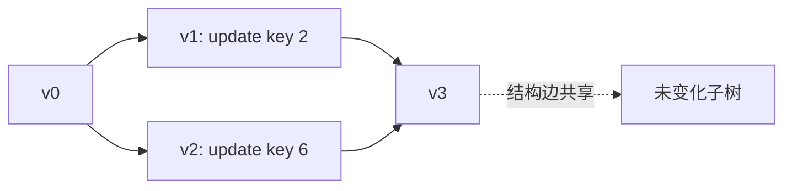

# 从版本树到版本 DAG：持久化结构怎样保存历史

> **本页要解决**：保留旧版本时，路径复制、fat node、完全持久化与合流持久化分别承诺什么？为什么一个只对线性操作历史成立的摊还证明，不能直接搬到任意版本分叉？
>
> **先修**：[[计算机知识/50-数据结构与算法/10-数据结构系统课程/10-可持久化结构与回滚并查集|先在这里掌握路径复制、旧根共享与回滚并查集]]。本页不重复其代码和离线动态连通实验。

## 两种“历史”先分开

数据结构的 persistence 指旧版本仍可查询；数据库 durability 指在指定故障模型下，确认写入在重启后仍存在。内存里的完全持久化树可以在进程退出时全部消失。一个落盘的可变 B 树也可以没有历史版本。两者都翻译成“持久化”时，必须在句子里补上版本或故障语义。

版本关系也有层级：

| 模型 | 可查询 | 可从哪里更新 | 版本图 |
| --- | --- | --- | --- |
| ephemeral | 仅当前版本 | 当前版本 | 一条被覆盖的状态 |
| partial persistence | 所有旧版本 | 仅最新版本 | 一条版本链 |
| full persistence | 所有版本 | 任意版本 | 版本树 |
| confluent persistence | 所有版本 | 还可合并多个版本 | 版本 DAG |

合流不是把两棵树的根随手连在一起。键冲突、共享结点身份、重复路径和后续回收都需要新的语义；版本 DAG 还可能使“版本大小”与“新建结点数”的关系更难计数。

## 路径复制的证明单位是可达对象图

在平衡 BST 中更新一个键，只新建从根到目标的路径，其他子树共享。若树高为 $h$，一次单点更新新增 $O(h)$ 个结点；平衡保证给出 $h=O(\log n)$。旧版本不变依赖两个条件：旧结点本身不可修改；结点内部引用的对象也遵守同样的不变协议。

手算一棵键为 `1..7` 的完全 BST，根为 4。从 `v0` 把键 2 的值改为 `x`：新建 4、2 两个结点，键 1、3 与根 6 的整棵右子树共享。从 `v0` 再把键 6 改为 `y` 得到 `v2`：这次新建 4、6。于是 `v1` 和 `v2` 有不同新根，却都共享未改变叶子。

| 版本 | 新建结点 | 必须仍能读到 |
| --- | --- | --- |
| `v0` | 初始 7 个 | 原始全部值 |
| `v1` | 根 4、结点 2 | 仅键 2 为 `x` |
| `v2` | 根 4、结点 6 | 仅键 6 为 `y` |

若共享叶子内部藏着可变列表，并在 `v1` 中原地追加，`v0/v2` 都可能观察到变化。根对象不可变并不足以证明整个可达对象图不可变。

## fat node 与路径复制交换了什么

fat node 把字段的历史修改记录保存在原结点旁，查询某版本时按版本号选择值。它减少部分结构复制，却增加查询解释、版本索引和结点溢出处理。路径复制让每个版本的普通查询更直接，却会新建路径结点。两者都需要明确：版本标识如何排序、每个字段能积累多少修改、引用从哪个版本解析。

## 为什么旧摊还证明可能失效

线性历史中的势能常把一次昂贵工作收费给后续操作。完全持久化允许用户反复从同一“信用很高”的旧版本分叉；若每条分支都再次花同一份历史信用，原总账可能重复报销。

例：假设某结构经过一串便宜操作积累势能，再执行一次昂贵整理。线性历史只会整理一次；若旧版本仍可作为十个分支的父版本，每个分支都触发同一整理，则总实际成本是十倍，而把父版本势能直接复制到各分支会把同一信用也复制十份。正确分析需规定版本访问模型，或选择对持久化执行图仍成立的势能/时间界。

> [!warning] “每次更新复制 $O(\log n)$ 个结点”是逐操作最坏界时可直接沿分支使用；依赖整段线性历史的摊还界则需重新证明。

## 回收是正确性的一部分

一个结点只有在从所有活版本根都不可达时才可回收。引用计数能处理普通 DAG，但循环或并发读取需要额外协议；追踪 GC、epoch、hazard pointer 或区域批量释放各有不同前提。删除“旧版本的所有结点”会误删新版本仍共享的子树。

## 成本口径与关系导航

令 `n` 为当前版本的键数、`h` 为树高；在指针读写与结点复制各计常数的 RAM 模型中，一次路径复制更新用 `O(h)` 时间和新结点，平衡树才进一步得到 `O(log n)`。该口径不含分配器停顿、回收扫描和跨版本合流去重。

- **先修**：[[计算机知识/50-数据结构与算法/10-数据结构系统课程/04-多路树外存与持久化|多路树、外存与持久化]]。
- **主解释**：[[计算机知识/50-数据结构与算法/10-数据结构系统课程/10-可持久化结构与回滚并查集|可持久化结构与回滚并查集]]仍负责路径复制与回滚的完整实现。
- **应用**：[[计算机知识/20-操作系统/02-操作系统原理/10-系统课程/09-页表写时复制与TLB失效|页表写时复制]]、[[计算机知识/55-数据库/10-系统课程/10-MVCC快照写偏斜与重试协议|MVCC 快照]]。
- **反例与边界**：[[计算机知识/50-数据结构与算法/21-动态结构不变量与摊还分析推演|摊还分析推演]]说明线性历史势能为何不能自动复制到版本树。

## 可检查性质与反例

1. 在 `v0` 上分叉出 `v1/v2` 后，继续更新 `v1` 不改变 `v0/v2` 的中序键值序列。
2. 单点路径复制的新建结点数不超过树高加一个新根常数；对不平衡树不能直接写 $O(\log n)$。
3. 活根可达性 oracle 计算全部仍在用的结点，回收集合必须与其不相交。
4. 任意两个版本的摘要不能普遍“相减”；只有摘要与版本构造具备相应代数关系时，主席树式差分才成立。

最小失败例：`v0` 与 `v1` 共享叶结点 `L`，在 `v1` 中原地写 `L.value=9`，随后 `v0` 也读到 9。这推翻“只要根不同，版本就隔离”。

## 来源与证据边界

- [MIT 6.851 Session 1：Persistent Data Structures](https://ocw.mit.edu/courses/6-851-advanced-data-structures-spring-2012/resources/session-1-persistent-data-structures/)：本批实际打开；页面明确区分 partial、full 与 confluent persistence，并由 Erik Demaine 主讲。
- Driscoll, Sarnak, Sleator, Tarjan, “Making Data Structures Persistent”, *Journal of Computer and System Sciences* 38(1), 1989, DOI `10.1016/0022-0000(89)90034-2`：原始论文检索锚点；候选中的分类与证明边界以 MIT 讲次交叉核对，不声称本批逐页读取付费版本。
- [[计算机知识/20-操作系统/02-操作系统原理/10-系统课程/09-页表写时复制与TLB失效|OS 写时复制]] 与 [[计算机知识/55-数据库/10-系统课程/10-MVCC快照写偏斜与重试协议|数据库 MVCC]] 共享“旧读者继续看旧状态”的直觉，但粒度、可见性与回收合同不同。

## 练习

画出上述 `v0/v1/v2` 的对象图并数新建结点；给每个结点标活根可达集合。再设计一个会让“复制势能”重复报销的版本分叉序列，说明原摊还证明缺了哪个量词。

返回 [[计算机知识/50-数据结构与算法/10-数据结构系统课程/00-数据结构系统课程索引|数据结构系统课程索引]]。
