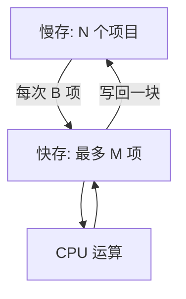
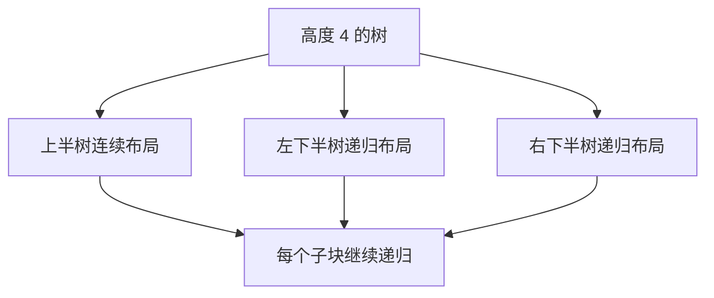

# 比较很少，搬运仍可能很贵：外存下界与缓存无关布局

> **本页要解决**：当数据远大于快存时，怎样用块传输而非 RAM 指令计费？为什么缓存无关算法虽然不把 `B,M` 写进代码，结论仍依赖缓存模型？
>
> **先修**：[[计算机知识/50-数据结构与算法/18-外存模型分块缓存感知与页式索引|先掌握 N、B、M、外排与页式索引]]；[[计算机知识/50-数据结构与算法/10-数据结构系统课程/04-多路树外存与持久化|再区分 B/B+ 树、LSM 与版本持久化]]。本页不重复 B+ 树分裂。

## 模型把“搬一块”当作一步

两层 I/O 模型用：数据项数 $N$、每块项目数 $B$、快存可容纳项目数 $M$。计算只能处理快存中的项；慢存与快存之间一次移动连续一块，计 1 次 I/O。CPU 比较、真实毫秒、并发排队和设备内部行为暂不计入这个模型。

只要算法必须查看全部 $N$ 项，哪怕块内计算免费，也至少要搬 `ceil(N/B)` 个含数据块；顺序扫描因此是 $\Theta(N/B)$ I/O。这个结论不提供毫秒：同样一次“块读”可能命中页缓存，也可能触发真实设备读取。

## 外排为何要做多路归并

先每次读入 $M$ 项，在内存排序并写成 run，可得约 `ceil(N/M)` 条有序 run。归并时每条输入 run 至少需要一个输入块缓冲，再留一个输出块缓冲；若快存共有 `floor(M/B)` 个块位，朴素实现的 fan-in 至多 `floor(M/B)-1`。每一轮读写全体数据是 $\Theta(N/B)$ I/O；在 `M/B` 足够大时，渐近轮数量级常写成 $\log_{M/B}(N/B)$，具体小例必须按实际缓冲块数取整。

手算 `N=32,B=4,M=12`：初始生成 3 条长度至多 12 的 run。快存有 3 个块位，扣掉输出缓冲后可做 2 路归并；第一轮把 3 条 run 变成 2 条（长度至多 24 与 8），第二轮变成 1 条。若误按 RAM 模型只数比较，就看不见每轮都要搬完整数据。

| 阶段 | run 数 | 每条长度 | 全量读写的块量级 |
| --- | ---: | ---: | ---: |
| run 生成 | 3 | ≤12 | 8 读 + 8 写 |
| 归并 1 | 2 | ≤24 | 8 读 + 8 写 |
| 归并 2 | 1 | 32 | 8 读 + 8 写 |

表格忽略输出缓冲刷新细节和最后一块未满，只用于核对轮数与量级。

## 缓存无关不是“没有缓存”

缓存感知算法显式按某个 `B,M` 分块。缓存无关算法不把具体参数写进算法或布局，而用递归分解同时产生多种尺度的局部性；分析仍在带块大小和快存容量的理想缓存模型中进行，常带最优替换和 tall-cache 一类前提。

完全二叉树的层序布局把同层结点放一起，根到叶路径会跨多个远处分段。van Emde Boas 式递归布局把上半树与各下半子树递归连续放置，使任意合适块尺度都能捕获一些完整子树。它改善的是某种访问模式下的块局部性，不改变 BST 的键序、不自动降低比较次数。

## 下界必须绑定模型

比较外排的经典 I/O 下界依赖不可分割记录、块传输和快存容量等假设。允许压缩、利用小整数键域、已有部分顺序或不同并行设备时，问题的信息与操作能力变了，结论需重述。`Ω(N log N)` 的 RAM 比较下界也不能直接替代 I/O 下界。

## 可检查性质与最小反例

1. 块模拟器把地址 `i` 映射为 `floor(i/B)`；固定访问序列的不同块数可精确复算。
2. 对 `N=32,B=4,M=12`，顺序扫描恰触及 8 个数据块；若报告 32 次 I/O，就是把项目访问与块传输混了。
3. 外排每轮的 run 数应为上轮 run 数除以实际 fan-in 后向上取整；缓冲不够时不能宣称任意高路归并。
4. 同一棵树比较层序与递归布局时，查询键与比较器必须相同；只改变布局，查询答案应逐项一致。

反例：数组中二分只做 $O(\log N)$ 次比较，但若每次中点都在不同冷页，I/O 仍可能接近比较次数；“比较少”没有推出“一次页读”。反过来，一块内顺序比较多个键可能有更多比较，却只需一次块传输。

## 常见错误说法

- cache-oblivious 不是忽略缓存，而是不把具体层级参数硬编码进算法。
- `O(log N)` 比较不等于 `O(1)` I/O。
- 页读更少是模型证据，不是端到端延迟、安全性或崩溃一致性证明。
- 扇出不能只用页大小除固定键长：页头、指针、变长编码与填充率都会改变容量。

## 关系导航

- **先修**：[[计算机知识/50-数据结构与算法/18-外存模型分块缓存感知与页式索引|外存模型、分块与页式索引]]。
- **主解释**：[[计算机知识/50-数据结构与算法/10-数据结构系统课程/04-多路树外存与持久化|多路树、外存与持久化]]仍负责 B/B+ 树与 LSM 的主体机制。
- **应用**：[[计算机知识/30-计算机系统/04-缓存局部性带宽与延迟|缓存、局部性、带宽与延迟]]把块模型连接到实际层级。
- **反例与边界**：[[计算机知识/50-数据结构与算法/23-正确性证明反例与复杂度边界|证明与复杂度边界]]用于检查比较模型与 I/O 模型是否被偷换。

## 来源与证据边界

- [MIT 6.851 Session 7：Memory Hierarchy Models](https://ocw.mit.edu/courses/6-851-advanced-data-structures-spring-2012/resources/session-7-memory-hierarchy-models/) 与 [Session 8：Cache-Oblivious Structures I](https://ocw.mit.edu/courses/6-851-advanced-data-structures-spring-2012/resources/session-8-cache-oblivious-structures-i/)：本批实际打开课程视频索引并核对这两个讲次标题和入口。
- Aggarwal & Vitter, “The Input/Output Complexity of Sorting and Related Problems”, *Communications of the ACM* 31(9), 1988, DOI `10.1145/48529.48535`：外存排序/相关问题下界的原始论文检索锚点。
- Frigo, Leiserson, Prokop, Ramachandran, “Cache-Oblivious Algorithms”, FOCS 1999, DOI `10.1109/SFFCS.1999.814600`：缓存无关模型的原始论文检索锚点。

原始论文全文未在本批成功提取，候选只采用课程讲次与当前页明确写出的教学模型；若将精确最优下界公式写入正式正文，发布前应由审阅者对原文定理的模型条件逐项签收。

## 练习

对 `N=64,B=8,M=24` 重算 run 生成、`floor(M/B)-1` fan-in 和轮数。再给 15 结点完全树编号，分别写层序与递归布局的地址序列，用 `B=2` 和 `B=4` 计算同一根到叶路径触及多少块；答案不变而块数可变，才说明你分开了语义与布局成本。

返回 [[计算机知识/50-数据结构与算法/10-数据结构系统课程/00-数据结构系统课程索引|数据结构系统课程索引]]。
