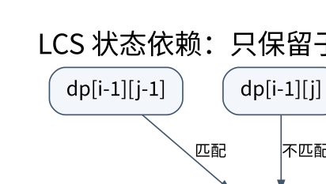

# 动态规划状态设计与优化：状态必须保留未来需要的信息

> **学习位置**：[[计算机知识/00-开始/课程地图/11-算法设计-课程地图|算法设计课程地图]] · **适用边界**：先给问题规格和前提，再证明和分析复杂度。

## 为什么只记“当前最好”有时不够

动态规划把具有相同未来决策条件的历史合并为一个状态。状态不足会把未来不同的历史误合并，状态过多则浪费时间和空间。设计时先用一句自然语言说明每个状态的精确含义，再写转移、初值、计算顺序和答案位置。

### 沿同一组区间保留选与不选

先接住[[计算机知识/50-数据结构与算法/20-算法设计系统课程/03-贪心交换论证与结构条件#给条件一个反例|上一讲的加权区间反例]]：A=$[0,2),w=2$，B=$[2,4),w=2$，C=$[0,4),w=5$。目标是在互不冲突的区间中最大化总权重，允许一个也不选；区间仍是正长度的半开区间，端点相接算相容。最早结束规则选择 A+B 得到 4，这次要保留单选 C 得到 5 的可能。

把 $n$ 个区间按结束时间 $f_j$ 非降序编号，结束时间并列时按输入顺序，所以本例 $j=1,2,3$ 分别是 A、B、C。令 $s_j$ 为开始时间，$w_j$ 为权重，定义：

$$
p(j)=\max\{i:1\le i<j,\ f_i\le s_j\},
$$

没有这样的 $i$ 时取 $p(j)=0$。它是编号在 $j$ 之前、最后一个能在 $j$ 开始前结束的区间的**索引**，不是最终方案中必选的上一段。结束时间已经排序，因此能放在 $j$ 前面的区间恰好构成前缀 $1,\ldots,p(j)$。正长度条件 $s_j<f_j$ 也保证相容前驱的结束时间严格小于 $f_j$；同结束时间的 B、C 不能互为前驱。并列次序固定了表格编号与复现方式，换一种固定并列次序也不改变最优值。

令 $dp[j]$ 表示**只允许使用前 $j$ 个区间时，互相相容的方案能取得的最大总权重**。这里 $j$ 是候选前缀的边界，不表示一定选了第 $j$ 个区间。空前缀 $dp[0]=0$；考察任一最优方案是否包含 $j$：

- 不包含 $j$：它只能使用前 $j-1$ 个区间，最佳值为 $dp[j-1]$。
- 包含 $j$：先前选的区间全部落在前缀 $1,\ldots,p(j)$，最佳总值为 $w_j+dp[p(j)]$。这个前缀中的任何相容方案也都能接上 $j$，因此该候选确实可行。

两类覆盖所有方案，于是

$$
dp[j]=\max\bigl(dp[j-1],\ w_j+dp[p(j)]\bigr),\qquad j=1,\ldots,n.
$$

如果包含 $j$ 的方案在前缀 $p(j)$ 内没有取到最优值，就可以把其中那部分换成更好的前缀方案，仍不与 $j$ 冲突；这正是转移可以复用 $dp[p(j)]$ 的理由。我们无需保留此前所有选择历史，但必须保留各个前缀的最优值，才能按相容边界取用。

按 $j$ 从小到大计算，因为 $p(j)<j$，每一格只读已经算好的格；最终答案是 $dp[n]$。本例 $p(1)=0$、$p(2)=1$、$p(3)=0$，逐格得到：

| $j$ / 当前区间 | $p(j)$ | 不选：$dp[j-1]$ | 选：$w_j+dp[p(j)]$ | $dp[j]$ | 本格较优分支 |
| --- | --- | --- | --- | --- | --- |
| 0 / 空前缀 | — | — | — | 0 | 空方案 |
| 1 / A | 0 | 0 | $2+0=2$ | 2 | 选 A |
| 2 / B | 1 | 2 | $2+2=4$ | 4 | 选 B，接前缀 1 |
| 3 / C | 0 | 4 | $5+0=5$ | 5 | 选 C，接空前缀 |

表里前两格曾经选择 A、B，不等于它们已经被写入最终方案。**恢复方案**从 $j=n$ 往回走：若选的候选严格大于不选的候选，记录区间 $j$ 并跳到 $p(j)$；否则跳到 $j-1$，到 0 停止。两候选相等时这里约定走“不选”分支，仍可得到一个最优方案。本例在 $j=3$ 比较 $5>4$，记录 C，跳到 0，最终方案就是 C，总权重 5。若恢复出多段，按时间正序输出。

推广到 $n$ 个区间时，排序和对有序结束时间二分查找所有 $p(j)$ 共需 $O(n\log n)$ 时间；只在 $1,\ldots,j-1$ 内查找满足 $f_i\le s_j$ 的最后位置。前驱已知后的填表和恢复均为 $O(n)$ 时间，保留 $p$ 与 $dp$ 数组需 $O(n)$ 空间。比起本例一眼可见的三段比较，这份摘要能把大量重复的前缀选择合并起来。

### 撤去提示后改变一个权重

保持 A、B、C 的时间、顺序和 A、B 的权重，只把 C 的权重从 5 改为 3。先遮住上表，自行写出各个 $p(j)$、$dp[j]$ 并恢复方案；再说明，为什么改变权重不需要重新计算相容前驱？

> **核对答案**：相容关系只取决于时间，故 $p$ 仍为 $(0,1,0)$；$dp$ 含空前缀为 $(0,2,4,4)$。从 $j=3$ 比较“选 C 的 3”和“不选 C 的 4”，先跳到 2；在 $j=2$ 记录 B 并跳到 1，在 $j=1$ 记录 A 并跳到 0，正序输出 A+B，总权重 4。原先的 C 方案仍可行，只是不再最优。这个变式中贪心恰好也得到 4，不能据此恢复它对任意权重的正确性保证。

这组区间也可以解释为同一间会议室的预约：占用时间不重叠，权重代表预约收益。若问题只是改了叙述，$dp[j]$ 仍是“前 $j$ 个预约中的最大总收益”，无需换状态；若允许两间会议室同时使用，前面的单条时间链条件就变了，必须重新论证状态和转移。

现在可以停下来复述：结束时间排序提供可查询的相容前缀，选与不选提供穷尽的方案划分，回溯把最优值还原成具体区间。下面换成字符串与背包，继续检查“状态中究竟要保留什么”。

### 字符串的两个前缀边界

最长公共子序列设 $dp[i][j]$ 为两个字符串前 i、前 j 个字符的 LCS 长度。末字符相同时可用 $dp[i-1][j-1]+1$；不同时取 $\max(dp[i-1][j],dp[i][j-1])$。空前缀为零。这里的状态是前缀边界，不是“两个字符串当前位置匹配了多少”，后者容易混同连续子串。

[PNG 备用图](../../_assets/diagrams/round3/dp-grid.png) · [可编辑图源](../../_assets/diagrams/round3/dp-grid.dot)

## 背包的循环方向代表能否重复使用

0/1 背包处理一件重量 w、价值 v 的物品时，压缩到一维后应按容量倒序更新 `dp[c] = max(dp[c], dp[c-w]+v)`，使读取的仍是处理该物品之前的状态。正序会让同一轮已经更新的较小容量再次被使用，相当于允许重复取该物品。

容量 4，只有一件重量 2、价值 3 的物品：正确答案 3；错误正序会先得到 dp[2]=3，再利用它得到 dp[4]=6。这个最小反例直接揭示空间压缩改变了依赖关系。完全背包允许无限取时，正序反而符合需求。

## 区间、树与状态压缩

矩阵链乘法设 $dp[i][j]$ 为第 i 到 j 个矩阵的最小乘法次数，枚举最后分割点 k。矩阵维度 10×30、30×5、5×60 时，先乘前两者成本 1500，再乘第三者成本 3000，总计 4500；另一括号顺序成本 9000+18000=27000。局部先选最小矩阵不提供一般正确性保证。

树形 DP 以父子结构组织条件，例如独立集分别记录“选当前点”和“不选当前点”。换根 DP 需要把来自父方向的信息也传入，通常两遍遍历。子集 DP 用位掩码编码已选集合，适合 n 较小的问题；旅行商常见状态为 `dp[mask][last]`，时间约 $O(n^2 2^n)$，不是多项式算法。

数位 DP 把前缀是否贴住上界、是否已经开始、自动机状态等纳入状态；不能缓存仍依赖具体上界前缀却没记录该条件的状态。概率 DP 还需检查概率质量与吸收状态，期望递推可能形成方程组而非简单 DAG。

## 优化之前先证明依赖条件

滚动数组减少存储，但可能丢失方案恢复所需的父指针；可以保留选择、重算或用分治恢复。单调队列优化需要窗口与候选支配关系；分治优化、Knuth 优化和凸包技巧各有不同的单调性或代数条件。看到一个相似式子就套优化，可能得到很快的错误答案。

最长递增子序列的 $O(n\log n)$ 方法维护各长度可达到的最小末尾值。这个数组不是某个真实 LIS 本身，而是未来延伸能力的摘要；恢复实际序列需要额外前驱信息。严格递增与非降序使用不同二分边界。

## 练习与答案

把矩阵链两种括号顺序完整写出，验证 4500 与 27000。为树形独立集构造只有一个点和一条边的测试，确认叶子与根边界。对自写背包用小规模枚举所有子集作参考，包含零价值、重复重量和无法装下的物品。完成标准是能够解释每次转移为什么既不漏解也不重复错误使用资源，而不是只背转移式。

<!-- ROUND4 DEPTH LINKS -->
## 继续推演本页难点

[[计算机知识/50-数据结构与算法/20-算法设计系统课程/09-动态规划状态充分性与优化前提|为什么相同的转移式，正序与倒序得到不同问题的答案？]] 本专题补上状态充分性、反例与可核对的保证。

这不是替换本页：先掌握原理，再用补充页核对容易被一句话略过的条件。
<!-- END ROUND4 DEPTH LINKS -->

## 关联阅读

- [[计算机知识/50-数据结构与算法/10-数据结构系统课程/05-区间聚合Fenwick与线段树|区间聚合、Fenwick 与线段树：摘要必须满足代数条件]]
- [[计算机知识/50-数据结构与算法/20-算法设计系统课程/03-贪心交换论证与结构条件|贪心、交换论证与结构条件：局部选择何时值得相信]]
- [[计算机知识/70-编译原理/10-系统课程/03-语法分析FIRST_FOLLOW与LR|语法分析：从预测集合到移进归约冲突]]

## 依据与继续查证

- [Jeff Erickson：Algorithms（作者教材入口）](https://jeffe.cs.illinois.edu/teaching/algorithms/)
- [MIT 6.046J：Design and Analysis of Algorithms（原课程）](https://ocw.mit.edu/courses/6-046j-design-and-analysis-of-algorithms-spring-2015/)

本页的例子、推演与练习为教学构造；语言契约、系统接口和版本相关结论应结合以上原始文档核对。

<!-- COURSE SEQUENCE -->
## 顺序导航与验证

[[计算机知识/50-数据结构与算法/20-算法设计系统课程/00-算法设计系统课程索引|本课程总索引]] · [[计算机知识/_labs/round3/ALG/算法设计-实验说明|本课程实验]]

上一讲：[[计算机知识/50-数据结构与算法/20-算法设计系统课程/03-贪心交换论证与结构条件|贪心、交换论证与结构条件：局部选择何时值得相信]]

下一讲：[[计算机知识/50-数据结构与算法/20-算法设计系统课程/05-图算法网络流与匹配证明|图算法、网络流与匹配证明：残量边记录可以撤销的选择]]
<!-- END COURSE SEQUENCE -->

<!-- ORIGINAL DEEP LINKS -->
## 与原有长篇专题衔接

- [[计算机知识/50-数据结构与算法/11-动态规划状态转移与空间优化|11-动态规划状态转移与空间优化]]
- [[计算机知识/50-数据结构与算法/25-动态规划进阶随机近似与算法全景|25-动态规划进阶随机近似与算法全景]]

新旧讲解采用的版本与模型可能不同，比较时先核对各自前提，不把教学简化当成实现细节。
<!-- END ORIGINAL DEEP LINKS -->
