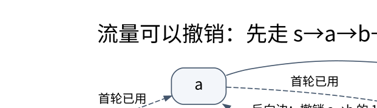

# 图算法、网络流与匹配证明：残量边记录可以撤销的选择

> **学习位置**：[[计算机知识/00-开始/课程地图/11-算法设计-课程地图|算法设计课程地图]] · **适用边界**：先给问题规格和前提，再证明和分析复杂度。

[PNG 备用图](../../_assets/diagrams/round3/residual-flow.png) · [可编辑图源](../../_assets/diagrams/round3/residual-flow.dot)

## 先选对路径模型

无权最短路用 BFS；DAG 可按拓扑序松弛并允许负边；Dijkstra 的经典正确性要求相关边权非负；Bellman–Ford 通过多轮松弛处理负边并检测从源可达的负环；Floyd–Warshall 按允许的中间点集合递增求全点对距离。不可达值加权前要检查，避免无穷哨兵与整数溢出产生假路径。

Dijkstra 每次确定最小暂定距离点时，非负边保证尚未经过的绕路不可能把它变得更短。负边破坏的正是这一证明步骤。A* 用启发式引导搜索，最优性与是否重开节点依赖启发式可采纳性、一致性及具体实现，不能把“像目标更近”当保证。

## 流的合同

网络流给每条有向边容量，流量不能超过容量，除源汇外流入等于流出。残量网络包含还可增加的正向容量，也包含可撤销已有流的反向容量。反向边不是物理管道必须反向送水，而是算法允许修正之前的分配。

例子容量均为 1：s→a、s→b、a→b、a→t、b→t。若先沿 s→a→b→t 增广，表面上 a 和 b 的部分出口都占住。残量路径 s→b→a→t 使用 b→a 撤销原来的 a→b 流，最终得到 s→a→t 与 s→b→t 两条单位流，总流量 2。没有反向边的实现会错误停在 1。

## 最大流与最小割是可检验的证书

若残量网络中已无 s 到 t 路径，令 S 为从 s 仍可达的点集，则跨越 S 到外部的正向边已饱和，反向贡献满足相应条件，可推出当前流值等于割容量。任何可行流都不超过任何 s-t 割容量，因此流与割相等证明最优。

算法复杂度依赖增广路径选择与容量模型。Ford–Fulkerson 是方法框架，不自动给多项式界；Edmonds–Karp 用 BFS 选最短边数增广路，经典界为 $O(VE^2)$。Dinic 使用层次图与阻塞流，一般容量网络常见最坏界为 $O(V^2E)$，特殊图类有更强结果，不能混写。

## 同一三角形：可行流与最大流改了哪个条件

带着[[电子电路/14-网络建模与仿真/01-图论电路与关联矩阵#固定注入的可行族与方向核对|三节点B与固定右端]]进入：行a,b,c、列ab,bc,ac，箭头a→b、b→c、a→c，流出为正，B为3×3无量纲。统一流量单位q（例如件/小时）；不把它默认为A或货币。固定输送1q时，$f=(t,t,1-t)^Tq$全部满足 $Bf=(1,0,-1)^Tq$，容量各1q与非负给 $0\le t\le1$。端点 $(0,0,1)q$与$(1,1,0)q$都是可行流；守恒和容量尚未提供选谁的目标。

现在**另立最大流问题**：a为源、c为汇，b守恒，源净流出数值F由优化决定：

$$\max F,\qquad Bf=(F,0,-F)^Tq,\qquad0\le f_e\le1q.$$

若用流量的以q计数值写约束，F也是数值；实际流值为Fq。中间点给 $f_{ab}=f_{bc}$，源给 $Fq=f_{ab}+f_{ac}\le2q$。向量 $(1,1,1)q$满足所有容量和中转守恒，流值2q；割 $S=\{a\}$ 的出边ab、ac容量和2q（另一个割{a,b}也为2q）。可行流给可达到的下界，割给任何流的上界，两端同为2q，故最大值是2q。

此时 $Bf=(2,0,-2)^Tq$，**右端从固定1变成2**；$(1,1,1)$不属于前面的固定1可行族。如果坚持固定右端 $(1,0,-1)$，所有可行流值都已等于1q；“最大化源流”就不能区分它们，必须另给费用等目标。

电阻模型在同图给 $(1/3,1/3,2/3)$ A，但其源固定1 A，且有 $i=G_\triangle B^Tv$。即使只比较以各自单位计的数值，它给流值1，不是本容量问题最大值2；容量最大流也未满足单位电导下的闭路电压条件：若把 $(1,1,1)$错误当电流，欧姆电压的 $1+1-1=1$ V并非0。返回[[电子电路/14-网络建模与仿真/01-图论电路与关联矩阵#本构怎样在可行族中选出电流|电路本构]]核正电导、参考点与源，才能解释为何电路有唯一解。

守恒也不等于所有业务合同都成立。携带“可行集还含哪些约束”去[[计算机知识/65-分布式系统/02-复制一致性与可见性历史#同一空时段为什么还能被接受两次|预约合并容量反例]]：两个合法单元素集合并成同一双元素集合，状态一致却超容量1。回来区分“分布式合并收敛”和本页“中转流量守恒”，再核自己的容量与目标；该反例没有替代最大流最小割证明。

带着固定源/可变源及“目标未由平衡给出”的区别，继续到[[社会科学/40-公共政策与社会学/10-财政货币与分配/04-从恒等式到因果政策判断#账本平衡、行为闭合与政策目标分三层|两期账户的附加条件]]；回来应能指出c、m与决策时点属于行为模型，部门净借贷是核算量，政策目标与现实因果需要另外说明。一般证书回查[[数学/40-微积分与优化/08-凸优化对偶与最优性证书#L≤OPT≤U 的两端从哪里来|上下界与最优性]]；只迁移界与证书的逻辑，不把不同领域的目标当成同一个量。

> [!question] 不看上面的流向量再求
> 只把bc容量降为1/4 q，其他两边仍1q。给最大流、一个割和新的Bf；再判断固定注入1q问题的可行t范围。

> [!answer]- 核对答案
> $(1/4,1/4,1)q$给F=5/4，割{a,b}的bc与ac容量和5/4q，所以已最优；Bf=(5/4,0,−5/4)q。固定注入1q时仍f=(t,t,1−t)q，但0≤t≤1/4，故可行并且不唯一。前一个优化解与后一个可行族右端不同。

依据：[Jeff Erickson作者教材第10章，§10.1–10.3](https://jeffe.cs.illinois.edu/teaching/algorithms/book/10-maxflow.pdf)分别给中间点守恒、流值、非负容量、割上界与流割相等证书。本段两套三角形数值是教学构造，未运行网络服务或流算法实现。

## 二分图匹配是一种单位容量流

从源连左侧每点容量 1，左到右按可配对关系连容量 1，右侧到汇容量 1。整数流对应匹配。增广路交替经过未匹配边和反向的已匹配边，重新安排已有配对。贪心给每个左点随便找一个空右点可能失败，因为某个左点的选择可以被重新分配。

最小费用流还要优化费用，需处理残量边负费用与最短路势能；一般图匹配涉及奇环收缩，不是直接把二分图算法删掉分区条件。强连通分量、割点、桥、欧拉路和网络流各回答不同结构问题，应按规格区分。

## 练习与答案

手画五边网络的两次增广，逐边列出流和残量，检查每个中间点的守恒。计算割 `{s}` 容量为 2，作为最终结果的上界证书。对小图穷举所有 s-t 割，与最大流实现对照；同时验证容量与守恒，防止两个错误实现碰巧给出相同流值。

<!-- ROUND4 DEPTH LINKS -->
## 继续推演本页难点

[[计算机知识/50-数据结构与算法/20-算法设计系统课程/10-残量网络最小割与匹配对偶|反向残量边没有真实管道，它到底代表什么？]] 本专题补上状态充分性、反例与可核对的保证。

这不是替换本页：先掌握原理，再用补充页核对容易被一句话略过的条件。
<!-- END ROUND4 DEPTH LINKS -->

## 关联阅读

- [[计算机知识/50-数据结构与算法/10-数据结构系统课程/07-图表示并查集与动态关系|图表示、并查集与动态关系：表达方式决定可支持的操作]]
- [[计算机知识/35-计算机网络/10-系统课程/03-IP编址路由与IPv6|IP 编址与路由：从掩码计算到控制平面]]
- [[计算机知识/50-数据结构与算法/20-算法设计系统课程/07-复杂性归约与指数算法|复杂性、归约与指数算法：困难结论也要写对方向]]

## 依据与继续查证

- [Jeff Erickson：Algorithms（作者教材入口）](https://jeffe.cs.illinois.edu/teaching/algorithms/)
- [MIT 6.046J：Design and Analysis of Algorithms（原课程）](https://ocw.mit.edu/courses/6-046j-design-and-analysis-of-algorithms-spring-2015/)

本页的例子、推演与练习为教学构造；语言契约、系统接口和版本相关结论应结合以上原始文档核对。

<!-- COURSE SEQUENCE -->
## 顺序导航与验证

[[计算机知识/50-数据结构与算法/20-算法设计系统课程/00-算法设计系统课程索引|本课程总索引]] · [[计算机知识/_labs/round3/ALG/算法设计-实验说明|本课程实验]]

上一讲：[[计算机知识/50-数据结构与算法/20-算法设计系统课程/04-动态规划状态设计与优化|动态规划状态设计与优化：状态必须保留未来需要的信息]]

下一讲：[[计算机知识/50-数据结构与算法/20-算法设计系统课程/06-随机近似与在线算法|随机、近似与在线算法：不同的不确定性要分开承诺]]
<!-- END COURSE SEQUENCE -->

<!-- ORIGINAL DEEP LINKS -->
## 与原有长篇专题衔接

- [[计算机知识/50-数据结构与算法/24-图算法网络流匹配与残量网络|24-图算法网络流匹配与残量网络]]
- [[计算机知识/50-数据结构与算法/22-平衡树区间结构与结构扩展地图|22-平衡树区间结构与结构扩展地图]]

新旧讲解采用的版本与模型可能不同，比较时先核对各自前提，不把教学简化当成实现细节。
<!-- END ORIGINAL DEEP LINKS -->
