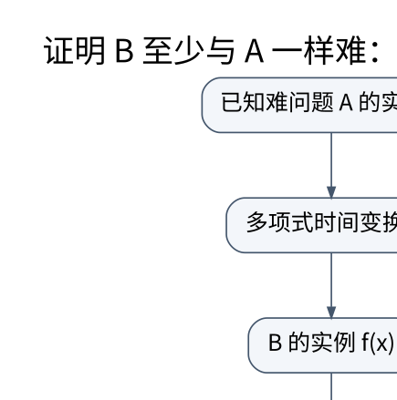

# 复杂性、归约与指数算法：困难结论也要写对方向

> **学习位置**：[[计算机知识/00-开始/课程地图/11-算法设计-课程地图|算法设计课程地图]] · **适用边界**：先给问题规格和前提，再证明和分析复杂度。

[PNG 备用图](../../_assets/diagrams/round3/reduction.png) · [可编辑图源](../../_assets/diagrams/round3/reduction.dot)

## P、NP 与 NP 完全

P 是可在确定性多项式时间内判定的问题类；NP 可通过多项式大小证书在多项式时间内验证是实例。NP 不是“非多项式”的缩写，也不表示所有这类问题都已经证明没有快速算法。NP-hard 描述至少与 NP 中所有问题一样难的归约关系；NP-complete 还要求问题本身属于 NP。

这些是判定问题框架。优化问题常通过阈值判定版本联系起来，但要明确转换。输入编码、归约计算时间和证书长度都属于定义，不能忽略。

## 归约方向决定结论

要证明新问题 B 很难，从已知难问题 A 构造到 B 的多项式归约。含义是：若能快速解决 B，就能先转换 A 实例，再解决 A。反过来把 B 归约到 A，通常只说明 B 不比 A 更难，不能据此证明 B 难。

3-SAT 到 CLIQUE 的教学构造：公式有 m 个子句，为每个子句中的每个文字建立一个顶点；不同子句的顶点之间，若文字不互相矛盾则连边；询问是否存在大小 m 的团。若公式可满足，从每个子句选一个为真的文字，它们两两不矛盾，形成团。若有大小 m 的团，同一子句内部无边使团必须来自不同子句，所选文字无矛盾，可扩成满足赋值。两方向都要证明，且图大小多项式。

## 困难不等于实践中只能放弃

小 n 可用指数算法，结构特殊可用专用算法，近似可接受时用保证明确的近似，参数小可用参数化算法。固定参数可解通常指 $f(k)n^{O(1)}$，与 $n^k$ 的差别在于输入规模的指数不随参数变化。树宽、解大小、维度等都可能成为参数，但参数是否实际小需要数据支持。

Meet-in-the-middle 把 n 个元素分成两半，各枚举约 $2^{n/2}$ 个子集，再按和排序或哈希匹配，常能显著扩展可处理规模。它仍是指数算法，并付出存储成本。回溯剪枝需要正确上界或下界；启发式改变搜索顺序不等于保证剪枝安全。

## 不可判定是另一种边界

停机问题的不可判定性不是“目前算法不够快”，而是不存在对所有程序输入都正确终止的通用判定算法。编译器因此无法普遍精确判断任意程序属性，实际静态分析通过限制语言、保守近似或接受不完备来工作。不能由此断言任何具体程序都无法分析；具体实例通常可以证明或测试。

## SAT、SMT 与整数规划的位置

把任务编码成 SAT/SMT/ILP 可以复用成熟求解技术，但模型正确性仍由编码者负责。变量、约束与目标要对应业务语义；求解器超时不等于无解，返回可满足也要检查解码后的解。不可满足核心、最优性界和证明日志可以提供更强证据，但支持度依工具与配置而异。

## 练习与答案

对两个子句手画上述团构造，特别检查互为 x 与非 x 的顶点不连边。解释为何“每个子句至少选一个点”不能只靠目标大小保证，必须依赖同子句不连边。再比较容量 W 的背包 DP 与输入位数，说明伪多项式为何不自动解决 NP 完全性问题。最后给一个可穷举的小实例建立参考求解器，用来验证更复杂优化算法的结果。

<!-- ROUND4 DEPTH LINKS -->
## 继续推演本页难点

[[计算机知识/50-数据结构与算法/20-算法设计系统课程/11-归约方向随机误差与近似保证|证明新问题很难时，归约箭头应该指向哪边？]] 本专题补上状态充分性、反例与可核对的保证。

这不是替换本页：先掌握原理，再用补充页核对容易被一句话略过的条件。
<!-- END ROUND4 DEPTH LINKS -->

## 关联阅读

- [[计算机知识/50-数据结构与算法/20-算法设计系统课程/01-问题规格证明与复杂度|问题规格、证明与复杂度：算法先回答“算的是什么”]]
- [[计算机知识/70-编译原理/10-系统课程/06-优化等价性数据流与陷阱|优化必须保持什么：别名、溢出、异常与浮点]]
- [[计算机知识/50-数据结构与算法/20-算法设计系统课程/06-随机近似与在线算法|随机、近似与在线算法：不同的不确定性要分开承诺]]

## 依据与继续查证

- [Jeff Erickson：Algorithms（作者教材入口）](https://jeffe.cs.illinois.edu/teaching/algorithms/)
- [MIT 6.046J：Design and Analysis of Algorithms（原课程）](https://ocw.mit.edu/courses/6-046j-design-and-analysis-of-algorithms-spring-2015/)

本页的例子、推演与练习为教学构造；语言契约、系统接口和版本相关结论应结合以上原始文档核对。

<!-- COURSE SEQUENCE -->
## 顺序导航与验证

[[计算机知识/50-数据结构与算法/20-算法设计系统课程/00-算法设计系统课程索引|本课程总索引]] · [[计算机知识/_labs/round3/ALG/算法设计-实验说明|本课程实验]]

上一讲：[[计算机知识/50-数据结构与算法/20-算法设计系统课程/06-随机近似与在线算法|随机、近似与在线算法：不同的不确定性要分开承诺]]

下一讲：[[计算机知识/50-数据结构与算法/20-算法设计系统课程/08-数值几何并行与综合设计|数值、几何、并行与综合设计：算法还要面对表示误差]]
<!-- END COURSE SEQUENCE -->

<!-- ORIGINAL DEEP LINKS -->
## 与原有长篇专题衔接

- [[计算机知识/50-数据结构与算法/23-正确性证明反例与复杂度边界|23-正确性证明反例与复杂度边界]]
- [[计算机知识/50-数据结构与算法/14-回溯搜索剪枝与计算复杂性边界|14-回溯搜索剪枝与计算复杂性边界]]

新旧讲解采用的版本与模型可能不同，比较时先核对各自前提，不把教学简化当成实现细节。
<!-- END ORIGINAL DEEP LINKS -->
