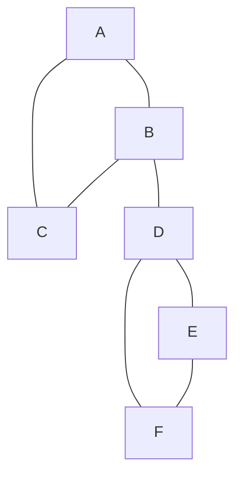

# 哪条边断了会拆开网络：桥、割点与双连通分量

> **问题**：SCC 解释有向图里的互相可达；无向图中怎样找单点或单边故障会破坏连通性的部位？
>
> **先修**：[[计算机知识/50-数据结构与算法/07-图的表示BFS-DFS与拓扑排序|DFS 的颜色、父边与遍历树]]。[[计算机知识/50-数据结构与算法/17-强连通分量凝聚DAG与工作列表不动点|SCC]] 解决的是有向图问题，不能直接替代本页。

## `disc` 与 `low` 记录不同信息

DFS 首次访问顶点 `v` 时记时间 `disc[v]`。`low[v]` 是从 `v` 的 DFS 子树出发，沿若干树边再至多一条回边能到达的最早发现时间。它不是“能到的最小顶点编号”。

对树边 `(v,w)`：若 `low[w] > disc[v]`，`w` 子树没有绕回 `v` 或祖先的路，这条边是桥；若 `v` 不是 DFS 根且 `low[w] >= disc[v]`，删除 `v` 会让 `w` 子树与上方断开，`v` 是割点。根没有祖先，只有当它有至少两个 DFS 子树时才是割点。

图中两个三角形由 `B-D` 连接。DFS 若从 A 开始，A/B/C 之间的回边使这一侧 `low` 回到 A；D/E/F 之间同理。但 D 子树无法绕过 `B-D` 回到 B 的祖先，所以 `B-D` 是桥，B 和 D 是割点。

## 手算表

取 DFS 树边 `A-B,B-C,B-D,D-E,E-F`，回边 `C-A,F-D`：

| 顶点 | `disc` | 子树回到的最早时间 `low` | 判据作用 |
| --- | ---: | ---: | --- |
| A | 0 | 0 | 根只有一个 DFS 子树，不是割点 |
| B | 1 | 0 | 子 D 的 low=3 ≥ 1，B 是割点 |
| C | 2 | 0 | 回边到 A |
| D | 3 | 3 | `low[D] > disc[B]`，B-D 是桥；D 是割点 |
| E | 4 | 3 | 由 F-D 回边降低 |
| F | 5 | 3 | 回边到 D |

平行边必须按“边身份”而非只按父顶点跳过：若 B-D 有两条平行边，第二条就是绕回父方的非树边，第一条不再是桥。

## 从分量到块割树

点双连通分量可由 DFS 边栈分组；每当 `low[child] >= disc[parent]`，弹出直到相应树边形成一个块。把“块”与“割点”分别作为两类结点，若割点属于某块就连边，得到块割森林。原图连通时它是一棵树，适合回答“经过哪个脆弱点才能从一个块到另一个块”。边双连通分量则按桥切分，定义不同。

## 独立检验

- 对每条报告桥，删除该边再 BFS，连通分量数必须增加；未报告边删除后不增加。
- 对每个报告割点，删除顶点及邻边后比较分量数；单顶点和 DFS 根按明确定义处理。
- 对全部小无向多重图，将线性 DFS 结果与逐边/逐点删除的慢 oracle 对照。
- 块割图应无环；原图连通时还应连通。

> [!warning] 错误说法
> DFS 树边不都是桥；`low` 不按顶点编号取最小；根判据不能照抄普通顶点；SCC、点双连通和边双连通不是同一个分解。

## 成本口径与关系导航

令 `V` 为顶点数、`E` 为带身份的无向边数；在邻接表 RAM 模型中，每个顶点和边身份只处理常数次，时间 `O(V+E)`、辅助状态 `O(V+E)`（含邻接表）。该界不含递归栈溢出、动态图更新或外存 I/O。

- **先修**：[[计算机知识/50-数据结构与算法/07-图的表示BFS-DFS与拓扑排序|图表示与 DFS]]。
- **主解释**：[[计算机知识/50-数据结构与算法/20-算法设计系统课程/05-图算法网络流与匹配证明|图算法系统主讲]]提供图算法证明框架。
- **应用**：[[计算机知识/70-编译原理/08-控制流图支配关系与SSA|控制流图、支配关系与 SSA]]展示故障点分析之外的 DFS 图结构应用。
- **反例与边界**：[[计算机知识/50-数据结构与算法/17-强连通分量凝聚DAG与工作列表不动点|有向图 SCC]]不能代替无向双连通分解。

## 来源

- [Jeff Erickson《Algorithms》第 6 章 Depth-First Search](https://jeffe.cs.illinois.edu/teaching/algorithms/book/06-dfs.pdf)：原作者教材章节；本批下载 32 页原章并渲染核对章首页。
- Robert Tarjan, “Depth-First Search and Linear Graph Algorithms”, *SIAM Journal on Computing* 1(2), 1972, DOI `10.1137/0201010`：DFS 线性图算法原始论文检索锚点。

教学表使用单一 DFS 顺序；邻接顺序改变会改变 `disc/low` 数字，但桥、割点和分量这一图性质不变。

返回 [[计算机知识/50-数据结构与算法/20-算法设计系统课程/00-算法设计系统课程索引|算法设计系统课程索引]]。
