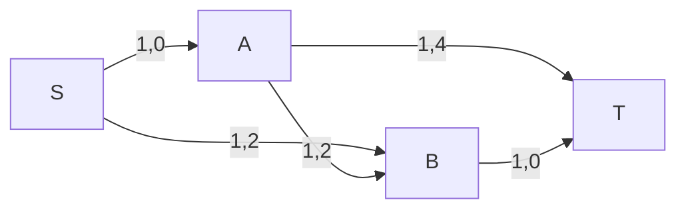

# 流量相同，费用为何不同：最小费用流与势函数

> **问题**：最大流只问能送多少；当每条边还有单位费用时，怎样在固定流量或最大流量中选总费用最小的方案？
>
> **先修**：[[计算机知识/50-数据结构与算法/20-算法设计系统课程/10-残量网络最小割与匹配对偶|先掌握残量反向边、流守恒与割证书]]。本页保持它为最大流主解释。

## 合同多了一项线性目标

每条边 `e` 有容量 `u_e`、费用 `c_e` 和流量 `f_e`。仍需 `0≤f_e≤u_e`，中间点流入等于流出；目标是在规定流值下最小化 `Σ c_e f_e`。反向残量边的容量是已发送流量，费用是 `-c_e`：撤回一单位旧流会退回原费用。

边标为“容量,费用”。若先走 `S-A-B-T`，流值 1、费用 2。为了送第二单位，可走残量路 `S-B-A-T`：其中 `B-A` 是撤回 `A-B` 的反向边，费用 -2，总增量费用 `2-2+4=4`。最终两条真实路径是 `S-A-T` 和 `S-B-T`，总费用 6。若删除反向残量边，算法会错误地认为旧选择不可改。

## 负费用让普通 Dijkstra 失去前提

successive shortest augmenting path 每轮在残量网络中找最短费用路。反向边天然可能为负；直接运行要求非负边的 Dijkstra 不正确。势函数 `π(v)` 定义约化费用

$$c_\pi(u,v)=c(u,v)+\pi(u)-\pi(v).$$

若所有可用残量边的约化费用非负，就可在约化图上用 Dijkstra；最短距离更新势函数后，原路径费用的相对最优性通过端点常数校正保持。初始若有负费用边，可用 Bellman-Ford 类方法取得可行势函数；若存在可达负费用环，还要先解释问题是否允许沿环降低费用。

## 最优性证书

对固定流值，若残量网络存在负费用环，就能沿环调整而不改变源汇净流量，却降低总费用，所以当前流不是最优。反之，在相应线性模型与可行流下，无负费用残量环提供最优性条件。整数容量配合逐单位或瓶颈增广可保持整数流，但复杂度还取决于增广策略与数值范围。

## 可检查性质

1. 每轮后容量约束和所有中间点守恒成立。
2. 每对正反残量边费用互为相反数，反向容量等于可撤回流量。
3. 手算例每次增广后的 `流值/总费用` 分别为 `(1,2)`、`(2,6)`。
4. 小整数网络可穷举所有边流，筛选可行且同流值者，比较最小费用作为独立 oracle。
5. 使用 Dijkstra 前检查所有可达残量边约化费用非负；否则拒绝该证明路径。

> [!warning] 错误说法
> 先求任意最大流再“挑便宜边”不保证费用最小；残量反向边不可省；负费用图不能无条件直接跑普通 Dijkstra；势函数不改变真实目标，它只重标边并需做端点校正。

## 成本口径与关系导航

令 `V,E` 为残量网络规模、`F` 为需发送的整数流量。在**已给可行势**、约化费用非负的前提下，逐单位 successive shortest path 加二叉堆 Dijkstra 的教学上界是 `O(F(E+V) log V)`；按瓶颈增广时轮数可少于 F，但须另证。若初始负费用边需 Bellman–Ford 构造势，还要另加一次 `O(VE)` 初始化。这里按 RAM 算术操作计费，不包含费用/容量位长和浮点误差。

- **先修**：[[计算机知识/50-数据结构与算法/20-算法设计系统课程/10-残量网络最小割与匹配对偶|残量网络与最小割]]。
- **主解释**：[[计算机知识/50-数据结构与算法/20-算法设计系统课程/05-图算法网络流与匹配证明|图算法、网络流与匹配证明]]仍是最大流主体。
- **应用**：[[计算机知识/50-数据结构与算法/24-图算法网络流匹配与残量网络|图算法深化地图]]连接分配、运输与匹配问题。
- **反例与边界**：[[计算机知识/50-数据结构与算法/23-正确性证明反例与复杂度边界|正确性与复杂度边界]]用于检查负边、位长与最优性证书。

## 来源

- [Jeff Erickson：Minimum-Cost Flows](https://jeffe.cs.illinois.edu/teaching/algorithms/notes/G-mincostflow.pdf)：原作者高级算法讲义；本批下载 15 页讲义并渲染核对标题、问题定义与第一节入口。
- [MIT 6.046J Lecture 13：Max Flow, Min Cut](https://ocw.mit.edu/courses/6-046j-design-and-analysis-of-algorithms-spring-2015/resources/lecture-13-notes/)：残量与流证书先修；本批实际打开资源页并核对其 PDF 入口。
- Ahuja, Magnanti, Orlin, *Network Flows*, 1993, ISBN `978-0-13-617549-0`：最小费用流与 reduced cost 的书目锚点；本批未取得全文。

本页使用整数小图教学模型，不声称给出通用工业实现、强多项式界或浮点稳定性保证。

返回 [[计算机知识/50-数据结构与算法/20-算法设计系统课程/00-算法设计系统课程索引|算法设计系统课程索引]]。
