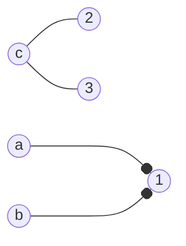

# 从存在条件到对偶证书：二分图匹配

> **问题**：怎样证明完美匹配存在或不存在；最大匹配算出后，怎样用同大小的最小点覆盖独立核验最优性？
>
> **先修**：[[计算机知识/50-数据结构与算法/20-算法设计系统课程/10-残量网络最小割与匹配对偶|二分图到单位容量流的主解释]]。

## Hall 条件检查的是所有左侧子集

对二分图 `G=(L,R,E)`，存在覆盖全部 `L` 的匹配，当且仅当对每个 `S⊆L` 都有 `|N(S)|≥|S|`。只检查单个顶点度数不够：`L={a,b,c}`，`R={1,2,3}`，令 a、b 都只连 1，c 连 2、3；每个左点都有邻居，但 `S={a,b}` 只有一个邻居，无法同时匹配。

这个 `S` 与 `N(S)` 就是一份“不存在覆盖 L 的匹配”的可检查证书。

## 增广路每次恰增加一条匹配边

从未匹配左点出发，沿“非匹配边、匹配边”交替到未匹配右点。把整条路的匹配/非匹配状态翻转：路径上新加入边比移除边多一，所以匹配大小加 1，且每个顶点仍至多一条匹配边。没有增广路当且仅当当前匹配最大，这是 Berge 引理的核心。

Hopcroft-Karp 用 BFS 构造相对于当前匹配的最短增广路层次，再在层次图中找一组**极大**的顶点不相交最短增广路并全部增广：不能再加入一条与已选路径顶点不交的同层最短增广路即可，不要求这组路径数最大。它不是“BFS 一次就得到最大匹配”；算法在多个 phase 间重复，极大（阻塞）性质清空本 phase 的最短增广路，才使下一 phase 的最短长度推进并支持经典时间界。

## 从最大匹配构造最小点覆盖

令 `Z` 是从所有未匹配左点出发，经交替路可达的顶点集合。构造

$$C=(L\setminus Z)\cup(R\cap Z).$$

它覆盖全部边，且与最大匹配大小相同；于是由“任意点覆盖至少要覆盖每条互不相交匹配边”的下界，得到最大匹配大小等于最小点覆盖大小。这是 Kőnig 定理，只对二分图成立。

### 手算

取 `L={a,b,c}`、`R={1,2,3}`，边 `a-1,a-2,b-2,c-2,c-3`。匹配 `{a-1,b-2,c-3}` 大小 3，已经覆盖所有左点。没有未匹配左点，`Z=∅`，构造点覆盖 `C=L`，大小也是 3。另一个最小覆盖可能不同；证书不要求唯一。

## 独立检验

- 检查匹配中任意两边端点不重复。
- 对小图枚举边子集求最大匹配，枚举顶点子集求最小点覆盖，两最优值应相等。
- 每次增广后匹配大小恰加 1，匹配不变量保持。
- 构造的 `C` 覆盖每条边且 `|C|=|M|`；这同时证明 `M` 最大、`C` 最小。

> [!warning] 错误说法
> 极大匹配不等于最大匹配；Hall 条件不是只查每个点有邻居；Kőnig 等式不适用于任意无向图；二分图流归约不能直接解决一般图匹配。

## 成本口径与关系导航

令 `V=|L|+|R|`、`E` 为去重后二分边数；每 phase 的 BFS/DFS 扫描为 `O(E)`，而极大最短路径组阻塞当前层次图、推动最短增广路长度；短路径 phase 与长路径 phase 合并给出 `O(√V)` 个 phase。因此邻接表 RAM 模型下时间为 `O(V+E√V)`（显式顶点列表的初始化计入 `O(V)`，即使 `E=0` 也不能省去；去除孤立顶点后的非空主算法常简写 `O(E√V)`）、匹配和分层状态 `O(V+E)`。平行边不改变匹配可行集合，却会改变未经去重实现的扫描常数。

- **先修**：[[计算机知识/50-数据结构与算法/20-算法设计系统课程/10-残量网络最小割与匹配对偶|残量网络、最小割与匹配对偶]]。
- **主解释**：[[计算机知识/50-数据结构与算法/20-算法设计系统课程/05-图算法网络流与匹配证明|网络流与匹配证明]]负责流归约主线。
- **应用**：[[计算机知识/50-数据结构与算法/24-图算法网络流匹配与残量网络|图算法深化地图]]连接任务分配与单位容量流。
- **反例与边界**：[[计算机知识/50-数据结构与算法/23-正确性证明反例与复杂度边界|证明与反例边界]]强调 Kőnig 等式不能越过二分图前提。

## 来源

- [MIT 6.046J Lecture 14A：Matching](https://ocw.mit.edu/courses/6-046j-design-and-analysis-of-algorithms-spring-2015/resources/lecture-14a-notes/)：本批实际打开资源页并核对其 matching PDF。
- [Jeff Erickson《Algorithms》第 11 章 Applications of Flows and Cuts](https://jeffe.cs.illinois.edu/teaching/algorithms/book/11-maxflowapps.pdf)：本批下载 26 页原章并渲染核对章首页与流应用入口。
- [Cornell CS 6820：Flows, Cuts and Matchings](https://www.cs.cornell.edu/courses/cs6820/2016fa/handouts/flows.pdf)：本批实际下载并定位第 3.3 节 Kőnig–Egervary 定理和第 3.4 节 Hall 定理及其流/割证明。
- Hopcroft & Karp, “An n^(5/2) Algorithm for Maximum Matchings in Bipartite Graphs”, *SIAM Journal on Computing* 2(4), 1973, DOI `10.1137/0202019`。

本页证明二分图中的结论；一般图最大匹配需要花算法等不同机制。

返回 [[计算机知识/50-数据结构与算法/20-算法设计系统课程/00-算法设计系统课程索引|算法设计系统课程索引]]。
