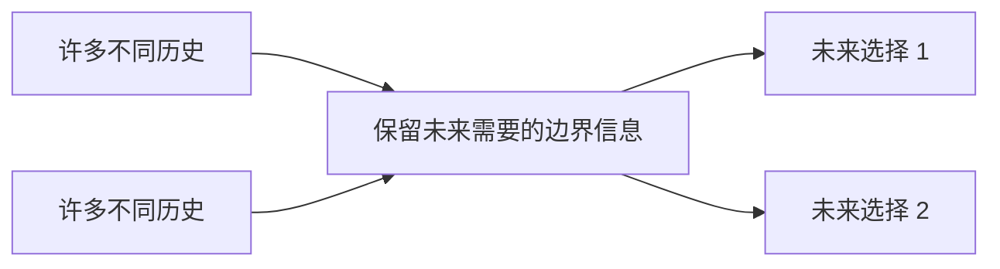

# 状态不是下标表：树形、区间与状态压缩 DP

> **问题**：怎样从“切开后哪些信息仍影响未来”推导状态，而不是见到树、区间或位掩码就套模板？
>
> **先修**：[[计算机知识/50-数据结构与算法/20-算法设计系统课程/09-动态规划状态充分性与优化前提|先掌握状态充分性、背包顺序与加权区间调度]]。本页不重写背包。

## 状态是历史的等价类

若两段历史对所有未来选择具有相同可行性与最优后续值，就可合并为同一状态。树的父边、区间的两个端点、状态压缩中的边界集合，都是“过去与未来的接口”。少记一位会错误合并，记住全部历史则失去压缩意义。

## 树形 DP：父结点状态决定子树边界

树上最大权独立集定义 `dp[v][0/1]` 为不选/选择 v 时 v 子树的最优值：

$$dp[v][1]=w_v+\sum_{c}dp[c][0],\qquad dp[v][0]=\sum_c\max(dp[c][0],dp[c][1]).$$

五结点树：根 A 权 4，孩子 B 权 3、C 权 2，B 的孩子 D/E 各权 2。手算 D/E 为 `(0,2)`，B 为 `(4,3)`，C 为 `(0,2)`，A 为 `(6,8)`，最优选 A、D、E，权 8。只记“B 子树最优为 4”会丢失父亲选中时必须禁选 B 的未来条件。

## 区间 DP：最后一次切分覆盖全部结构

矩阵链令 `dp[i][j]` 为矩阵 i 到 j 的最小乘法数，枚举最后切分 `k`。三个矩阵维度 `10×30,30×5,5×60`：`(AB)C` 成本 `1500+3000=4500`；`A(BC)` 为 `9000+18000=27000`。两种 k 覆盖所有括号化，局部挑“最小矩阵”没有一般证明。

## 状态压缩：mask 只记录集合还不够

Hamilton 路径常用 `dp[mask][last]`：已访问集合为 mask、最后位于 last 的最小成本。若只记 mask，不同末点可接的下一条边不同。依赖总从少一个点的 mask 指向当前层，形成 DAG；复杂度约 `O(n^2 2^n)`，仍是指数算法。

## 可独立检验

- 树 DP 与全部顶点子集枚举对照，并检查选中集合无相邻点。
- 区间 DP 与全部括号化递归枚举对照。
- `mask,last` 与全部顶点排列对照；不可达状态不能用 0 冒充。
- 方案恢复的父指针必须沿合法转移回到基例，目标值与重算一致。

> [!warning] 错误说法
> 有递归不等于能得到多项式 DP；树的子树并非无条件独立；只记 mask 可能丢末点；滚动数组可能删掉恢复方案所需证据。

## 成本口径与关系导航

令树有 `n` 点，树 DP 在邻接表 RAM 模型中为 `O(n)`；矩阵链有 `n` 个矩阵，按经典稠密矩阵标量乘法次数计费时表格算法为 `O(n³)`；Hamilton 状态压缩按常数时间查边为 `O(n²2^n)`。三种 `n` 与基本操作不同，不能只比较大 O 字串。

- **先修**：[[计算机知识/50-数据结构与算法/20-算法设计系统课程/09-动态规划状态充分性与优化前提|DP 状态充分性]]。
- **主解释**：[[计算机知识/50-数据结构与算法/20-算法设计系统课程/04-动态规划状态设计与优化|动态规划系统主讲]]。
- **应用**：[[计算机知识/50-数据结构与算法/25-动态规划进阶随机近似与算法全景|DP 与算法全景]]连接更多状态设计场景。
- **反例与边界**：[[计算机知识/50-数据结构与算法/14-回溯搜索剪枝与计算复杂性边界|回溯与复杂性边界]]说明指数状态并未被“DP”名称消除。

## 来源

- [Jeff Erickson《Algorithms》第 3 章 Dynamic Programming](https://jeffe.cs.illinois.edu/teaching/algorithms/book/03-dynprog.pdf) 与 [Advanced Dynamic Programming](https://jeffe.cs.illinois.edu/teaching/algorithms/notes/D-faster-dynprog.pdf)：本批下载 62 页原章与 18 页讲义，并渲染核对原章首页。
- [MIT 6.046J Lecture 10：Advanced DP](https://ocw.mit.edu/courses/6-046j-design-and-analysis-of-algorithms-spring-2015/resources/lecture-10-notes/)：本批实际打开资源页并核对 PDF。

正文例子为独立推演；未把优化技巧的名字当成无需第二份证明的模板。

返回 [[计算机知识/50-数据结构与算法/20-算法设计系统课程/00-算法设计系统课程索引|算法设计系统课程索引]]。
