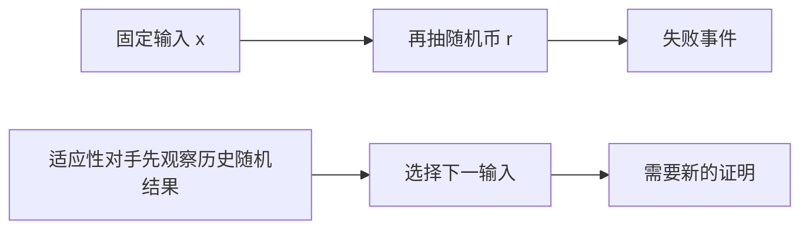

# 概率对谁成立：期望、高概率与适应性输入

> **问题**：随机算法的概率究竟对固定输入、随机种子还是整个请求序列取；怎样把一次失败率换成系统生命周期风险？
>
> **先修**：[[计算机知识/50-数据结构与算法/20-算法设计系统课程/11-归约方向随机误差与近似保证|先掌握随机误差的量词与 union bound]]。

## 先把量词写出来

典型保证是：对每个预先固定输入 x，对算法随机币 r 取概率，`Pr_r[fails(x,r)]≤δ`。若对手先看见 r 再选 x(r)，这已经交换量词，原证明可能失效。

期望运行时间只约束平均值。由 Markov 不等式，非负随机变量 `T` 只可推出 `Pr[T≥aE[T]]≤1/a`；期望线性没有自动给很强尾界。说“期望 O(n)”不能改写成“几乎每次 O(n)”。

## 线性期望不要求独立

设随机排列中的逆序数 `X=Σ_{i<j}X_ij`，每对逆序指示变量期望为 1/2，因此 `E[X]=n(n-1)/4`。这些指示变量彼此不全独立，但期望仍可逐项相加。独立性在乘失败概率、Chernoff 一类集中界时才可能成为关键前提。

## Karger 收缩的四环手算

四环每条边容量 1，固定“孤立顶点 A”的最小割。第一次的 4 条边中有 2 条不跨该割，安全概率为 `2/4`。收缩其中任一安全边、删除自环后得到三角形：3 条边中 2 条跨该固定割，只有 1 条安全，所以第二步安全概率为 `1/3`。该固定割存活到两个超点的概率为 `(2/4)×(1/3)=1/6`。算法也可能输出其他同值割，所以整体成功率可高于“固定割存活率”，两者不能混写。

重复 k 次并取最小割值，只有每轮使用所需独立随机性时，全部失败概率才可写成 `p^k`。对 q 次调用的“至少一次失败”，并集界给至多 `qδ`；它不要求调用独立，但要求每次的单次界在实际输入选择模型下仍成立。

## 可独立检验

- 枚举四环所有收缩序列，分别统计固定割存活率与算法找到任一最小割的概率。
- 小图上用穷举割作精确 oracle，随机收缩输出不得小于真最小割。
- 固定 seed 只验证可复现路径；频率实验报告样本量和置信不确定性，不宣称证明定理。
- 文档中的每个概率都标随机变量、输入选择时机、独立性和调用次数。

> [!warning] 错误说法
> 线性期望不要求独立；重复同一随机结构不能直接把失败率相乘；固定 seed 通过不是概率保证；公开随机性面对适应性对手时需要另证。

## 成本口径与关系导航

令图有 `n` 点、`m` 条保留平行边的边；收缩轮数是 `n-2`，朴素重建邻接结构的实际时间另依实现。本页主要口径是对固定输入、算法随机币取概率；若单轮失败率至多 `p`，独立重复 `r` 轮才有 `p^r`。概率界与 RAM 运行时间是两项成本。

- **先修**：[[计算机知识/50-数据结构与算法/20-算法设计系统课程/11-归约方向随机误差与近似保证|随机误差量词]]。
- **主解释**：[[计算机知识/50-数据结构与算法/20-算法设计系统课程/06-随机近似与在线算法|随机、近似与在线算法]]仍是分类主讲。
- **应用**：[[计算机知识/50-数据结构与算法/19-概率型数据结构流式摘要与误差合同|概率结构与误差合同]]连接系统生命周期风险。
- **反例与边界**：[[计算机知识/50-数据结构与算法/23-正确性证明反例与复杂度边界|证明与反例边界]]用于检查交换量词和共享随机性。

## 来源

- [MIT 6.046J Lecture 6：Randomized Matrix Multiply and Quicksort](https://ocw.mit.edu/courses/6-046j-design-and-analysis-of-algorithms-spring-2015/resources/lecture-6-notes/)：本批实际打开资源页。
- [Jeff Erickson：Discrete Probability](https://jeffe.cs.illinois.edu/teaching/algorithms/notes/01-random.pdf) 与 [Randomized Minimum Cut](https://jeffe.cs.illinois.edu/teaching/algorithms/notes/08-mincut.pdf)：本批下载 22 页与 7 页讲义，并渲染核对标题和开篇问题。
- David Karger, STOC 1993, DOI `10.1145/167088.167250`；本批打开 DOI 重定向，ACM 落地页拒绝自动读取，因此不声称逐页核验原文。

返回 [[计算机知识/50-数据结构与算法/20-算法设计系统课程/00-算法设计系统课程索引|算法设计系统课程索引]]。
