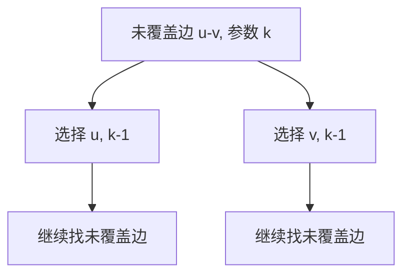

# 总规模很大，关键参数很小：FPT、核化与搜索树

> **问题**：NP-hard 不等于每个实例都无计可施；怎样把“难度集中在哪个参数”写成可验证算法合同？
>
> **先修**：[[计算机知识/50-数据结构与算法/20-算法设计系统课程/07-复杂性归约与指数算法|先掌握输入编码、NP-hard、指数与伪多项式边界]]。

## FPT 与 XP 的指数放在哪里

固定参数可解（FPT）时间形如 `f(k)n^c`，其中常数 c 不依赖 k；`n^k` 属于 XP 典型形式，k 增大时 n 的指数也增大。两者都可能在实际参数上很慢，所以还要报告 k 的分布、常数、内存和预处理。

## Vertex Cover 的有界搜索树

若图中仍有未覆盖边 `(u,v)`，任何大小至多 k 的覆盖至少选 u 或 v。分成两个完备分支：删除 u 及关联边并令 k-1，或对 v 同样处理。

递归深度至多 k、叶数至多 `2^k`；每层若线性处理图，得到 `O(2^k poly(n))` 的 FPT 上界。手算路径 `a-b-c-d`、`k=1`：分支选 b 后还剩 c-d，无预算；选 c 后还剩 a-b，同样失败，所以不存在大小 1 覆盖。`k=2` 时可选 b,c 成功。

## 核化必须保持 yes/no 等价

kernelization 在多项式时间把 `(x,k)` 变成 `(x',k')`，保证答案等价且新实例大小由 k 的函数界定。单纯“数据变少了”不够；每条规约都要双向证明。

例如在简单图中，若顶点 v 的**不同邻居数**大于 k，任何大小 k 的顶点覆盖必须选 v，否则每个不同邻居都要被选，超过预算。因此可选 v、删除其关联边、令 k-1。若输入是多重图，平行边先去重或仍按不同邻居计数；把平行边条数当度数会使规则失效。

## 可独立检验

- 对所有小图和 k，FPT 搜索结果与枚举全部至多 k 顶点子集的 oracle 一致。
- 每次分支 k 严格减 1；k<0 拒绝，边集为空接受。
- 每条核化规则记录变换前后 yes/no 等价证明，并由穷举小图回归。
- 报告 `f(k)` 与 n 的多项式次数，不能只写“很快”。

> [!warning] 错误说法
> `n^k` 不是 FPT；NP-hard 不排除小参数上的精确算法；任意预处理都不是核化；一个数据集的 k 很小不推出普遍高效。

## 成本口径与关系导航

令 `n=|V|+|E|` 为简单图编码规模，参数为预算 `k`；二分搜索树至多 `2^k` 个叶，每层多项式处理得到 `O(2^k poly(n))`。该口径是最坏 RAM 操作数，不承诺小常数或低内存。

- **先修**：[[计算机知识/50-数据结构与算法/20-算法设计系统课程/07-复杂性归约与指数算法|复杂性与指数算法]]。
- **主解释**：[[计算机知识/50-数据结构与算法/14-回溯搜索剪枝与计算复杂性边界|回溯搜索与复杂性边界]]负责通用分支搜索。
- **应用**：[[计算机知识/50-数据结构与算法/15-如何选择数据结构与建立不变量|选择结构与建立不变量]]用于把参数分布写进工程决策。
- **反例与边界**：[[计算机知识/50-数据结构与算法/23-正确性证明反例与复杂度边界|证明与反例边界]]检查核化双向等价与多重边反例。

## 来源

- [MIT 6.046J Lecture 18：Fixed-Parameter Algorithms](https://ocw.mit.edu/courses/6-046j-design-and-analysis-of-algorithms-spring-2015/resources/lecture-18-notes/)：本批实际打开资源页并核对 PDF。
- Cygan et al., *Parameterized Algorithms*, Springer 2015, DOI `10.1007/978-3-319-21275-3`：本批实际打开 DOI 跳转至 Springer 书目页；正文推演保持在 MIT 讲次与可枚举 Vertex Cover 范围内。

返回 [[计算机知识/50-数据结构与算法/20-算法设计系统课程/00-算法设计系统课程索引|算法设计系统课程索引]]。
