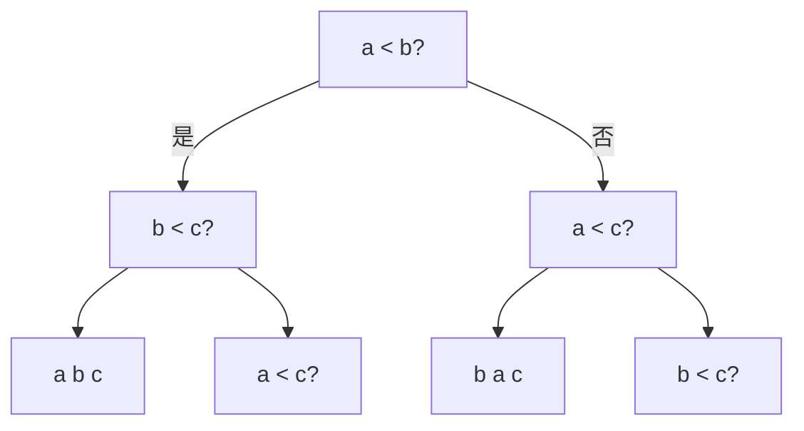

# 为什么不是“还没想到”：判定树、对手与信息下界

> **问题**：上界给一个算法；怎样证明某个模型中的任何算法都必须做足够多工作？
>
> **先修**：[[计算机知识/50-数据结构与算法/20-算法设计系统课程/01-问题规格证明与复杂度|比较排序下界直觉与成本模型]]。

## 判定树数算法必须区分的答案

三个互异元素有 6 种排列。确定性比较排序每次比较只有两种结果，可画成二叉树；深度 h 最多有 `2^h` 个叶。要让 6 种排列到不同叶，最坏深度至少 `ceil(log2 6)=3`。一般得到 `log2(n!)=Ω(n log n)`。

图只展示部分分支；完整树需要至少 6 个叶。下界约束比较模型，不禁止计数排序使用有限键域信息。

## 对手论证保持多个输入仍可能

找最大值时，对手把每次比较的败者标记为“不可能最大”，胜者仍可能。一次比较最多淘汰一个候选；要从 n 个候选剩 1 个至少需要 n-1 次比较。若还要找第二大，第二大必在“直接输给最大值”的元素中；锦标赛结构保存了这条败者链。

对手回答必须始终与至少一个完整合法输入一致。若为了拖慢算法给出互相矛盾的比较结果，证明无效。

## 模型一换，下界要重写

比较次数下界没有计算缓存块、字长并行比较、随机错误、通信或量子查询。外存要数 I/O，分布式要数轮次和消息，随机算法还要决定对手何时看到随机性。结论中的“任何算法”从来都隐含“该模型允许的任何算法”。

## 独立检验

- 枚举 3 元排列，沿判定树检查每个叶只容纳与输出一致的排列。
- 深度 h 的二叉树叶数不超过 `2^h`，与所需答案数比较。
- 最大值对手中，每次比较恰淘汰至多一个未败候选；终止时只剩一个。
- 给每个下界写明输入族、算法模型、允许操作与随机性。

> [!warning] 错误说法
> 一个 `O(n log n)` 算法不证明 `Ω(n log n)`；比较排序下界不禁止线性整数排序；信息下界不自动包含缓存/I/O；对手不能回答出没有任何真实输入支持的矛盾历史。

## 成本口径与关系导航

排序例令 `n` 为互异元素数，每次二元比较计 1，算法确定且只能由比较获知次序；结论是最坏比较次数 `Ω(n log n)`。最大值例同一模型下为 `n-1`。允许相等、多路比较、随机错误或整数字操作时必须重建输入叶与分支数。

- **先修/主解释**：[[计算机知识/50-数据结构与算法/20-算法设计系统课程/01-问题规格证明与复杂度|问题规格、证明与复杂度]]。
- **应用**：[[计算机知识/50-数据结构与算法/08-排序选择与稳定性|排序与选择]]把比较下界用于算法选择。
- **模型迁移**：[[计算机知识/50-数据结构与算法/10-数据结构系统课程/13-外存下界缓存无关布局与批量IO|外存下界与 I/O]]展示换成本模型后的结论。
- **反例与边界**：[[计算机知识/50-数据结构与算法/23-正确性证明反例与复杂度边界|证明与复杂度边界]]。

## 来源

- [Jeff Erickson：Lower Bounds](https://jeffe.cs.illinois.edu/teaching/algorithms/notes/12-lowerbounds.pdf) 与 [Adversary Arguments](https://jeffe.cs.illinois.edu/teaching/algorithms/notes/13-adversary.pdf)：本批下载 6 页与 8 页讲义，并渲染核对标题和开篇模型。
- [MIT 6.046J Lecture Notes](https://ocw.mit.edu/courses/6-046j-design-and-analysis-of-algorithms-spring-2015/pages/lecture-notes/)：用于与课程中的排序、复杂性模型交叉核对。

返回 [[计算机知识/50-数据结构与算法/20-算法设计系统课程/00-算法设计系统课程索引|算法设计系统课程索引]]。
