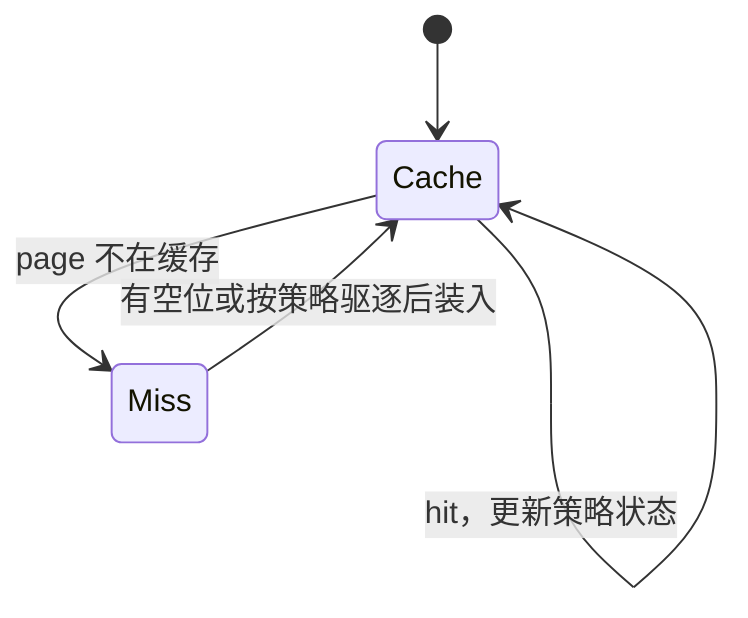

# 不知道下一次请求：分页缓存与竞争分析

> **问题**：在线算法必须在未来未知时驱逐页面；怎样与知道完整未来的离线最优比较，又不把最坏比值误当平均命中率？
>
> **先修**：[[计算机知识/50-数据结构与算法/20-算法设计系统课程/06-随机近似与在线算法|先掌握在线、近似、随机三种合同及滑雪租赁]]。

## 状态和成本

缓存容量 k，请求页已在缓存则 hit，否则 miss 并在满时驱逐。LRU 驱逐最久未访问页；FIFO 驱逐最早进入页；Belady/MIN 驱逐未来最晚再用的页，它需要完整未来，只能作为离线 oracle。

手算 `k=2`、请求 `A,B,C,A,B,C`：

| 请求后 | LRU 缓存 | LRU 累计 miss | MIN 的一个缓存 | MIN 累计 miss |
| --- | --- | ---: | --- | ---: |
| A | A | 1 | A | 1 |
| B | A,B | 2 | A,B | 2 |
| C | B,C | 3 | A,C（B 最晚再用） | 3 |
| A | C,A | 4 | A,C | 3 |
| B | A,B | 5 | B,C（A 不再用） | 4 |
| C | B,C | 6 | B,C | 4 |

## 竞争比不是经验平均

算法 A 若对任意请求序列 σ 满足 `cost_A(σ)≤c·OPT(σ)+b`，称 c-competitive（允许加性常数 b）。它是与离线最优的最坏序列比较，不是“命中率至少 OPT 的 1/c”，也不预测真实工作集分布。

phase 分析把请求序列分成至多含 k 个不同页的阶段，可用来证明 LRU 等标记算法的界。真实系统的预取、脏页写回、多级缓存和不同 miss 成本会改变模型，不能直接由 paging 定理推出 OS 延迟。

随机在线算法还要写对手模型：oblivious 对手先固定序列；adaptive 对手可根据已观察的随机行为选择后续请求。前者下的期望竞争界不能不加说明地搬到后者。

## 一个具体随机策略：MARKING

把请求分成每段至多出现 k 个不同页的 phase。phase 开始时全部页未标记；请求到页就标记。缺页且缓存已满时，从**未标记**缓存页中均匀随机驱逐；若缺页时所有缓存页已标记，先清除全部标记再开始新 phase。这样本 phase 已请求的页不会在同一 phase 内被驱逐。

对预先固定完整序列的 oblivious 对手，经典 phase 分析给 MARKING 的期望成本至多 `2H_k·OPT+O(1)`，其中 `H_k=1+1/2+...+1/k`。这个保证对随机币取期望，不是每次运行都满足的逐轨迹上界，也不覆盖看见驱逐结果后选下一请求的 adaptive 对手。

手算 `k=2`，前一 phase 请求 `A,B` 后两页均标记；新 phase 首次请求 C，先清标记，再从 A/B 中等概率驱逐并标记 C。下一请求 B：若刚才驱逐 A 则命中，若驱逐 B 则缺页，所以这两次请求的期望 miss 是 `1+1/2=1.5`。固定随机种子只会得到 1 或 2，不能替代该期望计算。

## 独立检验

- 每步缓存大小不超过 k，状态轨迹可重放，miss 计数一致。
- 对小页字母表和短序列，用 `(位置,缓存集合)` 动态规划枚举离线最优驱逐，作为 LRU/FIFO oracle。
- 穷举请求串寻找 LRU/FIFO 的坏例；另给高局部性串，区分最坏界与经验表现。
- 随机策略固定并报告对手模型、随机变量与取期望对象。

> [!warning] 错误说法
> Belady 不能在线部署；LRU 不在所有序列都优于 FIFO；竞争比不是平均命中率；随机策略的保证依赖对手何时知道随机结果。

## 成本口径与关系导航

令请求长度为 `T`、缓存容量为 `k`。用哈希表加双向链表时 LRU 每请求期望 `O(1)`、总期望 `O(T)`；若需确定最坏界可换平衡树并付 `O(log k)`。离线 oracle 的状态数随页宇宙和缓存子集指数增长，只用于短序列。

- **先修/主解释**：[[计算机知识/50-数据结构与算法/20-算法设计系统课程/06-随机近似与在线算法|随机、近似与在线算法]]。
- **应用**：[[计算机知识/20-操作系统/02-操作系统原理/10-系统课程/05-虚拟内存置换与工作集|虚拟内存置换与工作集]]。
- **概率边界**：[[计算机知识/50-数据结构与算法/20-算法设计系统课程/16-随机算法期望高概率与适应性对手|随机量词与适应性对手]]。
- **反例与边界**：[[计算机知识/50-数据结构与算法/23-正确性证明反例与复杂度边界|正确性、反例与成本模型]]。

## 来源

- Sleator & Tarjan, “Amortized Efficiency of List Update and Paging Rules”, *Communications of the ACM* 28(2), 1985, DOI `10.1145/2786.2793`：本批实际打开 DOI 重定向到 ACM，落地页拒绝自动读取，故不声称逐页认证。
- [[计算机知识/20-操作系统/02-操作系统原理/10-系统课程/05-虚拟内存置换与工作集|虚拟内存、置换与工作集]]：连接真实页面置换、工作集和系统成本；该页不替代在线算法证明。
- [MIT 6.046J Lecture Notes](https://ocw.mit.edu/courses/6-046j-design-and-analysis-of-algorithms-spring-2015/pages/lecture-notes/)：算法分析与随机性方法的官方课程入口，本批实际打开。
- [Brown CS251：Randomized Paging Algorithms](https://cs.brown.edu/courses/csci2950-w/ranpagingNotes.pdf)：本批实际下载；讲义明确给出 MARKING 规则、oblivious 固定序列的 phase 分析与 `2H_k` 竞争保证。

返回 [[计算机知识/50-数据结构与算法/20-算法设计系统课程/00-算法设计系统课程索引|算法设计系统课程索引]]。
