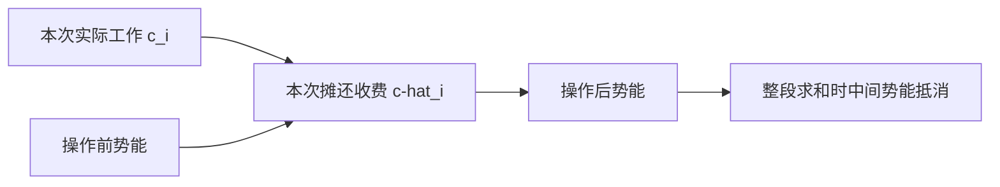
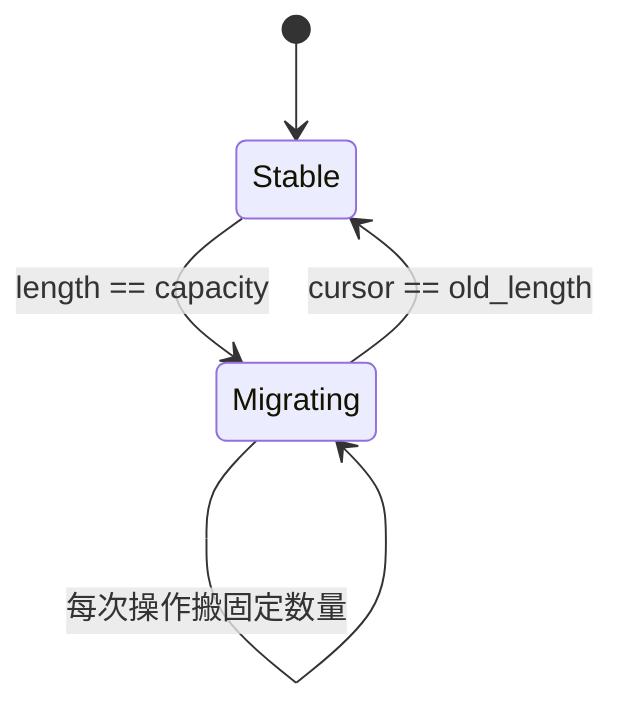

# 数据结构深化：从不变量推到摊还代价

> 阅读定位：抽象数据类型、不变量与实际存储代价。返回 [[计算机知识/00-开始/课程地图/06-数据结构-课程地图|数据结构 · 课程地图]]；全域入口 [[计算机知识/00-开始/全局导航/00-总学习地图|计算机知识库 · 总学习地图]]。

## 抽象数据类型先于存储实现

栈要求后进先出，队列要求先进先出，集合要求成员判定，映射关联键和值。这些是外部可观察合同，不决定内部一定用链表还是数组。选结构应先列操作频率、数据规模、最坏延迟要求、遍历顺序和内存预算，再讨论实现。

以动态数组为例，`len ≤ cap`、已初始化区域 `[0,len)`、未使用容量不可当成已存在元素，是比字段名称更重要的不变量。插入中间位置要搬动后缀，尾部追加也可能触发整体扩容。“vector 追加 O(1)”必须注明摊还意义，不是每次都常数。

## 倍增的总账和逐步账

容量按 1、2、4、8 增长，n 次追加中的搬运形成几何级数，总量为 O(n)，所以平均摊还 O(1)。这不要求输入随机，也不是“平均情况下运气好”。它是对任意符合操作模型的序列总成本的保证。

还可以定义势能 $\Phi=\max(0,2n-m)$，n 是元素数，m 是容量。普通追加实际成本 1，势能最多增加 2，因此摊还成本最多 3；满容量 m 时扩容到 2m，实际成本 m+1，势能从 m 变为 2，摊还成本同样为 3。这里把复制一个元素算单位成本，未计分配器和元素复杂构造开销。

如果删除后立即在半满时缩容，反复在阈值附近增删可能频繁搬运。用四分之一满才缩到一半可留出迟滞区间，避免抖动；需要对删除序列另行分析，不能直接把追加证明当成所有操作的证明。

## 链表为什么不总是更快

已知节点且不需查找时，链表局部插入/删除可以常数修改链接；寻找第 k 项仍可能线性。每个节点含额外指针，分散分配降低局部性。数组搬动很多字节却可能顺序高效，链表少量跳转却可能等待内存。渐近量级与机器代价应同时分析。

哈希表的期望常数查找依赖哈希和负载条件，恶劣冲突、昂贵键比较和重哈希都会改变单次成本。树的对数高度保障与缓存页数又是另一层合同。不要用一个 O 符号遮住全部前提。

## 所有权与失效规则也属于数据结构

扩容会使旧地址上的借用失效，删除节点会使指向该节点的引用悬空，迭代期间修改集合可能破坏遍历约定。C 需要程序员维护，C++ 容器给出具体失效规则，Rust 用借用约束排除部分错误，Python 的容器与迭代器又有自己的动态行为。

练习：实现数组栈和链式栈，分别统计追加、删除、遍历所需操作；构造一次昂贵扩容和一个长序列，解释为什么“某次很慢”和“摊还常数”可以同时成立。内存不足等失败路径也应保持不变量。

## 三种证明是在算同一本总账

设第 $i$ 次操作的实际成本为 $c_i$。聚合法直接证明前 $m$ 次操作总成本 $\sum_i c_i\le mT$；记账法给便宜操作多收“信用”，以后昂贵操作花掉信用；势能法把信用写成状态函数 $\Phi(D_i)$：

$$
\hat c_i=c_i+\Phi(D_i)-\Phi(D_{i-1}).
$$

只要初始势能为 0、整个合法执行中势能非负，就有

$$
\sum_{i=1}^{m}c_i=\sum_{i=1}^{m}\hat c_i-\Phi(D_m)\le\sum_{i=1}^{m}\hat c_i.
$$

势能不是随意给算法“减分”的魔法。它必须只依赖当前状态，单位要与实际成本一致，而且证明要覆盖所有合法操作。换一套操作语义、缩容阈值或复制成本，旧势能可能不再适用。

### 手算一：三位二进制计数器

从 `000` 连续加一到 `111`，把一次位翻转算作 1：

| 操作 | 状态变化 | 实际翻转数 |
| --- | --- | ---: |
| 1 | `000 → 001` | 1 |
| 2 | `001 → 010` | 2 |
| 3 | `010 → 011` | 1 |
| 4 | `011 → 100` | 3 |
| 5 | `100 → 101` | 1 |
| 6 | `101 → 110` | 2 |
| 7 | `110 → 111` | 1 |

总共 11 次翻转，不是 $7\times3$。最低位每次翻，次低位每两次翻，第三位每四次翻；对任意 $m\ge1$ 次加一，总翻转数小于 $2m$（$m=0$ 时总数为 0，应写成非严格界）。也可令势能为当前 1 的个数：翻掉 $t$ 个尾随 1 再写入一个 1 时，实际成本 $t+1$，势能变化 $1-t$，摊还成本恒为 2。

### 手算二：两栈队列

`in` 栈接收 enqueue；`out` 为空且需要 dequeue 时，把 `in` 全部倒入 `out`。序列 `enq(a), enq(b), deq, enq(c), deq, deq` 中，`a,b,c` 每个元素最多进入 `in` 一次、从 `in` 移到 `out` 一次、离开 `out` 一次。某次 `deq` 可能搬很多元素，但任意 $m$ 次操作的总栈动作仍是 $O(m)$。

> [!warning] 这不是单次最坏常数
> 若产品要求每次请求都在固定步骤内完成，摊还界不够。一批元素集中搬迁仍会形成尾延迟尖峰。

## 去摊还：把一次大搬迁摊到后续操作

容量满时不要一次复制全部元素，可以分配新数组并保留 `(old,new,cursor)`。此后每次公开操作除自己的逻辑工作外，最多搬两个旧元素；读取下标时依据 `cursor` 判断元素已在新数组还是仍在旧数组。搬完后才丢弃旧数组。

去摊还的代价是状态机更复杂：迁移期间读写可能访问两份存储，删除与再次扩容要定义，旧地址失效时间也改变。它能控制“每次最多搬几个元素”，却不自动控制分配器、页错误或元素复制构造的耗时。

## 可独立检查的性质

1. 对所有 `m≤2^k-1`，从全零开始做 `m` 次 `k` 位计数，实际翻转总数 `<2m`。
2. 对任意 enqueue/dequeue 序列，每个元素穿过 `in→out` 至多一次；返回序列应与普通列表参考模型一致。
3. 增量迁移数组每次公开操作搬迁元素数不超过约定预算，且逻辑序列与一次性扩容参考模型逐步一致。
4. 内存分配失败时，旧数组和其逻辑长度保持有效；不能先破坏旧状态再报告失败。

## 常见错误说法

- “摊还 $O(1)$”不是“每次最坏 $O(1)$”，也不是某个固定纳秒数。
- 摊还分析约束合法操作序列，不需要假设输入随机；随机算法的期望分析是另一套量词。
- 平均总成本低不保证尾延迟低；需要去摊还或资源预算才有逐操作界。
- 势能函数不能在看见结果后逐步改定义；它要先覆盖完整状态空间。

## 来源与证据边界

- [MIT 6.046J Lecture 5：Amortized Analysis](https://ocw.mit.edu/courses/6-046j-design-and-analysis-of-algorithms-spring-2015/resources/lecture-5-notes/)：聚合、记账与势能方法。本批实际打开该讲资源页，并确认其 PDF 为 `MIT6_046JS15_lec05.pdf`。
- [James Aspnes：Data Structures and Programming Techniques](https://www.cs.yale.edu/homes/aspnes/classes/223/notes.html)：ADT、结构与摊还分析的作者课程笔记入口。
- Robert E. Tarjan, “Amortized Computational Complexity”, *SIAM Journal on Algebraic and Discrete Methods* 6(2), 1985, DOI `10.1137/0606031`：术语与一般方法的原始论文检索锚点；本批未取得论文全文，不把未读段落写成已核验。

本页的计数器、两栈队列与增量迁移例子为独立教学推演。它们证明的是所述单位成本模型，不证明某种语言容器的具体实现或实时延迟。

## 把知识接起来

[[计算机知识/10-编程语言/03-C语言/03-结构体动态内存与资源协议|C：结构体、动态内存与失败时不破坏状态]]；[[计算机知识/10-编程语言/02-C++/12-泛型推导容器算法与约束|C++ 深化：从类型推导到可维护的泛型接口]]；[[计算机知识/10-编程语言/04-Rust/02-所有权借用与生命周期推演|Rust：所有权、借用和生命周期的逐步推演]]；[[计算机知识/30-计算机系统/22-缓存地址翻译一致性与存储层级推演|组成原理深化：缓存、地址翻译与一致性的定量模型]]。

## 规范与进一步核对

参见 [[计算机知识/90-资源/10-本轮权威资料与版本边界#数据结构与算法|数据结构与算法原始资料]]。正文中的例题是本库的教学构造；一般模型不自动等于某一实现。
