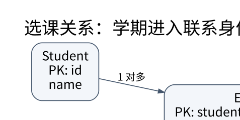

# 关系模型与 ER：先约束合法世界，再编写查询

> **学习位置**：[[计算机知识/00-开始/课程地图/10-数据库-课程地图|数据库课程地图]] · **适用边界**：关系理论；SQL 案例以 PostgreSQL 17 解释，SQLite 实验明确标识。



[PNG 备用图](../../_assets/diagrams/round3/er-enrollment.png) · [可编辑图源](../../_assets/diagrams/round3/er-enrollment.dot)

## 表不是电子表格的另一种文件格式

关系模型用属性、元组和关系表达数据及约束。数学关系是集合；SQL 查询结果通常具有多重集语义，重复行可以保留，NULL 又引入额外语义。讨论关系代数定律时必须说明是否允许重复和 NULL，否则一个理论上正确的变换可能改变 SQL 结果。

模式描述合法数据的形状，实例是某一时刻实际的数据。候选键是能唯一标识元组的最小属性集合，主键是从候选键中选定的一种。超键可以含冗余属性；外键引用被约束的键，表达的是引用完整性，不必与本表主键同名。

## 从业务叙述推导 ER 关系

设计选课系统：学生可以选多门课，每门课有多名学生；学生与课程之间是多对多关系。不能在学生表塞一个逗号分隔课程字符串，否则外键、去重、查询和更新都困难。应引入 Enrollment(student_id, course_id, term, grade)。

如果同一学生可以不同学期重修，主键至少应考虑学期或课程开设实例；只用 `(student_id, course_id)` 会误禁合法重修。若一个学期同课有多个班，还应引入 Section，区分课程定义与一次实际开课。数据模型的难点经常是身份与时间，而不是 SQL 语法。

实体、联系、联系的属性、基数和参与约束要一起画出。弱实体依赖所有者识别，ISA 泛化/特化涉及继承映射；选择单表、多表或具体子类表，需要权衡空值、连接成本和约束可表达性。

## 让数据库承担能可靠表达的约束

```sql
CREATE TABLE student (
    id INTEGER PRIMARY KEY,
    name TEXT NOT NULL
);
CREATE TABLE course (
    id INTEGER PRIMARY KEY,
    title TEXT NOT NULL
);
CREATE TABLE enrollment (
    student_id INTEGER NOT NULL REFERENCES student(id),
    course_id INTEGER NOT NULL REFERENCES course(id),
    term TEXT NOT NULL,
    grade INTEGER CHECK (grade BETWEEN 0 AND 100),
    PRIMARY KEY (student_id, course_id, term)
);
```

这里允许 grade 为 NULL，表示尚未评分：CHECK 一般拒绝 FALSE，而 UNKNOWN 不自动失败，所以 `CHECK (grade >= 0)` 不能代替 NOT NULL。名字不应默认当唯一身份，现实中会重名与改名。SQLite 实验需在事务外显式启用并验证 `PRAGMA foreign_keys=ON`；不能把在一个引擎里的默认配置想当然套给另一个。

跨多行的“全班人数不超过容量”不能靠某一行简单 CHECK 完整解决；需要恰当的事务、锁、可串行化或经审查的维护机制。应用层先查再写而没有并发控制，会在两个请求同时通过检查时失效。

## 关系代数连接到 SQL

选择筛行，投影选属性，连接根据关系条件组合元组，并差交表达集合操作，重命名消除歧义。除法可表达“选修了所有必修课”的全称条件；SQL 常用双重 NOT EXISTS 实现“没有一门必修课是他没选的”。这是把自然语言量词转成查询，而非背一条模板。

**练习**：业务说“邮箱唯一”时还缺什么条件？应明确是否允许 NULL、大小写规则、规范化方式、邮箱变更与历史保留、一个人能否有多个地址。约束只能正确实现一个定义明确的规则，不能替含糊业务自动补全意图。

## 关联阅读

- [[计算机知识/55-数据库/10-系统课程/02-函数依赖规范化与设计权衡|函数依赖与规范化：为什么拆表，以及怎样证明没拆坏]]
- [[计算机知识/55-数据库/10-系统课程/03-SQL查询语义与窗口函数|SQL 的逻辑语义：NULL、外连接、聚合和窗口]]
- [[计算机知识/10-编程语言/05-TypeScript/10-系统课程/07-Web边界安全与全栈协议|Web 边界、安全与全栈协议：类型不能跨过网络自动延续]]

## 依据与继续查证

- [PostgreSQL 17 文档（案例方言，不代表所有数据库）](https://www.postgresql.org/docs/17/)
- [SQLite 文档（本地实验引擎）](https://www.sqlite.org/docs.html)
- [CMU 15-445/645（数据库系统原课程）](https://15445.courses.cs.cmu.edu/fall2024/)

本页的例子、推演与练习为教学构造；语言契约、系统接口和版本相关结论应结合以上原始文档核对。

<!-- COURSE SEQUENCE -->
## 顺序导航与验证

[[计算机知识/55-数据库/10-系统课程/00-数据库系统课程索引|本课程总索引]] · [[计算机知识/_labs/round3/DB/数据库-实验说明|本课程实验]]

下一讲：[[计算机知识/55-数据库/10-系统课程/02-函数依赖规范化与设计权衡|函数依赖与规范化：为什么拆表，以及怎样证明没拆坏]]
<!-- END COURSE SEQUENCE -->
