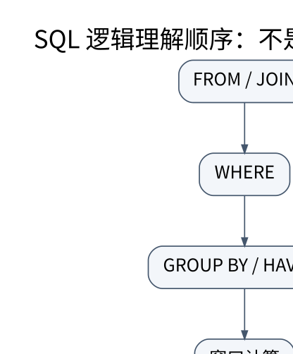

# SQL 的逻辑语义：NULL、外连接、聚合和窗口

> **学习位置**：[[计算机知识/00-开始/课程地图/10-数据库-课程地图|数据库课程地图]] · **适用边界**：关系理论；SQL 案例以 PostgreSQL 17 解释，SQLite 实验明确标识。



[PNG 备用图](../../_assets/diagrams/round3/sql-order.png) · [可编辑图源](../../_assets/diagrams/round3/sql-order.dot)

## 查询先问“哪些行”，再问“怎样运行”

概念上可按 FROM/JOIN、WHERE、GROUP BY、HAVING、窗口计算、SELECT、DISTINCT、ORDER BY、LIMIT 等阶段理解查询，但这是语义辅助，不是数据库必须执行的物理顺序。优化器可以交换许多操作，只要维持该方言规定的结果。

SQL 通常保留重复行；没有 ORDER BY 就没有可依赖的输出顺序。分页需要稳定排序，通常加入唯一键打破并列；仅按非唯一时间排序，即使没有明显业务变更，两页也可能缺行或重复。大偏移分页可考虑基于最后键值的游标式方案，同时定义并发更新时的一致性需求。

## NULL 的三值逻辑要用反例记住

`NULL = NULL` 不是 TRUE；`IS NULL` 才用于空值判断。WHERE 只保留条件为 TRUE 的行，FALSE 与 UNKNOWN 都被过滤。

### 把反连接的三种结果逐行算完

令外层 `o.x` 依次为 `{1, 2, NULL}`，子查询 `r.y` 为 `{1, NULL}`。下面按 PostgreSQL 17 的三值语义推演；本例未实跑数据库。

```sql
WITH outer_values(x) AS (VALUES (1), (2), (NULL)),
     rhs(y) AS (VALUES (1), (NULL))
SELECT o.x,
       o.x NOT IN (SELECT y FROM rhs) AS not_in,
       NOT EXISTS (SELECT 1 FROM rhs AS r WHERE r.y = o.x) AS not_exists
FROM outer_values AS o;
```

| `o.x` | `NOT IN` 结果 | 等值 `NOT EXISTS` 结果 |
| --- | --- | --- |
| `1` | FALSE，过滤 | FALSE，过滤 |
| `2` | UNKNOWN，过滤 | TRUE，保留 |
| `NULL` | UNKNOWN，过滤 | TRUE，保留 |

表中“保留/过滤”指把相应条件放入 `WHERE` 时的结果：`NOT IN` 不留任何行，等值 `NOT EXISTS` 保留 `2` 与外层 NULL。`2 NOT IN (1, NULL)` 要同时满足 `2 <> 1` 与 `2 <> NULL`；后一项为 UNKNOWN，所以整体不是 TRUE。外层为 NULL 时，比较也为 UNKNOWN。相反，相关 `NOT EXISTS` 只问等值谓词是否产生 TRUE 的匹配行；`r.y = NULL` 不会为 TRUE，因此默认等值语义把外层 NULL 当作“未匹配”而保留。

这不是无需约束的等价替换。若业务规定外层 NULL 是未知键、不得进入反连接结果，应明确写为：

```sql
WHERE o.x IS NOT NULL
  AND NOT EXISTS (SELECT 1 FROM rhs AS r WHERE r.y = o.x)
```

在本表中它只保留 `2`。若业务反而规定两个 NULL 代表同一可匹配缺失类别，应使用 PostgreSQL 的 `IS NOT DISTINCT FROM` 明确定义该比较，不能假定普通 `=` 会匹配两个 NULL。

要把“没有匹配行”用于知识问答，转到[[AI/13-搜索推理与规划/05-知识表示规则归结与查询#同一查询：未推出、表内无匹配与证据不足|同一关系的模型、表与材料合同]]，用两模型检查为何这里的UNKNOWN不等于经典开放世界的未决定，再返回本节复算外层NULL。NULL也可能来自未知字段、外连接补行或空聚合；须依据各自合同解释。

COUNT(*) 计行，COUNT(col) 忽略该列 NULL；SUM 在没有输入行时通常返回 NULL，而不是自动返回 0。业务要求 0 时显式 COALESCE，但不要把“未知金额”随意等同于 0。

空集合是另一件事：

```sql
SELECT COUNT(*) AS n, SUM(amount) AS total
FROM (VALUES (10), (NULL), (20)) AS t(amount)
WHERE FALSE;
-- n = 0, total = NULL
```

`COUNT(*)` 对空输入给 0；`SUM` 与除 `count` 外的一般聚合对空输入给 NULL。这里的 NULL 表示没有可聚合的行，和某一已有行的 `amount` 为 NULL 要分开理解。

## 外连接过滤的位置决定是否保留空匹配

```sql
SELECT s.id, COUNT(e.course_id) AS n
FROM student AS s
LEFT JOIN enrollment AS e
  ON e.student_id = s.id AND e.term = '2026A'
GROUP BY s.id;
```

此查询保留没有该学期选课记录的学生，计数为 0。若把 `e.term='2026A'` 移到 WHERE，NULL 扩展行被过滤，没有匹配的学生会消失。COUNT(*) 在 LEFT JOIN 后还会数到那一条扩展行，因此此处用非空匹配列计数。不能机械地把所有过滤条件“下推”而不检查外连接语义。

## 窗口保留行身份，聚合通常压缩行

设同一账户按 id 排列金额为 10、20、20。求逐笔累计：

```sql
SELECT id, amount,
       SUM(amount) OVER (
         PARTITION BY account_id ORDER BY id
         ROWS BETWEEN UNBOUNDED PRECEDING AND CURRENT ROW
       ) AS running_total
FROM payment
ORDER BY account_id, id;
```

若 id 唯一，结果为 10、30、50。窗口 ORDER BY 不保证最终输出顺序，所以外层仍给 ORDER BY。按 amount 排序并使用包含同值 peer 的默认框架时，两行 20 可能都看到累计 50；ROWS 与 RANGE 不是两个等价写法。

ROW_NUMBER 给每行编号；RANK 对并列共享名次并跳号；DENSE_RANK 不跳号。取“部门前两名”应明确是两个人还是两档成绩，分别对应不同策略。窗口结果需要在子查询或适用方言的后续过滤结构中筛选，不能假定能直接放进同层 WHERE。

### 从测量记录返回：四条身份、两组和一个汇总值

带着本节的行语义去[[计算机知识/10-编程语言/01-Python/10-系统课程/11-记录流统计与数据语义#阶段三：缺失与重复改变的是行集|Python测量记录]]：SQLite表 `samples(sample_id,tick_ms,code)` 已提交 a=(0,2)、b=(1000,4)、c=(2000,6)、d=(3000,8)，sample_id 为主键，时间单位 ms，码范围0..4095。默认1 mV/码、零偏置使下列码统计与 mV 统计的数值一致。以下为实际 SQLite 查询，不能用本节 PostgreSQL 的其他语法直接推断其支持情况。

```sql
SELECT sample_id, tick_ms, code FROM samples ORDER BY sample_id;
SELECT code % 4 AS bucket, COUNT(*) AS n, SUM(code) AS total
FROM samples GROUP BY code % 4 ORDER BY bucket;
SELECT COUNT(*) AS n, SUM(code) AS total, AVG(code) AS mean
FROM samples;
SELECT sample_id, code, COUNT(*) OVER () AS n, AVG(code) OVER () AS mean
FROM samples ORDER BY sample_id;
```

第一句保留四条身份行。第二句得到两行 `(bucket,n,total)=(0,2,12),(2,2,8)`；按码的余数分组只用于展示聚合如何压缩行，不声称这两个组是物理通道。第三句得到一行 `(4,20,5.0)`。第四句仍有四行，各带 n=4、mean=5.0；重复出现的窗口统计不是四个互相独立的总体均值，也不能再把 n 列相加当样本数。

这里拒绝缺失码后才写入 NOT NULL 列，故 `COUNT(code)=COUNT(*)`。普通SQL表允许NULL时，两种计数可能不同；`AVG` 跳过NULL也不会自动完成身份去重。相同ID同内容的重放仍四行，冲突则由[[计算机知识/10-编程语言/01-Python/10-系统课程/12-可恢复导入器与安装交付#两行一批：失败之后，哪些数据已经存在|Python当前批事务]]拒绝，而非依赖一个容器“最后覆盖”的默认动作。Python列表位置、字典键、数组索引与SQL主键须分别声明合同。

撤去步骤提示：在同一库加 `WHERE code>=6`，预测身份、分母与均值。答案是 c/d、N=2、均值7 mV；描述性方差1 mV²、RMS²50 mV²。去[[计算机知识/10-编程语言/01-Python/10-系统课程/13-科学数组与独立统计对照#输出一致支持哪一份输入|选定行集的数值对照]]返回核对：这个查询回答高码子集的问题，不能与全四行均值5的计算混成同一算法对照。项目 `examples/row_semantics.py` 用独立SQLite与Fraction复算上述行集、分组、窗口和单位；数据库行语义成立不证明选择后的样本代表原总体。[SQLite聚合函数](https://www.sqlite.org/lang_aggfunc.html)与[窗口函数](https://www.sqlite.org/windowfunctions.html)分别规定这两类查询。
## 子查询、递归和修改语句

相关子查询按外层变量表达依赖，不代表引擎必然逐行重新运行。CTE 可以改善可读性，其物化与内联策略依方言和版本而变；递归 CTE 必须考虑终止条件与环。UPDATE/DELETE 需要约束目标集合并在事务中验证影响行数，MERGE/UPSERT 的冲突语义也有引擎差异。

**练习**：金额为 10、NULL、20 时 COUNT(*)、COUNT(amount)、SUM(amount) 分别是什么？分别为 3、2、30。再把输入筛成空集合：COUNT(*) 为 0，SUM(amount) 为 NULL；这样才能看清“忽略 NULL”和“空输入的结果”是两个问题。

## 关联阅读

- [[计算机知识/55-数据库/10-系统课程/01-关系模型ER与约束设计|关系模型与 ER：先约束合法世界，再编写查询]]
- [[计算机知识/55-数据库/10-系统课程/06-查询优化器连接与执行模型|查询优化：从关系表达式到有证据的执行计划]]
- [[计算机知识/10-编程语言/01-Python/10-系统课程/07-类型协议数据边界与安全|类型、协议与数据边界：静态说明不能代替运行时验证]]

## 依据与继续查证

- [PostgreSQL 17 文档（案例方言，不代表所有数据库）](https://www.postgresql.org/docs/17/)
- [PostgreSQL 17：子查询表达式（EXISTS、IN、NOT IN）](https://www.postgresql.org/docs/17/functions-subquery.html)
- [PostgreSQL 17：聚合函数（count 与空输入）](https://www.postgresql.org/docs/17/functions-aggregate.html)
- [SQLite 文档（本地实验引擎）](https://www.sqlite.org/docs.html)
- [CMU 15-445/645（数据库系统原课程）](https://15445.courses.cs.cmu.edu/fall2024/)

本页的例子、推演与练习为教学构造；语言契约、系统接口和版本相关结论应结合以上原始文档核对。

<!-- COURSE SEQUENCE -->
## 顺序导航与验证

[[计算机知识/55-数据库/10-系统课程/00-数据库系统课程索引|本课程总索引]] · [[计算机知识/_labs/round3/DB/数据库-实验说明|本课程实验]]

上一讲：[[计算机知识/55-数据库/10-系统课程/02-函数依赖规范化与设计权衡|函数依赖与规范化：为什么拆表，以及怎样证明没拆坏]]

下一讲：[[计算机知识/55-数据库/10-系统课程/04-可串行化锁与MVCC|事务隔离：用并发历史判断，而不是只背 ACID]]
<!-- END COURSE SEQUENCE -->

<!-- ORIGINAL DEEP LINKS -->
## 与原有长篇专题衔接

- [[计算机知识/55-数据库/02-SQL连接聚合子查询窗口与NULL|02-SQL连接聚合子查询窗口与NULL]]

新旧讲解采用的版本与模型可能不同，比较时先核对各自前提，不把教学简化当成实现细节。
<!-- END ORIGINAL DEEP LINKS -->
