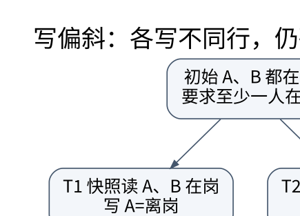

# 事务隔离：用并发历史判断，而不是只背 ACID

> **学习位置**：[[计算机知识/00-开始/课程地图/10-数据库-课程地图|数据库课程地图]] · **适用边界**：关系理论；SQL 案例以 PostgreSQL 17 解释，SQLite 实验明确标识。

[PNG 备用图](../../_assets/diagrams/round3/write-skew.png) · [可编辑图源](../../_assets/diagrams/round3/write-skew.dot)

## 原子性不等于隔离性

原子性讨论事务内部效果是否全有或全无；持久性讨论提交后在约定故障模型下是否可恢复；隔离性约束并发观察；一致性需要业务约束与数据库机制共同维持。数据库无法替错误业务逻辑自动定义“正确余额”。

两人同时从余额 100 读取，分别决定减 10 和减 20，然后写入 90 与 80，最终 80 而非 70，这是丢失更新的典型形态。使用数据库内原子 `balance=balance-amount` 可避免这个具体读改写模式，但不能自动保证跨行余额、额度或其他业务约束。

## 冲突图给出可检查的证明对象

读写同一对象且至少一方为写，来自不同事务的操作就可能冲突。按历史顺序给事务之间加有向边；图无环时，历史冲突可串行化，拓扑序给出等价串行次序。若 T1 写 A 先于 T2 读 A，则有 T1→T2；若 T2 写 B 又先于 T1 读 B，则形成环。

冲突可串行化是可串行化的一种重要可判定刻画，但视图可串行化更一般。严格性、无级联回滚和可恢复性又涉及读取未提交结果与提交顺序，不能都压成一个“事务安全”的标签。

## 两阶段锁与多版本解决不同冲突

两阶段锁先扩张获取锁，再收缩释放锁；严格变体保留写锁到结束等约束有利于恢复。锁会引入等待和死锁，系统需要检测/超时/预防及重试策略。行锁、范围锁、谓词锁与意向锁服务不同粒度，防止幻读不只是把已有几行锁住。

MVCC 保留多个版本，让读操作按快照选择可见版本。版本需要垃圾回收，长事务可能阻碍清理。MVCC 不等于完全无锁，不等于所有事务都可串行化，也不等于永远不会冲突。

## 写偏斜：最值得亲自画的反例

值班表初始 A=在岗、B=在岗，规则至少一人在岗。T1 和 T2 都读到两人在岗；T1 把 A 改为离岗，T2 把 B 改为离岗。两事务写不同的行，快照隔离可能允许二者提交，最终无人值班。不存在简单的同一行覆盖，但跨行不变量已破坏。

解决思路包括可串行化隔离并处理重试，或锁定能代表该约束的共同对象并正确设计事务。只锁各自要修改的行不够；把检查和更新都放进事务也不够，关键仍是并发语义。

## PostgreSQL 17 的具体边界

其 Read Committed 通常按语句取得快照；Repeatable Read 采用快照隔离，可避免某些标准表格中允许的现象，但仍可能发生序列化异常；Serializable 增加机制检测会破坏串行化的依赖，并可能报错要求重试。重试必须重做整个事务的读与决策，不能只补最后一条 UPDATE。序列号分配等行为也不能假定随普通事务回滚而“退回”。

SQLite 的并发与事务实现不能充当 PostgreSQL 多版本隔离实验的替身。本包 SQLite 实验用于 SQL、约束及回滚，不宣称复现 PostgreSQL 的 SSI 行为。

**练习**：快照一致，是否意味着读到的是“数据库现在最新的一切”？不是。快照提供某个规则定义的可见版本集合；一致视图与实时最新是不同要求。阅读业务需求时应先说明哪一种是必要的。

<!-- ROUND4 DEPTH LINKS -->
## 继续推演本页难点

[[计算机知识/55-数据库/10-系统课程/10-MVCC快照写偏斜与重试协议|可重复读为什么仍可能让两个值班医生同时离岗？]] 本专题补上完整推导、并发历史或恢复条件。

这不是替换本页：先掌握原理，再用补充页核对容易被一句话略过的条件。
<!-- END ROUND4 DEPTH LINKS -->

## 关联阅读

- [[计算机知识/20-操作系统/02-操作系统原理/10-系统课程/03-同步条件变量与经典问题|同步、条件变量与经典问题：保护不变量，而不是保护几行代码]]
- [[计算机知识/55-数据库/10-系统课程/07-恢复复制与分布式事务|恢复、复制与分布式事务：提交成功意味着什么]]
- [[计算机知识/35-计算机网络/10-系统课程/08-网络安全分布式边界与全景|网络知识全景：安全、无线、组播与分布式语义]]

## 依据与继续查证

- [PostgreSQL 17 文档（案例方言，不代表所有数据库）](https://www.postgresql.org/docs/17/)
- [SQLite 文档（本地实验引擎）](https://www.sqlite.org/docs.html)
- [CMU 15-445/645（数据库系统原课程）](https://15445.courses.cs.cmu.edu/fall2024/)

本页的例子、推演与练习为教学构造；语言契约、系统接口和版本相关结论应结合以上原始文档核对。

<!-- COURSE SEQUENCE -->
## 顺序导航与验证

[[计算机知识/55-数据库/10-系统课程/00-数据库系统课程索引|本课程总索引]] · [[计算机知识/_labs/round3/DB/数据库-实验说明|本课程实验]]

上一讲：[[计算机知识/55-数据库/10-系统课程/03-SQL查询语义与窗口函数|SQL 的逻辑语义：NULL、外连接、聚合和窗口]]

下一讲：[[计算机知识/55-数据库/10-系统课程/05-页布局索引与查询代价|数据库的物理组织：一条记录怎样落到磁盘页上]]
<!-- END COURSE SEQUENCE -->

<!-- ORIGINAL DEEP LINKS -->
## 与原有长篇专题衔接

- [[计算机知识/55-数据库/04-事务隔离锁MVCC与并发异常|04-事务隔离锁MVCC与并发异常]]

新旧讲解采用的版本与模型可能不同，比较时先核对各自前提，不把教学简化当成实现细节。
<!-- END ORIGINAL DEEP LINKS -->
