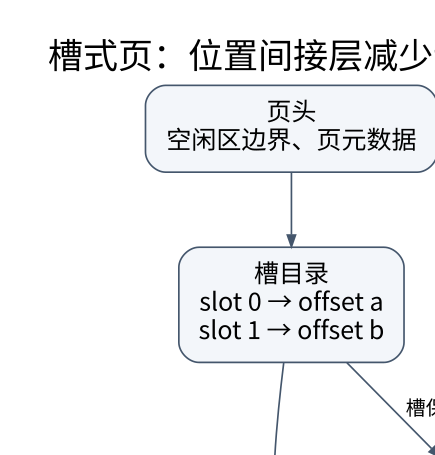

# 数据库的物理组织：一条记录怎样落到磁盘页上

> **学习位置**：[[计算机知识/00-开始/课程地图/10-数据库-课程地图|数据库课程地图]] · **适用边界**：关系理论；SQL 案例以 PostgreSQL 17 解释，SQLite 实验明确标识。

[PNG 备用图](../../_assets/diagrams/round3/slotted-page.png) · [可编辑图源](../../_assets/diagrams/round3/slotted-page.dot)

## 页是 I/O 与缓冲管理的重要单位

逻辑表是一组行，存储引擎需要把它编码到页。槽式页用页头、槽目录、记录区和空闲区组织变长记录；移动记录时可更新槽偏移，避免所有引用都直接指向易变字节位置。删除、更新与压缩会形成空洞，长记录还可能放到溢出区域。

缓冲池把磁盘页暂存在内存，页命中节省 I/O；脏页需要按日志与恢复约束刷回。pin 防止使用中的页被驱逐，latch 保护短期内存结构操作，事务 lock 保护逻辑并发语义，三者不是同一概念。

## 为什么 B+ 树适合页存储

较大扇出减少层数，内部节点用于导航，叶节点容纳条目并支持范围遍历。假设一个简化 4 KiB 内部页可放约 200 个子指针，三层结构可导航数量级为数百万的叶条目；这只是估算，实际容量受页头、键长、填充率和叶记录大小影响。

插入导致页满时分裂并向父节点传播分隔键，根分裂增加高度。删除可能借位或合并，但实际实现可能延迟整理以减少写放大。理解算法不等于知道某数据库的每一个页面格式，应把通用机制与具体引擎资料分开。

## 组合索引不是“把几个单列索引装一起”

索引 `(tenant_id, created_at, id)` 按字典序组织。查询某 tenant 的时间范围，通常能定位连续区间；只按 created_at 查所有 tenant，则不能简单假设同样高效。能否跳过前列、使用位图组合或其他路径依引擎而定，不能把“最左前缀”口诀当所有实现的绝对能力上限。

覆盖索引可能避免额外取行，但是否真的做到只读索引，还涉及可见性检查等引擎条件。索引越多并非越快：写入需维护每棵结构，空间与缓存占用也增加。低选择性条件在返回大量行时，顺序扫描可能比大量随机取页更经济。

## 算一次代价，而不是迷信索引

假设表有 100000 页，查询返回分散在 40000 页中的记录。一个索引路径即使树高只有 3，最终仍可能访问大量数据页；“查树只需三次 I/O”遗漏了取行成本。若数据聚簇良好，同样记录数可能集中在少数连续页，这解释了选择性与聚簇性为何都影响计划。

随机 I/O 与顺序 I/O 的差距在 SSD 上通常不同于机械盘，但并不意味着所有访问模式成本相同。CPU 解码、压缩、分支、缓存和并发也可能成为瓶颈。

## 其他物理结构

哈希索引擅长特定等值查找，范围访问不自然；位图适合某些分析负载；倒排索引支持词项到文档映射；LSM 把写入积累再归并，需权衡读放大、写放大、空间放大与压缩策略。行存有利于按行访问多个属性，列存让分析查询跳过无关列并利用编码压缩。

**练习**：为什么把邮件正文放进每个索引键可能伤害性能？大键降低扇出、增加树高与维护成本，还挤占缓存。索引设计应从查询谓词、排序、投影和更新频率出发，不是把所有可能读取的内容都复制进去。

<!-- ROUND4 DEPTH LINKS -->
## 继续推演本页难点

[[计算机知识/55-数据库/10-系统课程/11-连接基数索引选择与优化器误估|有索引却走全表扫描，是优化器失灵还是更便宜？]] 本专题补上完整推导、并发历史或恢复条件。

这不是替换本页：先掌握原理，再用补充页核对容易被一句话略过的条件。
<!-- END ROUND4 DEPTH LINKS -->

## 关联阅读

- [[计算机知识/50-数据结构与算法/10-数据结构系统课程/04-多路树外存与持久化|多路树、外存与持久化：一次访问尽量带回更多信息]]
- [[计算机知识/30-计算机系统/10-组成原理系统课程/05-缓存地址划分与AMAT|缓存地址划分与 AMAT：从一次地址访问算起]]
- [[计算机知识/55-数据库/10-系统课程/06-查询优化器连接与执行模型|查询优化：从关系表达式到有证据的执行计划]]

## 依据与继续查证

- [PostgreSQL 17 文档（案例方言，不代表所有数据库）](https://www.postgresql.org/docs/17/)
- [SQLite 文档（本地实验引擎）](https://www.sqlite.org/docs.html)
- [CMU 15-445/645（数据库系统原课程）](https://15445.courses.cs.cmu.edu/fall2024/)

本页的例子、推演与练习为教学构造；语言契约、系统接口和版本相关结论应结合以上原始文档核对。

<!-- COURSE SEQUENCE -->
## 顺序导航与验证

[[计算机知识/55-数据库/10-系统课程/00-数据库系统课程索引|本课程总索引]] · [[计算机知识/_labs/round3/DB/数据库-实验说明|本课程实验]]

上一讲：[[计算机知识/55-数据库/10-系统课程/04-可串行化锁与MVCC|事务隔离：用并发历史判断，而不是只背 ACID]]

下一讲：[[计算机知识/55-数据库/10-系统课程/06-查询优化器连接与执行模型|查询优化：从关系表达式到有证据的执行计划]]
<!-- END COURSE SEQUENCE -->

<!-- ORIGINAL DEEP LINKS -->
## 与原有长篇专题衔接

- [[计算机知识/55-数据库/05-页索引执行计划与查询优化|05-页索引执行计划与查询优化]]

新旧讲解采用的版本与模型可能不同，比较时先核对各自前提，不把教学简化当成实现细节。
<!-- END ORIGINAL DEEP LINKS -->
