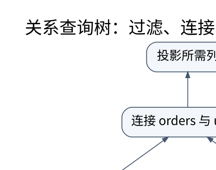

# 查询优化：从关系表达式到有证据的执行计划

> **学习位置**：[[计算机知识/00-开始/课程地图/10-数据库-课程地图|数据库课程地图]] · **适用边界**：关系理论；SQL 案例以 PostgreSQL 17 解释，SQLite 实验明确标识。

[PNG 备用图](../../_assets/diagrams/round3/query-plan.png) · [可编辑图源](../../_assets/diagrams/round3/query-plan.dot)

## 声明式查询留下了实现自由

同一个连接可以用嵌套循环、索引嵌套循环、哈希连接或排序归并连接执行。嵌套循环不总是坏：外侧只有几行且内侧有合适索引时可能很好。哈希连接也不总是好：构建侧过大、内存不足或键分布偏斜可能导致溢写和热点。

优化器先解析和绑定名称，验证类型，再进行等价改写，枚举物理路径并估计代价。等价改写必须尊重 NULL、重复、外连接、表达式副作用与方言规则；SQL 优化与编译器优化都首先是语义保持问题。

## 估计误差怎样放大

设 A 有 100 万行，B 有 1 万行，按某键等值连接。粗略均匀独立模型常用两边行数之积除以较大的不同值数估计结果，但真实数据可能强烈相关或倾斜。若“国家=某国”与“城市=某市”高度相关，逐个选择率相乘会严重失真。

早期估计把 100000 行误判为 10 行，可能选择大量内侧随机探测的嵌套循环；错误不仅体现在显示的一个数字，还会改变连接次序、内存预算和并行策略。直方图、最常见值、联合统计和更新统计信息是改进估计的工具，但不是消除所有不确定性的魔法。

## 连接次序是组合优化问题

A、B、C 的连接先算 AB 还是 BC，可能让中间结果差几个数量级。基于动态规划的枚举为子集合保存有用计划；搜索空间太大时需要启发式或限制。最小估计代价的计划只是模型下的选择，模型可能因缓存、参数值或资源竞争而偏离实际。

谓词下推可以早过滤，投影下推可以减少携带列，但并非所有操作都可任意跨过外连接、聚合和窗口。子查询去相关与共同子表达式复用也应以结果等价为前提。

## 执行引擎怎样传递数据

火山迭代器模型由算子逐行拉取，接口简单，但调用与分支开销可能明显；向量化执行一次处理一批值，改善 CPU 利用；代码生成把专门化查询编译成机器执行路径。流水化减少中间物化，但排序、某些聚合和哈希构建是阻塞或部分阻塞阶段。

并行查询按数据或算子分工，速度受串行部分、重分区、数据倾斜及内存带宽限制。把线程数加倍不保证查询时间减半。

## 读 EXPLAIN 的顺序

先核对返回结果，再看估计行数与实际行数差异、循环次数、扫描方式、连接次序、过滤位置、缓冲命中与临时文件。PostgreSQL 的代价单位不是直接的毫秒；某些实际行数和时间要结合 loops 理解。`EXPLAIN ANALYZE` 会真正执行语句，修改操作应在隔离实验库中进行，不能把它当无副作用预览。

保存数据规模、索引定义、统计更新时间、参数、计划和多次运行的分布，再比较一次有明确假设的改动。只截一张“更快”的截图不足以排除缓存变暖、样本偏差和并发噪声。

**练习**：查询从 10 ms 变成 2 ms，能否认定索引提升 5 倍？需控制结果相同、数据相同、缓存状态、并发、测量位置，并重复实验。可能是优化，也可能只是第一次冷缓存与第二次热缓存的差别。

<!-- ROUND4 DEPTH LINKS -->
## 继续推演本页难点

[[计算机知识/55-数据库/10-系统课程/11-连接基数索引选择与优化器误估|有索引却走全表扫描，是优化器失灵还是更便宜？]] 本专题补上完整推导、并发历史或恢复条件。

这不是替换本页：先掌握原理，再用补充页核对容易被一句话略过的条件。
<!-- END ROUND4 DEPTH LINKS -->

## 关联阅读

- [[计算机知识/50-数据结构与算法/20-算法设计系统课程/04-动态规划状态设计与优化|动态规划状态设计与优化：状态必须保留未来需要的信息]]
- [[计算机知识/70-编译原理/10-系统课程/06-优化等价性数据流与陷阱|优化必须保持什么：别名、溢出、异常与浮点]]
- [[计算机知识/10-编程语言/01-Python/10-系统课程/06-测试属性验证与性能方法|测试、属性验证与性能方法：把结论变成可反驳的实验]]

## 依据与继续查证

- [PostgreSQL 17 文档（案例方言，不代表所有数据库）](https://www.postgresql.org/docs/17/)
- [SQLite 文档（本地实验引擎）](https://www.sqlite.org/docs.html)
- [CMU 15-445/645（数据库系统原课程）](https://15445.courses.cs.cmu.edu/fall2024/)

本页的例子、推演与练习为教学构造；语言契约、系统接口和版本相关结论应结合以上原始文档核对。

<!-- COURSE SEQUENCE -->
## 顺序导航与验证

[[计算机知识/55-数据库/10-系统课程/00-数据库系统课程索引|本课程总索引]] · [[计算机知识/_labs/round3/DB/数据库-实验说明|本课程实验]]

上一讲：[[计算机知识/55-数据库/10-系统课程/05-页布局索引与查询代价|数据库的物理组织：一条记录怎样落到磁盘页上]]

下一讲：[[计算机知识/55-数据库/10-系统课程/07-恢复复制与分布式事务|恢复、复制与分布式事务：提交成功意味着什么]]
<!-- END COURSE SEQUENCE -->

<!-- ORIGINAL DEEP LINKS -->
## 与原有长篇专题衔接

- [[计算机知识/55-数据库/05-页索引执行计划与查询优化|05-页索引执行计划与查询优化]]

新旧讲解采用的版本与模型可能不同，比较时先核对各自前提，不把教学简化当成实现细节。
<!-- END ORIGINAL DEEP LINKS -->
