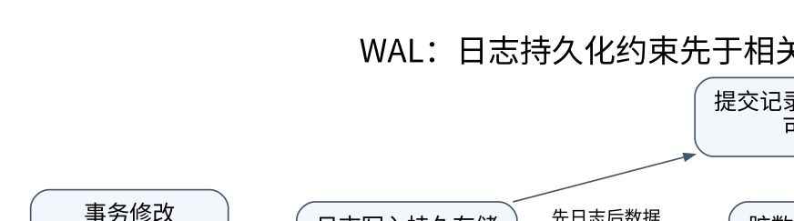

# 恢复、复制与分布式事务：提交成功意味着什么

> **学习位置**：[[计算机知识/00-开始/课程地图/10-数据库-课程地图|数据库课程地图]] · **适用边界**：关系理论；SQL 案例以 PostgreSQL 17 解释，SQLite 实验明确标识。

[PNG 备用图](../../_assets/diagrams/round3/wal-order.png) · [可编辑图源](../../_assets/diagrams/round3/wal-order.dot)

## 先说明故障模型

进程崩溃、操作系统崩溃、断电、磁盘损坏与机房丢失并不等价。持久化保证依赖日志刷盘、存储设备兑现写入承诺、复制配置及恢复策略。事务返回成功不应被泛化为“无论所有硬件如何损毁都永不丢失”。

WAL 的核心约束是：相关数据页落盘前，恢复所需日志先满足持久化要求。提交通常需要对应提交信息达到约定持久点，不要求所有修改的数据页立即写回。因此随机数据页写可以延后，而恢复通过日志重建所需状态。

## 撤销与重做为什么同时存在

若允许未提交修改被刷出（steal），崩溃后可能需要撤销；若提交不强制所有数据页立即落盘（no-force），可能需要重做。不同系统采用不同日志与版本设计，不应把某一种教材恢复算法的每个步骤硬套给全部数据库。

ARIES 的经典思路包括分析、重做历史与撤销未完成事务，使用日志序号和补偿日志记录支持恢复中的再次崩溃。检查点缩短恢复需要扫描或处理的范围，但不是“把日志清空”或“从此不需要备份”。

例：T1 修改 A 并提交，其日志持久化但数据页未写；T2 修改 B 未提交，却有页面变化落盘。崩溃后需要保留 T1 效果、去掉 T2 不应存在的效果。只恢复磁盘页原样或只重放所有写入都会错误。

## 复制不是备份

同步复制可让提交等待更多副本达到某状态，提高某些故障下的保留能力，但增加延迟并影响可用性；异步复制降低提交等待，却可能在故障切换时丢失尚未复制的已确认变化。具体“同步到哪里”应区分接收、刷盘和应用。

副本可能忠实复制误删与逻辑损坏，所以仍需要可恢复的历史备份。PITR 结合基础备份和持续日志回放到目标时间或位置；验收应真的恢复到隔离环境并检查数据，而不是只看到备份命令返回 0。

读副本可能滞后，刚写后立刻从副本读不到并不一定是写失败。读己之写、单调读、线性一致性等要求需要路由或协议支持。选主还要避免旧主继续写入的脑裂，通常需要任期、仲裁与 fencing 等机制。

## 两阶段提交与共识不要混为一谈

两阶段提交先让参与者准备，再由协调者决定提交或回滚，解决跨参与者原子决定。参与者进入准备后在某些故障情形可能阻塞；协调者决定本身的可靠保存与恢复非常重要。共识用于在故障模型内让复制节点对日志或决定达成一致，和原子提交相关但不完全是同一个问题。

Saga 用一系列局部事务及补偿表达长流程，补偿是新的业务操作，不是时间倒流；已发送邮件或已使用的服务无法简单抹去。事务发件箱与幂等消费者能缩小数据库与消息系统间的原子性裂缝，但要明确投递重复与业务效果的区别。

**练习**：客户端提交后超时，是重发还是回滚？单凭超时无法知道结果。应通过稳定业务键查询状态，或按已定义的幂等协议重试；重新生成一个业务 ID 可能制造第二次合法但不希望发生的操作。

<!-- ROUND4 DEPTH LINKS -->
## 继续推演本页难点

[[计算机知识/55-数据库/10-系统课程/12-WAL日志恢复与副本确认边界|提交不强制写全部数据页，为什么仍可能持久？]] 本专题补上完整推导、并发历史或恢复条件。

这不是替换本页：先掌握原理，再用补充页核对容易被一句话略过的条件。
<!-- END ROUND4 DEPTH LINKS -->

## 关联阅读

- [[计算机知识/20-操作系统/02-操作系统原理/10-系统课程/06-文件系统I_O与崩溃一致性|文件系统、I/O 与崩溃一致性：可见、写完和持久不是同义词]]
- [[计算机知识/35-计算机网络/10-系统课程/08-网络安全分布式边界与全景|网络知识全景：安全、无线、组播与分布式语义]]
- [[计算机知识/55-数据库/10-系统课程/04-可串行化锁与MVCC|事务隔离：用并发历史判断，而不是只背 ACID]]

## 依据与继续查证

- [PostgreSQL 17 文档（案例方言，不代表所有数据库）](https://www.postgresql.org/docs/17/)
- [SQLite 文档（本地实验引擎）](https://www.sqlite.org/docs.html)
- [CMU 15-445/645（数据库系统原课程）](https://15445.courses.cs.cmu.edu/fall2024/)

本页的例子、推演与练习为教学构造；语言契约、系统接口和版本相关结论应结合以上原始文档核对。

<!-- COURSE SEQUENCE -->
## 顺序导航与验证

[[计算机知识/55-数据库/10-系统课程/00-数据库系统课程索引|本课程总索引]] · [[计算机知识/_labs/round3/DB/数据库-实验说明|本课程实验]]

上一讲：[[计算机知识/55-数据库/10-系统课程/06-查询优化器连接与执行模型|查询优化：从关系表达式到有证据的执行计划]]

下一讲：[[计算机知识/55-数据库/10-系统课程/08-数据库工程安全与扩展专题|数据库工程全景：迁移、安全、分析与综合项目]]
<!-- END COURSE SEQUENCE -->

<!-- ORIGINAL DEEP LINKS -->
## 与原有长篇专题衔接

- [[计算机知识/55-数据库/06-WAL恢复复制与分布式一致性|06-WAL恢复复制与分布式一致性]]
- [[计算机知识/55-数据库/04-事务隔离锁MVCC与并发异常|04-事务隔离锁MVCC与并发异常]]

新旧讲解采用的版本与模型可能不同，比较时先核对各自前提，不把教学简化当成实现细节。
<!-- END ORIGINAL DEEP LINKS -->
