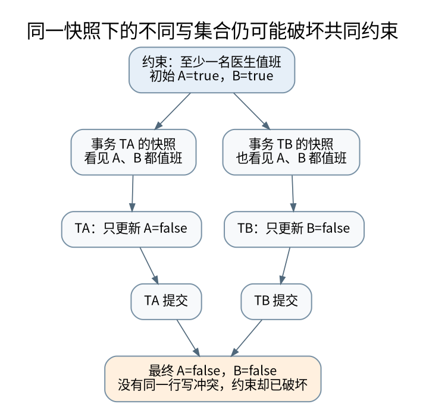

# 两个事务各自正确，合起来为何错误：快照、写偏斜与重试

> **本页要解决**：可重复读为什么仍可能让两个值班医生同时离岗？
>
> **先修**：[[计算机知识/55-数据库/10-系统课程/04-可串行化锁与MVCC|事务隔离：用并发历史判断，而不是只背 ACID]]。
>
> **阅读入口**：[[计算机知识/55-数据库/10-系统课程/00-数据库系统课程索引|本学科主索引]] · [[计算机知识/00-开始/全局导航/11-难点导读与研究证据|全局难点导读]]。

**版本、模型与证据边界**：并发隔离等具体行为以 PostgreSQL 17 文档为例；本轮真实 SQL 运行使用 SQLite，PostgreSQL 双会话脚本未执行。

## 快照回答“读哪个版本”，不自动回答“组合结果合法吗”

MVCC 让读者根据可见性规则选择版本，减少读写之间某些阻塞。但业务不变量可能涉及多行、范围甚至不存在的行。两笔事务读到各自一致的快照、更新不同的行，仍可能让合并后的结果违反全局条件。

本课产品语义固定为 PostgreSQL 17；其 Read Committed 为每条命令建立相应快照，Repeatable Read 在事务首个非事务控制语句建立快照并后续复用，不是简单地在 BEGIN 字符串被发送的瞬间拍照。其他数据库同名隔离级别不能直接套用。[^iso]

## 值班医生写偏斜：每个判断都对，整体却错

初始 Alice、Bob 都在岗，业务要求至少一人在岗。事务 T1 读到在岗人数 2，决定让 Alice 离岗；T2 在同一初始快照读到人数 2，决定让 Bob 离岗。它们写不同记录，所以单纯的同一行写写冲突检测未必阻止两者提交。

[矢量图](../../_assets/diagrams/round4/mvcc-skew.svg) · [可编辑图源](../../_assets/diagrams/round4/mvcc-skew.dot)

最终 Alice、Bob 都离岗。若把它们串行执行，先执行的一笔会把人数降到 1，后一笔就不应继续离岗。因此这个历史不能等价于任意满足业务判断的串行执行。问题不是读到了半行，也不是同一个字段的更新被覆盖。

把冲突画成依赖图：T1 读取 Bob 的旧状态而 T2 改写它，形成 T1→T2 的读写反依赖；T2 读取 Alice 的旧状态而 T1 改写它，形成 T2→T1，出现环。MVCC 版本机制本身没有消除这种环。

## PostgreSQL 可重复读与可串行化的区别

PostgreSQL 的 Repeatable Read 提供快照隔离风格的行为，消除了其文档中列出的某些读异常，但仍可能有序列化异常。Serializable 在这之上使用 SSI 机制检测危险的读写依赖组合，必要时让某个事务失败重试。它不等于所有事务真的一笔一笔执行。[^iso]

SSI 的监测、谓词锁与普通阻塞式行锁也不应混称。读者没有阻塞写者，不代表系统完全没记录读依赖。错误可能在执行或提交阶段出现，因此应用必须把整个事务作为可重试单元。

## 防护策略要对应不变量覆盖范围

将所有离岗操作先锁同一个“值班表守护行”，再检查人数并更新，可以把这个业务决定串行化；但要求所有写路径都遵守同一协议。可以在 Read Committed 下先拿到守护锁，再用之后的查询检查新状态。若已经固定了旧快照，只增加一个锁并不会自动更新快照。

锁住当前找到的行，不一定保护未来可能插入的行或“尚不存在的记录”。例如“这个时间段没有重叠预订”涉及谓词范围，单纯 `SELECT ... FOR UPDATE` 锁已有结果可能漏掉空集合中的竞争。可以采用数据库提供的合适约束、可串行化隔离或明确的业务锁域，不能把任何 FOR UPDATE 都当万能防幻读。[^locks]

对于“计数不能为负”这种单行条件，带谓词的原子 UPDATE 加结果检查可能比先 SELECT 再无条件 UPDATE 更适合。选择哪种方案要看不变量、冲突粒度、等待与重试成本，而不是给每个操作都套最高隔离级别后不再分析。

## 失败重试必须换一个完整事务

遇到 SQLSTATE 40001 等明确的序列化失败时，回滚当前事务，重新获取快照，并重新执行依赖读取结果的全部逻辑。只重试最后一条 UPDATE，会继续使用旧判断。不是所有错误都应无限重试：权限错误、约束违反、语法错误与持续资源故障需要不同处理。

重试还必须有次数或总时间预算、适当退避与取消处理。更重要的是，事务里的外部效果不能跟着每次尝试重复发生。发邮件、扣外部支付、调用不可撤销 API，应该通过 [[计算机知识/85-综合贯通/02-超时重试幂等与事务发件箱|发件箱与幂等协议]] 与数据库结果协调，而不是把数据库 rollback 想象成能回滚互联网。

## 两会话复现实验怎样阅读

附带 PostgreSQL SQL 脚本先建独立测试表，两个会话都开始 Repeatable Read 并查询人数，再各更新一名医生并提交，观察违规结果；重置数据后改用 Serializable 重复操作，观察至少一个相关事务需要失败重试。各会话步骤必须交错执行，不能把两份脚本先后整段运行再说“没有写偏斜”。

本轮环境未运行 PostgreSQL 服务。这份真实数据库实验标注为待用户在隔离测试库执行；本机只运行了一个明确的快照历史模型，验证依赖环及守护串行化的结果。SQLite 的 SQL 功能测试不会被当作 PostgreSQL SSI 验证。

## 自测与迁移

两个线程使用锁保护各自字段，却不共同保护跨字段不变量，会发生相似的组合问题，参见 [[计算机知识/10-编程语言/02-C++/10-系统课程/11-原子发布线性化与回收边界|原子与线性化]]。然而数据库可串行化与共享对象线性化并非同义：前者强调事务等价串行顺序，后者额外关注操作与真实时间顺序的对应，比较见 [[计算机知识/85-综合贯通/04-跨层保证与反例矩阵|跨层保证矩阵]]。

**自测**：更长的事务更容易还是更不容易发生冲突？没有无条件单调定理，但占用资源和观察旧快照的时间延长，通常扩大与其他工作重叠的机会；需要结合访问集合和负载测量，而不是只看事务数量。

[^iso]: PostgreSQL 17 官方 [Transaction Isolation](https://www.postgresql.org/docs/17/transaction-iso.html)，快照时点、Repeatable Read、Serializable 与事务重试。
[^locks]: PostgreSQL 17 官方 [Explicit Locking](https://www.postgresql.org/docs/17/explicit-locking.html)，表锁、行锁、死锁及锁的作用范围。

## 知识连接：下一步应追问什么

先画读写历史，再区分线程级原子、事务隔离、持久提交和重试后的业务效果。

[[计算机知识/55-数据库/10-系统课程/09-候选键最小覆盖与无损分解推演|把规范化真的算一遍：闭包、候选键、最小覆盖与分解]]：无损连接与依赖保持为什么必须分别验证？

[[计算机知识/55-数据库/10-系统课程/12-WAL日志恢复与副本确认边界|日志先行之后：重做、撤销、检查点与副本确认]]：提交不强制写全部数据页，为什么仍可能持久？

[[计算机知识/10-编程语言/02-C++/10-系统课程/11-原子发布线性化与回收边界|原子操作之间缺了什么：发布、线性化与内存回收]]：所有字段都是 atomic，为什么整体操作仍可能错误？

[[计算机知识/85-综合贯通/02-超时重试幂等与事务发件箱|贯通案例：超时、重试、幂等与事务发件箱]]：请求已经执行但确认丢失，怎样避免第二次业务效果？

[[计算机知识/85-综合贯通/04-跨层保证与反例矩阵|跨层保证辨析：类型、原子、隔离、一致性与持久性]]：一句“这是安全的”到底省略了哪一层前提？

## 本地核验与阅读顺序

[[计算机知识/_labs/round4/README|本轮实验：命令、检查范围与未执行项目]] 提供对应文件和记录。[[计算机知识/90-资源/维护/导入-com/_meta/round4/01-研究证据与版本边界|研究证据索引]] 区分规范、推演和实验；[[计算机知识/90-资源/维护/导入-com/_meta/round4/02-缺口回查与后续验证|仍需进一步验证的边界]] 不把概览或模型标成完整实现。

上一专题：[[计算机知识/55-数据库/10-系统课程/09-候选键最小覆盖与无损分解推演|把规范化真的算一遍：闭包、候选键、最小覆盖与分解]]。 下一专题：[[计算机知识/55-数据库/10-系统课程/11-连接基数索引选择与优化器误估|执行计划为什么选错：连接基数、索引代价与统计相关性]]。
