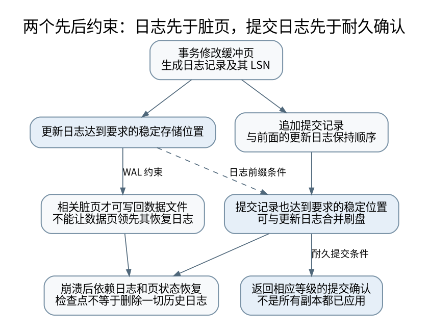

# 日志先行之后：重做、撤销、检查点与副本确认

> **本页要解决**：提交不强制写全部数据页，为什么仍可能持久？
>
> **先修**：[[计算机知识/55-数据库/10-系统课程/07-恢复复制与分布式事务|恢复、复制与分布式事务：提交成功意味着什么]]。
>
> **阅读入口**：[[计算机知识/55-数据库/10-系统课程/00-数据库系统课程索引|本学科主索引]] · [[计算机知识/00-开始/全局导航/11-难点导读与研究证据|全局难点导读]]。

**版本、模型与证据边界**：并发隔离等具体行为以 PostgreSQL 17 文档为例；本轮真实 SQL 运行使用 SQLite，PostgreSQL 双会话脚本未执行。

## 提交时为什么可以不把所有数据页写回

若一笔事务修改很多随机数据页，每次提交都强制写完它们，I/O 成本可能很高。WAL 的核心顺序是：在某个数据页的修改被允许稳定写出前，足以恢复它的日志先稳定；提交确认再服从所选的日志同步合同。重启后利用日志恢复，数据页可以稍后批量写回。[^wal]

“日志先行”不是只要求先调用一次 write(log)，而是要求对应的持久性与排序确实满足。若日志仍在易失缓存、数据页已覆盖旧版本，崩溃后就可能既没有旧值，也没有足够日志恢复新值。

[矢量图](../../_assets/diagrams/round4/wal-order.svg) · [可编辑图源](../../_assets/diagrams/round4/wal-order.dot)

## steal 与 force 两个维度各引入什么需求

steal 允许未提交事务改过的页被缓冲池提前写出；因此恢复需要处理不应保留的未提交效果。no-force 允许已提交事务的数据页在提交时尚未全部写出；因此恢复需要重做缺失的已提交效果。经典 steal/no-force 教学模型通常同时需要 undo 与 redo。

这只是恢复设计分类，不表示每个数据库都用同样的物理撤销方式。尤其 PostgreSQL 通过 MVCC 可见性等机制处理未提交版本，不能把下面的经典 before/after-image 模型当成它逐行回滚的源码描述。[^wal]

## 一个有明确日志和磁盘状态的恢复算例

初始 A=0、B=0。T1 记录 A:0→10、B:0→20，提交记录稳定。随后 T2 记录 A:10→99，日志稳定，但没有提交。崩溃时磁盘可能已经有 A=99，而 B 仍为 0：A 的未提交效果因 steal 已写出，B 的已提交效果因 no-force 尚未写出。

在本课简化的串行写入日志模型中，先重演已记录变化，再撤销未提交 T2 的 A 修改，最终应为 A=10、B=20。只做 redo 会留下 A=99；只做 undo 则可能让 B 仍为 0。两种缺口不同。

实际恢复算法需要日志序号、事务状态、页状态和更严格的依赖信息。ARIES 的分析、重复历史重做与 loser 撤销，以及补偿日志记录，正是为复杂并发和恢复过程中再次崩溃等问题组织信息；本轮的小字典模型不声称实现完整 ARIES。

## 页 LSN 为什么有用，但也不能单独解决撕裂写

若页记录它已经包含到哪条日志，恢复时可判断某些重做是否已经应用，避免盲目重复。但页自身部分写入或损坏可能连页 LSN 都不可信。校验、全页映像与存储原子性需要配合考虑。

PostgreSQL 的 full_page_writes 针对检查点后首次修改页等场景记录全页内容，帮助恢复部分页写入造成的问题。关闭相关保护不是一个只有“性能更好”而无风险的调优选项。fsync、同步提交与全页保护解决的侧面也不同。[^walconfig]

检查点减少恢复需要回溯的范围，但不是“检查点以前所有日志现在都可删除”的万能标记。备份、归档、复制槽、落后副本与恢复目标可能仍需要旧 WAL。保留策略必须和实际恢复路径一起设计。

## 副本确认要问：哪个节点，到哪一步

在配置了相应同步备库的 PostgreSQL 17 场景下，`remote_write`、`on` 与 `remote_apply` 等级的等待责任不同。remote_write 等待备库接收并写到其操作系统层面，不等同于备库磁盘稳定；on 等待所选同步备库按文档要求刷新日志；remote_apply 进一步等待重放应用。没有配置相应同步备库时，不能把选项名称直接读成“已复制到远端”。[^walconfig]

remote_apply 也不等于所有读副本立刻看到结果。请求要读到相应已经应用的副本，读取快照也要在适当时间建立；一个早已开始的长快照可能仍看旧版本。复制确认、读路由和事务可见性共同决定读己之写。

异步提交可能在系统崩溃时丢失已返回成功但尚未稳定的近期事务；这与数据结构损坏不是同一个后果。是否允许，必须由业务明确接受，而不是以“数据库一般不会坏”省略持久性合同。

## 两阶段提交、复制与业务效果不要混成一层

2PC 的 prepared 状态使参与者保留可最终提交的准备结果，但协调者失联时可能陷入等待，持有锁和资源。复制日志、选举领导者、维护一致历史与跨资源原子提交又是不同机制，单独引入一种不能自动获得其余全部保证。

即使数据库事务提交正确，数据库外的邮件或支付接口也不在同一原子边界里。事务发件箱先让业务变化与待发送意图共同提交，后续投递允许重试，再由接收者去重，见 [[计算机知识/85-综合贯通/02-超时重试幂等与事务发件箱|端到端效果协议]]。

读侧消费者是[[计算机知识/65-分布式系统/06-一致读的法定人数屏障与应用位置#先看一个必须等待的真实有限轨迹|一致读的应用等待]]：即使当前任期条目已提交且新鲜多数已确认，applied不足仍须wait_apply；带回readIndex与原子(appliedIndex,value)，不要把“已收到/已刷盘”当成状态机可读。

## 恢复验证应包括哪种失败

本轮模型验证“已提交但数据页未写”“未提交但数据页已写”和各日志位置的恢复结果，并检查重复重做的简单版本门槛。它不测试真实 PostgreSQL WAL 文件、备库同步或掉电，也没有实现并发 ARIES 和崩溃中的撤销持久化。

真正的数据库恢复演练还需隔离环境、可恢复备份、日志归档、恢复目标、校验查询与明确 RPO/RTO。模型帮助理解为何这些步骤必要，不取代它们。

[^wal]: PostgreSQL 17 官方 [Write-Ahead Logging](https://www.postgresql.org/docs/17/wal-intro.html)，日志先行与减少提交时数据页刷新。
[^walconfig]: PostgreSQL 17 官方 [Write Ahead Log 配置](https://www.postgresql.org/docs/17/runtime-config-wal.html)，fsync、synchronous_commit、full_page_writes 及各等待等级。

## 知识连接：下一步应追问什么

日志可以提供恢复依据，却不自动证明每个观察者、每个副本或外部系统已经看到结果。

[[计算机知识/20-操作系统/02-操作系统原理/10-系统课程/11-崩溃一致性与恢复状态机|断电发生在任意一步：文件替换与崩溃状态机]]：rename 成功以后，断电重启一定还能看到新文件吗？

[[计算机知识/55-数据库/10-系统课程/10-MVCC快照写偏斜与重试协议|两个事务各自正确，合起来为何错误：快照、写偏斜与重试]]：可重复读为什么仍可能让两个值班医生同时离岗？

[[计算机知识/85-综合贯通/02-超时重试幂等与事务发件箱|贯通案例：超时、重试、幂等与事务发件箱]]：请求已经执行但确认丢失，怎样避免第二次业务效果？

[[计算机知识/85-综合贯通/04-跨层保证与反例矩阵|跨层保证辨析：类型、原子、隔离、一致性与持久性]]：一句“这是安全的”到底省略了哪一层前提？

## 本地核验与阅读顺序

[[计算机知识/_labs/round4/README|本轮实验：命令、检查范围与未执行项目]] 提供对应文件和记录。[[计算机知识/90-资源/维护/导入-com/_meta/round4/01-研究证据与版本边界|研究证据索引]] 区分规范、推演和实验；[[计算机知识/90-资源/维护/导入-com/_meta/round4/02-缺口回查与后续验证|仍需进一步验证的边界]] 不把概览或模型标成完整实现。

上一专题：[[计算机知识/55-数据库/10-系统课程/11-连接基数索引选择与优化器误估|执行计划为什么选错：连接基数、索引代价与统计相关性]]。 返回 [[计算机知识/55-数据库/10-系统课程/00-数据库系统课程索引|课程与问题索引]]，用不看原文的复算检验是否真正理解。
