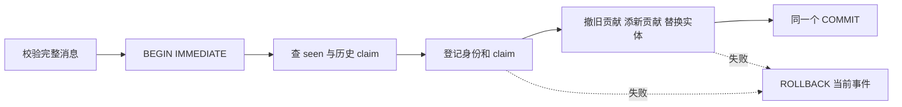

# 预约改了时长，报表为何不能再加一次？

一张预约表已有三条事实：a 为 10 分钟，b、c 各为 20 分钟。报表总时长 50 分钟，预约数 3。现在 a 改为 30 分钟。全表重算得到 70 分钟；若把更新消息当新预约再加 30，报表会变成 80 分钟、4 条。消息是在叙述事实变化，消息数并不是事实数。

本课把这个错位修到可检查的程度：先确定一行代表什么，再规定事件身份和版本，最后用“撤旧贡献、添新贡献”保持每个已提交前缀的物化视图与批量 SQL 相等。先修页 [[计算机知识/55-数据库/02-SQL连接聚合子查询窗口与NULL#先按逻辑含义理解查询|SQL 连接与聚合]] 负责多重集合和连接基数；带着“报表的每一条输入事实是否仍只出现一次”回到这里。事务及日志先修分别回 [[计算机知识/55-数据库/10-系统课程/04-可串行化锁与MVCC|隔离历史]] 与 [[计算机知识/55-数据库/10-系统课程/12-WAL日志恢复与副本确认边界#一个有明确日志和磁盘状态的恢复算例|WAL 恢复算例]]，本课在它们之上定义需要一起提交的业务状态。

本课是有限、本地、无窗口的教学扩展。现有 [[计算机知识/75-软件工程与人机交互/82-v2意图恢复与演进实验#唯一业务合同：移动端与流处理共用|预约 v2 合同]] 的 outbox 只有 `booking_created`，公开接口是 Python 函数与 JSON 值。本课独立构造更新和删除日志，没有改写该合同，也没有运行 HTTP 服务、CDC 连接器或 Beam 引擎。

## 事实粒度与可合并度量

本课的一条当前事实是“指定 entity_id 的预约在最新已接受版本中的组别及当前时长”。它不是一位客户、一条联系方式、一条消息或一次函数执行。`minutes` 是非负整数分钟；教学允许零分钟，用来区别零贡献与不存在。组别 `group` 是报表维度，可随预约更新改变。这里没有真实发生时点、币种或迟到窗口。

| 对象 | 标识或单位 | 用来回答什么 |
| --- | --- | --- |
| 业务实体 | entity_id，如 a | 当前是哪一条预约事实？ |
| 实体版本 | 同一实体的正整数 version | 哪个完整快照更新？允许跳号 |
| 业务变更消息 | event_id，如 a2 | 是同一个投递，还是另一条消息？ |
| 消息执行 | 调用次数 | 程序试了几次？不进入预约数 |
| 度量 | sum：分钟；count：条；mean：分钟/条 | 在同一粒度及口径下有多少、平均多少？ |

每个非空组保存 `(S,N)`：当前活跃预约时长之和与条数。组均值是 `S/N`，空组不计算均值。对不重叠的同粒度事实分区，这对状态可合并：

\[
(S_1,N_1)\oplus(S_2,N_2)=(S_1+S_2,N_1+N_2).
\]

例如一组 `(10,1)`、另一组 `(180,9)`，总体均值是 `(10+180)/(1+9)=19` 分钟/条。两组均值分别为 10 与 20，直接再平均得 15，是把“每条预约等权”换成“每组等权”。对照 `(10,1)+(90,9)` 才得到 10；均值相同的巧合不能认证错误方法。`sum/count` 也不是任意指标的万能摘要：中位数、精确去重客户数或撤去某条事实后的最小值，通常需要额外状态。

连接同样能悄悄改变粒度。原事实为 a10、b20、c20，联系方式维度含 a 的两行、b 和 c 各一行。按 entity_id 连接后变成 a10、a10、b20、c20：总时长从 50 放大到 60，count 从 3 变成 4，均值从 `50/3` 变成 15。不能用 `SUM(DISTINCT minutes)` 补救，它还会把 b 和 c 两条合法的 20 合并，得 30。应按业务问题保证维度键唯一、用存在性筛选，或先在事实粒度聚合后按正确基数连接；多值维度若真要分摊，就另定义权重与目标。回 SQL 先修核查 JOIN 行数，再返回核对 `(S,N)` 的分母。

## 一个可以裁决每条消息的合同

输入是 UTF-8 JSON 数组，每个元素必须恰有六字段：`event_id/entity_id/version/op/group/minutes`。id 与 put 的组名是长度 1–80、无首尾空白且可编码为 UTF-8 的字符串（JSON 转义产生的孤立代理项也拒绝）；version 为 `1..2^63−1` 的整数，minutes 为 `0..1,000,000` 的整数，bool 不算整数。put 携带完整 after-image（新快照）；delete 的 group 和 minutes 必须都为 null，表示不存在的贡献。额外字段、缺字段和其他值拒绝。文件读取拒绝重复 JSON 键及 NaN/Infinity，文件解析失败使 CLI 非零，尚未开始处理该文件。

版本由一个权威实体版本序列定义。不同 event_id 可以声称同一个 entity/version，但内容必须相同。一个合法较高版本快照直接替换当前快照；允许版本跳号，因为每条消息自带完整新状态。若消息只携带“加 5”之类差量，跳过中间版本会丢变化，不能沿用本合同。对从未见过的实体收到 delete 也保存该版本墓碑；显式更高版本 put 可以重新建立活跃事实，这是本教学合同允许的复活。

保留四种持久状态：seen 中每个已登记 event_id 的规范全 payload 和原裁决；claims 中每个已观察 `(entity_id,version)` 的规范内容；entities 中每个实体的最高已应用版本及当前快照/墓碑；view_totals 中每个非空组的 `(S,N)`。规范内容只含 op/group/minutes，规范全 payload 还含两个 id 和 version；比较 JSON 值的规范文本，字段排列不产生冲突。原输入日志另保留，seen 不是任意格式错误的隔离收件箱。

裁决按下表从上到下执行。`invalid` 在查身份前，所以即使输入带已知 id，只要结构/类型不合法也先报 invalid。运行报告对**本次调用**的每种裁决计数，重放不会把这组计数冒充历史累积计数。

| 条件 | 返回值 | 新身份与 claim | 实体与视图 |
| --- | --- | --- | --- |
| schema/类型/范围不合法 | invalid | 不登记 | 不变 |
| 已登记同 event_id，同规范全 payload | duplicate | 不写；原裁决仍保留 | 不变 |
| 已登记同 event_id，异规范全 payload | id_conflict | 不覆盖原记录 | 不变 |
| 新 id，但已观察同 entity/version 的内容不同 | version_conflict | 新 id 不登记；不覆盖 claim | 不变 |
| 新合法 id，version 小于实体当前版本 | stale | 登记 id 与此前未见的 claim | 不变 |
| 新合法 id，version 等于当前版本，内容一致 | same_version | 登记 id；复用 claim | 不变 |
| 新合法 id，version 更高或实体未见 | applied | 登记 id 与 claim | 替换实体，撤旧添新 |
| applied 将新增第 100001 个实体（墓碑也算） | capacity_rejected | 不登记 | 不变 |

例如已应用 a1→a2 后，新 id 送来 a 的 v1=10，裁决 stale；再送同 a/v1=11，因历史 claim 而 version_conflict。历史版本不能因为当前已到 v2 就任意改写。若 v1 原先从未出现，新合法 v1 即使已落后也登记为 stale，并固定其内容 claim；同 id 重试随后为 duplicate。同一 id 的错误消息被拒绝后，若该 id 从未登记，可以修正消息再使用它；若 id 已被合法消息占用，不能靠“修正”覆盖已接受内容。

这组状态是有限模型的成本：实体/墓碑随不同实体数增长，seen/claims 随已登记消息和观察版本增长。没有 TTL 或后台回收。CLI 最多处理 1000 条并保存完整前缀快照；oracle 从头重建每个前缀，工作量可为二次量级，因此用于短教学日志。实体容量上限是保护规则，不能把它当实测吞吐或生产可扩展性结论。

## 撤旧贡献 添新贡献与一般不变量

把活跃事实的贡献写成向量：对于组 g，当前快照 `(g,m)` 的贡献是该组 `(m,1)`，对其他组 `(0,0)`；墓碑贡献所有组 `(0,0)`。令 `c(x)` 为实体 x 的这份贡献，物化视图的目标是

\[
V=\sum_{x\in\text{已知实体}}c(x).
\]

这里的向量可在整数对空间相减，当前合法物化结果仍有非负时长与条数。更新 x 时，只有这一项改变，所以

\[
V'=V-c(x_{old})+c(x_{new}).
\]

同组时长更新把 `(S,N)` 变成 `(S−m_old+m_new,N)`；插入从 absent 到 present 加 `(m_new,1)`；删除减 `(m_old,1)`；换组先从旧组撤，再给新组加，零分钟的活跃事实仍贡献 count=1。当组 count 到 0 时删除该组行，不能只留下 sum=0 然后假装组里还有事实。

**一般前缀证明。** 初始 entities 和 view 都为空，恒等式成立。假设一个已提交前缀满足恒等式。invalid/conflict/capacity 拒绝和 duplicate 不改变任何业务状态；stale/same_version 只扩展身份证据，c 不变；applied 只替换一个实体，按上式正好替换该求和的一项，因此新前缀也成立。事务原子性保证读者不能观察“entities 新、view 旧”或“seen 已登记、实体未写”的半个已提交步骤。由前缀长度归纳，任意满足合同且每步成功提交的有限日志都得到同一批量目标。这是相对于**已裁决当前事实**的证明，不证明输入来源完整、业务版本正确或多资源原子性。

为什么光留 `(S,N)` 不够撤？历史 H₁ 是 x5、y5；H₂ 是 x7、y3。两者都为 `(10,2)`，下一条都是 x 更新成 10，但正确新总量分别 15 和 13。旧摘要相同、同一后续不同，故必须保存实体旧贡献，或另有能可靠取得它的 before-image。墓碑的版本也不能省：空摘要可来自“x 已在 v3 删除”或“从未见 x”；同一 x/v2 put 到达时，前者 stale，后者 applied。删除 seen/claims 还会失去重复身份或旧版本冲突证据。只增计数的合并性质并不提供这些撤销信息。

## 从第一条到最后一条都能手算

固定输入 [events.json](../../_labs/round3/DB/incremental_view/events.json) 共 21 条。`A:S/N` 表示 A 组时长/条数；`∅` 表示没有组行。每条之后独立 oracle 从该原始前缀重建当前实体，再用 SQL 全量 GROUP BY，比较实体、墓碑、seen、claims 与聚合，而不调用增量 reducer。

| 步 | 消息或变更 | 裁决 | 已提交组状态 |
| --- | --- | --- | --- |
| 1 | a1: a/v1 A10 | applied | A:10/1 |
| 2 | b1: b/v1 A20 | applied | A:30/2 |
| 3 | c1: c/v1 A20 | applied | A:50/3 |
| 4 | b1 原样重放 | duplicate | A:50/3 |
| 5 | b1 改成 21 | id_conflict | A:50/3 |
| 6 | a2: a/v2 A30 | applied | A:70/3 |
| 7 | a1-alias: a/v1 A10 | stale | A:70/3 |
| 8 | a1-bad: a/v1 A11 | version_conflict | A:70/3 |
| 9 | a2-alias: a/v2 A30 | same_version | A:70/3 |
| 10 | a2-bad: a/v2 A31 | version_conflict | A:70/3 |
| 11 | b2: b/v2 delete | applied | A:50/2 |
| 12 | b1-late: b/v1 A20 | stale | A:50/2 |
| 13 | c2: c/v2 B0 | applied | A:30/1，B:0/1 |
| 14 | a3: a/v3 delete | applied | B:0/1 |
| 15 | c3: c/v3 delete | applied | ∅ |
| 16 | z3: 未见的 z/v3 delete | applied | ∅（保存 z 墓碑） |
| 17 | z2: z/v2 A99 | stale | ∅ |
| 18 | fix: d/version=true A5 | invalid | ∅（fix 未登记） |
| 19 | fix: d/v1 A5 | applied | A:5/1 |
| 20 | d0: d/v0 A7 | invalid | A:5/1 |
| 21 | a4: a/v4 B7 | applied | A:5/1，B:7/1 |

第 6 步撤 a10 再添 a30；第 11 步撤 b20，count 也减一；第 13 步撤 A 中 c20 再添 B 中 c0。第 15 步不是把均值变为零：无 GROUP BY 的 `SUM(minutes),COUNT(*)` 是 `(NULL,0)`，GROUP BY 没有组行；第 14 步是 `(0,1)`，均值真为 0。这是 SQLite 的 [SUM/COUNT 文档语义](https://www.sqlite.org/lang_aggfunc.html)，本课 minutes 不允许 NULL，NULL 只用来表示删除快照的不存在。若报表选择 `COALESCE(SUM(...),0)`，必须一同展示 count=0 并另定义均值的空值；不能把“没有预约”变成“有一条零分钟预约”。

本次首次运行裁决计数应为 applied11、duplicate1、id_conflict1、stale3、version_conflict2、same_version1、invalid2。最终实体为 a/v4 B7、b/v2墓碑、c/v3墓碑、d/v1 A5、z/v3墓碑；最终全局 sum=12、count=2。两个新版本冲突 id（a1-bad、a2-bad）与 d0 没登记；b1 的原记录保留，fix 在第 19 步才登记。

## 三种状态必须在同一个本地提交里

如果先登记 event_id 并提交，再更新实体时失败，重放会被当成 duplicate，变化永远丢失。若先加视图并提交，再登记身份前失败，重放会再加一次。三处业务状态及历史 claim 因而必须在同一个事务中。



实现显式设置 `isolation_level=None`，自己发 BEGIN IMMEDIATE/COMMIT/ROLLBACK，不依赖连接上下文关闭连接。BEGIN IMMEDIATE 在身份查询前申请写事务；其他写者占用时可能失败，本实现让异常上抛。初始化与运行应使用本课创建的 SQLite v1 数据库，不把任意已有同名表当可兼容模型。查看 [SQLite 事务文档](https://www.sqlite.org/lang_transaction.html) 可核写事务与提交行为；磁盘硬件和配置的持久性前提仍回 WAL 先修。

| 注入点 | 失败后重开同一数据库 | 重放同一合法新消息 |
| --- | --- | --- |
| after_identity：seen/claim 已写，未提交 | 四张表均为前一已提交状态 | 正常 applied/stale/same_version |
| after_entity：视图/实体已改，未提交 | 四张表均回到前一状态 | 正常处理 |
| before_commit | 四张表均回到前一状态 | 正常处理 |
| after_commit：已提交，答复前抛异常 | 四张表均含完整新状态 | duplicate，不重复改变贡献 |

这些是应用异常注入和持久关闭重开的有限实验；after_entity 在 stale/same_version 路径表示到达相应程序位置，实体本身仍未修改。它们不是 SIGKILL、断电或磁盘损坏实验。每个事件独立事务，因此后续事件失败不会抹去早先已提交事件；如果 stdout/结果文件写失败，数据库提交仍可能存在，不能从命令非零推成数据库空。

这只解决一个 SQLite 数据库里的事件登记与状态维护。源位置未确认、远端报表/邮件已写、两个数据库分别提交，尚未形成同一个原子边界。Beam 的 [用户代码要求 §4.3](https://beam.apache.org/documentation/programming-guide/#requirements-for-writing-user-code-for-beam-transforms) 明确提醒可能重试或重复调用，外部副作用要另外设计。这里不据本地事务和唯一键声称分布式 exactly-once。回 [[计算机知识/65-分布式系统/05-分布式事务幂等与端到端失败#同一个业务 ID 穿过四个边界|跨四边界的业务身份]] 列出实际源、状态与副作用后，才能继续后续恢复课程。

## 实际运行与独立重建

Python 3.11+ 标准库即可，没有依赖安装。在 Vault 根运行下列命令；数据库和报告只写新建临时目录。源码分别见 [incremental_view_runner.py](../../_labs/round3/DB/incremental_view_runner.py) 与 [incremental_view_oracle.py](../../_labs/round3/DB/incremental_view_oracle.py)，固定输入是本课新日志。先预测轨迹，再执行：

```bash
work_dir=$(mktemp -d /tmp/wwl-incremental-view.XXXXXX)
python3 -B 计算机知识/_labs/round3/DB/incremental_view_runner.py \
  --input 计算机知识/_labs/round3/DB/incremental_view/events.json \
  --db "$work_dir/view.sqlite" --out "$work_dir/actual.json"
python3 -B 计算机知识/_labs/round3/DB/incremental_view_oracle.py \
  --input 计算机知识/_labs/round3/DB/incremental_view/events.json \
  --actual "$work_dir/actual.json" --out "$work_dir/oracle.json"
python3 -B 计算机知识/_labs/round3/DB/incremental_view_runner.py \
  --input 计算机知识/_labs/round3/DB/incremental_view/events.json \
  --db "$work_dir/view.sqlite" --out "$work_dir/replay.json"
```

oracle 限定新空数据库报告，不能拿 replay.json 去冒充首次独立核对；重放另比对 initial/final 四表完全相同。完整重放计数应为 duplicate16、id_conflict1、version_conflict2、invalid2：此前首次合法的 stale/same_version 已登记，也变成 duplicate；原冲突和无效输入仍然拒绝。无需为恢复重放创造新 event_id。

oracle 不导入 runner。它按原日志独立检查身份与版本，用完整快照替换重建实体，然后把当前活跃行放进独立内存 SQLite，运行 `SELECT g,SUM(minutes),COUNT(*) FROM live GROUP BY g`。它也比较 seen/claim 和墓碑，避免只比最终数字而漏掉恢复信息。其解释规则仍须独立审阅；“两个程序输出相同”不是一般证明。

[固定预期摘要](../../_labs/round3/DB/incremental_view/expected.json) 给出各前缀真值及首次/重放计数，便于手工检查；实际运行证据按当次机器、源码、输入与命令另记录，不把 expected 当已执行。课程入口 [[计算机知识/_labs/round3/DB/数据库-实验说明|数据库实验说明]] 区分旧 SQLite 基础实验和本课新增单元。

## 改变口径与撤去提示的迁移任务

**示范口径迁移。** 原来只数当前活跃预约，删除后移除贡献；若新政策要报“截至所选日志前缀，当前活跃和已撤销预约的最后一次已知时长总量”，删除事件只有 null，并没有带历史时长。最终空视图和墓碑本身不能恢复被删时长。须从保留日志重建，或从旧快照在删除时另写版本化的撤销事实；对第一次就见 delete 的实体，时长仍未知，不能填零伪造。旧政策结果与新政策结果都标注指标版本与日志截止位置。改变 group 映射也须重新计算旧贡献与新贡献，不能只改显示名称后接着消费增量。

下面不指定算法，先把答案写在纸上，再展开核对。每题需要说明对象、结果、状态和不能推出的结论。

1. 两个历史都报 `(10,2)`。H₁ 为 x5、y5，H₂ 为 x7、y3。下条是新身份 x/v2=10。系统只保留组摘要，能否保证正确？各历史应报多少？若把 x/v2 再执行一次又如何？
2. 新空数据库依次收到 q/v5 A0、q/v7 delete、q/v6 B9、同 q/v5 内容 A1 的新 id、q/v8 B4。所有 event_id 不同。给每步裁决、组行和需要保留的身份；把 v6 消息再用原 id 发一次会怎样？
3. 业务改为“删除后仍统计最近一次有效时长”，并允许维度中一位预约有两条联系方式。已有同库 a/v1 A10、a/v2 delete，想在当前墓碑上直接继续；当前可确认哪些量，缺哪些量？应给出可追溯迁移与连接方案，以及无法从本课推出的恢复保证。

> [!tip]- 可核答案与评分
> 1. H₁ 应为 `(15,2)`，H₂ 应为 `(13,2)`；相同摘要无法选择撤 5 还是撤 7，须有旧实体快照/before-image。第二次同 id 同 payload 是 duplicate，无变化；新 id 同 entity/version 同内容是 same_version，也无变化。（3 分：各量 1、状态不足 1、重放 1。）
> 2. applied→A:0/1；applied→∅；stale→∅并登记该 id/claim；version_conflict→∅且新冲突 id 不登记（v5 claim 仍为 A0）；applied→B:4/1。实体最终 q/v8，保留四个合法 id（v5、v7、v6、v8）与它们的 claim。原 v6 id 重发为 duplicate，即使仍落后也先核身份。（4 分：完整轨迹 2、身份/claim 1、优先次序 1。）
> 3. 当前能确认 a/v2 墓碑及旧政策无活跃行；完整日志能恢复其最近有效时长 10，但只有墓碑/group摘要不能。应按明确新指标版本从原日志重建独立目标，校验后切换；未知历史时长单独呈现未知，保留旧读者/回滚目标到迁移验收。联系方式不能把预约时长重复累计，选择唯一维度键、存在性过滤或明确分摊的新口径；`SUM(DISTINCT duration)` 不能代替粒度。新目标状态与本地身份是否同事务还须具体设计；本课不认证远端 sink/source 恢复或 exactly-once。（5 分：对象与缺失 1、重建/版本/校验 2、连接 1、边界 1。）

## 后续课程接口与当前覆盖

已经闭合的是同一当前事实粒度上的有限批量/增量等价、权重与连接反例、重复/乱序快照/更新/删除的完整轨迹、局部事务和持久重放。接着到 [[计算机知识/55-数据库/10-系统课程/17-事件时间窗口水位线与迟到修订|事件时间窗口与迟到修订]]：沿用实体身份、权威版本与完整快照，补事件时点、固定滚动窗、版本化输出、水位线和允许迟到/回收政策，检查跨窗撤旧添新及回收后的旁路损失。本页仍是无窗本地事务单元。

[Beam 模型的窗口/水位线说明](https://beam.apache.org/documentation/basics/#watermark) 将水位线作为到达完整性的估计；不能把最大 entity version 当 watermark，也不能把 stale 等同迟到。第17讲给有限内存窗口模型；[[计算机知识/55-数据库/10-系统课程/18-源位置状态快照与目标恢复|第18讲]] 接本页无窗事实，实测两个SQLite资源的进程kill与恢复，区分state内原子位置/状态和独立目标的稳定身份/权威结果。二者都不替代持久窗口、远端源/目标或断电验证。列存/向量化成本、完整星型及缓慢变化维度、实际 CDC/schema 演进也仍是后续范围，#172 整项保持 OPEN。

返回 [[计算机知识/55-数据库/10-系统课程/08-数据库工程安全与扩展专题#从批量报表到可撤销的增量视图|工程专题的分析入口]]：现在用事实粒度、旧贡献和提交边界解释其中的“增量视图维护”；再回 [[计算机知识/55-数据库/10-系统课程/00-数据库系统课程索引|唯一课程索引]] 选择下一项。本文教学推演和有限软件检查不代表真实 Obsidian 显示、真实业务、硬件故障或真人已经掌握。

## 规范源码逐字镜像

规范源码是真源，下列活动镜像用于就地阅读；改源码时同步镜像。

<!-- code-sync: 计算机知识/_labs/round3/DB/incremental_view_runner.py -->
```python
"""Finite after-image log -> transactional SQLite incremental view (Python 3.11+)."""
import argparse
import json
from pathlib import Path
import sqlite3

FIELDS = {"event_id", "entity_id", "version", "op", "group", "minutes"}
LIMIT = 100_000


def canonical(value):
    return json.dumps(value, sort_keys=True, separators=(",", ":"), ensure_ascii=False)


def utf8_text(value):
    if type(value) is not str or not 1 <= len(value) <= 80 or value.strip() != value:
        return False
    try:
        value.encode("utf-8")
    except UnicodeError:
        return False
    return True


def validate(event):
    if type(event) is not dict or set(event) != FIELDS:
        return False
    for key in ("event_id", "entity_id"):
        x = event[key]
        if not utf8_text(x):
            return False
    v = event["version"]
    if type(v) is not int or not 1 <= v <= 2**63 - 1:
        return False
    if event["op"] == "delete":
        return event["group"] is None and event["minutes"] is None
    if event["op"] != "put":
        return False
    g, m = event["group"], event["minutes"]
    return (utf8_text(g)
            and type(m) is int and 0 <= m <= 1_000_000)


def snapshot(event):
    return canonical({k: event[k] for k in ("op", "group", "minutes")})


class InjectedFailure(RuntimeError):
    pass


class ViewStore:
    """One owner per connection; no source offset or external sink is implemented."""
    def __init__(self, path):
        self.db = sqlite3.connect(path, isolation_level=None, timeout=5)
        self.db.executescript("""
        CREATE TABLE IF NOT EXISTS seen(
          event_id TEXT PRIMARY KEY, payload TEXT NOT NULL, outcome TEXT NOT NULL);
        CREATE TABLE IF NOT EXISTS claims(
          entity_id TEXT NOT NULL, version INTEGER NOT NULL, snapshot TEXT NOT NULL,
          PRIMARY KEY(entity_id, version));
        CREATE TABLE IF NOT EXISTS entities(
          entity_id TEXT PRIMARY KEY, version INTEGER NOT NULL,
          group_name TEXT, minutes INTEGER,
          CHECK((group_name IS NULL AND minutes IS NULL) OR
                (group_name IS NOT NULL AND minutes IS NOT NULL)));
        CREATE TABLE IF NOT EXISTS view_totals(
          group_name TEXT PRIMARY KEY, sum_minutes INTEGER NOT NULL,
          n INTEGER NOT NULL CHECK(n > 0), CHECK(sum_minutes >= 0));
        """)

    def close(self):
        self.db.close()

    def dump(self):
        """Stable logical state, including the identities needed for replay."""
        self.db.execute("BEGIN")
        try:
            result = {
                "entities": [list(r) for r in self.db.execute(
                    "SELECT * FROM entities ORDER BY entity_id")],
                "view": [list(r) for r in self.db.execute(
                    "SELECT group_name,sum_minutes,n FROM view_totals ORDER BY group_name")],
                "seen": [list(r) for r in self.db.execute(
                    "SELECT * FROM seen ORDER BY event_id")],
                "claims": [list(r) for r in self.db.execute(
                    "SELECT * FROM claims ORDER BY entity_id,version")],
            }
            self.db.execute("COMMIT")
            return result
        except BaseException:
            if self.db.in_transaction:
                self.db.execute("ROLLBACK")
            raise

    def _contribute(self, group, minutes, sign):
        if group is None:
            return
        old = self.db.execute(
            "SELECT sum_minutes,n FROM view_totals WHERE group_name=?", (group,)).fetchone()
        total, count = old if old else (0, 0)
        total, count = total + sign * minutes, count + sign
        if count < 0 or total < 0 or total > 2**63 - 1:
            raise RuntimeError("view invariant violated")
        if count == 0:
            if total != 0:
                raise RuntimeError("empty group has nonzero sum")
            self.db.execute("DELETE FROM view_totals WHERE group_name=?", (group,))
        else:
            self.db.execute("INSERT INTO view_totals VALUES(?,?,?) "
                            "ON CONFLICT(group_name) DO UPDATE SET "
                            "sum_minutes=excluded.sum_minutes,n=excluded.n",
                            (group, total, count))

    def apply(self, event, fail_at=None):
        """Return a decision; injected/runtime failure raises and preserves commit boundary."""
        if fail_at not in (None, "after_identity", "after_entity", "before_commit", "after_commit"):
            raise ValueError("unknown failure point")
        if not validate(event):
            return "invalid"
        payload, content = canonical(event), snapshot(event)
        eid, version = event["entity_id"], event["version"]
        self.db.execute("BEGIN IMMEDIATE")
        try:
            seen = self.db.execute("SELECT payload FROM seen WHERE event_id=?",
                                   (event["event_id"],)).fetchone()
            if seen:
                decision = "duplicate" if seen[0] == payload else "id_conflict"
                self.db.execute("ROLLBACK")
                return decision
            claim = self.db.execute("SELECT snapshot FROM claims WHERE entity_id=? AND version=?",
                                    (eid, version)).fetchone()
            if claim and claim[0] != content:
                self.db.execute("ROLLBACK")
                return "version_conflict"
            old = self.db.execute("SELECT version,group_name,minutes FROM entities WHERE entity_id=?",
                                  (eid,)).fetchone()
            decision = ("stale" if old and version < old[0] else
                        "same_version" if old and version == old[0] else "applied")
            if decision == "applied" and old is None:
                size = self.db.execute("SELECT COUNT(*) FROM entities").fetchone()[0]
                if size >= LIMIT:
                    self.db.execute("ROLLBACK")
                    return "capacity_rejected"
            self.db.execute("INSERT INTO seen VALUES(?,?,?)", (event["event_id"], payload, decision))
            self.db.execute("INSERT OR IGNORE INTO claims VALUES(?,?,?)", (eid, version, content))
            if fail_at == "after_identity":
                raise InjectedFailure(fail_at)
            if decision == "applied":
                if old:
                    self._contribute(old[1], old[2], -1)
                self._contribute(event["group"], event["minutes"], 1)
                self.db.execute("INSERT INTO entities VALUES(?,?,?,?) "
                                "ON CONFLICT(entity_id) DO UPDATE SET version=excluded.version,"
                                "group_name=excluded.group_name,minutes=excluded.minutes",
                                (eid, version, event["group"], event["minutes"]))
            if fail_at in ("after_entity", "before_commit"):
                raise InjectedFailure(fail_at)
            self.db.execute("COMMIT")
        except BaseException:
            if self.db.in_transaction:
                self.db.execute("ROLLBACK")
            raise
        if fail_at == "after_commit":
            raise InjectedFailure(fail_at)
        return decision


def no_duplicate_keys(pairs):
    value = {}
    for key, item in pairs:
        if key in value:
            raise ValueError("duplicate JSON key")
        value[key] = item
    return value


def main():
    p = argparse.ArgumentParser(description=__doc__)
    p.add_argument("--input", type=Path, required=True)
    p.add_argument("--db", required=True, help="new teaching database path or :memory:")
    p.add_argument("--out", type=Path, required=True)
    args = p.parse_args()
    if args.input.stat().st_size > 30_000_000:
        p.error("input exceeds 30 MB finite teaching budget")
    events = json.loads(args.input.read_text(), object_pairs_hook=no_duplicate_keys,
                        parse_constant=lambda _: (_ for _ in ()).throw(ValueError("nonfinite JSON")))
    if type(events) is not list or len(events) > 1000:
        p.error("input must be a list with at most 1000 events")
    store = ViewStore(args.db)
    try:
        initial = store.dump()
        trace, counts = [], {}
        for index, event in enumerate(events, 1):
            decision = store.apply(event)
            counts[decision] = counts.get(decision, 0) + 1
            trace.append({"step": index, "decision": decision, "state": store.dump()})
        report = {"protocol": "incremental-view-v1", "initial": initial,
                  "counts": counts, "trace": trace, "final": store.dump()}
        args.out.write_text(json.dumps(report, indent=2, ensure_ascii=False) + "\n")
    finally:
        store.close()


if __name__ == "__main__":
    main()
```

<!-- code-sync: 计算机知识/_labs/round3/DB/incremental_view_oracle.py -->
```python
"""Independent log interpreter and SQL batch oracle; never imports the runner."""
import argparse
import json
from pathlib import Path
import sqlite3


def encode(x):
    return json.dumps(x, ensure_ascii=False, sort_keys=True, separators=(",", ":"))


def admissible(x):
    if not isinstance(x, dict):
        return False
    if sorted(x) != ["entity_id", "event_id", "group", "minutes", "op", "version"]:
        return False
    text = (x["entity_id"], x["event_id"])
    if any(not isinstance(s, str) or not s or len(s) > 80 or s != s.strip() for s in text):
        return False
    try:
        for value in text:
            value.encode("utf-8")
        if isinstance(x["group"], str):
            x["group"].encode("utf-8")
    except UnicodeError:
        return False
    if isinstance(x["version"], bool) or not isinstance(x["version"], int):
        return False
    if x["version"] < 1 or x["version"] >= 2**63:
        return False
    if x["op"] == "delete":
        return (x["group"], x["minutes"]) == (None, None)
    if x["op"] != "put":
        return False
    g, m = x["group"], x["minutes"]
    return (isinstance(g, str) and 0 < len(g) <= 80 and g == g.strip()
            and isinstance(m, int) and not isinstance(m, bool) and 0 <= m <= 1_000_000)


def rebuild(log):
    """Replace full entity snapshots, then use SQL SUM/COUNT over all live rows."""
    identities, claims, rows, decisions = {}, {}, {}, []
    for event in log:
        if not admissible(event):
            decisions.append("invalid")
            continue
        message = encode(event)
        key, entity, v = event["event_id"], event["entity_id"], event["version"]
        content = encode({"op": event["op"], "group": event["group"], "minutes": event["minutes"]})
        if key in identities:
            decisions.append("duplicate" if identities[key][0] == message else "id_conflict")
            continue
        if (entity, v) in claims and claims[entity, v] != content:
            decisions.append("version_conflict")
            continue
        if entity not in rows and len(rows) >= 100_000:
            decisions.append("capacity_rejected")
            continue
        current = rows.get(entity)
        if current is None or current[0] < v:
            rows[entity] = (v, event["group"], event["minutes"])
            result = "applied"
        elif current[0] == v:
            result = "same_version"
        else:
            result = "stale"
        identities[key] = (message, result)
        claims[entity, v] = content
        decisions.append(result)
    db = sqlite3.connect(":memory:")
    try:
        db.execute("CREATE TABLE live(entity TEXT PRIMARY KEY, g TEXT, minutes INTEGER NOT NULL)")
        db.executemany("INSERT INTO live VALUES(?,?,?)",
                       [(id, row[1], row[2]) for id, row in rows.items() if row[1] is not None])
        view = [list(r) for r in db.execute(
            "SELECT g,SUM(minutes),COUNT(*) FROM live GROUP BY g ORDER BY g")]
        global_sum, n = db.execute("SELECT SUM(minutes),COUNT(*) FROM live").fetchone()
    finally:
        db.close()
    state = {
        "entities": [[id, *rows[id]] for id in sorted(rows)],
        "seen": [[id, *identities[id]] for id in sorted(identities)],
        "claims": [[id, v, claims[id, v]] for id, v in sorted(claims)],
        "view": view,
    }
    return decisions, state, {"sum_minutes": global_sum, "count": n}


def verify(events, actual):
    empty = {k: [] for k in ("entities", "view", "seen", "claims")}
    if actual["protocol"] != "incremental-view-v1" or actual["initial"] != empty:
        raise ValueError("oracle requires a fresh empty initial database")
    if len(actual["trace"]) != len(events):
        raise AssertionError("trace length")
    counts, checks = {}, []
    for end in range(1, len(events) + 1):
        decisions, truth, global_metric = rebuild(events[:end])
        step = actual["trace"][end - 1]
        if step != {"step": end, "decision": decisions[-1], "state": truth}:
            raise AssertionError(f"prefix {end}: decision or full state differs")
        counts[decisions[-1]] = counts.get(decisions[-1], 0) + 1
        checks.append({"step": end, "decision": decisions[-1], "view": truth["view"],
                       "global_batch": global_metric})
    _, truth, global_metric = rebuild(events)
    if actual["final"] != truth or actual["counts"] != counts:
        raise AssertionError("final state or decision counts differ")
    return {"oracle": "independent-snapshot-and-sql-v1", "prefixes": checks,
            "final": truth, "counts": counts, "global_batch": global_metric}


def read_json(path):
    def unique_object(pairs):
        if len({key for key, _ in pairs}) != len(pairs):
            raise ValueError("JSON object has repeated keys")
        return dict(pairs)

    def reject_constant(token):
        raise ValueError("nonfinite JSON token: " + token)

    return json.loads(path.read_text(), object_pairs_hook=unique_object,
                      parse_constant=reject_constant)


def main():
    parser = argparse.ArgumentParser(description=__doc__)
    parser.add_argument("--input", type=Path, required=True)
    parser.add_argument("--actual", type=Path, required=True)
    parser.add_argument("--out", type=Path, required=True)
    args = parser.parse_args()
    if args.input.stat().st_size > 30_000_000:
        parser.error("input exceeds 30 MB finite teaching budget")
    events = read_json(args.input)
    if type(events) is not list or len(events) > 1000:
        parser.error("at most 1000 events in the finite prefix check")
    result = verify(events, read_json(args.actual))
    args.out.write_text(json.dumps(result, indent=2, ensure_ascii=False) + "\n")


if __name__ == "__main__":
    main()
```
