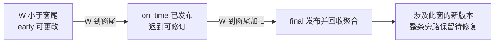

# 报表已经出炉，昨天的预约为何还能改写它？

先预测：a 的业务发生时点是第 2 分钟，时长 10 分钟；b 是第 12 分钟，时长 20 分钟。处理器先收到 b，再收到 a。若报“第 0–10 分钟发生的预约”，a 应去哪一窗？若第 10 分钟窗的结果已经发布，a 的更高版本随后纠正发生时点为第 11 分钟，又该撤哪一窗、添哪一窗？

[[计算机知识/55-数据库/10-系统课程/14-分析粒度与增量流处理#撤旧贡献 添新贡献与一般不变量|上一单元的撤旧添新]] 已解决身份、版本和无窗 sum/count。这里保留这些前提，增加“贡献属于哪个时间区间、何时发布、多久仍能修订”。本课独立构造带事件时间的教学日志，未改 [[计算机知识/75-软件工程与人机交互/82-v2意图恢复与演进实验#唯一业务合同：移动端与流处理共用|SE82 预约合同]]；其 outbox 仍只有 booking_created。没有启动 Beam、消息服务或远端 sink。

## 三种坐标不能混成一个钟

一条当前事实仍是一条 entity_id 对应的预约。它携带权威 version 与完整 after-image；本课新增 `event_time`：**该事实用于统计归窗的业务发生时点**，可被更高版本纠正。它不是这条修改消息抵达系统的时间，也不是消息的执行次数。本课按当前已接受快照归窗，统计每窗活跃事实的时长和条数；不统计“该窗内发生了多少次修改”。若问题改成变更次数，要保留变更事实，不能继续把实体最新版当作全部历史。

| 记号 | 本课精确定义 | 单位与限制 |
| --- | --- | --- |
| t | after-image 的事件时间 | 从共同原点起的整数分钟，0..1,000,000；未模拟时区或夏令时 |
| p | 输入数组的处理位置 | 从 1 起的序号，无时间单位；可定位重放与输出血缘 |
| τₚ | 处理第 p 项时的实际系统时钟 | 本实验不记录；p 不可冒充处理耗时或延迟测量 |
| W | 输入中显式推进的 watermark | 与 t 相同的事件时间坐标，初值 −1，只增或相等 |
| Δ、L | 窗宽、允许迟到长度 | 默认 Δ=10 分钟，L=5 分钟 |

这是一只钟加一张收件顺序表，再加一条完整性估计。把它们都叫 timestamp，报表通常会用沉默表达抗议。按处理时间归窗会让重放、网络拥塞和重新调度改变业务归属；按事件时间归窗则必须面对乱序与迟到。

Apache Beam 的官方模型区分事件时间与处理时间，以 watermark 估计输入完整性；它不是“物理上不会再有早数据”的证明。官方编程指南将窗口、trigger 和 allowed lateness 分开定义：窗口回答哪些元素一起算，trigger 回答何时发布，允许迟到给后续修订留下机会。[Beam 模型](https://beam.apache.org/documentation/basics/#watermark)、[编程指南 §8.4](https://beam.apache.org/documentation/programming-guide/#watermarks-and-late-data)、[§9](https://beam.apache.org/documentation/programming-guide/#triggers)。本课不从机器时钟或 max(t) 自动推 W，固定日志中的 watermark 是显式输入前提；生产系统的来源分区、空闲分区和传播规则须另验。

## 一个滚动窗、一套发布与回收政策

对 t≥0，窗口起点与区间为

\[
w(t)=\Delta\left\lfloor t/\Delta\right\rfloor,\qquad I(t)=[w(t),w(t)+\Delta).
\]

所以 t=9 属于 [0,10)，t=10 属于 [10,20)。每个事实只归一个固定、不重叠的滚动窗。把窗口起点和 group 合成键 k=(w,g)，每个键保存 `(S,N)`：分钟总和与活跃事实条数。0 分钟事实贡献 `(0,1)`，删除贡献 `(0,0)`。delete 的新 `event_time/group/minutes` 均为 null，撤哪一窗从**旧实体快照**取得。

本课采用下表的自定边界，比较符号是合同的一部分；不把离散分钟模型的边界符号冒充 Beam 的最大时间戳规则。Beam 模型说明窗口可在 watermark 超过最大时间戳加 allowed lateness 后过期，相关状态可能被丢弃；其触发器与累积模式也需配置。[官方窗口与过期定义](https://beam.apache.org/documentation/basics/#pcollection)、[允许迟到配置](https://beam.apache.org/documentation/programming-guide/#managing-late-data)。本课下列带业务更新的全快照修订是教学实现政策，不是仅设 `WindowInto` 就自动得到的撤销协议。

| 当前 W 与窗尾 e=w+Δ 的关系 | 接受新版本时 | watermark 控制项推进时 |
| --- | --- | --- |
| W<e | 仍可改；受影响键发 early 快照 | 首次跨到 e 且尚未过期时发 on_time |
| e≤W<e+L | 已迟到，但仍可改；发 late 修订 | 未跨新界限则不重复发 |
| W≥e+L | 已过期，涉及此窗的新版本整条旁路 | 对仍在活动表的键发 final，然后回收聚合行 |

每次 applied 都对旧、新贡献涉及的不同键各发一个**完整替换快照**；按 `(window_start,group)` 排序，同键一条。即使更高版本的贡献数值恰好相等，也发新 revision，表明处理过该次事实版本。WM 一步越过窗尾和回收界限时只发 final，不补发一张没有观察价值的 on_time；相等 W 可接受但不再触发。没有出现过的键不生成空报表。

每份输出含 `window_start/window_end/group/revision/sum_minutes/count/phase/position/watermark`。revision 是该窗该组从 1 开始递增的**输出版本**，区别于实体 version。下游应按键用更高 revision 替换旧快照，忽略同版重送；同版异内容应报冲突。把多个累计快照再相加，会把“修订账单”算成“新增收入”。本实验只产生顺序列表，未实现网络投递、下游去重或跨键原子发布。

count 降到 0 时仍保留活动键，发送 `(0,0)` 的撤回快照。否则下游会永久停在先前非空值。空组均值没有定义；final 的零值不是一条零分钟预约。只在 final 后删除该活动聚合行，已发快照仍保留。



图中的箭头推进的是 W；消息可以在各阶段乱序抵达。`final` 的意思是“本政策停止自动修改这版报表”，不是“现实业务已经永久完整”。

## 先判身份与版本，再判是否仍能撤

输入仍复用上一单元的 event_id、entity_id、正整数权威 version 与完整 after-image。put 恰有七字段：`event_id/entity_id/version/op/group/minutes/event_time`；delete 同七字段，后三个值均为 null。id、put 组名长 1–80、无首尾空白且可编码为 UTF-8；version 为 1..2⁶³−1；minutes 与 event_time 为 0..1,000,000 的整数，bool 不算整数。watermark 控制项恰有单字段 `watermark`，值为 0..1,000,000 的整数，不是一个实体事件。非法 schema、重复 JSON 键、NaN/Infinity 的文件处理边界见实践 README。

seen 保存登记 event_id 的规范 payload 与原裁决；claims 保存已观察 `(entity_id,version)` 的内容，包括 event_time；entities 保存每个实体**已应用最高版本**及完整快照或墓碑。新字段进入内容指纹，不能同版悄悄改时间。裁决顺序是：

1. schema/类型不合法 → invalid，不登记。WM 倒退 → watermark_regression，不改变 W 或状态。
2. 已登记 event_id：同 payload → duplicate；不同 → id_conflict，均不改变原记录。
3. 新 id、已有同 entity/version 但内容不同 → version_conflict，不登记该冲突 id。
4. 新 id、版本小于当前已应用版本 → stale；相等且内容一致 → same_version。登记 id/claim，不改实体和窗口。
5. 更高版本或从未见实体：计算旧、新贡献涉及的窗。任一已过期，整条进入旁路，裁决 expired_old / expired_new / expired_both；不改实体、窗口或普通输出。**仍登记该合法事件的 seen/claim 与旁路记录**，同 id 重试只得 duplicate，防止旁路被重放淹没。
6. 两侧都可改 → applied，撤旧添新、替换实体并发受影响键的修订。墓碑无贡献；新实体 delete 可保存墓碑；更高版本 put 可从墓碑复活。

第 5 条是明确增加的政策：与上一单元的 schema/conflict 拒绝不同，合法但超过在线修订范围的事件仍进入可追溯隔离结果。旁路保留原事件、p、W 和原因，供人工审阅或独立批量重建；本课没有自动补偿作业。已旁路的更高版本不成为 entities 当前版本，同版异内容仍受 claim 约束。某实体从未应用过旧事件时，未来窗中的更高版本可以新建当前事实；若已应用的旧事实卡在封存窗，则后续迁移也被阻止，必须走另起报表代数的离线修复。这是本政策换取“封存窗永不被半改”的实际业务损失，不能藏成实现细节。

**stale 与 late 是两条独立判断轴。** 第 7 步 a/v2 高于 v1，时点仍在旧窗，是 late 但可 applied；第 19 步 d/v1 低于已应用 v2，即使时点也很早，先裁 stale。第 16 步 d/v3 比当前 v2 更新，却因撤旧所需窗已封存而 expired_old。更高版本不是穿越保留期限的通行证。

## 只留组摘要，为何连撤哪一窗都猜不出

下面两段历史，所有事实时长都是 10、组别都是 A，版本都是 v1：

| 历史 | x 的事件时间 | y 的事件时间 | 当前无窗组摘要 | 当前每窗摘要 |
| --- | --- | --- | --- | --- |
| H₁ | 2 | 12 | A:(20,2) | [0,10) A:(10,1)，[10,20) A:(10,1) |
| H₂ | 12 | 2 | A:(20,2) | [0,10) A:(10,1)，[10,20) A:(10,1) |

同一后续是新的 `x/v2 delete`，W=−1。H₁ 应将 [0,10) A 改为 `(0,0)`，[10,20) A 留 `(10,1)`；H₂ 正好相反。连每窗摘要都完全相同，仍无法知道 x 属于哪一窗。上一单元的反例缺“撤多少”；本例各事实度量相同，缺的是**撤哪一窗**，因此保存旧实体的事件时间或可靠 before-image 是额外必要信息。

再把 W 先推到 15：H₁ 中删除 x 需要修改封存的 [0,10)，必须旁路；H₂ 中 x 在 [10,20)，仍可 applied。摘要不足不只造成数值错，也会选错接受/拒绝政策。这个反例没有把旧的 x5/x7 换个标题算作窗口推导。

## 保留哪些状态，才能证明每一步仍对

本实验回收的是已发 final 的**活动窗口聚合行**。保留 entities（含冻结事实的旧窗定位与墓碑）、seen、claims、每键输出 revision、输出历史及旁路。它们随不同实体、消息、版本和输出增长；没有 TTL，**总内存并不有界**。有限 CLI 最多 1000 项、输入≤1 MB；逐前缀全状态报告与 oracle 重建适合短日志，不是吞吐测试。

若要再回收 seen/claims 或墓碑，必须增加“该历史范围不会再重放或复活”的可验证期限、分区 epoch/源位置屏障或从权威日志重建方案；一个窗口 watermark 不能独自证明任意 entity/event_id 都不再出现。不要为了让内存曲线漂亮，悄悄把旧消息变成第一次见面。

令 Eₚ 是前缀 p 后的最新**已应用**实体快照集合，Wₚ 是当时 watermark。对尚未过期的键 k=(w,g)，定义

\[
c_k(x)=\begin{cases}(m_x,1),&x\text{ 为 put 且 }w(t_x)=w,g_x=g,\\(0,0),&\text{其他情况。}\end{cases}
\]

本课的窗口贡献不变量是：对每个未过期键，活动表有行时

\[
V_p(k)=\sum_{x\in E_p} c_k(x).
\]

没有行的键按 `(0,0)` 解释；存在的 `(0,0)` 行只是为后续输出撤回保留键。右侧只统计当前已接受事实，不能冒称所有原始输入的权威最新真值。

**归纳。** 空前缀两侧均零。duplicate/conflict/invalid 不改业务事实；stale/same_version 只增身份证据；expired 只增身份证据与旁路，所以各未过期键求和均不变。applied 在检查旧、新窗都未过期后，仅替换一个 x；对每个受影响键执行 `V′(k)=V(k)−c_k(x_old)+c_k(x_new)`，正好替换求和的一项。跨窗与换组只是影响两个键，仍满足同一式。WM 不改 E，未过期键的和值不变；刚过期键先按当前不变量发 final，再从不变量的活动定义域移除。故每个**成功完成的单线程调用前缀**都成立。

每份普通输出都是调用完成时该键 V 的完整快照；输出计数器只在 emit 处加一，因而各键 revision 严格递增。封存后任何会改变该窗贡献的更高版本都在修改前被拒绝，故该版 final 不再改变。这证明了本政策的自洽，并未证明 watermark 估计正确、旁路事件不重要或业务永不撤销；也未证明异常中断、持久状态、外部输出和源位置同一次提交。

## 用一条日志走完发布、迟到、跨窗与回收

完整 [events.json](../../_labs/round3/DB/event_time_windows/events.json) 有 41 项；[actual.json](../../_labs/round3/DB/event_time_windows/actual.json) 保存每步裁决与完整状态。[实践 README](../../_labs/round3/DB/event_time_windows/README.md) 给命令、输入与源码版本、oracle 和有限运行结果。下表 `0A=6/1@9 final` 表示 [0,10) A 的第 9 个输出快照，sum=6、count=1；`—` 表示本步没有普通输出，不能据此断言没有身份写入。

| p | 输入要点 | 裁决 | 本步窗口输出 |
| --- | --- | --- | --- |
| 1 | a/v1 t2 A10 | applied | 0A=10/1@1 early |
| 2 | b/v1 t12 A20 | applied | 10A=20/1@1 early |
| 3 | c/v1 t7 A0，晚于 t12 抵达 | applied | 0A=10/2@2 early |
| 4 | a1 原样重放 | duplicate | — |
| 5 | W=10 | watermark | 0A=10/2@3 on_time |
| 6 | d/v1 t8 A4 | applied | 0A=14/3@4 late |
| 7 | a/v2 t3 A15 | applied | 0A=19/3@5 late |
| 8 | a/v1 新 id 原内容 | stale | — |
| 9 | a/v3 改为 t11 A16 | applied | 0A=4/2@6 late；10A=36/2@2 early |
| 10 | b/v2 换 B20，t12 | applied | 10A=16/1@3 early；10B=20/1@1 early |
| 11 | c/v2 delete | applied | 0A=4/1@7 late |
| 12–13 | 重放 b2；W=14 | duplicate；watermark | — |
| 14 | d/v2 t9 A6 | applied | 0A=6/1@8 late |
| 15 | W=15，恰到回收界限 | watermark | 0A=6/1@9 final，删除活动0A行 |
| 16 | d/v3 改到 t16 A7 | expired_old | —；旁路，不能只给10A加7 |
| 17 | 新实体 e/v1 t4 B9 | expired_new | —；旁路 |
| 18–20 | 重放 d2；d/v1别名；d/v2 A99 | duplicate；stale；version_conflict | — |
| 21 | a/v4 t17 A18 | applied | 10A=18/1@4 early |
| 22 | W=20 | watermark | 10A=18/1@5 on_time；10B=20/1@2 on_time |
| 23 | b/v3 delete | applied | 10B=0/0@3 late |
| 24 | a/v5 t19 B19 | applied | 10A=0/0@6 late；10B=19/1@4 late |
| 25 | a/v6 改到 t21 B21 | applied | 10B=0/0@5 late；20B=21/1@1 early |
| 26 | W=25 | watermark | 10A=0/0@7 final；10B=0/0@6 final，回收两行 |
| 27 | a/v7 delete | applied | 20B=0/0@2 early |
| 28 | W=30 | watermark | 20B=0/0@3 on_time |
| 29–30 | 未见 z/v3 delete；z/v2 t32 B8 | applied；stale | —；保留墓碑 |
| 31 | W=35 | watermark | 20B=0/0@4 final，回收 |
| 32 | a/v8 从墓碑复活，t36 C9 | applied | 30C=9/1@1 early |
| 33–35 | a8 同 id 改时长；W退至34；bool版本 | id_conflict；watermark_regression；invalid | — |
| 36 | W=45，跳过40 | watermark | 30C=9/1@2 final，回收；不补发 on_time |
| 37 | a/v9 delete | expired_old | —；旁路 |
| 38 | 重放先前旁路的 e1 | duplicate | —；不再新增旁路 |
| 39 | e/v2 t46 B5 | applied | 40B=5/1@1 early；e 从未有已应用旧贡献 |
| 40 | a/v10 t37 C10 | expired_both | —；旁路 |
| 41 | e/v2 同内容新 id | same_version | — |

默认政策共有 29 份普通输出、4 份旁路；最终活动表仅 [40,50) B:(5,1)。这不是“全历史总和5”：旧窗的 final 仍分别存在。entities 中 d 仍为 v2 t9 A6，a 仍为 v8 t36 C9；它们的更新已旁路，不能在权威系统里把这份报表状态叫作源业务最新状态。

## 先预测，再改变一个条件

1. 保持日志不变，将 L 从 5 改成 0。先判断第 6、7、9 步能否应用，再说明为何不是简单“结果更快且同样准确”。
2. 保持 L=5，第 16 步 d/v3 新贡献已在可改的 [10,20)，是否只加新窗就够？若业务要求必须修正所有迟到数据，如何改变交付口径，而不是改一处比较符号？
3. 将 Δ 改成 20，保持同一显式 W 日志。第 5、9、15 步分别会发什么？能否拿旧窗版本号直接沿用到新窗报表？
4. 只保留 H₁/H₂ 的每窗总量并删除实体归窗字段，再接同一个 x/v2 delete。先给两个正确结果；再把 W 改成 15，比较接受与旁路。指出是哪项状态变得不可恢复。

> [!tip]- 答案：检查结果，也检查口径
> 1. W=10 时 [0,10) 已 final 并回收。第6步新 d 的旧窗输入为 expired_new；第7步 a 的旧、新窗都已封存，为 expired_both；第9步 a 的旧窗封存、新窗可改，为 expired_old。这些都没有 applied，旧实体停在 a/v1。更短保留减少活动状态和迟到修订，但会增加旁路、使在线报表偏离全量权威重算；偏差大小取决于迟到事实，不能只报延迟获益。
> 2. 不够。旧窗已给 final A6/1；只给新窗加7会同时保留旧贡献。应把完整事件与受影响窗交给离线重建，给旧、新窗发布同一**新报表代数/口径版本**的可追溯替换结果，并设计跨输出提交/恢复协议；或明确选择长期保留、允许重开窗的另一合同。当前模型没有完成这条修复链。
> 3. 第5步 W=10 尚未到 [0,20) 窗尾，不发布。第9步 t3→t11 仍在 [0,20) A，旧总量39/4撤15加16，得40/4；该键 @6 early。第15步 W=15仍早于20，不发布且不回收。[0,20) 与旧[0,10)是不同指标键域，必须从原日志重建并另标政策；复用旧revision会把不同口径误认作同一报表修订。
> 4. W=−1 时 H₁ 剩10窗10/1，0窗0/0；H₂ 剩0窗10/1，10窗0/0。W=15 时 H₁ 触及封存0窗而 expired_old，H₂ 可撤仍活动的10窗。缺的是x的旧事件时间/窗口定位，不是额外一份总和。若连身份、claim、墓碑也回收，重复裁决和旧版复活还会另失依据。

## 从这里返回哪一个实际问题

先用本课实验把“窗口归属、版本修订、回收损失”手算清楚，再回 [[计算机知识/55-数据库/10-系统课程/08-数据库工程安全与扩展专题#从批量报表到可撤销的增量视图|工程全景]] 对照迁移：改窗宽、迟到期限和统计口径都需要可追溯重算。再到 [[计算机知识/55-数据库/10-系统课程/18-源位置状态快照与目标恢复|源位置、状态快照与目标恢复]]，用两个本地SQLite资源和受控进程kill核对目标已写/位置未存与位置先走/事实未存的差异；新单元用无窗事实隔离恢复变量，本课仍只有内存窗口顺序输出，未实现持久窗口恢复。列存、完整星型与维度历史、CDC/schema 演化也仍是其他后续内容。

## 可运行真源与逐字镜像

[window_runner.py](../../_labs/round3/DB/event_time_windows/window_runner.py) 是增量实现真源，[batch_oracle.py](../../_labs/round3/DB/event_time_windows/batch_oracle.py) 从已应用原始历史取最高版本，并用 SQLite GROUP BY 独立重算；它不导入 reducer，不调用撤旧添新。每个前缀比较裁决、实体/墓碑、seen、claims、活动窗、输出版本/内容/相位、旁路原事件与原因。源码完整镜像如下；行为测试与运行说明从实践 README 进入。

<!-- code-sync: 计算机知识/_labs/round3/DB/event_time_windows/window_runner.py -->
```python
"""Finite, in-memory event-time revision model; no engine or durable sink."""
import argparse
from copy import deepcopy
import json
from pathlib import Path


def canonical(value):
    return json.dumps(value, ensure_ascii=False, sort_keys=True, separators=(",", ":"))


def read_json(path):
    def unique(pairs):
        if len({key for key, _ in pairs}) != len(pairs):
            raise ValueError("duplicate JSON key")
        return dict(pairs)
    def finite(_):
        raise ValueError("nonfinite JSON constant")
    return json.loads(path.read_text(encoding="utf-8"), object_pairs_hook=unique,
                      parse_constant=finite)


def valid(item):
    def text(s):
        if type(s) is not str or not 1 <= len(s) <= 80 or s != s.strip():
            return False
        try:
            s.encode("utf-8")
        except UnicodeError:
            return False
        return True
    def integer(n, low, high):
        return type(n) is int and low <= n <= high
    if type(item) is not dict:
        return False
    if set(item) == {"watermark"}:
        return integer(item["watermark"], 0, 1_000_000)
    if set(item) != {"event_id", "entity_id", "version", "op", "group", "minutes", "event_time"}:
        return False
    if not text(item["event_id"]) or not text(item["entity_id"]):
        return False
    if not integer(item["version"], 1, 2**63 - 1):
        return False
    if item["op"] == "delete":
        return all(item[k] is None for k in ("group", "minutes", "event_time"))
    return (item["op"] == "put" and text(item["group"])
            and integer(item["minutes"], 0, 1_000_000)
            and integer(item["event_time"], 0, 1_000_000))


class Windows:
    def __init__(self, width=10, lateness=5):
        if type(width) is not int or not 1 <= width <= 1000:
            raise ValueError("width must be integer 1..1000")
        if type(lateness) is not int or not 0 <= lateness <= 1000:
            raise ValueError("lateness must be integer 0..1000")
        self.width, self.lateness, self.watermark = width, lateness, -1
        self.entities, self.seen, self.claims, self.cells = {}, {}, {}, {}
        self.revisions, self.outputs, self.side = {}, [], []

    def key(self, event):
        if event is None or event["op"] == "delete":
            return None
        return (event["event_time"] // self.width * self.width, event["group"])

    def expired(self, key):
        return key is not None and self.watermark >= key[0] + self.width + self.lateness

    def emit(self, key, phase, position):
        self.revisions[key] = self.revisions.get(key, 0) + 1
        total, count = self.cells[key]
        self.outputs.append({"window_start": key[0], "window_end": key[0] + self.width,
                             "group": key[1], "revision": self.revisions[key],
                             "sum_minutes": total, "count": count, "phase": phase,
                             "position": position, "watermark": self.watermark})

    def apply(self, item, position):
        if not valid(item):
            return "invalid"
        if "watermark" in item:
            mark = item["watermark"]
            if mark < self.watermark:
                return "watermark_regression"
            previous, self.watermark = self.watermark, mark
            for key in sorted(list(self.cells)):
                end = key[0] + self.width
                if self.expired(key):
                    self.emit(key, "final", position)
                    del self.cells[key]
                elif previous < end <= mark:
                    self.emit(key, "on_time", position)
            return "watermark"
        message = canonical(item)
        eid, entity, version = item["event_id"], item["entity_id"], item["version"]
        if eid in self.seen:
            return "duplicate" if self.seen[eid][0] == message else "id_conflict"
        claim = canonical({k: item[k] for k in ("op", "group", "minutes", "event_time")})
        identity = (entity, version)
        if identity in self.claims and self.claims[identity] != claim:
            return "version_conflict"
        old = self.entities.get(entity)
        if old is not None and version <= old["version"]:
            decision = "stale" if version < old["version"] else "same_version"
        else:
            old_key, new_key = self.key(old), self.key(item)
            old_closed, new_closed = self.expired(old_key), self.expired(new_key)
            if old_closed or new_closed:
                decision = ("expired_both" if old_closed and new_closed else
                            "expired_old" if old_closed else "expired_new")
                self.side.append({"position": position, "reason": decision,
                                  "watermark": self.watermark, "event": deepcopy(item)})
            else:
                decision = "applied"
                for key, event, sign in ((old_key, old, -1), (new_key, item, 1)):
                    if key is not None:
                        total, count = self.cells.get(key, [0, 0])
                        self.cells[key] = [total + sign * event["minutes"], count + sign]
                self.entities[entity] = deepcopy(item)
                for key in sorted({k for k in (old_key, new_key) if k is not None}):
                    phase = "late" if self.watermark >= key[0] + self.width else "early"
                    self.emit(key, phase, position)
        self.seen[eid] = [message, decision]
        self.claims[identity] = claim
        return decision

    def snapshot(self):
        return {"watermark": self.watermark,
                "entities": [[key, self.entities[key]] for key in sorted(self.entities)],
                "seen": [[key, *self.seen[key]] for key in sorted(self.seen)],
                "claims": [[e, v, self.claims[e, v]] for e, v in sorted(self.claims)],
                "cells": [[w, g, *self.cells[w, g]] for w, g in sorted(self.cells)],
                "revisions": [[w, g, self.revisions[w, g]] for w, g in sorted(self.revisions)],
                "outputs": deepcopy(self.outputs), "side": deepcopy(self.side)}


def run(log, width=10, lateness=5):
    if type(log) is not list or len(log) > 1000:
        raise ValueError("finite teaching log: list of at most 1000 items")
    engine = Windows(width, lateness)
    trace = []
    for position, item in enumerate(log, 1):
        decision = engine.apply(item, position)
        trace.append({"position": position, "decision": decision, "state": engine.snapshot()})
    return {"protocol": "event-time-windows-v1", "width": width, "lateness": lateness,
            "trace": trace, "final": engine.snapshot()}


def main():
    parser = argparse.ArgumentParser(description=__doc__)
    parser.add_argument("--input", type=Path, required=True)
    parser.add_argument("--out", type=Path, required=True)
    parser.add_argument("--width", type=int, default=10)
    parser.add_argument("--lateness", type=int, default=5)
    args = parser.parse_args()
    if args.input.stat().st_size > 1_000_000:
        parser.error("finite teaching input exceeds 1 MB")
    result = run(read_json(args.input), args.width, args.lateness)
    args.out.write_text(json.dumps(result, ensure_ascii=False, indent=2) + "\n", encoding="utf-8")


if __name__ == "__main__":
    main()
```

<!-- code-sync: 计算机知识/_labs/round3/DB/event_time_windows/batch_oracle.py -->
```python
"""Independent prefix interpreter: rebuild accepted facts, SQL aggregate; no reducer import."""
import argparse
from copy import deepcopy
import json
from pathlib import Path
import sqlite3


def encode(value):
    return json.dumps(value, sort_keys=True, ensure_ascii=False, separators=(",", ":"))


def admissible(x):
    if not isinstance(x, dict):
        return False
    if list(sorted(x)) == ["watermark"]:
        return type(x["watermark"]) is int and 0 <= x["watermark"] <= 1_000_000
    fields = ["entity_id", "event_id", "event_time", "group", "minutes", "op", "version"]
    if sorted(x) != fields:
        return False
    strings = [x["entity_id"], x["event_id"]]
    if x["op"] == "put":
        strings.append(x["group"])
    for s in strings:
        if not isinstance(s, str) or not 0 < len(s) <= 80 or s.strip() != s:
            return False
        try:
            s.encode("utf-8")
        except UnicodeError:
            return False
    if type(x["version"]) is not int or not 0 < x["version"] < 2**63:
        return False
    if x["op"] == "delete":
        return (x["event_time"], x["group"], x["minutes"]) == (None, None, None)
    return (x["op"] == "put" and type(x["minutes"]) is int
            and 0 <= x["minutes"] <= 1_000_000 and type(x["event_time"]) is int
            and 0 <= x["event_time"] <= 1_000_000)


def rebuild(log, width, lateness):
    """All windows use full accepted history and SQL, never subtract old contributions."""
    accepted, receipts, claims, touched, versions, outputs, side, decisions = [], {}, {}, set(), {}, [], [], []
    mark = -1

    def facts():
        # The input contract is full after-images, so greatest accepted version wins.
        result = {}
        for event in accepted:
            entity = event["entity_id"]
            if entity not in result or result[entity]["version"] < event["version"]:
                result[entity] = event
        return result

    def location(event):
        if event is None or event["op"] != "put":
            return None
        return (width * (event["event_time"] // width), event["group"])

    def closed(key):
        return key is not None and mark >= key[0] + width + lateness

    def batch():
        db = sqlite3.connect(":memory:")
        try:
            db.execute("CREATE TABLE live(w INTEGER,g TEXT,m INTEGER)")
            db.executemany("INSERT INTO live VALUES(?,?,?)", [
                (*location(e), e["minutes"]) for e in facts().values()
                if location(e) is not None and not closed(location(e))])
            result = {(w, g): [s, n] for w, g, s, n in db.execute(
                "SELECT w,g,SUM(m),COUNT(*) FROM live GROUP BY w,g")}
            return {key: result.get(key, [0, 0]) for key in touched if not closed(key)}
        finally:
            db.close()

    def publish(key, phase, pos, values):
        versions[key] = versions.get(key, 0) + 1
        outputs.append({"window_start": key[0], "window_end": key[0] + width,
                        "group": key[1], "revision": versions[key],
                        "sum_minutes": values[0], "count": values[1], "phase": phase,
                        "position": pos, "watermark": mark})

    for pos, x in enumerate(log, 1):
        if not admissible(x):
            decisions.append("invalid")
            continue
        if "watermark" in x:
            if x["watermark"] < mark:
                decisions.append("watermark_regression")
                continue
            old_values = batch()
            previous, mark = mark, x["watermark"]
            for key in sorted(old_values):
                if closed(key):
                    publish(key, "final", pos, old_values[key])
                elif previous < key[0] + width <= mark:
                    publish(key, "on_time", pos, old_values[key])
            touched = {k for k in touched if not closed(k)}
            decisions.append("watermark")
            continue
        eid, entity, v = x["event_id"], x["entity_id"], x["version"]
        payload = encode(x)
        content = encode({k: x[k] for k in ("op", "group", "minutes", "event_time")})
        if eid in receipts:
            decisions.append("duplicate" if receipts[eid][0] == payload else "id_conflict")
            continue
        if (entity, v) in claims and claims[entity, v] != content:
            decisions.append("version_conflict")
            continue
        current = facts().get(entity)
        if current is not None and v < current["version"]:
            result = "stale"
        elif current is not None and v == current["version"]:
            result = "same_version"
        else:
            old, new = location(current), location(x)
            if closed(old) or closed(new):
                result = "expired_both" if closed(old) and closed(new) else (
                    "expired_old" if closed(old) else "expired_new")
                side.append({"position": pos, "reason": result,
                             "watermark": mark, "event": deepcopy(x)})
            else:
                result = "applied"
                accepted.append(deepcopy(x))
                affected = {k for k in (old, new) if k is not None}
                touched |= affected
                values = batch()
                for key in sorted(affected):
                    publish(key, "late" if mark >= key[0] + width else "early", pos, values[key])
        receipts[eid] = [payload, result]
        claims[entity, v] = content
        decisions.append(result)
    rows, values = facts(), batch()
    return decisions, {"watermark": mark,
                       "entities": [[k, rows[k]] for k in sorted(rows)],
                       "seen": [[k, *receipts[k]] for k in sorted(receipts)],
                       "claims": [[e, v, claims[e, v]] for e, v in sorted(claims)],
                       "cells": [[w, g, *values[w, g]] for w, g in sorted(values)],
                       "revisions": [[w, g, versions[w, g]] for w, g in sorted(versions)],
                       "outputs": outputs, "side": side}


def verify(log, actual):
    if actual["protocol"] != "event-time-windows-v1" or len(actual["trace"]) != len(log):
        raise AssertionError("protocol or trace length")
    width, lateness = actual["width"], actual["lateness"]
    for end in range(1, len(log) + 1):
        choices, state = rebuild(log[:end], width, lateness)
        expected = {"position": end, "decision": choices[-1], "state": state}
        if actual["trace"][end - 1] != expected:
            raise AssertionError(f"prefix {end}: decisions/identity/state/revision/output/side differ")
    _, final = rebuild(log, width, lateness)
    if actual["final"] != final:
        raise AssertionError("final")
    return {"oracle": "independent-history-sql-v1", "prefixes_checked": len(log),
            "width": width, "lateness": lateness, "outputs": len(final["outputs"]),
            "side": [[s["position"], s["reason"], s["event"]["event_id"]] for s in final["side"]],
            "status": "pass"}


def main():
    parser = argparse.ArgumentParser(description=__doc__)
    parser.add_argument("--input", type=Path, required=True)
    parser.add_argument("--actual", type=Path, required=True)
    parser.add_argument("--out", type=Path, required=True)
    args = parser.parse_args()
    result = verify(json.loads(args.input.read_text(encoding="utf-8")),
                    json.loads(args.actual.read_text(encoding="utf-8")))
    args.out.write_text(json.dumps(result, ensure_ascii=False, indent=2) + "\n", encoding="utf-8")


if __name__ == "__main__":
    main()
```
