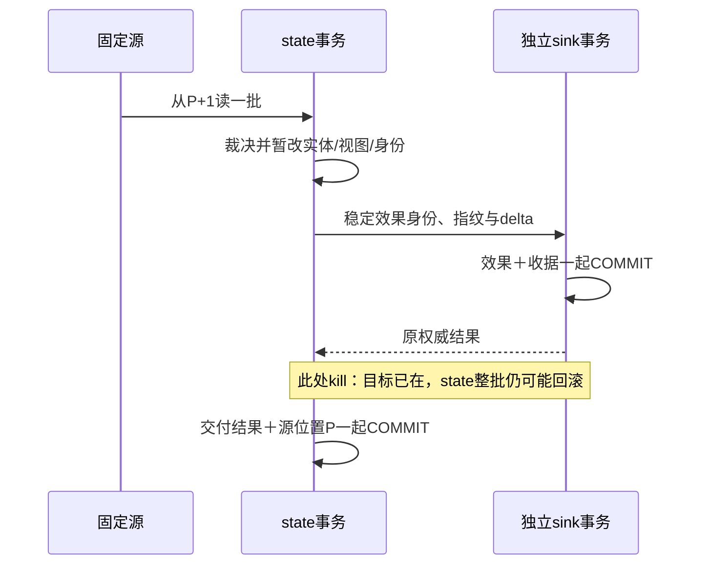

# 目标已经提交，重启以后究竟该从哪一条继续？

先预测两次重启。固定源的第1条是 f/v1，F组11分钟。处理器已让目标报表加上 `(11,1)`，还没保存“我已经处理到第1条”，进程就被终止。重启从第1条再读，目标会变成多少？反过来，若先保存“已读到第2条”，还没有保存这两条实体状态就终止，重启会补回它们吗？

这两种失败分别制造**重复效果**与**跳过事实**。[[计算机知识/55-数据库/10-系统课程/14-分析粒度与增量流处理|第14讲]] 的身份、版本、墓碑与本地事务仍必要；[[计算机知识/55-数据库/10-系统课程/17-事件时间窗口水位线与迟到修订|第17讲]] 的窗口、输出revision与回收政策又增加了必须恢复的状态。这里先用第14讲的**无窗事实**隔离跨资源恢复问题；没有把第17讲的内存窗口实现悄悄升级成持久流引擎。窗口化消费者若接入，还须把W、活动窗、revision、旁路及保留证据纳入其一致快照。

## 一条日志，两份数据库，三种“走到这里”

固定 [source.json](../../_labs/round3/DB/source_state_sink_recovery/source.json) 是不可变的18项源，协议 `wwl-db18-source-v1`，只有一个source_id和有序分区。p是从1开始的数组位置；检查点P表示**前P项都已按合同裁决**，恢复从P+1继续。P=0表示尚未处理任何项。duplicate、stale、冲突和invalid也占源位置；是否登记event_id，仍遵守第14讲的各自规则。

| 对象 | 实际资源与内容 | “已完成”凭什么判断 |
| --- | --- | --- |
| 源 | 只读固定JSON文件，source_id＋文件原字节SHA256 | 能重新读取相同位置、相同字节；本课没有broker确认协议 |
| 消费状态 | state.sqlite：实体/墓碑、seen、claims、组sum/count、逐位置裁决、目标收据、P | 同一个state事务COMMIT后可重开读取 |
| 目标效果 | 独立sink.sqlite：效果账本、组sum/count、按效果身份保存的指纹与权威结果 | 目标自己的事务COMMIT；不能从state事务推断 |
| 一次调用/尝试 | worker进程的一次执行 | 返回或退出码描述本次尝试，不等于业务是否已提交 |

因此“偏移未确认”在本实验中精确指**本地持久P尚未推进**，没有冒充Kafka等真实源端offset提交。源文件整份读入，≤1 MB、≤1000项；批大小B为1..100项，最后一批可短于B。没有多分区、并行worker、动态追加日志或生产内存上界结论。

两份数据库各用独立连接和独立事务，未ATTACH。每次打开验证协议版本、资源角色、source_id、源文件哈希和sink模式，拒绝把同一P套到另一份源。程序明确设置并记录 `journal_mode=WAL`、`synchronous=FULL`、`fullfsync=ON`、`wal_autocheckpoint=0`；SQL事务使用 `isolation_level=None` 配合 `BEGIN IMMEDIATE/COMMIT/ROLLBACK`。不靠连接上下文关闭连接。

WAL允许提交记录先进入WAL而数据库页稍后写回；WAL文件属于数据库持久状态，不能只搬主文件或手工删 `-wal` 来“清理”。FULL在WAL模式提交时增加同步操作，仍依赖操作系统、VFS和存储兑现其合同。本实验只杀进程，操作系统仍存活；设置FULL和观察成功重开不能代替断电测试。[SQLite WAL说明](https://www.sqlite.org/wal.html)、[synchronous说明](https://www.sqlite.org/pragma.html#pragma_synchronous)。

**逻辑检查点不等于WAL checkpoint。** 本课P与事实状态的一致提交回答恢复从哪条输入开始；SQLite把WAL页搬回数据库文件是物理checkpoint。关闭自动物理checkpoint只让这段有限实验的边界容易观察，没有赋予P跨资源原子性，也不建议生产系统无限保留WAL。正常关闭连接可能触发SQLite自身清理，本课不把它当成额外业务确认。

## 先把重复、更新和删除的合同接过来

每个源事件仍是第14讲六字段 `event_id/entity_id/version/op/group/minutes`。put为完整after-image，delete的group/minutes为null。身份和组名长1–80、无首尾空白、可编码UTF-8；version为1..2⁶³−1整数，minutes为0..1,000,000整数，bool不算整数。文件读取拒绝重复JSON键与NaN/Infinity；合法JSON中的坏单项记录invalid，不登记该事件身份，但记录该源位置的裁决。

同id同payload是duplicate，同id异payload是id_conflict；新id同entity/version异内容是version_conflict。历史claim先于stale裁决；合法旧版本和同内容同版本可登记身份证据，但不重复改变事实。更高版本完整快照撤旧添新；墓碑保留版本，显式更高版本可复活。冲突和invalid是**保留原源、记裁决后继续**的教学政策，不静默覆盖旧结果；若业务要求停流人工核对，应另设源位置推进政策。

只有applied产生一条教学目标效果，内容是此次完整事件及各组的整数差量 `[[group,Δsum,Δcount],…]`。未见实体的delete也产生一条空delta的版本效果，保存其已接受墓碑的交付结果；它不会凭空增加总量。目标效果是SQLite账本与报表差量，未发送邮件、扣款或通知真人。

效果身份为规范JSON数组 `[source_id,event_id]`，不是进程PID、尝试次数、当前批号或每次新生成的UUID。其参数指纹是规范效果body（协议、完整事件、delta）的SHA256；同一身份同指纹重试必须返回**已保存的原权威结果**，包括原effect_seq，而非随便返回“没报错”。同身份异指纹报冲突、原结果不覆盖。SHA256检查一致性，不认证调用者；永久保留收据是本实验的前提。这里还假定sink保存的是正确权威结果：若上游原裁决就错、返回错误缓存，或收据被恶意篡改，幂等只能稳定返回那份错误，不能自动纠正业务或认证结果来源。

[[计算机知识/75-软件工程与人机交互/82-v2意图恢复与演进实验#唯一业务合同：移动端与流处理共用|SE82]] 的actor/intent_id、原参数指纹、accepted/rejected/unknown与创建事件合同不变。本课复用“稳定身份＋同参重放＋权威原结果”的原则，没有把SE82的booking_created改成更新/删除协议，也没有挪用其预约指纹格式。多个真实Authority共用目标时还要明确全局命名空间。

## 安全顺序允许目标领先，但不能让位置超前

正确模式每批执行：

1. state开始一个写事务，从当前已提交状态裁决该批消息；在该事务内修改实体、身份、claim和视图。
2. 对每个applied效果，调用独立sink事务：查效果身份/指纹；已有则返回原结果，新效果则**在同一sink事务**写收据、效果账本与目标sum/count。
3. 把目标返回的原权威结果写入仍未提交的state交付表；该批全部效果成功后，在同一state事务内把P更新到批尾，再COMMIT。



若目标成功后worker失去答复，state可回滚而目标不回滚；调用方是unknown，应以同一身份查询或重试。重放从旧P开始，会重新算出相同效果body；sink识别已有身份，返回原结果而不再施加delta。若把去重表放在state数据库、把真实目标效果放到另一个资源，却分两次提交，就重新制造“身份有了效果没有”或“效果有了身份没有”的间隙。唯一键只是这份**目标事务合同**中的一部分。

本实现同步等待每个目标事务，持有state写事务期间访问另一个资源，适合短教学批；生产远程调用的长锁、超时、死锁与吞吐代价必须另设计。可用事务发件箱等办法解耦，但不能只换一个函数名就声称已获得同样恢复证明。

## 两个真实故障切面：先算，后看进程证据

父进程只启动自己的worker，传一次性屏障token；worker到指定代码位置后输出含PID、token、切面及源位置的JSON，flush后阻塞等待。父进程读到**完全匹配的屏障**才对这个Popen子进程发SIGKILL，并等待返回码−9；不是“睡一会儿猜它大概提交了”。父进程随后用新连接、读事务和 `integrity_check` 读取已提交两库，再启动新worker恢复。[Python对负信号返回码的定义](https://docs.python.org/3/library/subprocess.html#subprocess.Popen.returncode)。

固定B=2时，批首两条为f/F11和a/A10。下一表的状态是kill后重开查询的真实可见值；完整屏障、命令、PID、返回码、stdout及重启轨迹在 [results](../../_labs/round3/DB/source_state_sink_recovery/results/summary.json) 所指各场景中。

| 切面与模式 | kill后持久P / state组状态 | kill后目标 | 重启后结果 |
| --- | --- | --- | --- |
| after_sink p1，目标无去重反例 | P=0，空 | F11/1，1个效果 | f再施加一次；目标F22/2，最终36分钟/5条、12个效果；批量真值25/4、11效果 |
| after_sink p1，正确目标合同 | P=0，空 | F11/1，1效果和原收据 | 重放f返回原effect_seq=1，目标不再加；终局25/4、11效果 |
| after_offset p2，位置先单独提交反例 | P=2，空 | 空 | 从p3开始，永久跳过f；终局14/3、10效果，P仍可到18 |
| before_state_commit p2，正确原子状态 | P=0，空 | F11/1与A10/1，2效果 | 整批重放，两目标收据复用；终局25/4、11效果 |
| after_state_commit p2，正确原子状态 | P=2，F11/1与A10/1 | 同左，2效果 | 从p3继续，已存事实不丢；终局25/4、11效果 |
| after_sink p5，已完成前两批 | P=4，F11/1与A30/2 | F11/1与A35/2 | a/v2的+5差量重放不再加；终局25/4、11效果 |
| before_state_commit p4，B=4 | P=0，空 | F11/1与A30/2，3效果 | 重放4项，其中p4本来就是duplicate；终局25/4、11效果 |

第二个反例特意在**同一state数据库的另一个事务**先COMMIT P=2，再准备事实事务；kill发生在两者之间。数据都放一份文件，仍救不了错误的提交分组。位置成了一个只负责跑步、不负责等队友的队长。

被跳过的a后来在p4原id重现，因从未登记而变为applied，之后又有高版本，所以它的当前度量能补回；f从不再出现，永久少11/1。若只挑会被后续覆盖的事件做故障注入，终局sum可能碰巧正确，却已经丢了身份、claim与逐位置裁决。这也是oracle不能只检查最终sum/count的原因。

无去重反例中，state的实体/视图本身最终仍是25/4；它保存的交付结果序号已因目标重复而不同，所以完整state也不等于正确参考。目标真实账本的F22/2不会因为源消费者有一个seen表就自动消失。

## 固定源的批量真值与恢复不变量

[batch_oracle.py](../../_labs/round3/DB/source_state_sink_recovery/batch_oracle.py) 不导入worker或reducer。它从原始前缀独立裁决身份/claim，保留已接受after-image历史，选每实体最高已接受版本，再用SQLite全量GROUP BY。相邻前缀全量组表的差给目标效果，不调用撤旧添新作为答案。它比较实体/墓碑、seen、claims、所有已裁决位置、P、交付原结果、效果账本、指纹、收据和目标总量。

| 源位置 | 输入要点 | 裁决 | 当前批量组状态 |
| --- | --- | --- | --- |
| 1–3 | f/F11、a/A10、b/A20 | 各applied | F11/1，A30/2 |
| 4 | 原a1重放 | duplicate | 不变 |
| 5–6 | a/v2 A15、c/v1 B0 | 各applied | F11/1，A35/2，B0/1 |
| 7–8 | a旧v1；a同v2异内容 | stale；version_conflict | 不变 |
| 9–10 | b/v2 delete；未见d/v3 delete | 各applied | F11/1，A15/1，B0/1；d墓碑，第二效果delta空 |
| 11 | d/v2 B9 | stale | 不变 |
| 12–14 | a/v3换B7；c删除；d/v4 A4复活 | 各applied | F11/1，B7/1，A4/1 |
| 15–17 | a/v3同内容新id；b1同id异内容；bool版本fix | same_version；id_conflict；invalid | 不变 |
| 18 | 修正为合法fix：e/v1 A3 | applied | F11/1，B7/1，A7/2，总25/4 |

令S(P)是固定源前P项按既定协议裁决后的完整状态，E(P)是该前缀的applied效果序列。正确模式在每个已提交检查点维持：

\[
\text{state}=(P,S(P)),\qquad E(P)\subseteq\text{目标已提交的效果身份集合},
\]

且每个效果身份在目标账本**至多施加一次**，原指纹和原结果不变。目标可领先P，不能据“目标已有一部分”直接推进P。

**归纳与恢复。** 初始P=0、两端为空。假定state是(P,S(P))；一批从P+1开始，确定性裁决生成正确后续状态与效果。sink每个身份的收据和效果同事务，所以在本故障模型下要么该效果无已提交事实，要么原结果与效果一起可查；重试同参只读原结果。state的实体/身份/claim/裁决/交付结果与新P同事务，因此kill后要么全留旧(P,S(P))，要么全留新检查点，不存在P新而事实旧的已提交状态。前者重放，目标至多领先而不会再次施加；后者从新P+1继续。故每次恢复重试仍维持不变量。

在源可重读且字节固定、单写者、算法/指纹规则固定、身份记录不回收、SQLite提交合同成立，并且故障最终停止、后续调用能成功的前提下，有限源最终到P=N；所有E(N)已提交且每身份一次，所以目标效果与独立批量参考相等。两库没有组成一个瞬时共同事务，中间状态允许目标领先；此证明不保证任意时刻两个资源相等，也不覆盖无限失败、数据损坏或网络服务的隐藏效果。

把P先单独提交破坏第一个不变量；去掉目标原子去重破坏第二个。不变量失效发生在不同资源，不能用一个“exactly-once”标签代替检查。第17讲的watermark也不是源位置、目标确认或检查点的替代品。

## 改一个条件，再判断恢复方案

1. B从2改成4，在p4批尾提交前kill。P是多少？目标已有几次效果？重启应从哪条开始，是否把p4也产生一个新效果？
2. 同样在p1目标已commit后kill，重启时每次给效果换一个新UUID，即使sink对UUID有唯一键会怎样？如果只保留sum/count而丢失seen/claims，又少了什么依据？
3. 修改源文件中的旧事件，再保留同一source_id和原检查点重启，可否继续？若只向文件末尾加一项，本课是否自动接受？
4. 把sink换成“发送邮件后返回200”，但提供方不能按稳定身份查询原结果，消费者在邮件已送出、P未存时重启。怎样描述能保证与不能保证的部分？

> [!tip]- 可核答案
> 1. P仍为0；目标已提交f、a、b共3效果，A30/2、F11/1。重启从p1重放；三个已有身份返回原结果，p4在state中是duplicate，不产生新效果。已实际运行B4切面；B1/2/4/7无kill终局也相同，提交次数与重放批范围不同。
> 2. 每次新UUID把同一业务效果变成新身份，重试仍会再加F11/1；唯一键没有阻止语义重复。丢seen会失去同id重复/异payload冲突判断，丢claim会失去历史同version异内容证据，只有sum/count还缺实体旧贡献和墓碑版本。不能靠从P前移绕过这些缺失。
> 3. 源文件原字节哈希不匹配，程序拒绝复用资源；空白变化和追加也会改变哈希。本课只支持不可变有限源，不提供追加协议。业务更正应给明确的新源/指标代数，按原始证据重建并校验；真正可追加源需稳定分区、不可变位置与边界哈希/epoch，不能把有限文件的检查点合同原封照搬。
> 4. 本地state仍能保证位置与状态一致，重放可以避免丢消费进度，但不能证明邮件只发一次。目标若无原子身份/效果合同，需接受可能重复或设计提供方幂等键、可查询权威结果及补偿流程；“unknown”不是未发送。本课SQLite目标只能作为这种能力的模型，不认证真实邮件接口。

## 实验入口与下一项边界

[实践README](../../_labs/round3/DB/source_state_sink_recovery/README.md) 保存完整运行命令、原始屏障/进程轨迹、固定输入与源码版本、独立预期、失败判据和未验接口。作者实际完成11场景、7次屏障后SIGKILL及重启、9正确组合与2反例；6行为测试另验18个前缀、同身份异参数和源身份。成功运行只是有限软件证据，非作者仍需独立核论证、代码与结果。

回 [[计算机知识/55-数据库/10-系统课程/08-数据库工程安全与扩展专题#从批量报表到可撤销的增量视图|工程专题]]，现在能具体指出事实状态、源位置和目标效果分别在哪个COMMIT之后成立；与 [[计算机知识/10-编程语言/01-Python/10-系统课程/12-可恢复导入器与安装交付#两行一批：失败之后，哪些数据已经存在|Python批事务恢复]] 比较，新增边界正是独立sink，非一个连接内回滚。本次未实现持久窗口恢复、多分区一致切面、真实CDC或远程sink；列存/向量化、完整星型与维度历史、CDC/schema演进仍是#172后续内容。进程kill不验证断电、磁盘损坏、任意并发调度、真实服务或真人理解。

## 规范源码与镜像

真源为实践目录的worker、独立oracle和父进程driver；下列代码逐字镜像。测试真源与原始运行结果从实践README进入。

<!-- code-sync: 计算机知识/_labs/round3/DB/source_state_sink_recovery/recovery_worker.py -->
```python
"""Two-resource SQLite recovery model; deliberately bad modes are counterexamples."""
import argparse
from contextlib import contextmanager
import hashlib
import json
import os
from pathlib import Path
import sqlite3
import sys

PROTOCOL = "wwl-db18-recovery-v1"


def canonical(value):
    return json.dumps(value, ensure_ascii=False, sort_keys=True, separators=(",", ":"))


def fingerprint(value):
    return hashlib.sha256(canonical(value).encode("utf-8")).hexdigest()


def read_source(path):
    def unique(pairs):
        if len({k for k, _ in pairs}) != len(pairs):
            raise ValueError("duplicate JSON key")
        return dict(pairs)
    def finite(_):
        raise ValueError("nonfinite JSON constant")
    data = path.read_bytes()
    if len(data) > 1_000_000:
        raise ValueError("finite source exceeds 1 MB")
    source = json.loads(data, object_pairs_hook=unique, parse_constant=finite)
    if (type(source) is not dict or set(source) != {"protocol", "source_id", "events"}
            or source["protocol"] != "wwl-db18-source-v1"
            or not text(source["source_id"]) or type(source["events"]) is not list
            or len(source["events"]) > 1000):
        raise ValueError("source envelope")
    return source, hashlib.sha256(data).hexdigest()


def text(value):
    if type(value) is not str or not 1 <= len(value) <= 80 or value != value.strip():
        return False
    try:
        value.encode("utf-8")
    except UnicodeError:
        return False
    return True


def valid(event):
    if type(event) is not dict or set(event) != {"event_id", "entity_id", "version", "op", "group", "minutes"}:
        return False
    if not text(event["event_id"]) or not text(event["entity_id"]):
        return False
    if type(event["version"]) is not int or not 1 <= event["version"] < 2**63:
        return False
    if event["op"] == "delete":
        return event["group"] is None and event["minutes"] is None
    return (event["op"] == "put" and text(event["group"])
            and type(event["minutes"]) is int and 0 <= event["minutes"] <= 1_000_000)


@contextmanager
def transaction(db):
    db.execute("BEGIN IMMEDIATE")
    try:
        yield
        db.execute("COMMIT")
    except BaseException:
        if db.in_transaction:
            db.execute("ROLLBACK")
        raise


def open_resource(path, source, source_hash, role, sink_mode):
    db = sqlite3.connect(path, isolation_level=None, timeout=2)
    try:
        actual = db.execute("PRAGMA journal_mode=WAL").fetchone()[0]
        if actual.lower() != "wal":
            raise RuntimeError("WAL unavailable")
        db.execute("PRAGMA synchronous=FULL")
        db.execute("PRAGMA fullfsync=ON")
        db.execute("PRAGMA wal_autocheckpoint=0")
        metadata = {"protocol": PROTOCOL, "source_id": source["source_id"],
                    "source_sha256": source_hash, "role": role, "sink_mode": sink_mode}
        tables = {r[0] for r in db.execute("SELECT name FROM sqlite_master WHERE type='table'")}
        if tables:
            if "metadata" not in tables or dict(db.execute("SELECT k,v FROM metadata")) != metadata:
                raise ValueError("resource/source/protocol identity mismatch; no migration")
            return db
        with transaction(db):
            db.execute("CREATE TABLE metadata(k TEXT PRIMARY KEY,v TEXT NOT NULL)")
            db.executemany("INSERT INTO metadata VALUES(?,?)", sorted(metadata.items()))
            if role == "state":
                statements = ["CREATE TABLE checkpoint(singleton INTEGER PRIMARY KEY CHECK(singleton=1),p INTEGER NOT NULL)",
                              "CREATE TABLE entities(id TEXT PRIMARY KEY,payload TEXT NOT NULL)",
                              "CREATE TABLE seen(id TEXT PRIMARY KEY,payload TEXT NOT NULL,decision TEXT NOT NULL)",
                              "CREATE TABLE claims(entity TEXT,v INTEGER,content TEXT NOT NULL,PRIMARY KEY(entity,v))",
                              "CREATE TABLE totals(g TEXT PRIMARY KEY,s INTEGER NOT NULL,n INTEGER NOT NULL)",
                              "CREATE TABLE positions(p INTEGER PRIMARY KEY,decision TEXT NOT NULL)",
                              "CREATE TABLE deliveries(id TEXT PRIMARY KEY,fingerprint TEXT NOT NULL,result TEXT NOT NULL)"]
                for statement in statements:
                    db.execute(statement)
                db.execute("INSERT INTO checkpoint VALUES(1,0)")
            else:
                db.execute("CREATE TABLE effects(seq INTEGER PRIMARY KEY AUTOINCREMENT,id TEXT NOT NULL,fingerprint TEXT NOT NULL,body TEXT NOT NULL,result TEXT NOT NULL)")
                db.execute("CREATE TABLE receipts(id TEXT PRIMARY KEY,fingerprint TEXT NOT NULL,result TEXT NOT NULL)")
                db.execute("CREATE TABLE totals(g TEXT PRIMARY KEY,s INTEGER NOT NULL,n INTEGER NOT NULL)")
        return db
    except BaseException:
        db.close()
        raise


def add_totals(db, delta):
    for group, ds, dn in delta:
        row = db.execute("SELECT s,n FROM totals WHERE g=?", (group,)).fetchone() or (0, 0)
        total, count = row[0] + ds, row[1] + dn
        if count < 0 or total < 0 or (count == 0 and total != 0):
            raise ValueError("inconsistent aggregate")
        if count == 0:
            db.execute("DELETE FROM totals WHERE g=?", (group,))
        else:
            db.execute("INSERT OR REPLACE INTO totals VALUES(?,?,?)", (group, total, count))


def apply_event(db, event, source_id):
    if not valid(event):
        return "invalid", None
    eid, entity, version = event["event_id"], event["entity_id"], event["version"]
    payload = canonical(event)
    seen = db.execute("SELECT payload FROM seen WHERE id=?", (eid,)).fetchone()
    if seen:
        return ("duplicate" if seen[0] == payload else "id_conflict"), None
    content = canonical({k: event[k] for k in ("op", "group", "minutes")})
    claim = db.execute("SELECT content FROM claims WHERE entity=? AND v=?", (entity, version)).fetchone()
    if claim and claim[0] != content:
        return "version_conflict", None
    row = db.execute("SELECT payload FROM entities WHERE id=?", (entity,)).fetchone()
    old = json.loads(row[0]) if row else None
    if old and version <= old["version"]:
        decision = "stale" if version < old["version"] else "same_version"
        effect = None
    else:
        decision, delta = "applied", {}
        for item, sign in ((old, -1), (event, 1)):
            if item and item["op"] == "put":
                ds, dn = delta.get(item["group"], (0, 0))
                delta[item["group"]] = (ds + sign * item["minutes"], dn + sign)
        delta = [[g, *delta[g]] for g in sorted(delta) if delta[g] != (0, 0)]
        add_totals(db, delta)
        db.execute("INSERT OR REPLACE INTO entities VALUES(?,?)", (entity, payload))
        body = {"protocol": PROTOCOL, "event": event, "delta": delta}
        effect = {"id": canonical([source_id, eid]), "fingerprint": fingerprint(body), "body": body}
    db.execute("INSERT INTO seen VALUES(?,?,?)", (eid, payload, decision))
    db.execute("INSERT OR IGNORE INTO claims VALUES(?,?,?)", (entity, version, content))
    return decision, effect


def deliver(sink, effect, sink_mode):
    """The receipt and the teaching effect share THIS sink transaction."""
    if effect["fingerprint"] != fingerprint(effect["body"]):
        raise ValueError("incorrect fingerprint")
    with transaction(sink):
        prior = sink.execute("SELECT fingerprint,result FROM receipts WHERE id=?", (effect["id"],)).fetchone()
        if prior:
            if prior[0] != effect["fingerprint"]:
                raise ValueError("effect identity conflict")
            return json.loads(prior[1]), False
        add_totals(sink, effect["body"]["delta"])
        seq = sink.execute("SELECT COALESCE(MAX(seq),0)+1 FROM effects").fetchone()[0]
        result = {"status": "committed", "effect_id": effect["id"], "effect_seq": seq,
                  "fingerprint": effect["fingerprint"]}
        encoded = canonical(result)
        sink.execute("INSERT INTO effects VALUES(?,?,?,?,?)",
                     (seq, effect["id"], effect["fingerprint"], canonical(effect["body"]), encoded))
        if sink_mode == "dedupe":
            sink.execute("INSERT INTO receipts VALUES(?,?,?)", (effect["id"], effect["fingerprint"], encoded))
    return result, True


def state_snapshot(db):
    return {"checkpoint": db.execute("SELECT p FROM checkpoint").fetchone()[0],
            "entities": [list(r) for r in db.execute("SELECT id,payload FROM entities ORDER BY id")],
            "seen": [list(r) for r in db.execute("SELECT id,payload,decision FROM seen ORDER BY id")],
            "claims": [list(r) for r in db.execute("SELECT entity,v,content FROM claims ORDER BY entity,v")],
            "totals": [list(r) for r in db.execute("SELECT g,s,n FROM totals ORDER BY g")],
            "positions": [list(r) for r in db.execute("SELECT p,decision FROM positions ORDER BY p")],
            "deliveries": [list(r) for r in db.execute("SELECT id,fingerprint,result FROM deliveries ORDER BY id")]}


def record(value):
    print(canonical(value), flush=True)


def barrier(args, kind, position, extra=None):
    if args.fault == kind and args.at == position:
        record({"phase": "barrier", "kind": kind, "position": position,
                "pid": os.getpid(), "token": args.token, **(extra or {})})
        # Parent must observe the exact structured barrier before killing its child.
        if sys.stdin.readline() != "continue\n":
            raise RuntimeError("barrier closed without continuation")


def consume(args):
    source, source_hash = read_source(args.source)
    if not 1 <= args.batch_size <= 100 or args.at < 0:
        raise ValueError("batch size 1..100 and nonnegative fault position required")
    if args.fault == "after_offset" and args.checkpoint_mode != "offset_first_bad":
        raise ValueError("after_offset is exclusively the bad-order cut")
    if args.state.resolve() == args.sink.resolve():
        raise ValueError("state and sink must be distinct resources")
    state = open_resource(args.state, source, source_hash, "state", args.sink_mode)
    sink = None
    try:
        sink = open_resource(args.sink, source, source_hash, "sink", args.sink_mode)
        start = state.execute("SELECT p FROM checkpoint").fetchone()[0]
        if not 0 <= start <= len(source["events"]):
            raise ValueError("checkpoint outside source")
        record({"phase": "start", "position": start, "pid": os.getpid(),
                "source_sha256": source_hash, "journal_mode": state.execute("PRAGMA journal_mode").fetchone()[0],
                "synchronous": state.execute("PRAGMA synchronous").fetchone()[0],
                "fullfsync": state.execute("PRAGMA fullfsync").fetchone()[0],
                "wal_autocheckpoint": state.execute("PRAGMA wal_autocheckpoint").fetchone()[0],
                "sink_settings": {key: sink.execute("PRAGMA " + key).fetchone()[0]
                                  for key in ("journal_mode", "synchronous", "fullfsync", "wal_autocheckpoint")}})
        for low in range(start, len(source["events"]), args.batch_size):
            end = min(low + args.batch_size, len(source["events"]))
            if args.checkpoint_mode == "offset_first_bad":
                with transaction(state):
                    state.execute("UPDATE checkpoint SET p=?", (end,))
                barrier(args, "after_offset", end)
            with transaction(state):
                for index in range(low, end):
                    event = source["events"][index]
                    decision, effect = apply_event(state, event, source["source_id"])
                    if effect:
                        result, created = deliver(sink, effect, args.sink_mode)
                        state.execute("INSERT INTO deliveries VALUES(?,?,?)",
                                      (effect["id"], effect["fingerprint"], canonical(result)))
                        record({"phase": "sink_committed", "position": index + 1,
                                "effect": effect, "result": result, "new_effect": created})
                        barrier(args, "after_sink", index + 1, {"result": result})
                    state.execute("INSERT INTO positions VALUES(?,?)", (index + 1, decision))
                    record({"phase": "evaluated_uncommitted", "position": index + 1, "decision": decision})
                if args.checkpoint_mode == "atomic":
                    state.execute("UPDATE checkpoint SET p=?", (end,))
                barrier(args, "before_state_commit", end)
            record({"phase": "state_committed", "position": end, "state": state_snapshot(state)})
            barrier(args, "after_state_commit", end)
        record({"phase": "finished", "position": len(source["events"])})
    finally:
        if sink is not None:
            sink.close()
        state.close()


def main():
    parser = argparse.ArgumentParser(description=__doc__)
    parser.add_argument("--source", type=Path, required=True)
    parser.add_argument("--state", type=Path, required=True)
    parser.add_argument("--sink", type=Path, required=True)
    parser.add_argument("--batch-size", type=int, default=2)
    parser.add_argument("--sink-mode", choices=("dedupe", "naive_bad"), default="dedupe")
    parser.add_argument("--checkpoint-mode", choices=("atomic", "offset_first_bad"), default="atomic")
    parser.add_argument("--fault", choices=("none", "after_sink", "after_offset", "before_state_commit", "after_state_commit"), default="none")
    parser.add_argument("--at", type=int, default=0)
    parser.add_argument("--token", default="")
    consume(parser.parse_args())


if __name__ == "__main__":
    main()
```

<!-- code-sync: 计算机知识/_labs/round3/DB/source_state_sink_recovery/batch_oracle.py -->
```python
"""Independent finite source interpreter; full-snapshot SQL recomputation, no worker import."""
import hashlib
import json
import sqlite3


def encoded(value):
    return json.dumps(value, ensure_ascii=False, sort_keys=True, separators=(",", ":"))


def admissible(x):
    if not isinstance(x, dict) or sorted(x) != ["entity_id", "event_id", "group", "minutes", "op", "version"]:
        return False
    strings = [x["entity_id"], x["event_id"]] + ([x["group"]] if x["op"] == "put" else [])
    for value in strings:
        if not isinstance(value, str) or not 0 < len(value) <= 80 or value.strip() != value:
            return False
        try:
            value.encode("utf-8")
        except UnicodeError:
            return False
    if type(x["version"]) is not int or not 0 < x["version"] < 2**63:
        return False
    if x["op"] == "delete":
        return x["group"] is None and x["minutes"] is None
    return x["op"] == "put" and type(x["minutes"]) is int and 0 <= x["minutes"] <= 1_000_000


def rebuild(source, end=None):
    """Choose accepted snapshots, not deltas; independently GROUP BY every prefix."""
    events = source["events"][:end]
    history, seen, claims, decisions, effects = [], {}, {}, [], []

    def current():
        selected = {}
        for snapshot in history:
            entity = snapshot["entity_id"]
            if entity not in selected or snapshot["version"] > selected[entity]["version"]:
                selected[entity] = snapshot
        return selected

    def totals():
        db = sqlite3.connect(":memory:")
        try:
            db.execute("CREATE TABLE live(g TEXT,m INTEGER)")
            db.executemany("INSERT INTO live VALUES(?,?)", [
                (x["group"], x["minutes"]) for x in current().values() if x["op"] == "put"])
            return {g: (s, n) for g, s, n in db.execute("SELECT g,SUM(m),COUNT(*) FROM live GROUP BY g")}
        finally:
            db.close()

    for position, item in enumerate(events, 1):
        effect = None
        if not admissible(item):
            verdict = "invalid"
        else:
            eid, entity, version = item["event_id"], item["entity_id"], item["version"]
            message = encoded(item)
            content = encoded({k: item[k] for k in ("op", "group", "minutes")})
            if eid in seen:
                verdict = "duplicate" if seen[eid][0] == message else "id_conflict"
            elif (entity, version) in claims and claims[entity, version] != content:
                verdict = "version_conflict"
            else:
                old = current().get(entity)
                if old is not None and version < old["version"]:
                    verdict = "stale"
                elif old is not None and version == old["version"]:
                    verdict = "same_version"
                else:
                    verdict = "applied"
                    before = totals()
                    history.append(item)
                    after = totals()
                    delta = []
                    for group in sorted(before.keys() | after.keys()):
                        b, a = before.get(group, (0, 0)), after.get(group, (0, 0))
                        if b != a:
                            delta.append([group, a[0] - b[0], a[1] - b[1]])
                    body = {"protocol": "wwl-db18-recovery-v1", "event": item, "delta": delta}
                    digest = hashlib.sha256(encoded(body).encode("utf-8")).hexdigest()
                    identity = encoded([source["source_id"], eid])
                    result = {"status": "committed", "effect_id": identity,
                              "effect_seq": len(effects) + 1, "fingerprint": digest}
                    effect = {"id": identity, "fingerprint": digest, "body": body, "result": result}
                    effects.append(effect)
                seen[eid] = [message, verdict]
                claims[entity, version] = content
        decisions.append([position, verdict])
    rows, sums = current(), totals()
    state = {"checkpoint": len(events),
             "entities": [[k, encoded(rows[k])] for k in sorted(rows)],
             "seen": [[k, *seen[k]] for k in sorted(seen)],
             "claims": [[e, v, claims[e, v]] for e, v in sorted(claims)],
             "totals": [[g, *sums[g]] for g in sorted(sums)], "positions": decisions,
             "deliveries": sorted([[e["id"], e["fingerprint"], encoded(e["result"])] for e in effects])}
    return {"state": state, "effects": effects,
            "receipts": sorted([[e["id"], e["fingerprint"], encoded(e["result"])] for e in effects]),
            "totals": state["totals"]}


def compare(source, state, sink):
    truth = rebuild(source)
    expected_effects = [[i, e["id"], e["fingerprint"], encoded(e["body"]), encoded(e["result"])]
                        for i, e in enumerate(truth["effects"], 1)]
    checks = {"state": state == truth["state"], "sink_effects": sink["effects"] == expected_effects,
              "sink_receipts": sink["receipts"] == truth["receipts"],
              "sink_totals": sink["totals"] == truth["totals"]}
    return {"checks": checks, "all_match": all(checks.values()),
            "expected_totals": truth["totals"], "actual_totals": sink["totals"],
            "expected_effects": len(expected_effects), "actual_effects": len(sink["effects"])}
```

<!-- code-sync: 计算机知识/_labs/round3/DB/source_state_sink_recovery/run_experiment.py -->
```python
"""Parent-owned barrier/SIGKILL/restart experiment; writes raw local evidence."""
import argparse
import codecs
import hashlib
import json
import os
from pathlib import Path
import platform
import selectors
import signal
import sqlite3
import subprocess
import sys
import time
import uuid
import batch_oracle

HERE = Path(__file__).resolve().parent


def write(path, value):
    path.write_text(json.dumps(value, ensure_ascii=False, indent=2) + "\n", encoding="utf-8")


def inspect(path, role):
    db = sqlite3.connect(path.as_uri() + "?mode=ro", uri=True, isolation_level=None)
    try:
        db.execute("BEGIN")
        integrity = [r[0] for r in db.execute("PRAGMA integrity_check")]
        if integrity != ["ok"]:
            raise AssertionError((role, integrity))
        if role == "state":
            queries = {"entities": "SELECT id,payload FROM entities ORDER BY id",
                       "seen": "SELECT id,payload,decision FROM seen ORDER BY id",
                       "claims": "SELECT entity,v,content FROM claims ORDER BY entity,v",
                       "totals": "SELECT g,s,n FROM totals ORDER BY g",
                       "positions": "SELECT p,decision FROM positions ORDER BY p",
                       "deliveries": "SELECT id,fingerprint,result FROM deliveries ORDER BY id"}
            result = {k: [list(r) for r in db.execute(query)] for k, query in queries.items()}
            result["checkpoint"] = db.execute("SELECT p FROM checkpoint").fetchone()[0]
        else:
            result = {"effects": [list(r) for r in db.execute("SELECT seq,id,fingerprint,body,result FROM effects ORDER BY seq")],
                      "receipts": [list(r) for r in db.execute("SELECT id,fingerprint,result FROM receipts ORDER BY id")],
                      "totals": [list(r) for r in db.execute("SELECT g,s,n FROM totals ORDER BY g")]}
        db.execute("COMMIT")
        return result
    finally:
        db.close()


def launch(args, case_dir, name, state, sink, batch=2, mode="atomic", sink_mode="dedupe", fault="none", at=0):
    token = uuid.uuid4().hex
    command = [sys.executable, "-B", "-u", str(HERE / "recovery_worker.py"),
               "--source", str(args.source), "--state", str(state), "--sink", str(sink),
               "--batch-size", str(batch), "--checkpoint-mode", mode, "--sink-mode", sink_mode,
               "--fault", fault, "--at", str(at), "--token", token]
    started = time.monotonic()
    proc = subprocess.Popen(command, stdin=subprocess.PIPE, stdout=subprocess.PIPE,
                            stderr=subprocess.PIPE, text=True, encoding="utf-8")
    lines, observed = [], None
    try:
        if fault != "none":
            selector = selectors.DefaultSelector()
            selector.register(proc.stdout, selectors.EVENT_READ)
            try:
                deadline = time.monotonic() + 15
                pending = ""
                decoder = codecs.getincrementaldecoder("utf-8")()
                while time.monotonic() < deadline:
                    if not selector.select(timeout=max(0, deadline - time.monotonic())):
                        break
                    raw_chunk = os.read(proc.stdout.fileno(), 65536)
                    if not raw_chunk:
                        break
                    chunk = decoder.decode(raw_chunk)
                    lines.append(chunk)
                    pending += chunk
                    while "\n" in pending:
                        line, pending = pending.split("\n", 1)
                        event = json.loads(line)
                        if event.get("phase") == "barrier":
                            if (event.get("pid"), event.get("token"), event.get("kind"), event.get("position")) != (proc.pid, token, fault, at):
                                raise AssertionError("unrecognized barrier")
                            observed = event
                            proc.send_signal(signal.SIGKILL)  # Only this Popen-owned child.
                            break
                    if observed is not None:
                        break
            finally:
                selector.close()
            if observed is None:
                raise AssertionError("worker did not reach requested barrier; no expected cut observed")
        stdout, stderr = proc.communicate(timeout=20)
        lines.append(stdout)
    finally:
        if proc.poll() is None:
            proc.kill()  # Timeout/error cleanup is not counted as a successful fault cut.
            proc.communicate(timeout=5)
    raw = "".join(lines)
    case_dir.joinpath(name + ".stdout.jsonl").write_text(raw, encoding="utf-8")
    case_dir.joinpath(name + ".stderr.txt").write_text(stderr, encoding="utf-8")
    expected = -signal.SIGKILL if fault != "none" else 0
    if proc.returncode != expected:
        raise AssertionError((name, proc.returncode, stderr))
    record = {"command": command, "pid": proc.pid, "returncode": proc.returncode,
              "elapsed_seconds": time.monotonic() - started,
              "observed_barrier": observed, "signal": 9 if observed else None}
    write(case_dir / (name + ".process.json"), record)
    events = [json.loads(line) for line in raw.splitlines()]
    return record, events


def scenario(args, name, batch=2, mode="atomic", sink_mode="dedupe", fault="none", at=0):
    directory = args.out / name
    directory.mkdir()
    work = args.work / name
    work.mkdir()
    state, sink = work / "state.sqlite", work / "sink.sqlite"
    runs, traces = [], []
    first, events = launch(args, directory, "first", state, sink, batch, mode, sink_mode, fault, at)
    runs.append(first)
    traces.extend(events)
    cut = {"state": inspect(state, "state"), "sink": inspect(sink, "sink")}
    write(directory / "cut-observed.json", cut)
    if fault != "none":
        restarted, events = launch(args, directory, "restart", state, sink, batch, mode, sink_mode)
        runs.append(restarted)
        traces.extend(events)
    final_state, final_sink = inspect(state, "state"), inspect(sink, "sink")
    final = {"state": final_state, "sink": final_sink}
    write(directory / "final-observed.json", final)
    source = json.loads(args.source.read_text(encoding="utf-8"))
    comparison = batch_oracle.compare(source, final_state, final_sink)
    prefix_checks = []
    for event in traces:
        if event["phase"] == "state_committed":
            expected = batch_oracle.rebuild(source, event["position"])["state"]
            prefix_checks.append({"position": event["position"], "match": event["state"] == expected})
    good = mode == "atomic" and sink_mode == "dedupe"
    if good:
        if not comparison["all_match"] or not all(c["match"] for c in prefix_checks):
            raise AssertionError((name, comparison, prefix_checks))
        resumed, events = launch(args, directory, "resume_complete", state, sink, batch, mode, sink_mode)
        runs.append(resumed)
        if inspect(state, "state") != final_state or inspect(sink, "sink") != final_sink:
            raise AssertionError("completed checkpoint replay changed durable resources")
        # A fresh state rebuild replays every source item against the SAME sink receipts.
        fresh = work / "fresh_state.sqlite"
        replay, events = launch(args, directory, "fresh_state_replay", fresh, sink, batch, mode, sink_mode)
        runs.append(replay)
        if inspect(fresh, "state") != final_state or inspect(sink, "sink") != final_sink:
            raise AssertionError("stable authority results did not survive full source replay")
    elif comparison["all_match"]:
        raise AssertionError("counterexample was not observed")
    result = {"name": name, "batch_size": batch, "checkpoint_mode": mode, "sink_mode": sink_mode,
              "fault": fault, "at": at, "runs": runs, "comparison": comparison,
              "committed_prefix_checks": prefix_checks,
              "cut_checkpoint": cut["state"]["checkpoint"],
              "cut_state_totals": cut["state"]["totals"], "cut_sink_totals": cut["sink"]["totals"]}
    if mode == "offset_first_bad":
        if cut["state"]["checkpoint"] != 2 or cut["state"]["totals"] != []:
            raise AssertionError("bad offset cut not exposed")
        if final_state["totals"] != [["A", 7, 2], ["B", 7, 1]]:
            raise AssertionError("missing fixed f fact was not observed")
    if sink_mode == "naive_bad":
        if final_sink["totals"] != [["A", 7, 2], ["B", 7, 1], ["F", 22, 2]]:
            raise AssertionError("duplicate fixed f effect was not observed")
    write(directory / "result.json", result)
    return result


def run(args):
    if os.name != "posix":
        raise RuntimeError("this SIGKILL experiment requires POSIX")
    args.source = args.source.resolve()
    args.out = args.out.resolve()
    args.work = args.work.resolve()
    args.out.mkdir()
    args.work.mkdir()
    started = time.monotonic()
    specs = [("normal_b1", 1, "atomic", "dedupe", "none", 0),
             ("normal_b2", 2, "atomic", "dedupe", "none", 0),
             ("normal_b4", 4, "atomic", "dedupe", "none", 0),
             ("normal_b7", 7, "atomic", "dedupe", "none", 0),
             ("kill_sink_naive", 2, "atomic", "naive_bad", "after_sink", 1),
             ("kill_sink_dedupe", 2, "atomic", "dedupe", "after_sink", 1),
             ("kill_offset_first", 2, "offset_first_bad", "dedupe", "after_offset", 2),
             ("kill_atomic_before", 2, "atomic", "dedupe", "before_state_commit", 2),
             ("kill_atomic_after", 2, "atomic", "dedupe", "after_state_commit", 2),
             ("kill_update_sink", 2, "atomic", "dedupe", "after_sink", 5),
             ("kill_atomic_b4", 4, "atomic", "dedupe", "before_state_commit", 4)]
    results = [scenario(args, *spec) for spec in specs]
    expected = batch_oracle.rebuild(json.loads(args.source.read_text(encoding="utf-8")))
    write(args.out / "batch-truth.json", expected)
    summary = {"protocol": "wwl-db18-recovery-v1", "python": platform.python_version(),
               "sqlite": sqlite3.sqlite_version, "platform": platform.platform(),
               "cpu_threads": 1, "wall_clock_limit_seconds": 300,
               "elapsed_seconds": time.monotonic() - started,
               "source_sha256": hashlib.sha256(args.source.read_bytes()).hexdigest(),
               "source_files_sha256": {p.name: hashlib.sha256(p.read_bytes()).hexdigest()
                                       for p in (HERE / "recovery_worker.py", HERE / "batch_oracle.py", HERE / "test_recovery.py", Path(__file__).resolve())},
               "scenarios": [{"name": r["name"], "fault": r["fault"], "at": r["at"],
                              "returncodes": [p["returncode"] for p in r["runs"]],
                              "comparison": r["comparison"], "cut_checkpoint": r["cut_checkpoint"],
                              "cut_state_totals": r["cut_state_totals"], "cut_sink_totals": r["cut_sink_totals"]}
                             for r in results],
               "controlled_sigkills": sum(r["fault"] != "none" for r in results),
               "correct_scenarios": sum(r["comparison"]["all_match"] for r in results),
               "intentional_counterexamples": sum(not r["comparison"]["all_match"] for r in results),
               "status": "pass"}
    write(args.out / "summary.json", summary)
    print(json.dumps({k: summary[k] for k in ("status", "controlled_sigkills", "correct_scenarios", "intentional_counterexamples", "elapsed_seconds")}, indent=2))


def main():
    parser = argparse.ArgumentParser(description=__doc__)
    parser.add_argument("--source", type=Path, default=HERE / "source.json")
    parser.add_argument("--out", type=Path, required=True, help="new evidence directory")
    parser.add_argument("--work", type=Path, required=True, help="new directory for disposable SQLite resources")
    run(parser.parse_args())


if __name__ == "__main__":
    main()
```
