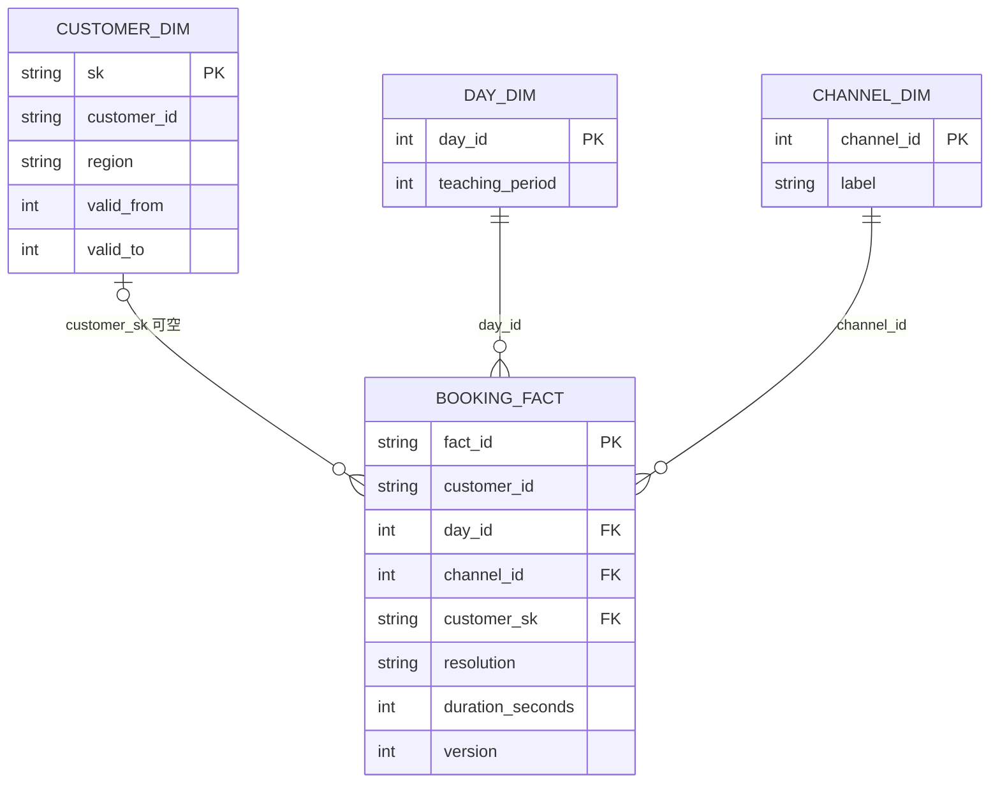
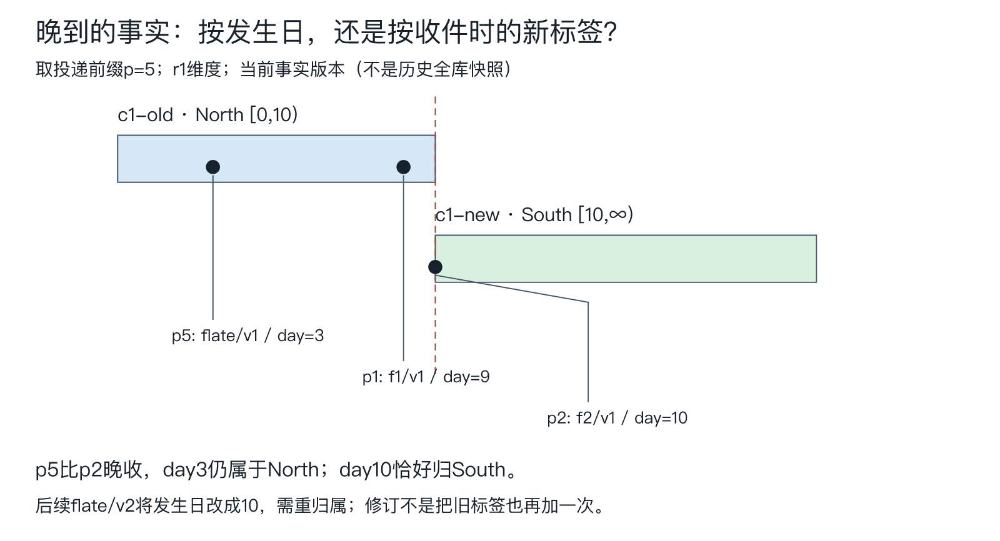
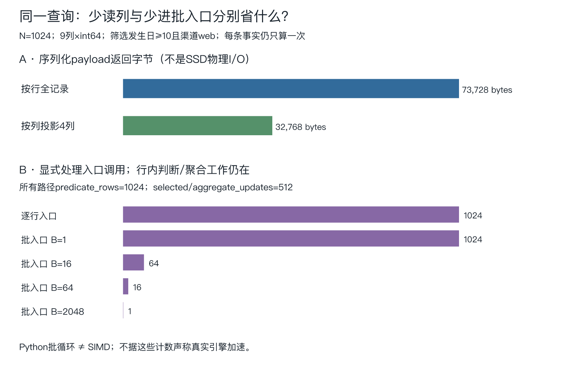

# 客户换了地区，旧预约应该搬家吗？

客户c1在第10天从North变为South。f1发生在第9天，f2发生在第10天；另一个发生于第3天的预约，直到投递第5项才抵达分析端。三个都属于South，还是按各自的业务发生日分别归属？若历史维度恰有两行，直接按customer_id连接又会把几条预约算成几条？

[[计算机知识/55-数据库/10-系统课程/14-分析粒度与增量流处理|第14讲]] 已给当前事实、完整版本快照、撤旧添新与批量真值；[[计算机知识/55-数据库/10-系统课程/17-事件时间窗口水位线与迟到修订|第17讲]] 区分业务时点与收件顺序；[[计算机知识/55-数据库/10-系统课程/18-源位置状态快照与目标恢复|第18讲]] 核过两个资源的恢复边界。本课接三个尚未回答的具体问题：怎样按历史维度解释同一事实；如何从真实本地变更及schema演进得到它；同一查询按行、按列、按批算，究竟少了哪一种工作。

本课以独立新SQLite库实际捕获增删改和一次单位迁移，再用有限投递日志检验重放/隔离。没有修改SE82预约合同，没有启动Debezium、Kafka、远端CDC或真实列式数据库。实验中的行/列文件和Python批循环有真实输入输出，但不作为物理引擎加速或SIMD证据。

## 先定事实粒度，再画星型

这里的主事实粒度是：**在选定投递前缀中，每个预约fact_id的最高已应用版本所代表的一条当前有效计量事实**。一条活跃事实含customer_id、业务occurred_day、duration_seconds、channel及血缘字段。业务版本更新可改变时长或发生日；delete使该预约不再贡献，仍保留版本墓碑。它不是一条CDC消息、一个客户、一行维度历史或“系统在历史那天已经知道的全部事实”。

因此，本课取当前after-image，再按它的业务发生日连接历史维度；f1末尾已更新为660秒，flate末尾已纠正到第10天。这个as-of只限定**维度有效时间**，不等于重现“当时已知的时长与事实版本”，也不是自动双时态。要重现历史知识，须另存事实版本有效期/系统时间与当时报表截点，不能仅保留维度历史。

Kimball把grain定义为一行测量所代表的业务对象，并要求度量与之相符；事实可按事务、周期快照或累积过程等粒度设计。[Fact Tables](https://www.kimballgroup.com/2008/11/fact-tables/)。本课当前可修改预约行适合维护“截至P仍有效的预约时长”，不拿它冒充“累计创建过多少预约”。若每天保存一次当前预约快照，跨天相加会重复同一预约；若要分析流程多个里程碑，应另定义累积快照的对象和日期角色。不能先把所有数字塞进同一表，再让SUM决定业务含义。

实验实际建立以下星型。客户维度的sk是每个历史版本唯一的代理键，customer_id是跨版本稳定的自然键；日期和渠道各有独立唯一键。



图的日期只是从共同原点起的整数天，teaching_period=day_id//10是教学分桶，没有伪造公历月份。未知或歧义客户归属使用空customer_sk和显式resolution，不把事实删掉。`star_model.py` 在新库启用外键，以fact_id主键装载8条活跃事实；客户/日期/渠道维度键唯一，GROUP BY保持4050秒、8条。已解析代理键使常规报表不必每次重做时态搜索，代价是装载、晚到维度修正和重绑定责任。

时长在这份不重叠的当前事实集合上可加；count是同一粒度的条数。均值须携带sum/count再合并，比例、库存快照、中位数各有不同可加性，沿用第14讲的分母与权重边界。星型是服务查询的对象设计，不是放弃事务库规范化的通行证；源库与分析副本可以分别优化更新约束和大范围读取。

## SCD2：自然键相同，历史版本不能随便连

Type1覆盖旧属性，适合只问“按当前地区看现有客户”；Type2新增带有效区间的维度版本，回答“事实发生时该客户属于哪里”。Kimball的Type2原说明要求新代理键、相接的有效起止时点和事实对应正确的同期键。[Slowly Changing Dimensions, Part 2](https://www.kimballgroup.com/2008/09/slowly-changing-dimensions-part-2/)。本课用半开区间和null表示无上界，是明确的教学数据合同。

对事实f与客户历史行d，归属条件为

\[
f.customer=d.customer\ \land\ d.valid\_from\le f.day\ \land\ (d.valid\_to=\text{null}\ \lor\ f.day<d.valid\_to).
\]

r1维度中c1-old是North `[0,10)`，c1-new是South `[10,∞)`，c2-only是East `[0,∞)`。第9天属于North，第10天恰好属于South；“≤结束”会在接缝同时匹配两行。**客户sk唯一不能单独排除同自然键有效区间重叠**，仍须核候选数。

| 候选维度行数 | 本课处理 | 为什么保留这个状态 |
| --- | --- | --- |
| 1 | matched，保存唯一sk与region | 每条事实只贡献一次 |
| 0 | unmatched，region=null，保留到独立未知桶 | 缺维度不能静默丢事实或填当前标签 |
| >1 | ambiguous，region=null，保留到歧义桶 | 不任选一行，也不按候选数重复计量 |

每份报告同时给逐事实候选sk、status、region与三类桶的sum/count；null region不会和真实文字“Unknown”混为一类。维度行缺字段、重复sk或坏区间拒绝作为维度输入，合法但重叠的区间则显式暴露歧义。生产可在装载阶段整体拒绝重叠，或按相同隔离政策处理；必须先声明，不能让一条任意ORDER BY替业务裁决。



[可缩放SVG](../../_labs/round3/DB/analytics_history_cdc/figures/scd-boundary.svg)由同一spec与实际前缀生成。p5比p2晚收，不能把p5替代业务day3；随后flate/v2把发生日纠正为10时，才需撤去旧North归属、按新快照归South。当前实验每前缀全量重算归属，没有声称实现维度变更的高效增量传播。

最终r1为East1200/3、North660/1、South1830/3、unmatched360/1，合计4050秒/8条。若把所有c1事实按当前维度解释，South会是2490/4，North消失；这是另一个可声明的问题，不是同一历史问题的答案。若只按customer_id连全部历史，c1的4条事实各出现两次，合计变6540/12；`SUM(DISTINCT duration_seconds)`又把两条合法的600秒预约合成一个，只剩3450。历史维度不是自动消除重复的魔法表，它只是把“这是谁”变成了“这是谁的哪个时期”。

r2后来补c3-late West `[0,∞)`，同一8事实与同一源截点重新计算后，unknown360/1移到West360/1，总量不变。overlap输入再给c2一个 `[6,13)` 版本，会把3条c2事实共1200/3隔离为ambiguous；gap把c1-old截止改为8，则第9天f1变未知，未知桶共1020/2。旧报表必须保留源截点和维度revision；重算新r2可以替换新一代报表，不能抹掉旧r1后宣称此前从未未知。

## 从源变更得到事实：真实本地捕获与明确的适配层

`capture_source.py` 创建新源库。每个业务事务先推进versions权威版本，再修改facts；AFTER INSERT/UPDATE/DELETE触发器在**同一SQLite事务**把OLD/NEW写进changes。实际执行15次业务变化、一次迁移和一次回滚探针：回滚的行、版本和变更记录都没有留下。SQLite官方说明NEW/OLD在不同触发事件中的适用范围，本课只用相应合法引用。[CREATE TRIGGER](https://www.sqlite.org/lang_createtrigger.html)。这属于触发器式本地变更捕获，不是读取PostgreSQL WAL、启动复制槽或远端连接器。

源操作按已声明顺序使每实体version恰好加1，删除后versions表仍保留权威版本；消费者沿用完整after-image合同，允许跳版本。捕获source_pos是本源库的变更序号，不是LSN、watermark、实体版本或输出revision。实验另有delivery_plan：先投15条真实捕获，再构造重放、旧版本、冲突及坏schema压力输入；不能把这个人工投递顺序说成Kafka真实分区调度。

| 变化 | 原消息含义 | 规范分析事实 |
| --- | --- | --- |
| schema1，minutes=10 | 分钟单位的完整after-image | duration_seconds=600 |
| schema2，duration_seconds=660 | 秒单位的完整after-image | 保留660，不再乘60 |
| put缺度量字段 | schema不能解码 | missing_measure，保留原事件隔离 |
| put度量显式null | 来源明确没有一个合法整数度量 | null_measure，不能补0 |
| put度量为0 | 合法零时长事实 | sum贡献0，count贡献1 |
| delete，after=null，带新业务version | 此实体新版本不存在 | 保存带版本业务墓碑，撤旧贡献 |
| transport_tombstone，value=null | 已声明的传输清理信号，无权威业务version | 不把它当新业务删除，也不抹实体版本证据 |

迁移在本机新源库的一个事务中完成：暂停这段单写者操作、删除旧表触发器、建秒单位新布局、把既有minutes乘60复制、再装新版触发器。布局复制不是新预约，changes条数仍为8；之后消息明确标schema2，旧schema1原始日志仍可按原单位解码。这个有限迁移不证明大表在线DDL、双写者兼容或连接器增量快照期间schema变化安全。

Debezium PostgreSQL官方文档区分带delete envelope的行删除与随后同key、整个消息value为null的压缩清理tombstone；before内容还受源的REPLICA IDENTITY等条件影响。[delete/tombstone说明](https://debezium.io/documentation/reference/stable/connectors/postgresql.html#postgresql-delete-events)。本课自定JSON不是Debezium原生线协议；人工补的transport_tombstone只检验这一区分。若只从已压缩topic重新建状态，是否把null当删除还取决于那个快照/流适配合同，不能直接套用这里“保留版本证据”的策略。

消费者将已知schema解码到同一秒单位，再按第14讲顺序裁决。seen比较**完整原始消息**，包括before、schema和source_pos；claims比较同实体/version的**规范业务内容**。所以新id下schema1的10分钟和schema2的600秒可为same_version；同一原id悄悄改schema或payload仍是身份冲突。before只保留作原始身份与血缘，不拿它替代本地旧贡献，也不核它是否真实等于源前态；本消费者不是任意CDC真实性校验器。

未知schema和坏度量进quarantine，不登记业务身份/claim；原始消息、位置与原因都保留。同id后续修成合法schema可正常参与裁决。冲突也隔离，原身份不覆盖；duplicate不重复改变事实。当前有限模型处理后续项，**没有把这称为源位置已可靠确认**，持久停流/重试/隔离与跨资源提交仍回第18讲。报告用ASCII转义保存JSON值，孤立代理项能被逐项拒绝并完整留证，不因输出编码失败留下空报告；字段合法性和保留原值是不同责任。

## 同一有限查询：行、列和批各自减少什么

最终8事实按同一r1归属，保留customer、日期、渠道和血缘；仅为成本实验，把整组复制128份，给每个副本不同事实编号，得到N=1024行。每行9个有符号int64编码列：fact_id、customer_id、occurred_day、duration_seconds、region、channel、note、source_ref、version。字符串字典共享并记录；这不是把原来8条业务事实真的增加到1024条。

实际写一份`<9q`行文件和9份`<q`列文件，都是小端8字节标量。固定查询是：`day>=10 AND channel='web'`，按已解析region桶求sum_seconds/count。只需日期、渠道、地区、秒数4列，选中512行；所有路径都得到East0/128、South234240/384。零时长行仍进入分母。

| 路径 | 实际返回的编码payload | 显式处理入口 | 不曾省去的工作 |
| --- | --- | --- | --- |
| 行式全记录扫描 | 9N×8=73728 bytes | 每行一次，共1024 | 1024行谓词，512次聚合更新 |
| 列式4列投影、逐行处理 | 4N×8=32768 bytes | 每行一次，共1024 | 同左；仍有Python循环 |
| 同4列、B=16批处理 | 同32768 bytes | ceil(N/16)=64批 | 同样1024行谓词与512次更新 |
| B=1 / 64 / 2048 | 同32768 bytes | 1024 / 16 / 1 | 批大不等于内层工作消失 |



[SVG及图源](../../_labs/round3/DB/analytics_history_cdc/figures/projection-batches.svg)来自实际layout-result。返回字节是本程序read取得的序列化payload，不是SSD I/O量，未含字典、页头、文件系统缓存、读预取或编码/装载成本。operator_calls只计代码显式process/process_batch入口，不是全部Python函数或CPU指令调用；批循环也没有SIMD。scratch_slots_peak只计额外mask与selection元素槽，不含已载入4列、字典、原事实、结果组表或Python对象大小，不能冒充RSS峰值。

MonetDB/X100原论文把批执行放在逐元组迭代和整列中间物化之间，讨论解释开销、紧循环及向量过大超缓存的取舍；其具体最佳批大小依当时查询和硬件。[原论文§4、§5.1.1](https://www.cidrdb.org/cidr2005/papers/P19.pdf)。本课只把“少进多少次入口”做成可复算计数，没有据2005年的平台结果给当前硬件选最优B，也没有把Python计数改名引擎吞吐。

列式还可能利用编码，但压缩依赖分布和顺序。同一region编码列原始8192字节；按当前事实顺序做`(int64 value,int64 run_length)`游程编码，1024段反而16384字节。把**完整行同步排序**后只有4段，64字节；这个数未含排序、字典、索引和页元数据，不能推为全库压缩率。只排序region一列而不保留其他列同一事实的位置，会把时长和客户配错。

反过来，按行号点取一条完整9列编码记录：行文件一次读72字节，列文件九次各读8字节，同样72字节。列存不是每种查询都少读；短事务点查、多字段更新、列组重写、delta合并与索引维护各有成本。行列布局与批执行也是两个维度，换成列文件并不自动取消逐行解释器开销。

## 读多、写多与物化：别把投影收益当成维护免费

第14讲给增量视图的正确性，这里比较另一笔账。假设要反复读取**全部地区桶的当前sum/count**，已经完成归属；N=1024、G=4、查询Q次，期间有U次不改变N的时长/归属修改，每次最多影响旧、新两桶。不含身份日志、索引定位、同步和字符串输出，采用一个明确的教学逻辑访问模型：全量每事实读group/seconds两值，聚合pair读2写2，共6次标量访问；每次结果读2G值。增量修改读旧/新group/seconds共4值，最坏两pair各读2写2共8次，合计至多12。

\[
C_{\text{每查重算}}=Q(6N+2G),\qquad C_{\text{已建物化}}\le2QG+12U.
\]

Q=100、U=10时分别615200与至多920次这类逻辑访问；首次建物化还要约6N访问，未藏进“免费初始化”。Q=1、U=10000且每次修改都跨两个不同桶时，本访问模型的物化维护恰为120008，多于一次全扫6152；这证明该声明负载下的逻辑访问更多，尚非运行时间结论，另外还有写日志、事务冲突和状态保留。这个模型说明什么时候值得付写放大，不是性能倍数预测；实际成本须按负载、访问局部性和持久配置测。

批量重建每隔一段输入或时间刷新一次，写侧可简单、读取可复用快照，代价是必须显示源截点与刷新新鲜度；严格要求每次读最新，就不能把尚未刷新的快照当当前真值。增量维护把部分读成本移到每次写，仍要把旧贡献、维度版本、汇总和身份纳入一致提交。

维度晚改还会扩大维护范围：r2只补c3一段历史，却需重绑所有受影响的旧事实；本例f5由未知移到West。若有customer_id/时间反向依赖可找R条受影响事实，否则可能扫描N行；不能把“一条维度更新”按一个事实delta计费。业务发生日修正、schema单位修正或全新分组口径也可能要求回溯重算。预聚合丢掉实体/时点之后，更不能从四个桶猜回归属；保留日志与维度revision是可追溯修复的成本。

## 为什么这套结果能逐步核对

每个投递前缀先得到规范当前事实E(P)，再对每个活跃事实枚举SCD候选。将它映到恰好一个桶：唯一候选的region，或unmatched，或ambiguous。令b(f)为这唯一桶，则

\[
V_P(g)=\sum_{f\in E(P),\ b(f)=g}(seconds_f,1),\quad
\sum_gV_P(g)=\sum_{f\in E(P)}(seconds_f,1).
\]

身份/版本不变的投递不改E；applied只替换一个完整快照或墓碑，事实侧沿用第14讲归纳。映射侧的三种候选数穷尽且互斥，所以每条活跃事实恰好贡献一次；维度revision改变的是b，不凭空改变E的总量。解析出的客户sk最多一项；实际星型对客户用LEFT JOIN，以resolution与null地区桶保留未知/歧义；日期/渠道则有NOT NULL外键和唯一主键，INNER JOIN不会丢失这些事实。PK/FK本身不保证任意INNER JOIN都保行：若把客户连接改成INNER JOIN，未知f5就会丢掉。若直接按自然键连接所有历史，一条事实出现多个候选，此分割前提已经被破坏。

本课作者oracle独立从接受的原始after-image历史选最高版本，再用SQL列所有时态候选与GROUP BY，逐前缀比较实体/墓碑、seen、规范claims、隔离原值/原因、sk候选和桶。布局路径又对同一编码记录求同一整数查询，正式结果保留原始捕获、投递、实际输出及计数。正确性、源捕获、显示与成本模型分开验收；独立非作者还须核这些论证与接口，代码相同输出不证明来源完整或真人理解。

## 先预测，再变口径

1. r1中f1/day9与f2/day10为什么不能都连c1-new？如果查询改成“按当前地区看当前有效预约”，哪一张结果反而应被接受？若把上界也写成≤会发生什么？
2. p21是f4的transport_tombstone，p22又把旧f2清理信号送到已经复活的f2/v4之后。分别写实体版本与贡献；再把输入换成真正更高版本f2/v5 delete，应保存什么？
3. 同一entity/version的10分钟换成600秒，何时same_version，何时id_conflict？字段缺失、null、0各影响什么？r2补c3后是否要改事实source version？
4. 把扫描问题换成一条完整记录点查，再把B从16增到2048，哪些已观察计数改变？若只排序region列压缩，会破坏什么？最后让Q=1、U=10000，是否仍应为了“少扫列”强制物化？

> [!tip]- 可核答案
> 1. as-of按当前事实业务day连接，f1→North、f2→South；按当前地区的另一口径则c1当前4事实都South2490/4，须改标题与指标口径。闭区间会让day10同时匹配两行，本课应入ambiguous而不是重复计量；正常半开接缝唯一。
> 2. f4保持v2业务delete墓碑，无贡献；f2保持v4活跃1260秒、South一条，旧传输清理没有业务version。真正v5 delete撤去1260/1并保存v5墓碑，重放同业务id不再撤一次；不能删除墓碑版本后允许旧v4复活。压缩topic重建另需明确适配合同。
> 3. 新event_id、两个已知schema都解成同规范业务内容时same_version；已占用同event_id却改原始payload则id_conflict。缺失→missing_measure，null→null_measure，均隔离不登记；0是活跃事实，count仍1。r2只改维度知识/归属，不改事实权威source version，但报表须有新维度revision和可追溯重算。
> 4. 点查9列：两布局同72 payload bytes，行1次读、列9次读。B16→2048：显式批入口64→1，payload仍32768，谓词1024、聚合512不变；scratch槽可增大，不代表总内存只随B。只排序region会错配同一行各属性；须同步完整行置换。写多读少时物化维护、初建及一致提交可能更贵；按已声明负载比较，不能把投影收益当每次写的免费午餐。

## 实验与返回

[实践README](../../_labs/round3/DB/analytics_history_cdc/README.md) 提供新临时目录的真实捕获→分析→星型→布局→独立oracle命令、固定输入、逐项拒因、图源、重要性断言、实际结果与未验接口。第14/17/18各自原保证对象保留；真实跨库源/连接器、持久窗口、远端sink、多分区调度、TTL/迁移和断电不由本单元认证。

回 [[计算机知识/55-数据库/10-系统课程/08-数据库工程安全与扩展专题#从批量报表到可撤销的增量视图|工程全景]]，现在用“哪个事实、哪版维度、哪版schema、哪一段源、哪类布局/刷新策略”提出可检查的设计，而不是只说“上数仓会更快”。#172是否完整闭合须对当前原范围逐项fresh审计，不能由本文存在或测试数量先行决定。

## 规范源码与完整镜像

下列源码以实践目录文件为真源；源码改动同步相关行为测试和镜像。图的SVG/PNG由同一spec与实际报告生成，非手填示意数。

<!-- code-sync: 计算机知识/_labs/round3/DB/analytics_history_cdc/capture_source.py -->
```python
"""Actual local trigger capture with a transactional schema/unit migration; no connector."""
import argparse
from copy import deepcopy
import json
from pathlib import Path
import sqlite3


def encode(value):
    return json.dumps(value, ensure_ascii=False, sort_keys=True, separators=(",", ":"))


def write(path, value):
    path.write_text(json.dumps(value, ensure_ascii=False, indent=2) + "\n", encoding="utf-8")


def columns(schema):
    return ["fact_id", "customer_id", "occurred_day", "minutes" if schema == 1 else "duration_seconds",
            "version", "channel", "note", "source_ref"]


def install_triggers(db, schema):
    def image(prefix):
        return "json_object(" + ",".join("'" + key + "'," + prefix + "." + key for key in columns(schema)) + ")"
    for kind, action in (("c", "INSERT"), ("u", "UPDATE"), ("d", "DELETE")):
        before = image("OLD") if kind != "c" else "NULL"
        after = image("NEW") if kind != "d" else "NULL"
        key = "OLD.fact_id" if kind == "d" else "NEW.fact_id"
        version = "(SELECT v FROM versions WHERE id=" + key + ")"
        db.execute("CREATE TRIGGER capture_" + kind + " AFTER " + action + " ON facts BEGIN "
                   "INSERT INTO changes(schema_v,op,key,v,before_json,after_json) VALUES("
                   + str(schema) + ",'" + kind + "'," + key + "," + version + "," + before + "," + after + "); END")


def create_facts(db, schema, triggers=True):
    db.execute("CREATE TABLE facts(fact_id TEXT PRIMARY KEY,customer_id TEXT NOT NULL,occurred_day INTEGER NOT NULL,"
               + columns(schema)[3] + " INTEGER NOT NULL,version INTEGER NOT NULL,channel TEXT NOT NULL,note TEXT NOT NULL,source_ref TEXT NOT NULL)")
    if triggers:
        install_triggers(db, schema)


def capture(spec, db_path):
    if db_path.exists():
        raise ValueError("capture requires a NEW source database path")
    db = sqlite3.connect(db_path, isolation_level=None)
    trace, schema = [], 1
    try:
        db.execute("PRAGMA journal_mode=WAL")
        db.execute("PRAGMA synchronous=FULL")
        db.execute("CREATE TABLE versions(id TEXT PRIMARY KEY,v INTEGER NOT NULL)")
        db.execute("CREATE TABLE changes(p INTEGER PRIMARY KEY AUTOINCREMENT,schema_v INTEGER,op TEXT,key TEXT,v INTEGER,before_json TEXT,after_json TEXT)")
        create_facts(db, schema)
        for index, operation in enumerate(spec["source_operations"], 1):
            start_count = db.execute("SELECT COUNT(*) FROM changes").fetchone()[0]
            db.execute("BEGIN IMMEDIATE")
            try:
                if operation["op"] == "migrate_to_seconds":
                    if schema != 1:
                        raise ValueError("only the declared v1-to-v2 migration is supported")
                    for kind in ("c", "u", "d"):
                        db.execute("DROP TRIGGER capture_" + kind)
                    db.execute("ALTER TABLE facts RENAME TO old_facts")
                    create_facts(db, 2, triggers=False)
                    # Layout/unit migration preserves facts; it is not a new business change.
                    db.execute("INSERT INTO facts SELECT fact_id,customer_id,occurred_day,minutes*60,version,channel,note,source_ref FROM old_facts")
                    db.execute("DROP TABLE old_facts")
                    install_triggers(db, 2)
                    schema = 2
                else:
                    row = operation.get("row")
                    key = row["fact_id"] if row else operation["key"]
                    v = row["version"] if row else operation["version"]
                    prior = db.execute("SELECT v FROM versions WHERE id=?", (key,)).fetchone()
                    if v != (prior[0] + 1 if prior else 1):
                        raise ValueError("source authority version must advance exactly once")
                    db.execute("INSERT OR REPLACE INTO versions VALUES(?,?)", (key, v))
                    if operation["op"] == "delete":
                        if db.execute("DELETE FROM facts WHERE fact_id=?", (key,)).rowcount != 1:
                            raise ValueError("source delete missing fact")
                    elif operation["op"] == "update":
                        names = columns(schema)
                        if db.execute("UPDATE facts SET "+",".join(k+"=?" for k in names[1:])+" WHERE fact_id=?",
                                      [row[k] for k in names[1:]]+[key]).rowcount != 1:
                            raise ValueError("source update missing fact")
                    else:
                        db.execute("INSERT INTO facts VALUES(?,?,?,?,?,?,?,?)", [row[k] for k in columns(schema)])
                if operation["op"] == "rollback_probe":
                    db.execute("ROLLBACK")
                    committed = False
                else:
                    db.execute("COMMIT")
                    committed = True
            except BaseException:
                if db.in_transaction:
                    db.execute("ROLLBACK")
                raise
            end_count = db.execute("SELECT COUNT(*) FROM changes").fetchone()[0]
            trace.append({"operation": index, "op": operation["op"], "committed": committed,
                          "schema_version": schema, "capture_before": start_count, "capture_after": end_count})
        changes = []
        for p, sv, op, key, v, before, after in db.execute("SELECT * FROM changes ORDER BY p"):
            changes.append({"kind": "change", "event_id": spec["source_id"]+":"+str(p), "source_pos": p,
                            "schema_version": sv, "op": op, "key": key, "version": v,
                            "before": json.loads(before) if before else None,
                            "after": json.loads(after) if after else None})
        live = [dict(zip(columns(schema), row)) for row in db.execute("SELECT * FROM facts ORDER BY fact_id")]
        return {"changes": changes, "trace": trace, "source_live_rows": live,
                "versions": [list(r) for r in db.execute("SELECT id,v FROM versions ORDER BY id")],
                "integrity": db.execute("PRAGMA integrity_check").fetchone()[0]}
    finally:
        db.close()


def deliveries(spec, captured):
    result = []
    for instruction in spec["delivery_plan"]:
        if "literal" in instruction:
            result.append(deepcopy(instruction["literal"]))
            continue
        event = deepcopy(captured[instruction["capture"] - 1])
        event.update(instruction.get("patch", {}))
        for key in instruction.get("after_remove", []):
            del event["after"][key]
        if "after_patch" in instruction:
            event["after"].update(instruction["after_patch"])
        result.append(event)
    return result


def main():
    parser = argparse.ArgumentParser(description=__doc__)
    parser.add_argument("--input", type=Path, required=True)
    parser.add_argument("--db", type=Path, required=True)
    parser.add_argument("--out", type=Path, required=True)
    args = parser.parse_args()
    args.out.mkdir()
    spec = json.loads(args.input.read_text(encoding="utf-8"))
    result = capture(spec, args.db)
    write(args.out / "captured_changes.json", result["changes"])
    write(args.out / "capture-observed.json", result)
    write(args.out / "delivery_log.json", deliveries(spec, result["changes"]))


if __name__ == "__main__":
    main()
```

<!-- code-sync: 计算机知识/_labs/round3/DB/analytics_history_cdc/analytics_runner.py -->
```python
"""Schema-aware current facts and temporal dimension attribution; finite in-memory model."""
import argparse
from copy import deepcopy
import json
from pathlib import Path


def canonical(value):
    return json.dumps(value, ensure_ascii=False, sort_keys=True, separators=(",", ":"))


def read_json(path):
    def unique(pairs):
        if len({k for k, _ in pairs}) != len(pairs):
            raise ValueError("duplicate JSON key")
        return dict(pairs)
    def finite(_):
        raise ValueError("nonfinite JSON constant")
    if path.stat().st_size > 1_000_000:
        raise ValueError("finite input exceeds 1 MB")
    return json.loads(path.read_text(encoding="utf-8"), object_pairs_hook=unique, parse_constant=finite)


def text(value):
    if type(value) is not str or not 1 <= len(value) <= 80 or value != value.strip():
        return False
    try:
        value.encode("utf-8")
    except UnicodeError:
        return False
    return True


def integer(value, lo=0, hi=1_000_000):
    return type(value) is int and lo <= value <= hi


def normalize(event):
    if type(event) is not dict:
        return "invalid_envelope", None
    if event.get("kind") == "transport_tombstone":
        if set(event) == {"kind", "key", "value"} and text(event["key"]) and event["value"] is None:
            return "transport_tombstone", None
        return "invalid_envelope", None
    if set(event) != {"kind", "event_id", "source_pos", "schema_version", "op", "key", "version", "before", "after"}:
        return "invalid_envelope", None
    if (event["kind"] != "change" or not text(event["event_id"]) or not text(event["key"])
            or not integer(event["source_pos"], 1) or not integer(event["version"], 1, 2**63 - 1)
            or event["op"] not in ("c", "u", "d")
            or (event["before"] is not None and type(event["before"]) is not dict)):
        return "invalid_envelope", None
    schema = event["schema_version"]
    if type(schema) is not int or schema not in (1, 2):
        return "schema_unsupported", None
    if event["op"] == "d":
        if event["after"] is not None:
            return "invalid_schema", None
        return "valid", {"op": "delete", "version": event["version"], "after": None}
    after = event["after"]
    if type(after) is not dict:
        return "invalid_schema", None
    measure = "minutes" if schema == 1 else "duration_seconds"
    if measure not in after:
        return "missing_measure", None
    if after[measure] is None:
        return "null_measure", None
    if not integer(after[measure], 0, 1_000_000 if schema == 1 else 60_000_000):
        return "invalid_measure", None
    required = {"fact_id", "customer_id", "occurred_day", measure, "version", "channel", "note", "source_ref"}
    if (set(after) != required or after["fact_id"] != event["key"]
            or type(after["version"]) is not int or after["version"] != event["version"]
            or not integer(after["occurred_day"])
            or any(not text(after[k]) for k in ("customer_id", "channel", "note", "source_ref"))):
        return "invalid_schema", None
    normalized = {k: v for k, v in after.items() if k != measure}
    normalized["duration_seconds"] = after[measure] * (60 if schema == 1 else 1)
    return "valid", {"op": "put", "version": event["version"], "after": normalized}


def attribute(entities, dimensions):
    identities = set()
    for dim in dimensions:
        if (set(dim) != {"sk", "customer_id", "region", "valid_from", "valid_to"}
                or any(not text(dim[k]) for k in ("sk", "customer_id", "region"))
                or dim["sk"] in identities or not integer(dim["valid_from"])
                or (dim["valid_to"] is not None and not integer(dim["valid_to"], dim["valid_from"] + 1))):
            raise ValueError("dimension row schema or duplicate surrogate key")
        identities.add(dim["sk"])
    assignments, totals = [], {}
    for key in sorted(entities):
        entity = entities[key]
        if entity["op"] != "put":
            continue
        fact = entity["after"]
        matches = sorted([dim for dim in dimensions if dim["customer_id"] == fact["customer_id"]
                          and dim["valid_from"] <= fact["occurred_day"]
                          and (dim["valid_to"] is None or fact["occurred_day"] < dim["valid_to"])], key=lambda d: d["sk"])
        status = "matched" if len(matches) == 1 else "unmatched" if not matches else "ambiguous"
        region = matches[0]["region"] if len(matches) == 1 else None
        assignments.append([key, [d["sk"] for d in matches], status, region])
        group = (status, region)
        total, count = totals.get(group, (0, 0))
        totals[group] = (total + fact["duration_seconds"], count + 1)
    return {"assignments": assignments,
            "groups": [[s, r, *totals[s, r]] for s, r in sorted(totals, key=lambda k: (k[0], k[1] or ""))]}


class Model:
    def __init__(self):
        self.entities, self.seen, self.claims, self.quarantine = {}, {}, {}, []

    def apply(self, event, position):
        reason, row = normalize(event)
        if reason == "transport_tombstone":
            return reason
        if reason != "valid":
            self.quarantine.append([position, reason, deepcopy(event)])
            return reason
        eid, key, version = event["event_id"], event["key"], row["version"]
        payload = canonical(event)
        if eid in self.seen:
            reason = "duplicate" if self.seen[eid][0] == payload else "id_conflict"
            if reason == "id_conflict":
                self.quarantine.append([position, reason, deepcopy(event)])
            return reason
        normalized_content = deepcopy(row)
        del normalized_content["version"]
        if normalized_content["after"] is not None:
            del normalized_content["after"]["version"]
            del normalized_content["after"]["fact_id"]
        content = canonical(normalized_content)
        if (key, version) in self.claims and self.claims[key, version] != content:
            self.quarantine.append([position, "version_conflict", deepcopy(event)])
            return "version_conflict"
        old = self.entities.get(key)
        if old is None or old["version"] < version:
            reason = "applied"
            self.entities[key] = deepcopy(row)
        else:
            reason = "stale" if old["version"] > version else "same_version"
        self.seen[eid] = [payload, reason]
        self.claims[key, version] = content
        return reason

    def snapshot(self, dimensions):
        return {"entities": [[key, self.entities[key]] for key in sorted(self.entities)],
                "seen": [[key, *self.seen[key]] for key in sorted(self.seen)],
                "claims": [[key, v, self.claims[key, v]] for key, v in sorted(self.claims)],
                "quarantine": deepcopy(self.quarantine), "as_of": attribute(self.entities, dimensions)}


def run(spec, deliveries):
    if type(deliveries) is not list or len(deliveries) > 1000:
        raise ValueError("finite delivery list of at most 1000 items")
    model, trace = Model(), []
    for p, item in enumerate(deliveries, 1):
        decision = model.apply(item, p)
        trace.append({"position": p, "decision": decision,
                      "state": deepcopy(model.snapshot(spec["dimension_snapshots"][0]["rows"]))})
    return {"protocol": "wwl-db19-analysis-v1", "dimension_revision": spec["dimension_snapshots"][0]["revision"],
            "trace": trace, "final": deepcopy(model.snapshot(spec["dimension_snapshots"][0]["rows"])),
            "dimension_reports": {d["revision"]: attribute(model.entities, d["rows"])
                                  for d in spec["dimension_snapshots"]}}


def main():
    parser = argparse.ArgumentParser(description=__doc__)
    parser.add_argument("--input", type=Path, required=True)
    parser.add_argument("--deliveries", type=Path, required=True)
    parser.add_argument("--out", type=Path, required=True)
    args = parser.parse_args()
    result = run(read_json(args.input), read_json(args.deliveries))
    args.out.write_text(json.dumps(result, ensure_ascii=True, indent=2) + "\n", encoding="utf-8")


if __name__ == "__main__":
    main()
```

<!-- code-sync: 计算机知识/_labs/round3/DB/analytics_history_cdc/batch_oracle.py -->
```python
"""Independent schema decoder, accepted-snapshot history, SQL temporal join and batch truth."""
import argparse
from copy import deepcopy
import json
from pathlib import Path
import sqlite3


def encode(x):
    return json.dumps(x, ensure_ascii=False, sort_keys=True, separators=(",", ":"))


def decode(x):
    def string(s):
        if not isinstance(s, str) or not 0 < len(s) <= 80 or s.strip() != s:
            return False
        try:
            s.encode("utf-8")
            return True
        except UnicodeError:
            return False
    def number(n, a, b):
        return isinstance(n, int) and not isinstance(n, bool) and a <= n <= b
    if not isinstance(x, dict):
        return "invalid_envelope", None
    if x.get("kind") == "transport_tombstone":
        return ("transport_tombstone", None) if (sorted(x) == ["key", "kind", "value"] and string(x["key"]) and x["value"] is None) else ("invalid_envelope", None)
    if sorted(x) != ["after", "before", "event_id", "key", "kind", "op", "schema_version", "source_pos", "version"]:
        return "invalid_envelope", None
    if (x["kind"] != "change" or not all(string(x[k]) for k in ("event_id", "key"))
            or not number(x["source_pos"], 1, 1_000_000) or not number(x["version"], 1, 2**63 - 1)
            or x["op"] not in ["c", "u", "d"] or not (x["before"] is None or isinstance(x["before"], dict))):
        return "invalid_envelope", None
    if type(x["schema_version"]) is not int or x["schema_version"] not in [1, 2]:
        return "schema_unsupported", None
    if x["op"] == "d":
        return ("valid", {"version": x["version"], "op": "delete", "after": None}) if x["after"] is None else ("invalid_schema", None)
    a = x["after"]
    if not isinstance(a, dict):
        return "invalid_schema", None
    field = [None, "minutes", "duration_seconds"][x["schema_version"]]
    if field not in a:
        return "missing_measure", None
    if a[field] is None:
        return "null_measure", None
    if not number(a[field], 0, 1_000_000 if field == "minutes" else 60_000_000):
        return "invalid_measure", None
    expected = {"fact_id", "customer_id", "occurred_day", field, "version", "channel", "note", "source_ref"}
    if (set(a) != expected or a["fact_id"] != x["key"] or type(a["version"]) is not int
            or a["version"] != x["version"] or not number(a["occurred_day"], 0, 1_000_000)
            or not all(string(a[k]) for k in ("customer_id", "channel", "note", "source_ref"))):
        return "invalid_schema", None
    normalized = {k: a[k] for k in a if k != field}
    normalized["duration_seconds"] = a[field] if field == "duration_seconds" else 60 * a[field]
    return "valid", {"version": x["version"], "op": "put", "after": normalized}


def sql_as_of(entities, dimensions):
    db = sqlite3.connect(":memory:")
    try:
        db.execute("CREATE TABLE facts(id TEXT,c TEXT,t INTEGER,s INTEGER)")
        db.execute("CREATE TABLE dims(sk TEXT,c TEXT,r TEXT,lo INTEGER,hi INTEGER)")
        db.executemany("INSERT INTO facts VALUES(?,?,?,?)", [(key, row["after"]["customer_id"], row["after"]["occurred_day"], row["after"]["duration_seconds"])
                       for key, row in entities.items() if row["op"] == "put"])
        db.executemany("INSERT INTO dims VALUES(?,?,?,?,?)", [(d["sk"], d["customer_id"], d["region"], d["valid_from"], d["valid_to"]) for d in dimensions])
        join = " FROM facts f LEFT JOIN dims d ON f.c=d.c AND d.lo<=f.t AND (d.hi IS NULL OR f.t<d.hi)"
        matches = {}
        for key, sk in db.execute("SELECT f.id,d.sk" + join + " ORDER BY f.id,d.sk"):
            matches.setdefault(key, [])
            if sk is not None:
                matches[key].append(sk)
        grouped = "SELECT f.id,f.s,COUNT(d.sk) AS hits,CASE WHEN COUNT(d.sk)=1 THEN MIN(d.r) END AS region" + join + " GROUP BY f.id,f.s"
        assignments = [[key, matches[key], "matched" if len(matches[key]) == 1 else "unmatched" if not matches[key] else "ambiguous",
                        next(d["region"] for d in dimensions if d["sk"] == matches[key][0]) if len(matches[key]) == 1 else None] for key in sorted(matches)]
        query = ("SELECT CASE hits WHEN 0 THEN 'unmatched' WHEN 1 THEN 'matched' ELSE 'ambiguous' END AS status,region,SUM(s),COUNT(*) FROM ("
                 + grouped + ") GROUP BY status,region ORDER BY status,region")
        return {"assignments": assignments, "groups": [list(row) for row in db.execute(query)]}
    finally:
        db.close()


def rebuild(log, dimensions):
    accepted, seen, claims, quarantine, decisions = [], {}, {}, [], []
    def current():
        rows = {}
        for key, snapshot in accepted:
            if key not in rows or rows[key]["version"] < snapshot["version"]:
                rows[key] = snapshot
        return rows
    for p, event in enumerate(log, 1):
        verdict, row = decode(event)
        if verdict == "transport_tombstone":
            decisions.append(verdict)
            continue
        if verdict != "valid":
            quarantine.append([p, verdict, deepcopy(event)])
            decisions.append(verdict)
            continue
        key, eid, v = event["key"], event["event_id"], row["version"]
        payload = encode(event)
        content = {"op": row["op"], "after": None if row["after"] is None else {k: val for k, val in row["after"].items() if k not in ("fact_id", "version")}}
        content = encode(content)
        if eid in seen:
            verdict = "duplicate" if seen[eid][0] == payload else "id_conflict"
            if verdict == "id_conflict":
                quarantine.append([p, verdict, deepcopy(event)])
        elif (key, v) in claims and claims[key, v] != content:
            verdict = "version_conflict"
            quarantine.append([p, verdict, deepcopy(event)])
        else:
            old = current().get(key)
            if old is None or old["version"] < v:
                verdict = "applied"
                accepted.append((key, deepcopy(row)))
            else:
                verdict = "stale" if old["version"] > v else "same_version"
            seen[eid] = [payload, verdict]
            claims[key, v] = content
        decisions.append(verdict)
    rows = current()
    return decisions, {"entities": [[key, rows[key]] for key in sorted(rows)],
                       "seen": [[key, *seen[key]] for key in sorted(seen)],
                       "claims": [[key, v, claims[key, v]] for key, v in sorted(claims)],
                       "quarantine": quarantine, "as_of": sql_as_of(rows, dimensions)}


def verify(spec, log, actual):
    if actual["protocol"] != "wwl-db19-analysis-v1" or len(actual["trace"]) != len(log):
        raise AssertionError("protocol/trace length")
    dims = spec["dimension_snapshots"][0]["rows"]
    for end in range(1, len(log) + 1):
        decisions, state = rebuild(log[:end], dims)
        if actual["trace"][end-1] != {"position": end, "decision": decisions[-1], "state": state}:
            raise AssertionError(f"prefix {end}: state/identity/as-of/quarantine/decision differs")
    _, state = rebuild(log, dims)
    if actual["final"] != state:
        raise AssertionError("final state")
    rows = dict(state["entities"])
    for d in spec["dimension_snapshots"]:
        if actual["dimension_reports"][d["revision"]] != sql_as_of(rows, d["rows"]):
            raise AssertionError("dimension revision " + d["revision"])
    return {"oracle": "independent-history-sql-asof-v1", "prefixes": len(log),
            "dimension_snapshots": len(spec["dimension_snapshots"]), "groups": state["as_of"]["groups"], "status": "pass"}


def main():
    p = argparse.ArgumentParser(description=__doc__)
    p.add_argument("--input", type=Path, required=True)
    p.add_argument("--deliveries", type=Path, required=True)
    p.add_argument("--actual", type=Path, required=True)
    p.add_argument("--out", type=Path, required=True)
    args = p.parse_args()
    result = verify(json.loads(args.input.read_text()), json.loads(args.deliveries.read_text()), json.loads(args.actual.read_text()))
    args.out.write_text(json.dumps(result, ensure_ascii=False, indent=2) + "\n")


if __name__ == "__main__":
    main()
```

<!-- code-sync: 计算机知识/_labs/round3/DB/analytics_history_cdc/star_model.py -->
```python
"""Materialize one-current-booking grain with customer-history/day/channel dimensions."""
import argparse
import json
from pathlib import Path
import sqlite3


STAR_QUERY = """SELECT f.resolution,c.region,SUM(f.duration_seconds),COUNT(*)
FROM booking_fact f JOIN day_dim d ON f.day_id=d.day_id
JOIN channel_dim h ON f.channel_id=h.channel_id
LEFT JOIN customer_dim c ON f.customer_sk=c.sk
GROUP BY f.resolution,c.region ORDER BY f.resolution,c.region"""


def materialize(entities, dimensions, attribution, path):
    if path.exists():
        raise ValueError("star demonstration requires a NEW database")
    db = sqlite3.connect(path, isolation_level=None)
    try:
        db.execute("PRAGMA foreign_keys=ON")
        db.execute("BEGIN IMMEDIATE")
        db.execute("CREATE TABLE customer_dim(sk TEXT PRIMARY KEY,customer_id TEXT,region TEXT,valid_from INTEGER,valid_to INTEGER)")
        db.execute("CREATE TABLE day_dim(day_id INTEGER PRIMARY KEY,teaching_period INTEGER)")
        db.execute("CREATE TABLE channel_dim(channel_id INTEGER PRIMARY KEY,label TEXT UNIQUE)")
        db.execute("CREATE TABLE booking_fact(fact_id TEXT PRIMARY KEY,customer_id TEXT,day_id INTEGER NOT NULL REFERENCES day_dim(day_id),"
                   "channel_id INTEGER NOT NULL REFERENCES channel_dim(channel_id),customer_sk TEXT REFERENCES customer_dim(sk),"
                   "resolution TEXT NOT NULL,duration_seconds INTEGER NOT NULL,version INTEGER NOT NULL)")
        live = {key: row["after"] for key, row in entities.items() if row["op"] == "put"}
        channels = {s: i+1 for i, s in enumerate(sorted({r["channel"] for r in live.values()}))}
        db.executemany("INSERT INTO customer_dim VALUES(?,?,?,?,?)", [(r["sk"],r["customer_id"],r["region"],r["valid_from"],r["valid_to"]) for r in dimensions])
        db.executemany("INSERT INTO day_dim VALUES(?,?)", [(day,day//10) for day in sorted({r["occurred_day"] for r in live.values()})])
        db.executemany("INSERT INTO channel_dim VALUES(?,?)", [(i,s) for s,i in channels.items()])
        assignments = {r[0]: r for r in attribution["assignments"]}
        for key, r in sorted(live.items()):
            matches, status = assignments[key][1:3]
            sk = matches[0] if status == "matched" else None
            db.execute("INSERT INTO booking_fact VALUES(?,?,?,?,?,?,?,?)", (key,r["customer_id"],r["occurred_day"],channels[r["channel"]],sk,status,r["duration_seconds"],r["version"]))
        db.execute("COMMIT")
        star = [list(row) for row in db.execute(STAR_QUERY)]
        if star != attribution["groups"]:
            raise AssertionError("star keys lost or multiplied the declared grain")
        current = [list(r) for r in db.execute("""SELECT CASE COUNT(c.sk) WHEN 0 THEN 'unmatched' WHEN 1 THEN 'matched' ELSE 'ambiguous' END,
CASE WHEN COUNT(c.sk)=1 THEN MIN(c.region) END,MAX(f.duration_seconds),COUNT(*)
FROM booking_fact f LEFT JOIN customer_dim c ON f.customer_id=c.customer_id AND c.valid_to IS NULL
GROUP BY f.fact_id ORDER BY f.fact_id""")]
        # Collapse per-fact current-dimension classifications; no event-time predicate here.
        grouped = {}
        for status, region, total, count in current:
            key = (status, region)
            s,n = grouped.get(key,(0,0))
            grouped[key] = (s+total,n+1)
        current_groups = [[s,r,*grouped[s,r]] for s,r in sorted(grouped,key=lambda k:(k[0],k[1] or ""))]
        natural = db.execute("SELECT SUM(f.duration_seconds),COUNT(*) FROM booking_fact f LEFT JOIN customer_dim c ON f.customer_id=c.customer_id").fetchone()
        known_only = db.execute("SELECT SUM(f.duration_seconds),COUNT(*) FROM booking_fact f JOIN customer_dim c ON f.customer_sk=c.sk").fetchone()
        distinct = db.execute("SELECT SUM(DISTINCT duration_seconds),COUNT(DISTINCT duration_seconds) FROM booking_fact").fetchone()
        return {"star_query": STAR_QUERY, "star_groups": star,
                "fact_rows": [list(r) for r in db.execute("SELECT * FROM booking_fact ORDER BY fact_id")],
                "customer_rows": [list(r) for r in db.execute("SELECT * FROM customer_dim ORDER BY sk")],
                "day_rows": [list(r) for r in db.execute("SELECT * FROM day_dim ORDER BY day_id")],
                "channel_rows": [list(r) for r in db.execute("SELECT * FROM channel_dim ORDER BY channel_id")],
                "current_dimension_groups": current_groups,
                "wrong_natural_key_join": {"sum_seconds":natural[0],"count":natural[1]},
                "known_only_inner_join": {"sum_seconds":known_only[0],"count":known_only[1]},
                "wrong_sum_distinct": {"sum_seconds":distinct[0],"distinct_measure_values":distinct[1]},
                "foreign_key_check": [list(r) for r in db.execute("PRAGMA foreign_key_check")],
                "integrity": db.execute("PRAGMA integrity_check").fetchone()[0]}
    finally:
        db.close()


def main():
    p=argparse.ArgumentParser(description=__doc__)
    p.add_argument("--input",type=Path,required=True)
    p.add_argument("--actual",type=Path,required=True)
    p.add_argument("--work",type=Path,required=True)
    p.add_argument("--out",type=Path,required=True)
    args=p.parse_args()
    spec=json.loads(args.input.read_text())
    actual=json.loads(args.actual.read_text())
    args.work.mkdir()
    entities=dict(actual["final"]["entities"])
    reports={d["revision"]:materialize(entities,d["rows"],actual["dimension_reports"][d["revision"]],args.work/(d["revision"]+".sqlite")) for d in spec["dimension_snapshots"]}
    args.out.write_text(json.dumps(reports,ensure_ascii=False,indent=2)+'\n')


if __name__=="__main__":
    main()
```

<!-- code-sync: 计算机知识/_labs/round3/DB/analytics_history_cdc/layout_workload.py -->
```python
"""Same coded finite records in row/column files; payload counts, NOT engine speed claims."""
import argparse
import json
from pathlib import Path
import struct

COLUMNS = ["fact_id", "customer_id", "occurred_day", "duration_seconds", "region", "channel", "note", "source_ref", "version"]
ROW = struct.Struct("<9q")
VALUE = struct.Struct("<q")
PAIR = struct.Struct("<qq")


def encode(x):
    return json.dumps(x, ensure_ascii=False, sort_keys=True, separators=(",", ":"))


def build_workload(entities, assignments, repeat):
    if type(repeat) is not int or not 0 <= repeat <= 1000:
        raise ValueError("repeat must be 0..1000")
    live = [(key, row["after"]) for key, row in sorted(entities.items()) if row["op"] == "put"]
    by_key = {a[0]: encode(a[2:]) for a in assignments}
    dictionaries = {name: sorted({row[name] for _, row in live}) for name in ("customer_id", "channel", "note", "source_ref")}
    dictionaries["region"] = sorted(set(by_key.values()))
    maps = {k: {v: i for i, v in enumerate(values)} for k, values in dictionaries.items()}
    rows = []
    for copy_index in range(repeat):
        for _, (key, fact) in enumerate(live):
            rows.append([len(rows), maps["customer_id"][fact["customer_id"]], fact["occurred_day"],
                         fact["duration_seconds"], maps["region"][by_key[key]], maps["channel"][fact["channel"]],
                         maps["note"][fact["note"]], maps["source_ref"][fact["source_ref"]], fact["version"]])
    return {"columns": COLUMNS, "rows": rows, "dictionaries": dictionaries,
            "base_fact_count": len(live), "repeat": repeat, "scalar_bytes": 8}


def write_layout(workload, directory):
    directory.mkdir()
    rows = workload["rows"]
    with (directory / "rows.bin").open("wb") as stream:
        for row in rows:
            stream.write(ROW.pack(*row))
    for j, name in enumerate(COLUMNS):
        with (directory / (name + ".bin")).open("wb") as stream:
            for row in rows:
                stream.write(VALUE.pack(row[j]))


def metrics(n, selected, calls, payload_bytes, read_calls, scratch=0):
    return {"rows": n, "predicate_rows": n, "selected_rows": selected, "aggregate_updates": selected,
            "operator_calls": calls, "returned_payload_bytes": payload_bytes,
            "nonempty_read_calls": read_calls, "scratch_slots_peak": scratch}


def decode_groups(groups, workload):
    result = []
    for code in sorted(groups):
        status, region = json.loads(workload["dictionaries"]["region"][code])
        result.append([status, region, *groups[code]])
    return result


def query_rows(path, workload, day, channel):
    channels = workload["dictionaries"]["channel"]
    code = channels.index(channel) if channel in channels else -1
    groups, n, selected, payload, reads = {}, 0, 0, 0, 0
    def process(row):
        nonlocal selected
        if row[2] >= day and row[5] == code:
            selected += 1
            total, count = groups.get(row[4], (0, 0))
            groups[row[4]] = (total + row[3], count + 1)
    with path.open("rb") as stream:
        while raw := stream.read(ROW.size):
            if len(raw) != ROW.size:
                raise ValueError("truncated row")
            payload += len(raw)
            reads += 1
            n += 1
            process(ROW.unpack(raw))
    return {"groups": decode_groups(groups, workload), "metrics": metrics(n, selected, n, payload, reads)}


def read_column(directory, name):
    raw = (directory / (name + ".bin")).read_bytes()
    if len(raw) % 8:
        raise ValueError("truncated column")
    return [v[0] for v in struct.iter_unpack("<q", raw)], len(raw)


def query_columns(directory, workload, day, channel, batch=None):
    columns, payload = {}, 0
    for name in ("occurred_day", "channel", "region", "duration_seconds"):
        columns[name], size = read_column(directory, name)
        payload += size
    n = len(columns["occurred_day"])
    if any(len(values) != n for values in columns.values()):
        raise ValueError("misaligned column lengths")
    channels = workload["dictionaries"]["channel"]
    channel_code = channels.index(channel) if channel in channels else -1
    groups, selected, calls, scratch = {}, 0, 0, 0
    def add(index):
        nonlocal selected
        selected += 1
        code = columns["region"][index]
        total, count = groups.get(code, (0, 0))
        groups[code] = (total + columns["duration_seconds"][index], count + 1)
    if batch is None:
        def process(index):
            if columns["occurred_day"][index] >= day and columns["channel"][index] == channel_code:
                add(index)
        for index in range(n):
            process(index)
            calls += 1
    else:
        if type(batch) is not int or not 1 <= batch <= 4096:
            raise ValueError("batch must be 1..4096")
        def process_batch(low, high):
            nonlocal scratch
            mask = [columns["occurred_day"][i] >= day and columns["channel"][i] == channel_code for i in range(low, high)]
            selection = [low + i for i, chosen in enumerate(mask) if chosen]
            scratch = max(scratch, len(mask) + len(selection))
            for index in selection:
                add(index)
        for low in range(0, n, batch):
            process_batch(low, min(n, low + batch))
            calls += 1
    return {"groups": decode_groups(groups, workload),
            "metrics": metrics(n, selected, calls, payload, 4 if n else 0, scratch)}


def rle(values):
    pairs = []
    for value in values:
        if pairs and pairs[-1][0] == value:
            pairs[-1][1] += 1
        else:
            pairs.append([value, 1])
    raw = b"".join(PAIR.pack(v, n) for v, n in pairs)
    decoded = [v for v, n in struct.iter_unpack("<qq", raw) for _ in range(n)]
    if decoded != list(values):
        raise AssertionError("RLE roundtrip")
    return {"runs": len(pairs), "encoded_bytes": len(raw), "decoded_values": len(decoded)}


def run(workload, directory, day, channel, batches):
    write_layout(workload, directory)
    rows = query_rows(directory / "rows.bin", workload, day, channel)
    columns = query_columns(directory, workload, day, channel)
    blocked = {str(b): query_columns(directory, workload, day, channel, b) for b in batches}
    if any(result["groups"] != rows["groups"] for result in [columns, *blocked.values()]):
        raise AssertionError("same workload has different aggregates")
    point = None
    n = len(workload["rows"])
    if n:
        index = n // 2
        with (directory / "rows.bin").open("rb") as stream:
            stream.seek(index * ROW.size)
            row_point = list(ROW.unpack(stream.read(ROW.size)))
        col_point = []
        for name in COLUMNS:
            with (directory / (name + ".bin")).open("rb") as stream:
                stream.seek(index * 8)
                col_point.append(VALUE.unpack(stream.read(8))[0])
        if row_point != col_point:
            raise AssertionError("point record alignment")
        point = {"index": index, "row": row_point, "row_payload_bytes": 72, "row_read_calls": 1,
                 "column_payload_bytes": 72, "column_read_calls": 9}
    region = [row[4] for row in workload["rows"]]
    # Reorder FULL rows, so every column keeps its fact identity; query is order-independent.
    sorted_rows = sorted(workload["rows"], key=lambda row: row[4])
    return {"query": {"day_at_least": day, "channel": channel}, "columns": COLUMNS,
            "N": n, "W": len(COLUMNS), "projected_columns": 4, "scalar_bytes": 8,
            "row_scan": rows, "column_scan": columns, "blocked": blocked, "point": point,
            "rle_region": {"raw_bytes": 8 * n, "unsorted": rle(region),
                           "full_rows_sorted_by_region": rle([row[4] for row in sorted_rows]),
                           "sort_requires_full_row_permutation": True},
            "boundary": "returned serialized payload bytes and explicit Python calls; not disk I/O, cache misses, SIMD or measured engine speed"}


def main():
    p = argparse.ArgumentParser(description=__doc__)
    p.add_argument("--input", type=Path, required=True)
    p.add_argument("--actual", type=Path, required=True)
    p.add_argument("--work", type=Path, required=True)
    p.add_argument("--out", type=Path, required=True)
    args = p.parse_args()
    spec = json.loads(args.input.read_text())
    actual = json.loads(args.actual.read_text())
    workload = build_workload(dict(actual["final"]["entities"]), actual["final"]["as_of"]["assignments"], spec["workload"]["repeat"])
    result = run(workload, args.work, spec["workload"]["day_at_least"], spec["workload"]["channel"], spec["workload"]["batch_sizes"])
    args.out.write_text(json.dumps({"workload": workload, "result": result}, ensure_ascii=False, indent=2) + "\n")


if __name__ == "__main__":
    main()
```

<!-- code-sync: 计算机知识/_labs/round3/DB/analytics_history_cdc/render_figures.py -->
```python
"""Generate accessible SVG figures directly from the fixed spec/actual/layout results."""
import argparse
from html import escape
import json
from pathlib import Path


def text(x, y, value, size=16, fill="#17212b"):
    return f'<text x="{x}" y="{y}" font-size="{size}" fill="{fill}">{escape(str(value))}</text>'


def svg(width, height, title, desc, nodes):
    return ('<svg xmlns="http://www.w3.org/2000/svg" width="'+str(width)+'" height="'+str(height)+'" viewBox="0 0 '+str(width)+' '+str(height)+'" role="img" aria-labelledby="title desc">\n'
            '<title id="title">'+escape(title)+'</title><desc id="desc">'+escape(desc)+'</desc>'
            '<rect width="100%" height="100%" fill="white"/>'
            '<g font-family="sans-serif">'+''.join(nodes)+'</g></svg>\n')


def cost_figure(result):
    n=result["N"]
    rows=result["row_scan"]["metrics"]
    cols=result["column_scan"]["metrics"]
    nodes=[text(32,35,'同一查询：少读列与少进批入口分别省什么？',23),
           text(32,65,f'N={n}；9列×int64；筛选发生日≥10且渠道web；每条事实仍只算一次',15),
           text(32,105,'A · 序列化payload返回字节（不是SSD物理I/O）',18)]
    maximum=max(rows["returned_payload_bytes"],cols["returned_payload_bytes"],1)
    for i,(label,metrics,color) in enumerate([('按行全记录',rows,'#326b9b'),('按列投影4列',cols,'#55916a')]):
        y=132+i*62
        value=metrics["returned_payload_bytes"]
        nodes.append(text(35,y+22,label))
        nodes.append(f'<rect x="205" y="{y}" width="{560*value/maximum:.1f}" height="32" fill="{color}"/>')
        nodes.append(text(210+560*value/maximum,y+23,f'{value:,} bytes',14))
    nodes += [text(32,290,'B · 显式处理入口调用；行内判断/聚合工作仍在',18),
              text(32,318,f'所有路径predicate_rows={n}；selected/aggregate_updates={rows["selected_rows"]}',15)]
    calls=[('逐行入口',rows['operator_calls'])]+[(f'批入口 B={b}',r['metrics']['operator_calls']) for b,r in result['blocked'].items()]
    for i,(label,value) in enumerate(calls):
        y=345+i*40
        nodes.append(text(35,y+21,label,15))
        nodes.append(f'<rect x="205" y="{y}" width="{560*value/max(n,1):.1f}" height="27" fill="#8768a5"/>')
        nodes.append(text(213+560*value/max(n,1),y+20,str(value),14))
    nodes.append(text(32,585,'Python批循环 ≠ SIMD；不据这些计数声称真实引擎加速。',15))
    return svg(980,610,'同一有限工作负载的投影字节与批入口调用','上半图比较行文件完整记录与四列投影返回的序列化字节；下半图比较显式入口调用。单位分开，不给运行时间或物理I/O加速结论。',nodes)


def temporal_figure(spec, actual):
    prefix=actual['trace'][4]['state']
    entities=dict(prefix['entities'])
    dims=[d for d in spec['dimension_snapshots'][0]['rows'] if d['customer_id']=='c1']
    x=lambda day:100+27*day
    nodes=[text(30,35,'晚到的事实：按发生日，还是按收件时的新标签？',23),
           text(30,64,'取投递前缀p=5；r1维度；当前事实版本（不是历史全库快照）',15)]
    for j,d in enumerate(dims):
        y=115+j*85
        hi=d['valid_to'] if d['valid_to'] is not None else 22
        nodes.append(f'<rect x="{x(d["valid_from"])}" y="{y}" width="{27*(hi-d["valid_from"])}" height="40" fill="{["#d6e7f6","#daf0df"][j]}" stroke="#415568"/>')
        nodes.append(text(x(d['valid_from']),y-12,d['sk']+' · '+d['region']+' ['+str(d['valid_from'])+','+(str(d['valid_to']) if d['valid_to'] is not None else '∞')+')',16))
    nodes.append(f'<line x1="{x(10)}" y1="82" x2="{x(10)}" y2="320" stroke="#9a493f" stroke-dasharray="6 4"/>')
    for key,label,y in [('flate','p5: flate/v1',142),('f1','p1: f1/v1',142),('f2','p2: f2/v1',227)]:
        day=entities[key]['after']['occurred_day']
        nodes.append(f'<circle cx="{x(day)}" cy="{y}" r="6" fill="#17212b"/>')
        label_y=290 if key=='flate' else 325 if key=='f1' else 360
        label_x=x(day)+130 if key=='f2' else x(day)
        if key=='f2':
            nodes.append(f'<polyline points="{x(day)},{y+7} {label_x},{y+30} {label_x},{label_y-18}" fill="none" stroke="#415568"/>')
        else:
            nodes.append(f'<line x1="{x(day)}" y1="{y+7}" x2="{label_x}" y2="{label_y-18}" stroke="#415568"/>')
        nodes.append(text(label_x-35,label_y,label+' / day='+str(day),14))
    nodes += [text(30,405,'p5比p2晚收，day3仍属于North；day10恰好归South。',17),
              text(30,435,'后续flate/v2将发生日改成10，需重归属；修订不是把旧标签也再加一次。',15)]
    return svg(850,460,'SCD半开接缝与迟到事实归属','r1客户c1的North区间为零到十不含十，South从十开始。前缀五中迟到的flate业务日三仍属North，f2业务日十属South。',nodes)


def main():
    p=argparse.ArgumentParser(description=__doc__)
    p.add_argument('--input',type=Path,required=True)
    p.add_argument('--actual',type=Path,required=True)
    p.add_argument('--layout',type=Path,required=True)
    p.add_argument('--out',type=Path,required=True)
    a=p.parse_args()
    spec=json.loads(a.input.read_text())
    actual=json.loads(a.actual.read_text())
    layout=json.loads(a.layout.read_text())
    a.out.mkdir()
    (a.out/'projection-batches.svg').write_text(cost_figure(layout['result']))
    (a.out/'scd-boundary.svg').write_text(temporal_figure(spec,actual))


if __name__=='__main__':
    main()
```
