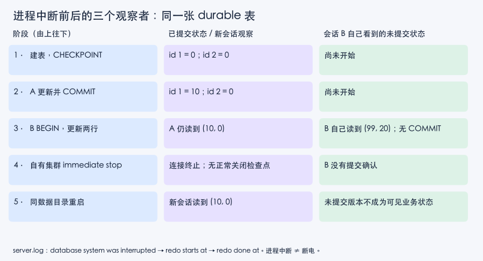

# PostgreSQL 并发与崩溃恢复：把时间线交给真实进程

读者问题是：之前画出的快照、写偏斜和 WAL 恢复历史，在真正的 PostgreSQL 中会出现什么？本页给出可重跑的进程实验与小账本。机制推导继续读 [[计算机知识/55-数据库/10-系统课程/10-MVCC快照写偏斜与重试协议|快照、依赖环与写偏斜]] 和 [[计算机知识/55-数据库/10-系统课程/12-WAL日志恢复与副本确认边界|日志顺序与恢复模型]]；这两页旧实验中的 SQLite 和字典模型，与本页 PostgreSQL 实测分开计算证据。

## 对象、环境与可重跑命令

`balance.v` 是一个整数余额，单位为实验记账单位；每次业务扣减为 10。`duty.id` 为医生编号，`oncall` 为布尔值，不变量是至少一人在岗。`durable` 是普通、记录 WAL 的永久表，两个 `id` 对应两个整数状态。会话 A/B 是两个独立 `psql` 客户端和后端连接；同一 Python 程序按预定顺序发命令，不依赖线程调度或 sleep 碰运气。

2026-09-17 实际运行环境是 macOS Darwin 25.6.0、arm64、Python 3.14.7，现有 MATLAB 安装附带 PostgreSQL 15.11；服务报告编译目标 aarch64-apple-darwin23.3.0。本实验的产品语义查 PostgreSQL **15** 文档，而既有系统课以 17 文档为例；本次结果不冒充 17 的实际运行结果。工具来源无需跟随示例，复跑只需已有、可信的完整 PostgreSQL 工具目录：

```bash
export PG_BIN=/你已有的PostgreSQL/bin
python3 -B postgres_lab.py --evidence /private/tmp/my-postgres-evidence
LAB_EVIDENCE=/private/tmp/my-postgres-tests python3 -B -m unittest test_postgres_lab -v
```

从本页伴随源码所在目录执行。源码只用 Python 标准库；缺少工具会直接报错。`PG_BIN` 必须含 `initdb`、`pg_ctl`、`psql`、`postgres`。Unix/macOS 环境是当前实现的运行范围，不是 Windows 通用脚本。首次 sandbox 执行因 `shmget` 被拒绝而停止并清理；允许临时集群所需系统调用后完成了真实运行，失败尝试没有计作通过。

每次创建随机名的库外临时目录，目录和 socket 仅当前用户可访问，`listen_addresses=''` 关闭 TCP；客户端显式指定自己的 socket、端口、用户和数据库，删除继承的 `PG*` 环境参数、跳过 `.psqlrc`。`trust` 是本次私有临时 socket 的教学认证，不能照搬到共享服务器；[initdb 的认证选项说明](https://www.postgresql.org/docs/15/app-initdb.html) 也要求慎用 trust。这里只保证本次脚本范围，不隔离同一操作系统账号下的恶意进程。

## 并发小账本：看实际结果，也看错误协议

| 实验 | 强制交错 | 实际结果 | 检查的承诺 |
| --- | --- | --- | --- |
| READ COMMITTED 重读 | A BEGIN、读100；B写90并提交；A重读 | `[100,90]` | 后一语句能看见 B 的提交 |
| REPEATABLE READ 快照 | 相同交错，A 改为 RR | `[100,100]` | A 第一次读之后固定的快照不随 B 提交改变 |
| 客户端绝对值写回 | A/B都读100；A写90提交；B用旧100算90写回提交 | `90` | 两次扣10的串行业务结果应为80；错误协议丢了一次更新 |
| 数据库内相对更新 | 保持两个事务都先读100；各自执行 `v=v-10` | `80` | 此单行扣减由数据库基于更新版本执行 |
| RR 写偏斜 | A/B都读在岗人数2；A改医生1并提交；B改医生2并提交 | `0` 人，无SQL错误 | 稳定快照仍不能维护这个跨行不变量 |
| Serializable与重试 | 相同交错；被拒者回滚、新BEGIN、重新读与决定 | `40001`；重试读1；最终1人 | 成功历史满足串行业务规范 |

可用 [[计算机知识/55-数据库/81-真实隔离级别异常与重试协议|读写历史与重试协议]] 逐步解释各项。余额原子更新只验证这个单行表达式，不推导出复杂跨行决策也安全。[PostgreSQL 15 §13.2](https://www.postgresql.org/docs/15/transaction-iso.html) 是快照时点和写入冲突规则的依据；账本数字来自实际 SQL 输出。

## 恢复小账本：已提交与未提交分开



先建表 `(1,0),(2,0)` 并执行 CHECKPOINT，固定清楚的起点。随后 A 把第1行改为10并成功 COMMIT。B 开始事务，把第1行改为99、第2行改为20，**不提交**。中断前同时查两种视角：B 自己看见 `1|99,2|20`，A 的新查询仍看见 `1|10,2|0`。只检查 B 的自读会混淆“执行了 UPDATE”和“其他事务可见且已经提交”。

接着用 `pg_ctl -D 本次目录 -m immediate -w -t 15 stop` 终止本次服务器进程，再启动同一数据目录。这种停止方式无正常关闭，官方 [pg_ctl 描述](https://www.postgresql.org/docs/15/app-pg-ctl.html) 指明下一次启动需要崩溃恢复。本次日志真实包含：

```text
received immediate shutdown request
database system was interrupted
redo starts at 0/1567838
redo done at 0/15679B0
```

LSN 是本次 WAL 位置标识，不是时间戳，也不应硬编码到测试。新会话查询得到 `(1,10),(2,0)`：A 的已提交值存在，B 的未提交修改没有成为可见业务状态。测试分别核对查询结果与 recovery/redo 日志，避免仅重启后“能连接”就宣布恢复成功。

本次设置实际查询确认 `fsync=on`、`synchronous_commit=on`、`full_page_writes=on`；没有备库。WAL 先行的保证和提交不必刷新全部数据页的机制见 [§30.3](https://www.postgresql.org/docs/15/wal-intro.html)，配置责任见 [§20.5.1](https://www.postgresql.org/docs/15/runtime-config-wal.html)。这里既没有观测每个数据页是否写回，也没有解析 WAL 记录并证明某个具体页确由 redo 重建。日志与 SQL 支持“真实执行了崩溃恢复并得到正确可见状态”这个较窄结论。

## 故障模型决定能说到哪里

这是数据库进程中断。操作系统、文件系统、硬件缓存与供电始终存活，不能据此证明掉电时的物理持久性、撕裂页恢复或存储控制器诚实遵守同步。本实验未覆盖异步提交丢数据、复制切换、归档/PITR、两阶段提交、并发 ARIES，也不声称实现 PostgreSQL 的完整恢复算法。尤其未提交值不可见不意味着数据库一定把每个物理版本逐行 undo；解释产品恢复需结合 MVCC，而不能把旧课 before/after-image 教学模型直接当源码。

应用还有“服务器可能已提交，但客户端没收到确认”的第三种情况，本次只在已观察到 COMMIT 成功之后中断。处理确认丢失应去读 [[计算机知识/85-综合贯通/02-超时重试幂等与事务发件箱|幂等键、结果查询与发件箱]]，不能把这份脚本的“没有提交命令”套到真实网络超时上。

## 测试、安全退出与练习

12 项测试覆盖账本六种并发结果、恢复结果与 redo 日志、socket与WAL配置，以及成功退出、启动故障、SQL错误/无效参数、等待超时后的清理。错误码还独立检查了除零 `22012`；它应报错，不在 `40001` 的重试分支。Oracle 是串行业务要求与明确可见性预期，不是用实验实现再计算一次相同输出。

SQL、锁、连接、空闲事务和 pg_ctl 等待均有时间界限；Python 上下文在异常时关闭自己创建的客户端，按自己的 `-D` 停止集群、保存命令与服务日志，再删除临时目录。停止失败就抛错并保留现场，不把未完成清理写成成功。测试的实际结果是 **12/12通过，0跳过**；它覆盖固定交错，不枚举全部并发历史。源码和镜像是同一个实验单位，修改后须同步并重跑适用检查。

**练习1**：把恢复查询只保留 B 中断前的自读，可否证明已提交？**答案**：不能，事务能读自己的未提交修改；需提交边界及独立连接观察。

**练习2**：最后余额为90时，它是否可能等价于两次正确扣10的任意串行顺序？**答案**：不能，两种顺序都得到80；这直接给出错误协议的独立反例。

**练习3**：同一机器上进程中断恢复通过，是否可关闭 fsync 追求性能？**答案**：实验没有改变或验证那个故障模型；关掉 fsync 之后的OS/硬件崩溃合同需要另行分析，不能从本账本推断。

两张图的可修改图源是 [postgres-figures.py](assets/postgres-figures.py)。从库根用已有含 Matplotlib 的 Python 重绘，例如：

```bash
.venv/bin/python -B 计算机知识/55-数据库/assets/postgres-figures.py --preview-dir /private/tmp/postgres-figures-preview
```

默认使用已有的 `Heiti TC` 中文字体族；其他平台可用 `--font-family` 指定已安装中文字体，或以 `--font-file` 指定字体文件。图源相对自身定位 SVG 输出，不依赖工作目录。当前重绘环境固定 Matplotlib 与字体后，SVG 排除生成时间、固定内部ID并去除行尾空格/Tab；连续两次生成字节一致，改成可交付图源前后的渲染像素一致。跨 Matplotlib 版本或字体的字节/像素一致性未验证。

下面完整保存伴随源码与测试，便于直接检索；可执行文件是真源。

<!-- code-sync: ./postgres_lab.py -->
~~~python
"""真实 PostgreSQL 双会话实验；只创建/控制自己拥有的临时集群。
Python 标准库；PG_BIN 指定含 initdb/pg_ctl/psql/postgres 的目录。
"""
from __future__ import annotations
import json
import os
from pathlib import Path
import re
import selectors
import shutil
import subprocess
import tempfile
import time
import uuid

LEVELS = {'READ COMMITTED', 'REPEATABLE READ', 'SERIALIZABLE'}


def pg_bin():
    explicit = os.environ.get('PG_BIN')
    found = explicit or (str(Path(shutil.which('initdb')).parent)
                         if shutil.which('initdb') else '')
    path = Path(found)
    if not found or not all((path / x).is_file() for x in
                            ('initdb', 'pg_ctl', 'psql', 'postgres')):
        raise FileNotFoundError('设置 PG_BIN；需要真实 PostgreSQL 四个工具')
    return path.resolve()


class SqlError(RuntimeError):
    def __init__(self, state, output):
        super().__init__(output)
        self.state = state


class Session:
    def __init__(self, cluster):
        self.cluster = cluster
        self.process = subprocess.Popen(
            [str(cluster.bin / 'psql'), '-X', '-q', '-A', '-t', '-h',
             str(cluster.socket), '-p', '55432', '-U', 'wwl', '-d', 'postgres',
             '-v', 'VERBOSITY=verbose'], stdin=subprocess.PIPE,
            stdout=subprocess.PIPE, stderr=subprocess.STDOUT, env=cluster.env)
        self.pending = b''
        self.selector = selectors.DefaultSelector()
        self.selector.register(self.process.stdout, selectors.EVENT_READ)
        cluster.sessions.append(self)

    def sql(self, statement, timeout=8):
        if timeout <= 0 or not isinstance(statement, str):
            raise ValueError('SQL 必须为字符串，timeout 必须为正')
        marker = 'WWL_' + uuid.uuid4().hex
        self.process.stdin.write((statement + '\n\\echo ' + marker + '\n').encode())
        self.process.stdin.flush()
        deadline, lines = time.monotonic() + timeout, []
        while True:
            while b'\n' in self.pending:
                line, self.pending = self.pending.split(b'\n', 1)
                text = line.decode(errors='replace').strip()
                if text == marker:
                    output = '\n'.join(lines)
                    self.cluster.events.append({'sql': statement, 'output': output})
                    error = re.search(r'ERROR:\s+([A-Z0-9]{5}):', output)
                    if error:
                        raise SqlError(error.group(1), output)
                    return output
                if text:
                    lines.append(text)
            remaining = deadline - time.monotonic()
            if remaining <= 0 or not self.selector.select(remaining):
                raise TimeoutError('psql 响应超时；调用者须退出上下文清理')
            chunk = os.read(self.process.stdout.fileno(), 65536)
            if not chunk:
                raise RuntimeError('psql 提前退出: ' + '\n'.join(lines))
            self.pending += chunk

    def close(self):
        if self.process.poll() is None:
            self.process.terminate()  # 只终止本次 Popen 创建的客户端
            try:
                self.process.wait(timeout=3)
            except subprocess.TimeoutExpired:
                self.process.kill()
                self.process.wait(timeout=3)
        self.selector.close()
        self.process.stdin.close()
        self.process.stdout.close()


class Cluster:
    def __init__(self, binary=None, evidence=None):
        self.bin = Path(binary).resolve() if binary else pg_bin()
        self.evidence = Path(evidence) if evidence else None
        self.root = Path(tempfile.mkdtemp(prefix='wwlpg-', dir='/private/tmp'
                                        if Path('/private/tmp').exists() else None))
        self.data, self.socket = self.root / 'data', self.root / 's'
        self.socket.mkdir(mode=0o700)
        self.log = self.root / 'server.log'
        self.sessions, self.events = [], []
        # 不继承 PGHOST/PGSERVICE/.psqlrc，避免接入已有数据库与个人设置。
        self.env = {k: v for k, v in os.environ.items() if not k.startswith('PG')}
        self.env.update({'LC_ALL': 'C', 'PGCONNECT_TIMEOUT': '3',
                         'PGPASSFILE': str(self.root / 'no-passfile')})

    def command(self, args, timeout=30):
        result = subprocess.run([str(self.bin / args[0]), *args[1:]],
                                capture_output=True, text=True, timeout=timeout,
                                env=self.env)
        self.events.append({'argv': args, 'returncode': result.returncode,
                            'stdout': result.stdout, 'stderr': result.stderr})
        result.check_returncode()
        return result.stdout

    def __enter__(self):
        try:
            self.command(['initdb', '-D', str(self.data), '-U', 'wwl',
                          '--auth=trust', '--locale=C', '--encoding=UTF8'])
            with (self.data / 'postgresql.conf').open('a') as f:
                f.write("\nlisten_addresses = ''\nport = 55432\n"
                        f"unix_socket_directories = '{self.socket}'\n"
                        "unix_socket_permissions = 0700\nfsync = on\n"
                        "synchronous_commit = on\nfull_page_writes = on\n"
                        "statement_timeout = '5s'\nlock_timeout = '3s'\n"
                        "idle_in_transaction_session_timeout = '30s'\n"
                        "checkpoint_timeout = '1h'\n")
            self.start()
            return self
        except BaseException:
            self.close()
            raise

    def start(self):
        self.command(['pg_ctl', '-D', str(self.data), '-l', str(self.log),
                      '-w', '-t', '15', 'start'])

    def stop(self, mode='fast'):
        if mode not in {'fast', 'immediate'}:
            raise ValueError('仅允许 fast/immediate')
        if (self.data / 'postmaster.pid').exists():
            self.command(['pg_ctl', '-D', str(self.data), '-w', '-t', '15',
                          '-m', mode, 'stop'])

    def session(self):
        return Session(self)

    def close(self):
        for session in self.sessions:
            session.close()
        # 停止失败就保留目录并抛错，不能伪称已清理。
        self.stop()
        if self.evidence:
            self.evidence.mkdir(parents=True, exist_ok=True)
            (self.evidence / 'commands.json').write_text(
                json.dumps(self.events, ensure_ascii=False, indent=2))
            if self.log.exists():
                shutil.copy2(self.log, self.evidence / 'server.log')
        shutil.rmtree(self.root)

    def __exit__(self, *exc):
        self.close()


def snapshots(c, level):
    if level not in LEVELS:
        raise ValueError('未知隔离级别')
    a, b = c.session(), c.session()
    try:
        a.sql('DROP TABLE IF EXISTS balance; CREATE TABLE balance(v int); '
              'INSERT INTO balance VALUES(100);')
        a.sql(f'BEGIN ISOLATION LEVEL {level};')
        first = int(a.sql('SELECT v FROM balance;'))
        b.sql('UPDATE balance SET v=90;')
        second = int(a.sql('SELECT v FROM balance;'))
        a.sql('COMMIT;')
        return [first, second]
    finally:
        a.close(); b.close()


def lost_update(c, atomic=False):
    a, b = c.session(), c.session()
    try:
        a.sql('DROP TABLE IF EXISTS balance; CREATE TABLE balance(v int); '
              'INSERT INTO balance VALUES(100);')
        a.sql('BEGIN;'); b.sql('BEGIN;')
        old_a = int(a.sql('SELECT v FROM balance;'))
        old_b = int(b.sql('SELECT v FROM balance;'))
        a.sql('UPDATE balance SET v=v-10;' if atomic else
              f'UPDATE balance SET v={old_a - 10};')
        a.sql('COMMIT;')
        b.sql('UPDATE balance SET v=v-10;' if atomic else
              f'UPDATE balance SET v={old_b - 10};')
        b.sql('COMMIT;')
        return int(a.sql('SELECT v FROM balance;'))
    finally:
        a.close(); b.close()


def skew(c, level):
    if level not in {'REPEATABLE READ', 'SERIALIZABLE'}:
        raise ValueError('写偏斜比较仅 RR/Serializable')
    a, b = c.session(), c.session()
    count = 'SELECT count(*) FROM duty WHERE oncall;'
    try:
        a.sql('DROP TABLE IF EXISTS duty; CREATE TABLE duty(id int PRIMARY KEY, '
              'oncall boolean); INSERT INTO duty VALUES(1,true),(2,true);')
        a.sql(f'BEGIN ISOLATION LEVEL {level};')
        b.sql(f'BEGIN ISOLATION LEVEL {level};')
        reads = [int(a.sql(count)), int(b.sql(count))]
        a.sql('UPDATE duty SET oncall=false WHERE id=1;')
        a.sql('COMMIT;')
        state, reread = None, None
        try:
            b.sql('UPDATE duty SET oncall=false WHERE id=2;')
            b.sql('COMMIT;')  # 两阶段都可能出现 40001
        except SqlError as e:
            state = e.state
            b.sql('ROLLBACK;')
            if state != '40001':
                raise
            # 全事务重试：新快照重新读/决策，最多三次。
            for attempt in range(3):
                try:
                    b.sql('BEGIN ISOLATION LEVEL SERIALIZABLE;')
                    reread = int(b.sql(count))
                    if reread > 1:
                        b.sql('UPDATE duty SET oncall=false WHERE id=2;')
                    b.sql('COMMIT;')
                    break
                except SqlError as retry_error:
                    b.sql('ROLLBACK;')
                    if retry_error.state != '40001' or attempt == 2:
                        raise
                    time.sleep(0.01 * (attempt + 1))
        return {'reads': reads, 'sqlstate': state, 'retry_read': reread,
                'remaining': int(a.sql(count))}
    finally:
        a.close(); b.close()


def recovery(c):
    a, b = c.session(), c.session()
    try:
        a.sql('CREATE TABLE durable(id int PRIMARY KEY, v int); '
              'INSERT INTO durable VALUES(1,0),(2,0); CHECKPOINT;')
        a.sql('BEGIN; UPDATE durable SET v=10 WHERE id=1; COMMIT;')
        b.sql('BEGIN; UPDATE durable SET v=99 WHERE id=1; '
              'UPDATE durable SET v=20 WHERE id=2;')
        local = b.sql('SELECT id,v FROM durable ORDER BY id;')
        observer = a.sql('SELECT id,v FROM durable ORDER BY id;')
        c.stop('immediate')  # 自有集群 SIGQUIT；无正常关闭检查点
        a.close(); b.close()
        c.start()
        fresh = c.session()
        try:
            after = fresh.sql('SELECT id,v FROM durable ORDER BY id;')
        finally:
            fresh.close()
        return {'uncommitted_session': local, 'observer_before': observer,
                'after_restart': after}
    finally:
        a.close(); b.close()


def run(evidence):
    with Cluster(evidence=evidence) as c:
        s = c.session()
        settings = json.loads(s.sql("SELECT json_build_object('version',version(), "
                         "'listen_addresses',current_setting('listen_addresses'), "
                         "'fsync',current_setting('fsync'), "
                         "'synchronous_commit',current_setting('synchronous_commit'), "
                         "'full_page_writes',current_setting('full_page_writes'));") )
        s.close()
        result = {'settings': settings,
                  'rc_snapshots': snapshots(c, 'READ COMMITTED'),
                  'rr_snapshots': snapshots(c, 'REPEATABLE READ'),
                  'lost_update': lost_update(c), 'atomic_update': lost_update(c, True),
                  'rr_skew': skew(c, 'REPEATABLE READ'),
                  'serializable': skew(c, 'SERIALIZABLE'), 'recovery': recovery(c)}
        root = str(c.root)
    result['cleanup'] = {'root': root, 'removed': not Path(root).exists()}
    Path(evidence, 'results.json').write_text(json.dumps(result, ensure_ascii=False, indent=2))
    return result


if __name__ == '__main__':
    import argparse
    parser = argparse.ArgumentParser(description=__doc__)
    parser.add_argument('--evidence', required=True, help='库外证据目录')
    print(json.dumps(run(parser.parse_args().evidence), ensure_ascii=False, indent=2))
~~~

<!-- code-sync: ./test_postgres_lab.py -->
~~~python
"""Oracle 来自串行业务规范/明确可见性预期，所有集成检查运行真实服务。"""
import os
from pathlib import Path
import tempfile
import unittest
from unittest.mock import patch
import postgres_lab as lab


class PostgresLabTests(unittest.TestCase):
    @classmethod
    def setUpClass(cls):
        cls.evidence = Path(os.environ.get('LAB_EVIDENCE',
                            tempfile.mkdtemp(prefix='wwlpg-evidence-')))
        cls.result = lab.run(cls.evidence / 'suite')

    def test_read_committed_rereads(self):
        self.assertEqual(self.result['rc_snapshots'], [100, 90])

    def test_repeatable_read_snapshot(self):
        self.assertEqual(self.result['rr_snapshots'], [100, 100])

    def test_client_absolute_write_loses_one_debit(self):
        # 串行完成两次 -10 应为 80；故意错误协议实际为 90。
        self.assertEqual(self.result['lost_update'], 90)
        self.assertNotEqual(self.result['lost_update'], 80)

    def test_atomic_two_debits(self):
        self.assertEqual(self.result['atomic_update'], 80)

    def test_repeatable_read_violates_duty(self):
        self.assertEqual(self.result['rr_skew']['reads'], [2, 2])
        self.assertEqual(self.result['rr_skew']['remaining'], 0)
        self.assertIsNone(self.result['rr_skew']['sqlstate'])

    def test_serializable_retries_all_decisions(self):
        r = self.result['serializable']
        self.assertEqual(r['reads'], [2, 2])
        self.assertEqual(r['sqlstate'], '40001')
        self.assertEqual(r['retry_read'], 1)
        self.assertEqual(r['remaining'], 1)

    def test_process_crash_committed_uncommitted(self):
        r = self.result['recovery']
        self.assertEqual(r['uncommitted_session'], '1|99\n2|20')
        self.assertEqual(r['observer_before'], '1|10\n2|0')
        self.assertEqual(r['after_restart'], '1|10\n2|0')
        log = (self.evidence / 'suite' / 'server.log').read_text()
        self.assertIn('database system was interrupted', log)
        self.assertIn('redo starts at', log)
        self.assertIn('redo done at', log)

    def test_socket_only_and_wal_settings(self):
        settings = self.result['settings']
        self.assertEqual(settings['listen_addresses'], '')
        for name in ('fsync', 'synchronous_commit', 'full_page_writes'):
            self.assertEqual(settings[name], 'on')

    def test_success_cleanup(self):
        self.assertTrue(self.result['cleanup']['removed'])
        self.assertFalse(Path(self.result['cleanup']['root']).exists())

    def test_start_failure_cleanup(self):
        c = lab.Cluster(evidence=self.evidence / 'start-failure')
        with patch.object(c, 'start', side_effect=RuntimeError('injected start failure')):
            with self.assertRaisesRegex(RuntimeError, 'injected'):
                with c:
                    pass
        self.assertFalse(c.root.exists())

    def test_sql_error_and_invalid_input_cleanup(self):
        c = lab.Cluster(evidence=self.evidence / 'invalid')
        with c:
            s = c.session()
            with self.assertRaises(lab.SqlError) as caught:
                s.sql('SELECT 1/0;')
            self.assertEqual(caught.exception.state, '22012')
            with self.assertRaises(ValueError):
                s.sql('SELECT 1;', timeout=0)
            with self.assertRaises(ValueError):
                lab.snapshots(c, 'READ UNCOMMITED')
            with self.assertRaises(ValueError):
                c.stop('anything')
        self.assertFalse(c.root.exists())

    def test_timeout_finally_cleanup(self):
        c = lab.Cluster(evidence=self.evidence / 'timeout')
        with self.assertRaises(TimeoutError):
            with c:
                c.session().sql('SELECT pg_sleep(2);', timeout=0.05)
        self.assertFalse(c.root.exists())


if __name__ == '__main__':
    unittest.main(verbosity=2)
~~~

<!-- code-sync: ./assets/postgres-figures.py -->
~~~python
"""重绘 PostgreSQL 时间线；输出到图源所在目录，不接触数据库。
需要已有 matplotlib；默认解析中文字体族 Heiti TC，可显式传 --font-file。
同版本 matplotlib 与同一字体下，SVG 去除时间元数据并稳定 ID/行尾。
"""
from pathlib import Path
import argparse
import matplotlib
matplotlib.use('Agg')
import matplotlib.pyplot as plt
from matplotlib.patches import FancyBboxPatch
from matplotlib.font_manager import FontProperties, findfont


def render(font, preview_dir=None):
    base = Path(__file__).resolve().parent
    matplotlib.rcParams['svg.fonttype'] = 'path'
    matplotlib.rcParams['svg.hashsalt'] = 'wwl-postgres-timelines-v1'

    def figure(name, title, headers, rows, footer):
        width, height = 1120, 180 + len(rows) * 85
        fig, ax = plt.subplots(figsize=(width / 100, height / 100), dpi=100)
        try:
            fig.patch.set_facecolor('#f5f7fb')
            ax.set_position([0, 0, 1, 1])
            ax.set_xlim(0, width)
            ax.set_ylim(height, 0)
            ax.axis('off')

            def text(x, y, value, size):
                ax.text(x, y, value, fontproperties=font, fontsize=size,
                        color='#17243b', va='center')

            text(30, 36, title, 19)
            for column, value in enumerate(headers):
                text(30 + column * 360, 78, value, 13)
            for row, values in enumerate(rows):
                y = 104 + row * 85
                for column, value in enumerate(values):
                    ax.add_patch(FancyBboxPatch(
                        (20 + column * 360, y), 345, 70,
                        boxstyle='round,pad=0,rounding_size=9', linewidth=0,
                        facecolor=['#dceaff', '#e7e1ff', '#ddf2e7'][column]))
                    for line, value_line in enumerate(value.split('\n')):
                        text(32 + column * 360, y + 24 + line * 25, value_line, 13)
            text(30, height - 24, footer, 11)
            output = base / name
            fig.savefig(output, format='svg', metadata={'Date': None})
            # 只去除行尾空格/Tab；保留SVG文字和几何信息。
            output.write_text('\n'.join(line.rstrip(' \t')
                              for line in output.read_text().splitlines()) + '\n')
            if preview_dir is not None:
                preview_dir.mkdir(parents=True, exist_ok=True)
                fig.savefig(preview_dir / (Path(name).stem + '.png'))
        finally:
            plt.close(fig)

    figure('postgres-duty-timeline.svg','同一交错：RR 两笔成功；Serializable 第二笔被拒绝',
     ['步骤（由上往下）','会话 A / 医生 1','会话 B / 医生 2'],[
     ('1 · 两笔事务开始','BEGIN；读 count = 2','BEGIN；读 count = 2'),
     ('2 · A 修改并提交','医生 1 → 离岗；COMMIT','仍持有读到 2 的旧快照'),
     ('3 · B 用旧判断写','A 已成功提交','医生 2 → 离岗；尝试 COMMIT'),
     ('4 · 隔离级别分叉','RR：最终 count = 0','Serializable：SQLSTATE 40001'),
     ('5 · 全事务重试（Serializable）','医生 1 离岗，医生 2 在岗','ROLLBACK → BEGIN → 读 1\n取消离岗；COMMIT；count = 1')],
     '计数单位：人；两笔并发事务在各自第一次读时固定快照。错误可能在 UPDATE 或 COMMIT。')
    figure('postgres-recovery-timeline.svg','进程中断前后的三个观察者：同一张 durable 表',
     ['阶段（由上往下）','已提交状态 / 新会话观察','会话 B 自己看到的未提交状态'],[
     ('1 · 建表，CHECKPOINT','id 1 = 0；id 2 = 0','尚未开始'),
     ('2 · A 更新并 COMMIT','id 1 = 10；id 2 = 0','尚未开始'),
     ('3 · B BEGIN，更新两行','A 仍读到 (10, 0)','B 自己读到 (99, 20)；无 COMMIT'),
     ('4 · 自有集群 immediate stop','连接终止；无正常关闭检查点','B 没有提交确认'),
     ('5 · 同数据目录重启','新会话读到 (10, 0)','未提交版本不成为可见业务状态')],
     'server.log：database system was interrupted → redo starts at → redo done at。进程中断 ≠ 断电。')


def main():
    parser = argparse.ArgumentParser(description=__doc__)
    parser.add_argument('--font-family', default='Heiti TC', help='已有中文字体族')
    parser.add_argument('--font-file', type=Path, help='可选：已有中文字体文件')
    parser.add_argument('--preview-dir', type=Path, help='可选：库外PNG预览目录')
    args = parser.parse_args()
    if args.font_file is not None:
        if not args.font_file.is_file():
            parser.error('--font-file 必须指向已有字体文件')
        font_file = args.font_file
    else:
        font_file = findfont(FontProperties(family=args.font_family),
                             fallback_to_default=False)
    render(FontProperties(fname=str(font_file)), args.preview_dir)


if __name__ == '__main__':
    main()
~~~
