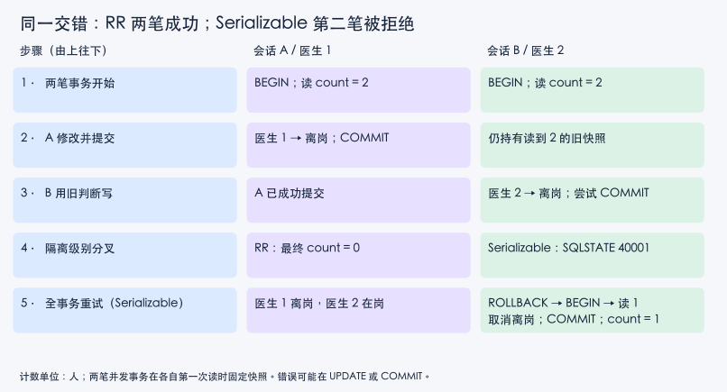

# 两个真实会话：异常在哪里，重试应该重做什么

读者问题是：已经选了隔离级别，为什么还要审查应用的读写协议？先修页已经推导快照写偏斜的依赖环，本页用 [[计算机知识/55-数据库/80-PostgreSQL并发与崩溃恢复实验|可重跑的 PostgreSQL 15.11 实验]] 核对每一步。表、源码、12项测试与恢复账本都在该实验页；这里只保留解释协议需要的 SQL。

## 同一事务，读到不同余额

初始单行余额 `v=100`，单位是实验记账单位。会话 A 在 READ COMMITTED 下 BEGIN 后读100。会话 B 执行 `UPDATE balance SET v=90` 并提交。A 第二次 SELECT 读90，虽仍处在同一事务中。A 第一次读没有固定后续所有语句的视图；改用 REPEATABLE READ、让第一次 SELECT 先执行，再插入 B 的提交，A 重读仍得到100。本次输出分别为 `[100,90]` 和 `[100,100]`。

这一步区别的是“哪次读的版本”，尚未验证整个业务操作正确。PostgreSQL 的 RR 快照始于第一次非事务控制语句，而不是简单的 BEGIN 字符串时点。这个产品规则见 [PostgreSQL 15 §13.2.1–13.2.2](https://www.postgresql.org/docs/15/transaction-iso.html)。其他数据库的同名等级或特殊对象不能直接套用；本实验只用普通表，不使用事务回滚语义不同的 sequence。

## 丢更新不是读到脏数据

让 A/B 都在默认 READ COMMITTED 事务中先读100，各自在客户端算 `100-10=90`。A 把绝对值90写回并提交，B 随后把自己早已算出的90写回并提交。结果90，两个读都读取了已提交数据，仍丢失一次扣减。第二笔 UPDATE 本身成功并不能证实它使用的应用参数仍然正确。

如果业务就是对这一个确定行扣10，改为 `UPDATE balance SET v=v-10`。本次保持两个事务都先读100，但用该表达式写入：A提交后 B 基于更新版本扣减，结果80。它移除了依赖旧客户端余额的绝对写回。它没有维护另一个表的总余额、允许透支范围或“至少一个医生值班”等额外业务条件；这些条件必须按其作用范围检查。

## 值班表为什么需要看到整个决策

表中医生1和医生2初始都在岗，单位为人，不变量为 `count(oncall=true) ≥ 1`。业务逻辑是“若当前人数大于1，允许自己离岗”。在任一正确串行顺序中，先执行者读2、离岗，后执行者读1、保留在岗，所以合法结果只有一名医生离岗、在岗人数1。

本次在 RR 下先让 A/B 各读2，再让 A 把医生1改为离岗并提交，最后让 B 把医生2改为离岗并提交，两笔都成功、最终0人。B 重复 SELECT 即便仍看到2，也只是证明它的旧快照稳定；无法证明把另一笔提交效果合并后满足不变量。这里写的是不同记录，与余额例的覆盖同一字段是两种错误。

改为 Serializable，保持同一交错。本次 A 提交成功；B 在 UPDATE 阶段得到 `SQLSTATE 40001`，输出含 `could not serialize access due to read/write dependencies among transactions`。错误提示定位这一尝试，而不承诺每种调度都在相同语句、由相同医生失败。实验代码捕获 UPDATE 和 COMMIT 两个阶段。数据库拒绝危险执行正是应用需要处理的结果，不能只把成功次数作为隔离级别质量指标。

## 重做整笔尝试，读1以后改变决定

失败的 B 先 ROLLBACK，再 BEGIN SERIALIZABLE，再查人数。本次新查询得到1，因此取消离岗，只 COMMIT；最终医生2在岗。全事务重试重复了读取、业务判断和必要写入，成功可以表现为“判断后不做 UPDATE”，而不是一定把原意执行到底。[PostgreSQL 15 §13.5](https://www.postgresql.org/docs/15/mvcc-serialization-failure-handling.html) 明确要求重试整个事务，包括决定 SQL 和参数的应用逻辑。

若只重发 `UPDATE duty SET oncall=false WHERE id=2`，它仍消费旧的“人数2”判断。若吞掉错误后在同一个失败事务里继续发 SQL，也没有获得新快照。应用必须把异常与撤销、新尝试边界联系起来；本次 `SqlError.state` 来自 PostgreSQL verbose 错误中的SQLSTATE，并没有用“包含 serialize 字样”代替错误分类。

实验最多做3次完整重试，每次数据库语句与客户端等待有限时，第二次起有短退避。固定交错中只发生一次40001，因此只验证了第一轮失败之后的完整新尝试；未测试高争用多轮退避、公平性、活性或性能最优。业务系统还需总期限、取消传播与合适的带随机抖动退避。把全部错误都丢进这条分支也不正确：本组除零测试得到22012并直接报错。

## 数据库成功不等于外部效果恰好一次

本例的尝试没有发邮件、扣外部支付或调用HTTP接口；这使数据库回滚真正覆盖所有状态修改。如果在每次尝试读到2后就发“您已离岗”邮件，之后40001和重试无法撤回已发邮件。应让外部效果与数据库提交通过明确协议衔接；[[计算机知识/85-综合贯通/02-超时重试幂等与事务发件箱|发件箱、幂等键与确认丢失]] 解释这个应用边界，而实验页的 [[计算机知识/55-数据库/80-PostgreSQL并发与崩溃恢复实验#恢复小账本：已提交与未提交分开|恢复账本]] 解释本地提交与进程故障。

**练习**：医生1的事务已经成功之后，医生2重试成功但没离岗，算不算业务失败？**答案**：事务成功表示重新检查后的决策与提交完成；请求必须按业务合同返回“由于只剩一人，保持值班”，不应把 COMMIT 当作原始请求必然获准。

**迁移题**：把在岗规则换成“两个仓库合计至少剩1件”，各事务只更新一个仓库，`stock=stock-1` 是否足够？**答案**：不足。单行相对更新防余额例的覆盖，但跨行判断仍能写偏斜；需在数据库约束、正确锁域或全事务可串行化协议中维护合计条件。

**反例检查**：为什么不把本次“B失败”写成系统定理？**答案**：失败者与阶段受调度和实现影响；一般合同是成功事务符合可串行化保证、应用处理可能的序列化失败。本次观察只证明这一个明确输入与交错发生了该结果。
