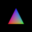

# 图形学：三维三角形怎样成为有遮挡和光照的像素

相机拍到的图像并不是把三维点的前两维抄进数组。先确定相机看见的空间，再把连续投影离散成像素样本，决定哪片表面挡住哪片，最后计算表面反射的近似颜色。本路线追踪一个原创三角形；全部数表和实验使用同一约定。

| 次序 | 读者问题与出口 |
| --- | --- |
| 1 | [[计算机知识/62-图形学/01-坐标变换齐次坐标与相机空间\|对象为何要经过世界与相机空间：列向量、齐次坐标、矩阵次序]] |
| 2 | [[计算机知识/62-图形学/02-正交透视投影齐次裁剪与视口\|近大远小怎样产生：投影、六平面裁剪、除以 w、视口]] |
| 3 | [[计算机知识/62-图形学/03-三角形光栅化重心坐标与属性插值\|哪几个像素属于三角形：共享边、重心与透视属性]] |
| 4 | [[计算机知识/62-图形学/04-可见性深度缓冲与裁剪次序\|重叠像素由谁留下：深度、裁剪次序、透明排序]] |
| 5 | [[计算机知识/62-图形学/05-法线光照与渲染边界\|表面为何有明暗：法线变换、局部光照及物理边界]] |
| 6 | [[计算机知识/62-图形学/06-曲线网格与几何建模\|顶点从哪里来：控制曲线、窄带、索引邻接与采样误差]] |
| 8 | [[计算机知识/62-图形学/08-纹理足迹与抗锯齿\|同一棋盘缩小时如何平均：UV足迹、双线性、mip与覆盖边缘]] |
| 实验 | [[计算机知识/62-图形学/80-最小软件渲染器与复算\|执行软件渲染器与独立射线复算，读源码和测试镜像]] |

首读按 1→5；要生成自己的几何，再到 6。第二遍在每课改一项条件并解释失败原因。练习答案用于自查，未替任何人记录已掌握。

**统一教学约定**：对象、世界、相机均右手系；列向量左乘；相机原点看向 −Z，+Y 向上；近平面距离 n=1，远平面 f=9；垂直视场 90°，宽高比 1；clip 六平面为 −w≤x,y,z≤w；NDC z 从近 −1 到远 +1；64×64 视口左上原点，X 向右、Y 向下；像素 (i,j) 的中心是 (i+0.5,j+0.5)。深度 d=(z_NDC+1)/2，较小获胜。这里借用一种 OpenGL 风格裁剪范围，却自行规定数组原点和 CPU 实现；不能把它当成所有 API 的默认值。[OpenGL 4.6 §§13.7–13.8](https://registry.khronos.org/OpenGL/specs/gl/glspec46.core.pdf) 支持裁剪/除法的规范定位。

模型只绘不透明三角形、单样本、方向光和教学环境项；没有纹理滤波、阴影、透明管线、GPU、MSAA 或全局光照。此切片回答一个渲染问题，不代表整门图形学、交互技术或本科已完成。

纹理首单元已由 [[计算机知识/62-图形学/08-纹理足迹与抗锯齿|08纹理足迹]] 与独立实践接续，复用本路线数组/投影/sRGB；上述旧renderer仍保持单中心、无纹理着色接口。纹理首单元不是完整光传输或整门图形学已完成。

已有正文承担另外三件事：[[数学/20-线性代数与几何/05-正交投影子空间与方向消除|向子空间的正交投影]]提供内积/投影数学，不能替代相机透视；[[数学/70-信号处理与多模态数学/01-空间几何Patch卷积与频域|图像数组与混叠]]解释采样后的表示；[[计算机知识/60-数据编码与媒体系统/05-图像表示色彩空间采样与图像编码|线性光、sRGB 与 alpha]]说明最终颜色的工程表示。这里复用这些出口。

图为 renderer.py 的实际输出，原生 64×64；彩色前景挡住灰色后景。像素边缘锯齿来自单中心样本，不是几何裁剪漏洞。颜色是教学局部光照后再经 sRGB 编码的显示结果。

返回问题路线：[[计算机知识/62-图形学/00-图形学-MOC|图形学 MOC]]。
