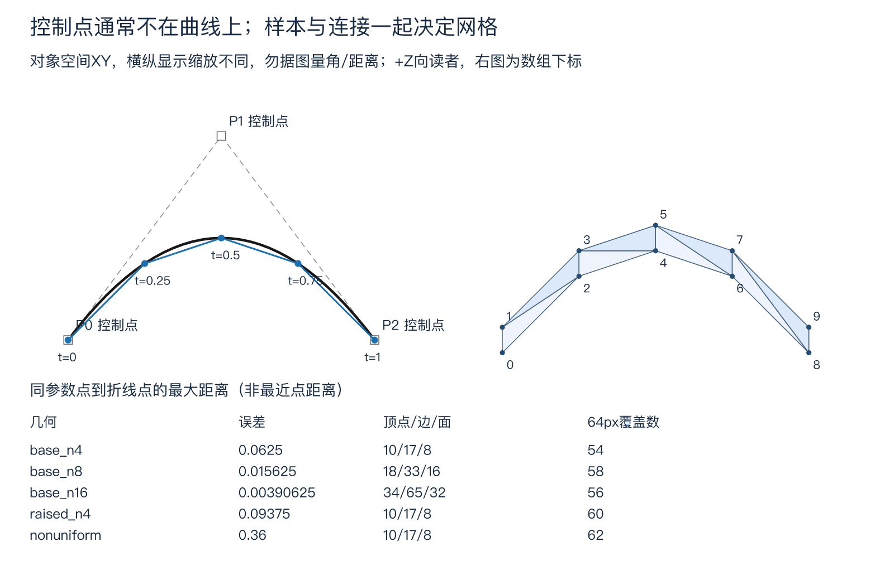
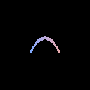
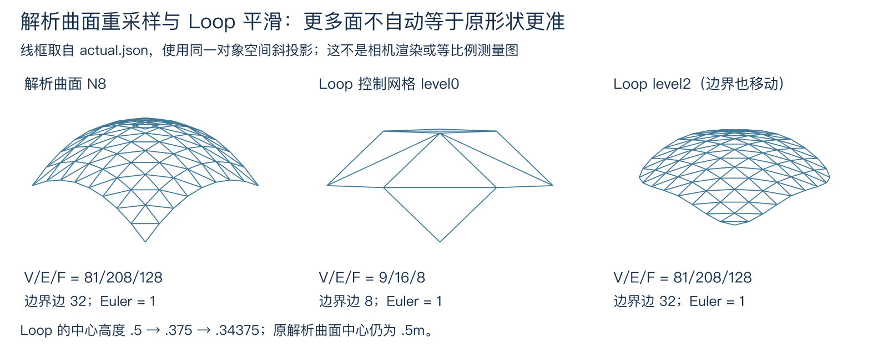

# 曲线、网格与几何建模

前面的渲染器接收三维顶点与三角形，却没有解释这些顶点从哪里来。手填三个点可以画三角形；要改一条轮廓的弯曲程度，逐个拖动几百个网格点就很容易把相邻面拖裂。本页用三个控制点描述一条曲线，再生成窄带网格，把“可编辑的形状”接到同一个软件渲染器。读完应能区分控制点、曲线点、网格索引与像素样本，并说明增加三角形何时改善几何、何时仍会看到锯齿。

## 三个控制点怎样给出连续曲线

对象空间取右手系，长度使用同一种任意场景单位。参数 t∈[0,1] 无单位。给定 P₀=(0,0,0)、P₁=(1,2,0)、P₂=(2,0,0)，先在两条控制边上分别插值，再在插值得到的两点间插值：

$$
A(t)=(1-t)P_0+tP_1,\quad B(t)=(1-t)P_1+tP_2,
\qquad C(t)=(1-t)A(t)+tB(t).
$$

这是二次 Bézier 曲线的 de Casteljau 构造。展开得

$$
C(t)=(1-t)^2P_0+2t(1-t)P_1+t^2P_2.
$$

三个系数非负且和为 1，所以曲线留在控制点凸包内；t=0、1 时分别取 P₀、P₂。P₁ 控制弯曲，但通常不是曲线经过的点。本例 t=.5 时 A=(.5,1,0)、B=(1.5,1,0)，C=(1,1,0)，没有到达 P₁=(1,2,0)。将 P₁.y 改成 3，中点变成 (1,1.5,0)，不是 (1,3,0)。控制多边形给编辑者把手，不能被误读成插值折线。[MTU 的 de Casteljau 原始教学构造](https://pages.mtu.edu/~shene/COURSES/cs3621/NOTES/spline/Bezier/de-casteljau.html)给出逐层插值的几何解释；这里的数字和网格由随附源码生成。



左侧黑曲线来自同一二次方程，灰虚线连接控制点，蓝折线连接 N=4 的参数样本；右侧是同一组样本生成的十顶点、八三角形网格。对象坐标单位相同，但图的横纵显示缩放不同，勿据图量角或距离。表中误差与覆盖数来自 [实际输出](curve_mesh_practice/results/actual.json)，不是美术示意值。

求导可得

$$
C'(t)=2[(1-t)(P_1-P_0)+t(P_2-P_1)],\quad
C'(0)=(2,4,0),\ C'(1)=(2,-4,0).
$$

它是“每单位参数的位移”，还不是物体每秒速度。若用物理时间 τ 在时长 h 内走完曲线，t=(τ-τ₀)/h，则 dC/dτ=C'(t)/h。曲线长短、参数均匀、弧长均匀与运动匀速是不同条件，不能看见一个 t 就擅自给它发秒表。

## 接起来不等于接得光滑

另一条二次曲线控制点记 Q₀、Q₁、Q₂，各段先使用本地 [0,1] 参数。令 Q₀=P₂ 是 C⁰ 连续：位置接上。要本地参数下 C¹ 连续，还需 Q₁−Q₀=P₂−P₁，使连接处两侧导数相同。本例 Q₁=(3,−2,0) 满足此式；Q₂ 可另定，例如 (4,0,0)。

若改成 Q₁=(2.5,−1,0)，右段初切向为 (1,−2,0)，左段末切向为 (2,−4,0)。两者同向而长度减半：满足非零切向下的 G¹ 几何连续，不满足同参数尺度的 C¹。G¹ 保方向，C¹ 还约束导数大小。[MTU 的端点导数与连续性说明](https://pages.mtu.edu/~shene/COURSES/cs3621/NOTES/spline/Bezier/bezier-der.html)区分这两个条件。切向为零时，不能靠“零向量也共线”声称有确定的光滑切线。

若左段时长为 1、右段时长为 .5，后一例的全局时间速度却相等：(2,−4,0)/1=(1,−2,0)/.5。动画接缝要检查实际时间映射，不能只检查控制点图。本页没有把此几何条件升级成骨骼动画或动力学积分器。

## 从曲线采样到有方向的三角形

渲染器需要面积，不接受一条零宽曲线当作表面。这里明确构造一种简单窄带：

$$
S(t,u)=C(t)+(0,(u-\tfrac12)w,0),\quad t,u\in[0,1],\quad w=.25.
$$

w 是 **Y 方向总跨度**，上下各偏移 .125；它不是沿曲线法向偏移的等距宽度。生成器的构带域限制为所有控制点 z=0、控制点 x 严格递增、0<w≤1。曲线求值本身支持一般三维点，但不能把这个构带器搬到任意三维曲线上仍硬塞 +Z 法线。因为 x'(t)>0，有

$$
\partial_tS\times\partial_uS=(0,0,w x'(t)),
$$

所以带面不折返，给定绕序的面朝 +Z；固定 x 也唯一决定 t，因此此域内条带不会自交。一般曲面则需要自己的切向、法线与自交检查。

选 N 个参数区间，端点 t₀=0<t₁<⋯<t_N=1。每个曲线点生成两个顶点：

$$
v_{2i}=C(t_i)+(0,-w/2,0),\qquad
v_{2i+1}=C(t_i)+(0,w/2,0).
$$

每个区间 i 生成面 (2i,2i+2,2i+1) 与 (2i+2,2i+3,2i+1)。索引是数组下标，不能把坐标值当索引。N=4 时可逐项复算：

| i | tᵢ | C(tᵢ) | 下顶点 v₂ᵢ | 上顶点 v₂ᵢ₊₁ |
| --- | --- | --- | --- | --- |
| 0 | 0 | (0,0,0) | (0,−.125,0) | (0,.125,0) |
| 1 | .25 | (.5,.75,0) | (.5,.625,0) | (.5,.875,0) |
| 2 | .5 | (1,1,0) | (1,.875,0) | (1,1.125,0) |
| 3 | .75 | (1.5,.75,0) | (1.5,.625,0) | (1.5,.875,0) |
| 4 | 1 | (2,0,0) | (2,−.125,0) | (2,.125,0) |

八个面依次为 (0,2,1)、(2,3,1)、(2,4,3)、(4,5,3)、(4,6,5)、(6,7,5)、(6,8,7)、(8,9,7)。第一面两边 (.5,.75,0)、(0,.25,0) 的叉积为 (0,0,.125)，检查了朝向而非凭屏幕印象。所有顶点提供单位法线 (0,0,1)；线性 RGB 属性取 (.2+.6t,.4,1−.6t)，上下顶点共享同色。固定平面里的“弯”是轮廓弯曲，没有产生不同的表面法线。

重复坐标不等于共享拓扑。相邻面必须引用同一个顶点索引，才能声明共享顶点；若复制一套坐标再用新索引，它们在屏幕上也许贴合，网格连接关系仍已经断开。

## 局部拓扑要查边，也要查顶点邻域

把每条无向边表示成排序后的索引对，同时保留各面的有向使用方向。内部边恰有两个面使用，且在两个面中方向相反；边界边恰有一个面使用。三面共边是非流形，两个相邻面沿共享边同向则是给定绕序不一致。[CMU 的网格流形课件](https://15462.courses.cs.cmu.edu/fall2020/lecture/meshes/slide_025)进一步要求顶点周围像一个环或一条扇带。只检查“每边至多两面”会放过蝴蝶结：两个三角形只共用一个顶点，所有边都只有一个面，该顶点邻域却分成两片。

源码给每个顶点建立 link：每个相邻三角形在去掉中心顶点后贡献一条边。内部点的 link 必须是单个环；边界点的 link 必须是单条路径。它还检查索引越界/非整数、重复面、面内重复顶点、退化面积及未使用顶点。数值面积阈值和输入规模上限是此教学计算器的政策，不能当作任意尺度 CAD 的精确谓词。

对本构造，顶点 V=2N+2，面 F=2N；边由上下横边各 N、竖边 N+1、对角线 N 构成，E=4N+1。因此 V−E+F=1，边界边 2N+2，内部边 2N−1。N=4 得 V/E/F=10/17/8，单个边界环可无向枚举为

`0→1→3→5→7→9→8→6→4→2→0`。

输出的 `boundary_loops` 为确定的**无向**环枚举，不保证是面朝向诱导的边界绕序。Euler 数等于 1 本身也不能证明网格是圆盘；这里还依赖具体条带构造、连接性和局部 link 条件。检查器允许多个彼此分离的合法分量，不负责检测一般嵌入的几何自交：连接正确与空间中不穿插是两种问题。

## 细分参数怎样给出可证明的误差

写 C(t)=a t²+b t+c，a=P₀−2P₁+P₂。对任一参数区间 [l,r]，用两个端点的线性插值 L(t) 近似曲线。由于 C−L 在 l、r 都为零且二次项仍为 a，

$$
C(t)-L(t)=a(t-l)(t-r),\qquad
\max_{t\in[l,r]}\|C(t)-L(t)\|=\|a\|(r-l)^2/4.
$$

最大值在区间中点取到。本例 a=(0,−4,0)，均匀 N 段的误差是 1/N²；把 N 从 4 加倍到 8，误差除以 4。将中间控制点抬到 y=3，‖a‖=6，同 N=4 的误差为 .09375。非均匀参数 [0,.1,.2,.8,1] 仍有四段，但最大跨度 .6，误差 .36；“点数一样多”没有承诺同等质量。

这里比较同一参数 t 的 C(t) 与 L(t)，不是求曲线点到折线的最近点距离。它给出可检查的配对误差，不能直接把表中数字叫作最近距离的精确最大值。一般非二次曲线还需二阶导数上界，可接 [[数学/60-数值计算与量化/11-插值逼近节点选择与误差|插值误差为何依赖区间长度与曲率]]；本例推导给出了二次情形的精确值。

## 同一数组怎样真正进入已有渲染器

[规范源码](curve_mesh_lab.py)生成 `positions[V,3]`、整数 `triangles[F,3]`、线性 RGB `colors[V,3]` 与对象空间 `normals[V,3]`，直接调用现有 [renderer.py](renderer.py) 的 `render`，没有另造第二套光栅器。模型矩阵只做平移 T(−1,−.5,−3)，view=I；列向量依次乘 M、V、P。位置先补齐次 w=1；平移后都在相机 z=−3，透视 clip w=3，除 w 后才进入视口。法线按 (VM) 左上 3×3 的逆转置处理，不乘 P；本例平移不改变 +Z 法线。相机看向 −Z、近远距离 1/9、垂直视场 90°、宽高比 1，完整合同沿用 [[计算机知识/62-图形学/80-最小软件渲染器与复算|唯一软件渲染器的数组与裁剪约定]]。

方向光指向 +Z，本例教学光照强度为 1；显示 PNG 仍经过线性光到 sRGB 编码。下面覆盖数指 depth 有限的像素数，不是帧率、面积估计或主观平滑评分。

| 同一输入变式 | 参数区间数 | V/E/F | 最大同参数误差 | 64² 覆盖数 | 128² 覆盖数 |
| --- | --- | --- | --- | --- | --- |
| 原控制点 N4 | 4 | 10/17/8 | .0625 | 54 | 230 |
| 原控制点 N8 | 8 | 18/33/16 | .015625 | 58 | 218 |
| 原控制点 N16 | 16 | 34/65/32 | .00390625 | 56 | 220 |
| P₁.y=3，N4 | 4 | 10/17/8 | .09375 | 60 | 220 |
| 非均匀四段 | 4 | 10/17/8 | .36 | 62 | 241 |



这是原生 128×128 的实际 CPU 输出，黑色为背景。条带在场景中很窄，几何细分与屏幕采样分别改变输出。N4→N8→N16 的几何误差严格减小，覆盖数却不单调；像素中心落在哪一侧受边界位置影响。增加几何不能替代抗锯齿，增加分辨率也不会修复错误索引或错误法线。

[实践 README](curve_mesh_practice/README.md)给出固定输入、完整几何输出、十张 PNG、独立多项式/平面射线复算、行为反例与运行原始记录。这里实际执行的是本地 NumPy 几何计算和既有 CPU 三角形渲染；没有 GPU、真人观看实验或物理材料验证。

## 先预测，再改变条件

1. 不运行程序，先预测 t=.5 的曲线点是否等于 P₁。再把 P₁.y 从 2 改成 3：中点、端点切向、N4 最大同参数误差各怎样变化？
2. 保持四个区间，将参数从均匀改成 [0,.1,.2,.8,1]。最大误差是否不变？若要原控制点的误差≤.01，均匀分段至少需要多少段？
3. 先让右曲线 Q₀=P₂、Q₁=(3,−2,0)。再只将 Q₁ 改成 (2.5,−1,0)：同本地参数下哪些连续性仍成立？若右段时长也从 1 改成 .5，连接速度如何？
4. N4 网格有多少边界边与内部边？将第一个面 (0,2,1) 反向，其余不变，会破坏哪项条件？若两个面只共一个顶点，每边至多两面足够吗？
5. 将一个控制点 z 改成 .1，仍提供固定 +Z 法线是否安全？若只提高图像分辨率，能修复这项错误吗？再预测 N4→N8 时覆盖数应不应该按几何误差比例减少。

### 答案与迁移理由

1. 原中点 (1,1,0)，不等于 (1,2,0)。修改后中点 (1,1.5,0)，起末切向分别 (2,6,0)、(2,−6,0)，‖a‖=6，误差 6×(.25)²/4=.09375。端点位置仍未改变，控制点修改影响的是整段形状。
2. 最大跨度由 .25 变 .6，误差由 .0625 变 .36。均匀误差 1/N²≤.01，所以 N≥10；这是几何误差要求，不自动保证某屏幕大小下无锯齿。
3. 第一版 C⁰、C¹，因而非零切向下也 G¹。第二版仍 C⁰、G¹，本地导数从 (2,−4,0) 跳到 (1,−2,0)，不 C¹。若右时长 .5，时间导数恰等左侧；若不改变时长，运动会在连接处减速。参数连续性与时间速度需分别说明。
4. 边界 10、内部 7。翻第一面使它与相邻面在共享边上同向，给定面绕序不一致，也翻转其几何法线。两个三角形仅共一顶点可通过边数检查，但顶点 link 断成两片，所以仍不满足局部流形条件；必须同时查边和顶点。
5. 一般三维曲线求值仍有意义，但本页平面构带域已不满足，应拒绝并重新定义表面法线/构带方式，而非沿用 +Z。提高分辨率只改变像素采样，不能使错误法线正确。实际 N4→N8 的 64² 覆盖数从 54 到 58，未随误差减少；两项衡量对象不同。

本页先贯通“可编辑曲线→参数采样→有索引和邻接的表面→现有像素管线”，后续各节补 B-spline、参数曲面与细分。对象运动另接 [[计算机知识/62-图形学/07-层级动画与变形|层级动画与变形]]，形状采样与运动积分分别验算。返回 [[计算机知识/62-图形学/00-图形学-MOC|图形学路线]]；若疑惑“曲线弯了为何法线没变”，回看 [[计算机知识/62-图形学/05-法线光照与渲染边界|轮廓与表面法线的区别]]。


## 从全局控制到局部支撑：B-spline

一个 Bézier 段的任意控制点通常影响整段。长轮廓若靠不断升高单段次数，编辑一个局部也会牵动远处；分段 Bézier 则要自行维护接缝。B-spline 用次数 p、非递减节点向量 U 与控制点 Pᵢ，将局部多项式段组织在同一表达式中。节点是参数区间的分界，不是必须通过的空间点。记 K 个控制点，节点数为 K+p+1，有效参数域为 [Uₚ,U_K]。

零次基函数 Nᵢ,₀(t) 在 [Uᵢ,Uᵢ₊₁) 为 1，其他位置为 0；高次递推为

$$
N_{i,p}(t)=\frac{t-U_i}{U_{i+p}-U_i}N_{i,p-1}(t)
+\frac{U_{i+p+1}-t}{U_{i+p+1}-U_{i+1}}N_{i+1,p-1}(t),\qquad
C(t)=\sum_iN_{i,p}(t)P_i.
$$

分母为零的整项定义为零，不做 0/0。右端使用有效域内的左极限；实现用 `nextafter` 取相邻浮点数，夹持端点的输出因此在浮点容差内等于末控制点。这里不是把所有半开区间的右端都改成闭区间。[MTU 的 Cox–de Boor 定义](https://pages.mtu.edu/~shene/COURSES/cs3621/NOTES/surface/bspline-basis.html)可对照节点与递推。

由递推的两项可归纳 Nᵢ,ₚ 的支撑只在 [Uᵢ,Uᵢ₊ₚ₊₁] 内；一个非空节点区间最多有 p+1 个基函数非零。有效域内基函数非负、和为 1：把同一个低阶基函数的两项系数合并，恰好加成 1，再由零次情形归纳。因此修改 Pᵢ 只影响其支撑区间，且仿射变换可以直接施于控制点。这是局部编辑的收益，代价是节点/重数/边界约定也成为模型的一部分。代码实际执行的是基函数递推；de Boor 点求值是相关的局部求值算法，本包没有将两种实现名称混用。

固定二次例取控制点 (0,0,0)、(1,2,0)、(2,2,0)、(3,0,0)，U=(0,0,0,1,2,2,2)，t∈[0,2]。在 [0,1]，四个权重为 ((1−t)²,2t−1.5t²,.5t²,0)。故 t=.5 时权重 (.25,.625,.125,0)，点 (.875,1.5,0)；t=1 时点 (1.5,2,0)。在右段令 s=t−1，点为 (1.5+s+.5s²,2−2s²,0)；左段点为 (2t−.5t²,4t−2t²,0)。两侧在节点 1 的导数都是 (1,0,0)，可直接检查 C¹，而不只看线条像不像接平了。只将 P₀.y 加 1，t=.5 的 y 增 .25，t=1.5 不变。

内节点重数 1≤m≤p 时通常只保证 C^(p−m)；m=p+1 时可断开，不能将负阶 C 当作连续性定义。特定控制点可能偶然更光滑，不能把“允许出现折角”写成“必有折角”。[MTU 的节点连续性与张量积局部性质](https://pages.mtu.edu/~shene/COURSES/cs3621/NOTES/surface/bspline-properties.html)给出这个条件。另一固定例用 U=(0,0,0,1,1,2,2,2)，五点 (0,0)、(1,2)、(2,2)、(2,3)、(4,0)。它恰是两段在 (2,2) 相接的二次 Bézier：左导数 (2,0)，右导数 (0,2)，只有 C⁰。这说明形状连续性来自次数、节点和控制点共同作用，不由“样条”这个名字担保。

## 两个参数给出真正的曲面

前面的条带沿固定 Y 平移一条平面曲线；现在让两个方向都参与形状。以二次 Bernstein 基 B₀=(1−u)²、B₁=2u(1−u)、B₂=u²，定义张量积曲面

$$
S(u,v)=\sum_{i=0}^{2}\sum_{j=0}^{2}B_i(u)B_j(v)P_{ij},\quad (u,v)\in[0,1]^2.
$$

数组 `control[i][j]` 的 i 对应 u，j 对应 v。先沿一个方向求三条曲线，再沿另一方向插值，与双重求和相同；偏导由相应方向的基函数求导得到。只有 Sᵤ×Sᵥ≠0 时，单位法线 n=(Sᵤ×Sᵥ)/‖Sᵤ×Sᵥ‖ 才有定义。换成两组 B-spline 基即可得到张量积 B-spline 曲面；它善于规则参数块及局部控制，却不自动消除拼接接缝或处理任意拓扑。[MTU 的曲面构造](https://pages.mtu.edu/~shene/COURSES/cs3621/NOTES/surface/bezier-construct.html)说明二维控制网与两方向基的乘积。本包实际执行双二次 Bézier patch，B-spline 的实际执行层为前一节曲线，未声称运行 NURBS/CAD 内核。

固定 3×3 控制网为 Pᵢⱼ=(i,j,.5[ i=1 ]+.5[ j=1 ])，坐标单位在本节及动画实验选为米。中间控制点高 1m，边中点控制点高 .5m，角点高 0。利用加权恒等式 $\sum_{i=0}^{2} i B_i(u)=2u$，得到

$$
S=(2u,2v,u(1-u)+v(1-v)),\quad
S_u=(2,0,1-2u),\quad S_v=(0,2,1-2v).
$$

中心点 (1,1,.5) 仍不经过中心控制点 (1,1,1)。法线正比 (−(1−2u)/2,−(1−2v)/2,1)，不同参数点的法线不同。所有点的偏导叉积 z 分量恒为 4，参数化不退化。若把控制网压成一条线，叉积为零，源码明确拒绝，不从零向量“归一化”出一个看似合法的法线。

每方向均匀 N 段，顶点下标 `j*(N+1)+i`，每格 a=左下、b=右下、c=左上、d=右上，取 (a,b,c)、(b,d,c)。共享对角为 b—c；对象空间 +Z 朝向由正的 xy 有向面积确定。V=(N+1)²、F=2N²、E=3N²+2N、边界边 4N，Euler=1；曲面弯曲不改变这些连接计数。拼接另一块曲面时，边界坐标/导数约束与是否共享索引还要分别检查。单块无裂缝不代表任意多块自动无缝。

对于此可分离二次高度，逐格令局部参数为 ξ,η∈[0,h]，h=1/N。三角形线性插值与解析高度的差为 ξ(h−ξ)+η(h−η)，两个三角形都成立。最大值在共享对角中点 ξ=η=h/2，为 h²/2。因此**同参数欧氏距离**精确最大值为 1/(2N²)m：N4 为 .03125，N8 为 .0078125。xy 已被线性精确再现，距离就是高度差；它仍不是最近点误差的精确最大值。代码逐格记录这些极值点，独立批量多项式真值检查全部顶点、偏导、法线和误差。

## 细分网格：增加面，同时改变极限形状

规则参数块适合上述 patch。复杂拓扑常从粗控制网格出发，通过局部规则反复加点、分面、移动旧点，定义一张细分极限曲面。本实验选择三角形 Loop 规则；Catmull–Clark 则以四边形规则为主，二者不能混用权重。Loop 每个三角形分为四面；所有新旧位置都必须从**同一份旧网格**计算，再统一替换，不能边遍历边写回而让访问顺序决定形状。

边界边新点取端点中点；内部边端点 a,b、两侧相对顶点 c,d，新点取 3(a+b)/8+(c+d)/8。边界旧点 v 的两个边界邻点为 a,b，更新为 3v/4+(a+b)/8。内部旧点有 n 个邻点，更新为

$$
v'=(1-n\beta_n)v+\beta_n\sum_{k=1}^{n}v_k,\qquad
\beta_n=\frac{1}{n}\left[\frac58-\left(\frac38+\frac14\cos\frac{2\pi}{n}\right)^2\right].
$$

这里使用含 cos 的原 Loop 内点权重；不是另一个常见的 Warren 简化权重。n=6 时 β=1/16，n=3 时 3/16，n=4 时 31/256，后者可区分不同公式。边界规则选择平滑边界，连原角点也会移动；要保硬角/折痕需另外的标记和规则。[Pixar OpenSubdiv 的 Loop 实现](https://raw.githubusercontent.com/PixarAnimationStudios/OpenSubdiv/release/opensubdiv/sdc/loopScheme.h)中 smooth edge/vertex 与 crease masks 可逐项核权重；本代码只实现上述有限流形三角网格规则，没有使用其完整非流形/折痕/极限求值系统。

从本解析曲面的 N2 网格开始，细分计数依次为 9/16/8、25/56/32、81/208/128；边界边 8→16→32。每条旧边贡献一个新顶点，V′=V+E；旧边被二分且每旧面内新增三条边，E′=2E+3F；F′=4F，所以 V′−E′+F′=V−E+F。边与 link 的局部连接方式保持原流形邻域，但这不是空间不自交、体积不变或任意形状光滑性的独立证明；本实验重查实际输出的连接与非退化面。

中心旧点从 (1,1,.5) 变 (1,1,.375)，再变 (1,1,.34375)；角点从 (0,0,0) 变 (.125,.125,.0625)，再变 (.15625,.15625,.078125)。**它在逼近由细分规则定义的形状，不是在重新采样原解析 patch**。二者恰好在 N8/level2 都有 81 顶点、128 面，几何仍不同。细分不是给粗网格贴一个“更精确”的标签；必须先说精确到哪个目标。



图由同一 actual.json 的网格和计数生成。线框为对象空间斜投影，非相机的等距测量图；原 renderer 的实际 PNG 另见 [实践结果](model_animation_practice/README.md)。Loop 输出用实际三角面叉积计算平面法线；解析 patch 另提供解析法线，两种法线合同在输入中明确记录。

### 形状迁移题与答案

1. 只将固定 B-spline 的 P₀.y 加 1，t=.5 与 1.5 怎样变化？再把节点 1 重复一次但不增加控制点是否仍是同一合法规格？答案：前者 y 分别增 .25 与 0；后者控制点数、次数与节点总数不再满足 K+p+1，源码拒绝。节点重数不是可以脱离控制网随手添加的外观选项。
2. 对固定曲面，将所有控制点 z 加倍，中心、法线和 N4 误差怎样变化？答案：S.z 加倍，中心从 .5 到 1m；Sᵤ/Sᵥ 的 z 分量加倍，法线的 xy 比例相应变化，不能保留旧法线。相同参数差也加倍，误差 .0625m。若只加倍 N，原高度误差则降为 .0078125m。
3. Loop 为什么不能更新一个旧点后马上用它更新邻点？答案：规则是一次线性权矩阵作用于旧位置向量；混入已更新值会变成依赖遍历顺序的矩阵乘积，不再是声明的同步细分。原 N2 中心的六邻点高度和为 1，β=1/16，故中心新高 (1−6/16)×.5+1/16=.375，可作为复算检查点。
4. 细分后 Euler 数仍为 1，能否证明更接近原解析曲面、没有自交？答案：不能。Euler 数只约束连接组合，中心高度已经与原 patch 分离；自交属于几何嵌入，需另查。改变参数采样 N 与改变细分规则是两种形状操作。

形状生成后，继续 [[计算机知识/62-图形学/07-层级动画与变形|把同一 patch 放入对象层级、蒙皮和运动方程]]。其中独立改变 N 与时间步 h，直接比较几何距离和完整运动状态误差；[新实践入口](model_animation_practice/README.md)保留输入、13 张实际 CPU PNG 与独立批量复算。

## 规范源码镜像

本节供读者边读边复算；修改必须先改同目录源码，再同步镜像。

<!-- code-sync: ./curve_mesh_lab.py -->
```python
"""Quadratic de Casteljau -> indexed XY ribbon -> the existing renderer arrays."""
import argparse
from collections import defaultdict
import hashlib
import importlib.util
import json
import re
from pathlib import Path
import struct
import zlib
import numpy as np


def controls(value):
    p=np.asarray(value,dtype=float)
    if p.shape!=(3,3) or not np.isfinite(p).all() or np.max(np.abs(p))>100:raise ValueError('control_shape_or_scale')
    return p


def casteljau(p,t):
    p=controls(p)
    if not np.isfinite(t) or not 0<=t<=1:raise ValueError('parameter_domain')
    first=(1-t)*p[:-1]+t*p[1:]
    return (1-t)*first[0]+t*first[1]


def tangent(p,t):
    p=controls(p)
    if not np.isfinite(t) or not 0<=t<=1:raise ValueError('parameter_domain')
    return 2*((1-t)*(p[1]-p[0])+t*(p[2]-p[1]))


def topology(positions,faces):
    p=np.asarray(positions,dtype=float);f=np.asarray(faces)
    if p.ndim!=2 or p.shape[1]!=3 or not np.isfinite(p).all():raise ValueError('vertex_shape')
    if f.ndim!=2 or f.shape[1]!=3 or f.dtype.kind not in 'iu' or len(f)==0 or np.any(f<0) or np.any(f>=len(p)):raise ValueError('face_index')
    edge_faces=defaultdict(list);vertex_faces=defaultdict(list);seen=set()
    for i,face in enumerate(f.tolist()):
        if len(set(face))!=3:raise ValueError('repeated_face_vertex')
        if tuple(sorted(face)) in seen:raise ValueError('duplicate_face')
        seen.add(tuple(sorted(face)))
        a,b,c=p[face]
        if np.linalg.norm(np.cross(b-a,c-a))<=1e-12:raise ValueError('numerically_degenerate_face')
        for v in face:vertex_faces[v].append(i)
        for a,b in zip(face,face[1:]+face[:1]):edge_faces[tuple(sorted((a,b)))].append((i,a,b))
    if set(vertex_faces)!=set(range(len(p))):raise ValueError('unused_vertex')
    boundary=[];face_neighbors=[set() for _ in f]
    for edge,uses in edge_faces.items():
        if len(uses)>2:raise ValueError('nonmanifold_edge')
        if len(uses)==1:boundary.append(edge)
        else:
            u,v=uses
            if (u[1],u[2])!=(v[2],v[1]):raise ValueError('shared_edge_orientation')
            face_neighbors[u[0]].add(v[0]);face_neighbors[v[0]].add(u[0])
    links=[]
    for v,ids in sorted(vertex_faces.items()):
        graph=defaultdict(set)
        for face_id in ids:
            a,b=[x for x in f[face_id].tolist() if x!=v];graph[a].add(b);graph[b].add(a)
        reached=set();todo=[next(iter(graph))]
        while todo:
            n=todo.pop()
            if n not in reached:reached.add(n);todo.extend(graph[n]-reached)
        if len(reached)!=len(graph):raise ValueError('disconnected_vertex_link')
        degrees=sorted(map(len,graph.values()));bd=sum(v in edge for edge in boundary)
        if (bd==0 and any(d!=2 for d in degrees)) or (bd==2 and (degrees.count(1)!=2 or any(d not in (1,2) for d in degrees))) or bd not in (0,2):raise ValueError('invalid_vertex_link')
        links.append({'vertex':v,'neighbor_degrees':degrees,'boundary_edges':bd})
    bdgraph=defaultdict(set)
    for a,b in boundary:bdgraph[a].add(b);bdgraph[b].add(a)
    loops=[];remaining=set(boundary)
    while remaining:
        a=min(min(e) for e in remaining);b=min(bdgraph[a]);loop=[a,b];remaining.remove(tuple(sorted((a,b))))
        while b!=a:
            c=next(x for x in bdgraph[b] if x!=loop[-2]);remaining.remove(tuple(sorted((b,c))));loop.append(c);b=c
        loops.append(loop)
    return {'V':len(p),'E':len(edge_faces),'F':len(f),'chi':len(p)-len(edge_faces)+len(f),
            'edges':[{'vertices':list(e),'faces':[u[0] for u in uses]} for e,uses in sorted(edge_faces.items())],
            'boundary_edges':[list(e) for e in sorted(boundary)],'boundary_loops':loops,
            'face_neighbors':[sorted(n) for n in face_neighbors],'vertex_links':links,
            'boundary_count':len(boundary),'scope':'connectivity and supplied orientation only; no global self-intersection test'}


def band(p,ts,width):
    p=controls(p);ts=np.asarray(ts,dtype=float)
    if np.any(p[:,2]!=0) or np.any(np.diff(p[:,0])<=1e-10):raise ValueError('band_requires_xy_increasing_control_x')
    if ts.ndim!=1 or not 2<=len(ts)<=65 or not np.isfinite(ts).all() or ts[0]!=0 or ts[-1]!=1 or np.any(np.diff(ts)<=1e-8):raise ValueError('sample_parameters')
    if not np.isfinite(width) or not 0<width<=1:raise ValueError('band_width')
    points=np.array([casteljau(p,float(t)) for t in ts])
    pos=np.array([point+[0,sign*width/2,0] for point in points for sign in (-1,1)])
    faces=np.array([[2*i,2*i+2,2*i+1] if k==0 else [2*i+2,2*i+3,2*i+1] for i in range(len(ts)-1) for k in range(2)],dtype=int)
    n=np.tile([0.,0.,1.],(len(pos),1));color=np.array([[.2+.6*t,.4,1-.6*t] for t in ts for _ in (-1,1)])
    error=[];a=p[0]-2*p[1]+p[2]
    for lo,hi in zip(ts[:-1],ts[1:]):
        mid=(lo+hi)/2; exact=np.linalg.norm(casteljau(p,mid)-(casteljau(p,lo)+casteljau(p,hi))/2)
        error.append({'interval':[float(lo),float(hi)],'midpoint_error':float(exact),'exact_matched_parameter_max':float(np.linalg.norm(a)*(hi-lo)**2/4)})
    return {'control':p.tolist(),'parameters':ts.tolist(),'total_y_width':float(width),'curve_points':points.tolist(),
            'endpoint_tangents':[tangent(p,0).tolist(),tangent(p,1).tolist()],
            'positions':pos.tolist(),'triangles':faces.tolist(),'colors':color.tolist(),'normals':n.tolist(),
            'interval_errors':error,'exact_matched_parameter_max':max(x['exact_matched_parameter_max'] for x in error),
            'topology':topology(pos,faces)}


def write_png(path,pixels):
    h,w,_=pixels.shape
    def chunk(kind,data):return struct.pack('!I',len(data))+kind+data+struct.pack('!I',zlib.crc32(kind+data))
    rows=b''.join(b'\0'+row.tobytes() for row in pixels)
    path.write_bytes(b'\x89PNG\r\n\x1a\n'+chunk(b'IHDR',struct.pack('!IIBBBBB',w,h,8,2,0,0,0))+chunk(b'IDAT',zlib.compress(rows,9))+chunk(b'IEND',b''))


def run(spec,renderer_path,out):
    if out.exists():raise FileExistsError('use a new output directory')
    if not 1<=len(spec['cases'])<=8 or any(type(x)!=int or not 8<=x<=128 for x in spec['resolutions']) or len(spec['resolutions'])>2:raise ValueError('fixture_limit')
    names=[case['id'] for case in spec['cases']]
    if len(set(names))!=len(names) or any(not re.fullmatch(r'[a-z][a-z0-9_]{0,31}',name) for name in names):raise ValueError('case_id')
    loaded=importlib.util.spec_from_file_location('canonical_raster',renderer_path);r=importlib.util.module_from_spec(loaded);loaded.loader.exec_module(r)
    result={'input_version':spec['input_version'],'numpy':np.__version__,'renderer_sha256':hashlib.sha256(renderer_path.read_bytes()).hexdigest(),'cases':[]}
    meshes=[(case['id'],band(case['control'],case['parameters'],case['total_y_width'])) for case in spec['cases']]
    out.mkdir(parents=True)
    for name,mesh in meshes:
        mesh['id']=name;mesh['renders']=[]
        for resolution in spec['resolutions']:
            image,depth=r.render(np.array(mesh['positions']),np.array(mesh['triangles']),np.array(mesh['colors']),np.array(mesh['normals']),model=np.array(spec['model']),width=resolution,height=resolution)
            pixels=np.rint(r.srgb(image)*255).astype(np.uint8);filename=f'{name}_{resolution}.png';write_png(out/filename,pixels)
            mesh['renders'].append({'resolution':resolution,'covered_pixels':int(np.isfinite(depth).sum()),'png':filename,'png_sha256':hashlib.sha256((out/filename).read_bytes()).hexdigest()})
        result['cases'].append(mesh)
    (out/'actual.json').write_text(json.dumps(result,indent=2)+'\n');return result


def main():
    p=argparse.ArgumentParser();p.add_argument('--spec',type=Path,required=True);p.add_argument('--renderer',type=Path,default=Path(__file__).parent/'renderer.py');p.add_argument('--out',type=Path,required=True)
    a=p.parse_args();result=run(json.loads(a.spec.read_text()),a.renderer,a.out);print(json.dumps({'cases':len(result['cases']),'renders':sum(len(x['renders']) for x in result['cases'])}))
if __name__=='__main__':main()
```

## 曲面与细分规范源码镜像

<!-- code-sync: ./surface_lab.py -->
```python
"""Finite spline/patch/Loop teaching model; canonical rasterizer and topology stay separate."""
import math
from collections import defaultdict
import numpy as np
from curve_mesh_lab import topology


def spline(control,knots,degree,t):
    p=np.asarray(control,dtype=float);u=np.asarray(knots,dtype=float)
    if p.ndim!=2 or p.shape[1]!=3 or not 2<=len(p)<=12 or not np.isfinite(p).all() or np.max(np.abs(p))>100:raise ValueError('spline_control')
    if type(degree)!=int or not 1<=degree<=3 or len(p)<=degree:raise ValueError('spline_degree')
    if u.shape!=(len(p)+degree+1,) or not np.isfinite(u).all() or np.any(np.diff(u)<0) or u[degree]>=u[len(p)]:raise ValueError('knots')
    if not np.isfinite(t) or not u[degree]<=t<=u[len(p)]:raise ValueError('spline_parameter')
    # Left-limit at the final domain endpoint, not a global step-function convention.
    x=np.nextafter(t,-np.inf) if t==u[len(p)] else t
    values=((u[:-1]<=x)&(x<u[1:])).astype(float)
    for q in range(1,degree+1):
        values=np.array([((x-u[i])/(u[i+q]-u[i])*values[i] if u[i+q]!=u[i] else 0)+((u[i+q+1]-x)/(u[i+q+1]-u[i+1])*values[i+1] if u[i+q+1]!=u[i+1] else 0) for i in range(len(values)-1)])
    return {'basis':values.tolist(),'point':(values@p).tolist()}


def patch(control,u,v):
    p=np.asarray(control,dtype=float)
    if p.shape!=(3,3,3) or not np.isfinite(p).all() or np.max(np.abs(p))>100:raise ValueError('patch_control')
    if not np.isfinite([u,v]).all() or not 0<=u<=1 or not 0<=v<=1:raise ValueError('patch_parameter')
    def basis(t):return np.array([(1-t)**2,2*t*(1-t),t*t]),np.array([-2*(1-t),2-4*t,2*t])
    bu,du=basis(u);bv,dv=basis(v)
    point=np.einsum('i,j,ijk->k',bu,bv,p);su=np.einsum('i,j,ijk->k',du,bv,p);sv=np.einsum('i,j,ijk->k',bu,dv,p)
    n=np.cross(su,sv);length=np.linalg.norm(n)
    if length<=1e-12:raise ValueError('singular_patch_parameterization')
    return point,su,sv,n/length


def patch_mesh(control,n):
    if type(n)!=int or not 1<=n<=16:raise ValueError('patch_resolution')
    samples=[patch(control,i/n,j/n) for j in range(n+1) for i in range(n+1)]
    p=np.array([s[0] for s in samples]);normal=np.array([s[3] for s in samples]);faces=[]
    for j in range(n):
        for i in range(n):
            a=j*(n+1)+i;b=a+1;c=a+n+1;d=c+1;faces.extend([[a,b,c],[b,d,c]])
    f=np.array(faces,dtype=int)
    return {'positions':p.tolist(),'triangles':f.tolist(),'normals':normal.tolist(),'topology':topology(p,f)}


def loop_step(positions,faces):
    p=np.asarray(positions,dtype=float);f=np.asarray(faces);top=topology(p,f)
    neighbors=defaultdict(set);boundary=defaultdict(list)
    for row in top['edges']:
        a,b=row['vertices'];neighbors[a].add(b);neighbors[b].add(a)
        if len(row['faces'])==1:boundary[a].append(b);boundary[b].append(a)
    new=[]
    for i,point in enumerate(p):
        ns=sorted(neighbors[i])
        if i in boundary:
            if len(boundary[i])!=2:raise ValueError('loop_boundary')
            q=.75*point+.125*p[boundary[i]].sum(axis=0)
        else:
            n=len(ns);beta=(5/8-(3/8+.25*math.cos(2*math.pi/n))**2)/n
            q=(1-n*beta)*point+beta*p[ns].sum(axis=0)
        new.append(q)
    edge_index={}
    for row in top['edges']:
        a,b=row['vertices'];ids=row['faces'];edge_index[(a,b)]=len(new)
        if len(ids)==1:q=(p[a]+p[b])/2
        else:
            opposite=[next(x for x in f[k] if x not in (a,b)) for k in ids]
            q=3/8*(p[a]+p[b])+1/8*p[opposite].sum(axis=0)
        new.append(q)
    refined=[]
    for a,b,c in f.tolist():
        ab=edge_index[tuple(sorted((a,b)))];bc=edge_index[tuple(sorted((b,c)))];ca=edge_index[tuple(sorted((c,a)))]
        refined.extend([[a,ab,ca],[b,bc,ab],[c,ca,bc],[ab,bc,ca]])
    new=np.asarray(new);refined=np.asarray(refined,dtype=int)
    return {'positions':new.tolist(),'triangles':refined.tolist(),'topology':topology(new,refined),'edge_indices':[{'edge':list(e),'vertex':i} for e,i in edge_index.items()]}


def flat_arrays(mesh):
    """Face normals from actual geometry; duplicated vertices are a render view, not welded topology."""
    p=np.asarray(mesh['positions']);f=np.asarray(mesh['triangles'],dtype=int);tri=p[f];cross=np.cross(tri[:,1]-tri[:,0],tri[:,2]-tri[:,0]);length=np.linalg.norm(cross,axis=1)
    if np.any(length<=1e-12):raise ValueError('deformed_degenerate_face')
    vertices=tri.reshape(-1,3);normals=np.repeat(cross/length[:,None],3,axis=0)
    return vertices,np.arange(len(vertices)).reshape(-1,3),normals
```
