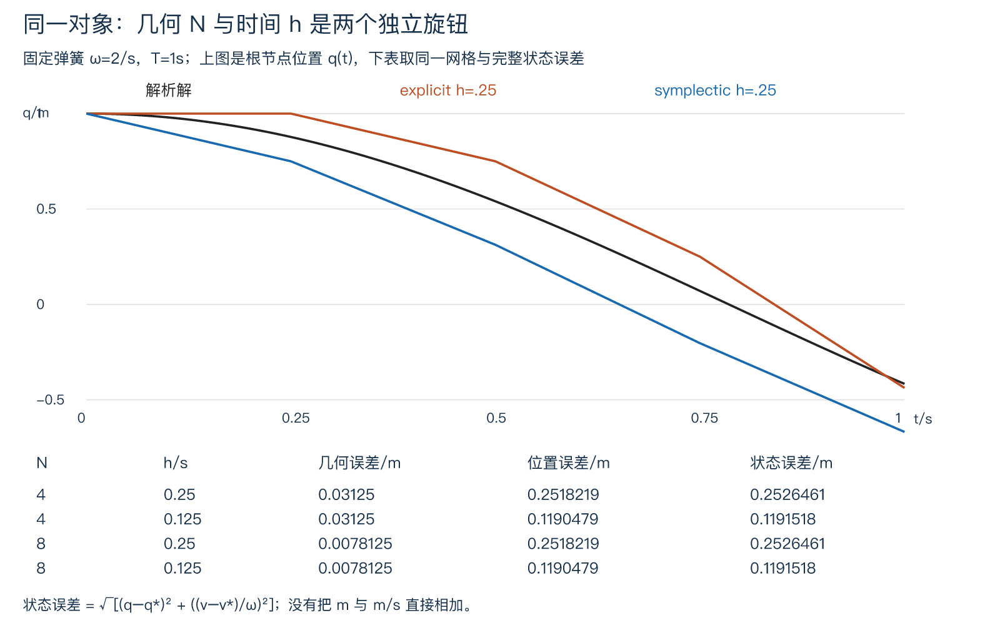

# 层级动画与变形

生成顶点只说明物体是什么形状。要让模型抬起一截、让关节带动表面、让整个对象受弹簧力移动，还要回答三种不同问题：每个局部坐标附着在哪里，姿态随时间怎样指定，以及速度为何改变。本页用上一课同一个曲面网格贯通对象层级、旋转关键帧、两骨骼蒙皮与一个有限弹簧模型，再分别改变几何 N 和时间步 h。源码、原始轨迹和图像在 [实践入口](model_animation_practice/README.md)。

## 父子坐标与非刚体变形

沿用右手系、列向量左乘，位置补齐次 w=1，方向为 w=0。新例长度用米，角度内部用弧度，时间用秒。节点 i 的局部矩阵 Lᵢ 把节点坐标转到父坐标；公共空间矩阵 Gᵢ=G_parent Lᵢ，根的 G=L。遍历必须先父后子，循环或指向尚未计算节点都被本有限实现拒绝。组合矩阵右侧先作用，与 [[计算机知识/62-图形学/01-坐标变换齐次坐标与相机空间#坐标变换、齐次坐标与相机空间|原坐标变换页]]相同。

例如父节点 T(3,0,0)，子节点 S=diag(2,1,1,1)，子点 (1,0,0,1) 的公共位置为 TS p=(5,0,0,1)。把父改成 S、子改成 T，则 ST p=(8,0,0,1)。这就是已有 TS/ST 反例在层级中的含义：父坐标的缩放会连子节点平移一起缩放。

若父子只含旋转和平移，G 的 3×3 部分仍正交且行列式 1，可以用刚体组合/逆公式，衔接 [[AI/45-机器人与具身智能/01-坐标变换与平面运动学#SE(2)把位置与方向放在一起|机器人 SE(2) 的同一父子方向约定]]。三维推广使用 4×4，不能把二维公式当完整三维旋转。若父含非均匀缩放，再乘子旋转，整体可能含剪切，已经不能假设属于 SE(3)，也不能用转置代替一般矩阵逆。

法线也要重查。复用 [[计算机知识/62-图形学/05-法线光照与渲染边界#逆转置保持法线与切向垂直|逆转置推导]]：A=diag(2,1,1)，原切向 (1,1,0)、法线 (1,−1,0)。At=(2,1,0)，错误 An=(2,−1,0) 点积 3；正确 A⁻ᵀn=(.5,−1,0) 点积 0。归一化后方向才适合光照。父节点改缩放，不能只拖顶点而把旧法线当作免检证件；奇异变换更不能求逆。

## 关键帧给姿态，不自动给出力

在时间 τ₀、τ₁ 保存位置和旋转，要求 τ₁>τ₀ 且 τ∈[τ₀,τ₁]，令 α=(τ−τ₀)/(τ₁−τ₀)。位置可取 (1−α)p₀+αp₁，当前例根节点从 x=0 到 .2m，历时 1s。它在这一段内有恒定速度；拼多个线性段时，速度一般在关键帧跳变。改变插值函数/段时长也会改变速度和加速度。关键帧是艺术家规定的轨迹，不会自动满足重力、关节力矩或碰撞方程。

旋转不能随便把九个矩阵分量线性混合，因为结果可能不正交。Euler 角也依赖轴顺序、角度分支和奇异姿态；本页先用单轴的分支问题作一个无需术语记忆的反例。绕 +Z 从 170° 到 −170°，直接插值两个角的中点是 0°，会绕远路；就这对端点而言，短弧经过 180°，总转角只有 20°。单轴也可先展开角度解决；一般三维旋转则需要一致的表示和插值。

四元数写 q=(w,x,y,z)=(cos(θ/2), a sin(θ/2))，a 为单位轴。Hamilton 乘法为 (s,v)(t,u)=(st−v·u, su+tv+v×u)。本页采用主动右手旋转，将向量嵌入 (0,p)，以 q(0,p)q⁻¹ 得到旋转结果；绕 +Z 的 +90° 将 +X 转向 +Y。单位 q 与 −q 表示同一个旋转。四元数不能只凭分量顺序与别的 API 互换；[Shoemake 1985 原论文 §§3.3–3.4](https://www.cs.cmu.edu/~kiranb/animation/p245-shoemake.pdf)支持球面插值与双覆盖，论文的向量作用次序与本页约定不同，矩阵符号须按本页核对。

先归一化 q₀、q₁，若 q₀·q₁<0 就将 q₁ 取负，选取较近的球面代表。令 Ω=acos(q₀·q₁)，则

$$
q(\alpha)=\frac{\sin((1-\alpha)\Omega)}{\sin\Omega}q_0+
\frac{\sin(\alpha\Omega)}{\sin\Omega}q_1.
$$

这是大圆弧在两端点张成平面内的单位圆插值，端点夹角为 Ω，实际旋转夹角为 2Ω。在线性的物理时间 α 下，此分支给恒角速短弧。数值接近 Ω=0 时除以 sinΩ 不稳，代码在 dot>.9995 时改用归一化线性插值 NLERP；那是近似分支，不严格保持恒角速。q 与 −q 的相同旋转先统一符号，避免线性插值出零向量。相对 180° 的旋转可能有两条同长短弧，不声称路径唯一。

实际 170°/−170° 四元数中点的矩阵是 diag(−1,−1,1)，将 (1,0,0) 变成 (−1,0,0)；线性角中点矩阵为 I，得到 (1,0,0)。本实验还保留单位轴失败、双覆盖和一般三维轴的独核。单段 SLERP 不保证多关键帧之间角速度连续；更高阶四元数曲线是继续深化的具体目标，而不是本算法已经完成的能力。

## 蒙皮：关节坐标怎样共同影响一个顶点

单个刚体矩阵保持形状；一个顶点混合多个骨骼的变换，会产生非刚体形变。对关节 j，记绑定姿态下关节到公共骨架空间矩阵 Bⱼ，当前姿态为 Gⱼ。原顶点 p 已在绑定模型的公共空间，因此先用 Bⱼ⁻¹ 转到该关节，再用 Gⱼ 放到当前姿态：

$$
K_j=G_jB_j^{-1},\qquad
p'=\sum_j w_jK_jp,\quad w_j\ge0,\ \sum_jw_j=1.
$$

这就是线性混合蒙皮 LBS 的空间合同。若 Gⱼ=Bⱼ，所有 Kⱼ=I，绑定姿态应完整复原，这是很强的接线检查。没有逆绑定矩阵就会错误地把原公共空间点当成每根骨骼的局部点；权重不和为 1 还会破坏齐次仿射组合。[CMU 的 LBS 教学源码](https://graphics.cs.cmu.edu/courses/15-466-f17/notes/skinning.html)可对照 bind 与 pose 的组合；其中逐点法线近似不能自动当成本页连续权重场的精确微分。

固定骨架只有两节点，parent=[−1,0]，B₀=I，B₁=T(1,0,0)。当前 G₀=T(.2α,0,0)，G₁=G₀T(1,0,0)Rz(30°α)。上一课 patch 的每顶点 x∈[0,2]，取 w₀=1−x/2，w₁=x/2；这里是固定权重设计，不是由算法学出权重。α=0/.5/1 对应实际 0/15/30° 三帧。忽略根平移、取中心顶点 p=(1,1,.5)，30° 时关节1变换结果为 (.5,.8660254,.5)，与原顶点 p 按 .5/.5 混合，再加 .2m 根平移，得 (.95,.9330127,.5)。完整数组和矩阵见 [actual.json](model_animation_practice/results/actual.json)。

输出字段 `world` 是各骨骼相对共同骨架空间的 G；显示时另乘统一场景矩阵 M_display，真正场景 world 为 M_display G。两层空间不是同一矩阵，也没有把模型矩阵重复作用两次。送渲染器前，顶点已经蒙皮到公共姿态空间，随后只走一次显示 model/view/projection。

即使每个 Kⱼ 都是刚体，混合矩阵也一般不是刚体。令两变换为 I 和绕 Z 的 180°，权重各 .5，则线性部分为 diag(0,0,1)，整个 xy 截面塌到轴上，行列式为零。这解释了 LBS 关节扭转时的体积损失，也给出失败边界。换四元数插值可以改善刚体姿态插值，却不会自动修复使用矩阵线性混合的蒙皮；双四元数/校正形状是另一些形变模型。

法线尤其不能沿用绑定值。连续权重场的 F(p)=∑wⱼ(p)Kⱼp，其导数还含 ∇wⱼ 项；只对 ∑wⱼRⱼ 作逆转置会漏掉这些项。本有限模型直接在**变形后的实际三角面**上叉乘重算法线，给每个面复制三个渲染顶点做平面着色；这是离散三角面的正确法线，不声称连续蒙皮曲面的精确光滑法线。原焊接网格的索引和拓扑仍另存，不能拿渲染用重复顶点去误判原拓扑已经断裂。若面退化则拒绝；重算法线也不能证明没有全局自交。


这是同一 patch、两骨骼权重与 30° 姿态的实际 CPU 帧，原生 128²。轮廓和面积会变化，LBS 没有体积守恒承诺；本图不是肌肉或材料力学验证。

## 正运动学与逆运动学给不同方向的问题

层级矩阵从局部关节角计算末端位置，就是正运动学。对平面两杆长度 l₁=l₂=1m，关节角 θ₁、θ₂，末端为

$$
x=l_1\cos\theta_1+l_2\cos(\theta_1+\theta_2),\qquad
y=l_1\sin\theta_1+l_2\sin(\theta_1+\theta_2).
$$

这等同 G₀=Rz(θ₁)、G₁=G₀T(l₁,0,0)Rz(θ₂)，再把关节1局部点 (l₂,0,0,1) 转到公共空间。逆运动学则给目标 (x,y)，由两杆与目标构成三角形：

$$
\cos\theta_2=\frac{x^2+y^2-l_1^2-l_2^2}{2l_1l_2},\quad
\theta_1=\operatorname{atan2}(y,x)-\operatorname{atan2}(l_2\sin\theta_2,l_1+l_2\cos\theta_2).
$$

有解需 |l₁−l₂|≤r≤l₁+l₂，θ₂ 正负一般给肘上/肘下两解。目标 (1,1) 有 (0,π/2)、(π/2,−π/2)，两套角度都回代到同一个末端；目标 (3,0) 不可达。目标 (2,0) 只有伸直解，处于 Jacobian 奇异边界；目标 (0,0) 且等长时折叠、θ₁ 有无穷多选择，代码以 `underdetermined_target` 明确交给上层，未假装返回唯一姿态。忽略关节限制、碰撞和末端朝向的此解，不能冒称完整机器人规划。

这里复用 [[AI/45-机器人与具身智能/30-刚体与机械臂/01-二连杆正逆运动学与Jacobian|已发布二连杆主解释]]的相对关节角、单位和多解合同，把动画目标接到同一关节姿态；该主解释继续处理位置/姿态任务区别、Jacobian 与功率配对，机器人路线另负责受力和接触约束。IK 只找到姿态，不会计算实现该姿态所需力矩，也不会使物体遵守动力学。

## 动力学与时间积分：运动怎样由力改变

现在固定上述同一 patch，只让整个对象根节点沿 x 受弹簧力移动，不再为它手画 q(t)。取质量 m=1kg、刚度 k=4N/m、无阻尼、无外力，初始 q=1m、v=0m/s。Newton 方程化成

$$
\dot q=v,\quad\dot v=-\omega^2q,\quad\omega=\sqrt{k/m}=2\text{ s}^{-1},
\qquad q_*(t)=\cos(2t)\text{ m},\quad v_*(t)=-2\sin(2t)\text{ m/s}.
$$

精确总能量 E=(mv²+kq²)/2=2J。代码中的 energy 固定 m=1kg，数值式为 (v²+ω²q²)/2；若改质量，必须恢复 m 因子。本模型没有把表面顶点逐个当弹簧质点，也未模拟接触或柔体受力；刚体根位移和 LBS 形变分别可观察。

显式 Euler 用旧状态更新两项：qₙ₊₁=qₙ+h vₙ，vₙ₊₁=vₙ−hω²qₙ。半隐式/辛 Euler 先更新速度，再以新速度更新位置：vₙ₊₁=vₙ−hω²qₙ，qₙ₊₁=qₙ+h vₙ₊₁。h=.25s 的第一步分别为 (1,−1) 和 (.75,−1)，换一个赋值顺序已经换了算法。

令 a=hω，在尺度统一的状态 z=(q,v/ω) 上，显式矩阵为 [[1,a],[−a,1]]，特征值 1±ia，模 √(1+a²)>1；能量每步乘 1+a²，所以任意固定正步长都有长期增长。这不否认固定有限时间下 h→0 的收敛。辛 Euler 矩阵为 [[1−a²,a],[−a,1]]，行列式 1，特征多项式 λ²−(2−a²)λ+1。**0<a<2** 时两根为不同单位复数，线性模型的状态幂有界；a=2 一般有 Jordan 增长，不能把稳定范围写成≤2；a>2 有模大于1的根。

它也不严格守恒原能量。直接代入可验证修正二次型 H_h=(v²+ω²q²−hω²qv)/2 保持不变；只有 a<2 时该二次型正定，可以控制状态大小。连续系统能量稳定、离散方法长期有界、短时间误差较小，是不同断言。[[数学/60-数值计算与量化/12-数值常微分方程局部全局误差与稳定#稳定函数处理的是误差放大|数值 ODE 的稳定与误差主解释]]给一般框架，本页具体推导这个二维系统。

实际完整轨迹包含 h=.25/.125/.0625s、共同 T=1s，另有 h=1.25s、T=10s 的超界反例。后者 hω=2.5，辛 Euler 的 q 从 1 增至约 87381.33m；这是积分失稳，没有新力在给它供能。显式方法在 h=.25、T1 的位置误差 .02135m 恰好小于 h=.125 的 .06724m，但速度分别为 −3 与 −2.35840m/s，远离精确 −1.81859。只挑 q 一个分量会误判。我们使用有共同长度单位的状态误差

$$
e_{state}=\sqrt{(q-q_*)^2+((v-v_*)/\omega)^2}.
$$

显式三种 h 的状态误差约 .591088/.278151/.132510m；辛 Euler 约 .252646/.119152/.058107m。这是当前有限输入的结果，不是所有系统/终点都单调的定理。两种方法都是一阶；需要更高精度时应改变算法/误差控制，不能给辛方法贴“任何步长都物理正确”的标签。

## 几何误差与积分误差

将 patch 用显示矩阵 T(q,0,−4) Rx(25°) T(−1,−1,0) 送给已有 renderer；view=I，投影、裁剪、线性颜色和 sRGB 沿原合同。显示矩阵为刚体变换，不改变上一课同参数几何距离。模型把积分的 q 用于根 x，网格 N 不参与弹簧状态更新；这样两个控制量能独立改变。



| N | h/s | 几何距离/m | T1 位置误差/m | T1 状态误差/m |
| --- | --- | --- | --- | --- |
| 4 | .25 | .03125 | .2518219135 | .2526460591 |
| 4 | .125 | .03125 | .1190479141 | .1191518448 |
| 8 | .25 | .0078125 | .2518219135 | .2526460591 |
| 8 | .125 | .0078125 | .1190479141 | .1191518448 |

表为辛 Euler。N4→N8 只将几何误差除以4，轨迹完全相同；h 减半改变状态误差，不会改变该 N 的曲面离散误差。四种组合均实际生成 PNG，另有解析根位置的参考帧。像素覆盖数还受屏幕采样影响，不能从截图推回唯一的世界空间误差。纹理的采样问题继续 [[计算机知识/62-图形学/08-纹理足迹与抗锯齿|纹理足迹与抗锯齿]]，它也不代替几何或时间积分。

## 先预测，再换对象或条件

1. 原父为 T(3,0,0)、子为 S=diag(2,1,1,1)。预测子点 (1,0,0)；再交换父子，位置和法线要重查什么？
2. 170°→−170° 的线性角与短弧旋转中点分别怎样作用于 +X？若把终点四元数取负，物理结果应不应该变？近角 NLERP 是否严格恒角速？
3. 绑定两骨骼时 G=B，是否应改变顶点？若忘了 B₁⁻¹ 或权重和变成1.1，会怎样？再用 I/Rz(180°) 的等权混合预测一个截面的命运。
4. 目标 (1,1) 的两套关节角都对，能否说明给定机械臂都能实际执行？将目标改成 (3,0) 与 (0,0)，分别是什么失败？
5. 同一 patch 将 N4 改 N8，h=.25不变，能否修复弹簧状态误差？若只将 h 减半，是否修复几何？再把 h 改成1s，ω=2，能否因 hω=2 而声称辛 Euler 稳定？
6. 修改模型为阻尼弹簧 m q¨+c q˙+kq=0，原能量守恒与稳定判据还能原封不动复用吗？怎样检查是否确实改变了问题？

### 完整答案

1. TS p=(5,0,0)，交换得到 ST p=(8,0,0)。非均匀缩放已经不是刚体，父子顺序、平移尺度、逆矩阵和法线都要重查；原 n 用 A⁻ᵀ 变换才继续垂直于 At，不能直接用 An。
2. 线性角中点0°，+X不变；短弧中点180°，+X变−X。取负只改变同一旋转的四元数代表，规范化短弧选择后物理结果相同。NLERP近角分支不严格恒角速；多段SLERP也不自动保持关键帧处角速度连续。
3. G=B 时所有 K=I，权重和1应完全复原顶点。忘逆绑定会把关节平移重复引入；权重和1.1不再满足仿射组合合同，本实现拒绝。I/R180等权使xy线性部分为零，截面塌缩，无法通过简单法线变换恢复。改渲染分辨率同样无济于事。
4. 不能。两解只满足无关节限制/无碰撞/只约束位置的几何方程。目标3m超过总长2m不可达；零目标在等长时是折叠欠定，θ₁可任意，并非无解。关节限制、接触/力矩与轨迹需另有模型，沿机器人主解释继续。
5. 表中状态误差仍 .2526460591m，几何降至 .0078125m；只减h则N4几何仍.03125m。h=1使hω=2，矩阵重根−1一般伴Jordan增长，处在严格稳定域之外。更多三角形既不能缩小h，也不能阻止数值系统供给虚假能量。
6. 不能。连续能量导数变为 −c v²（c>0时衰减），解析轨迹和更新矩阵都变化；应记录c单位kg/s、方程/初值/时长、每步速度更新中的阻尼项，并用新解析或独立高精度参考核误差与耗散。只让图看起来慢下来，不是已经实现阻尼。此题给迁移推导，当前固定可执行实验仍是c=0。

本页实际完成有限图形对象的层级、旋转插值、蒙皮、FK/IK与基本动力学积分；提供继续深入高阶姿态曲线、校正形变、约束IK和受力模型的具体入口。CPU模型不代替GPU、真实材料或真人体验，但这些扩展不改变已经可复算的有限结论。返回 [[计算机知识/62-图形学/00-图形学-MOC|图形学路线]]。

## 规范源码镜像

<!-- code-sync: ./animation_lab.py -->
```python
"""Column-vector scene hierarchy, shortest-arc quaternions, LBS and finite spring integration."""
import math
import numpy as np


def translation(x,y,z):
    m=np.eye(4);m[:3,3]=[x,y,z];return m


def unit_quaternion(value):
    q=np.asarray(value,dtype=float)
    if q.shape!=(4,) or not np.isfinite(q).all() or np.linalg.norm(q)<=1e-12:raise ValueError('quaternion')
    return q/np.linalg.norm(q)


def axis_angle(axis,angle):
    a=np.asarray(axis,dtype=float)
    if a.shape!=(3,) or not np.isfinite(a).all() or np.linalg.norm(a)<=1e-12 or not np.isfinite(angle):raise ValueError('axis_angle')
    return np.r_[math.cos(angle/2),a/np.linalg.norm(a)*math.sin(angle/2)]


def rotation(value):
    w,x,y,z=unit_quaternion(value);m=np.eye(4)
    m[:3,:3]=[[1-2*(y*y+z*z),2*(x*y-w*z),2*(x*z+w*y)],[2*(x*y+w*z),1-2*(x*x+z*z),2*(y*z-w*x)],[2*(x*z-w*y),2*(y*z+w*x),1-2*(x*x+y*y)]]
    return m


def slerp(a,b,t):
    a=unit_quaternion(a);b=unit_quaternion(b)
    if not np.isfinite(t) or not 0<=t<=1:raise ValueError('key_parameter')
    dot=float(a@b)
    if dot<0:b=-b;dot=-dot
    dot=min(1.,max(-1.,dot))
    if dot>.9995:return unit_quaternion((1-t)*a+t*b)
    theta=math.acos(dot)
    return unit_quaternion((math.sin((1-t)*theta)*a+math.sin(t*theta)*b)/math.sin(theta))


def hierarchy(parents,local):
    a=np.asarray(local,dtype=float)
    if not 1<=len(parents)<=16 or a.shape!=(len(parents),4,4) or not np.isfinite(a).all() or not np.allclose(a[:,3,:],[0,0,0,1],atol=1e-12,rtol=0):raise ValueError('local_affine')
    world=[]
    for i,parent in enumerate(parents):
        if type(parent)!=int or parent < -1 or parent>=i:raise ValueError('parent_topological_order')
        world.append(a[i] if parent==-1 else world[parent]@a[i])
    return np.array(world)


def skin(positions,weights,pose,bind):
    p=np.asarray(positions,dtype=float);w=np.asarray(weights,dtype=float);g=np.asarray(pose,dtype=float);b=np.asarray(bind,dtype=float)
    if p.ndim!=2 or p.shape[1]!=3 or w.ndim!=2 or w.shape[0]!=len(p) or not 1<=w.shape[1]<=16 or g.shape!=(w.shape[1],4,4) or b.shape!=g.shape:raise ValueError('skin_shape')
    if not all(np.isfinite(x).all() for x in (p,w,g,b)) or np.any(w<0) or not np.allclose(w.sum(axis=1),1,atol=1e-12,rtol=0):raise ValueError('skin_weights')
    if not np.allclose(g[:,3,:],[0,0,0,1],atol=1e-12,rtol=0) or not np.allclose(b[:,3,:],[0,0,0,1],atol=1e-12,rtol=0) or any(np.linalg.cond(x)>1e12 for x in b):raise ValueError('skin_bind')
    k=g@np.linalg.inv(b);hp=np.c_[p,np.ones(len(p))];blend=np.einsum('ij,jab->iab',w,k);out=np.einsum('iab,ib->ia',blend,hp)
    return {'positions':out[:,:3].tolist(),'joint_matrices':k.tolist(),'blend_linear_determinants':np.linalg.det(blend[:,:3,:3]).tolist()}


def fk2(lengths,angles):
    l=np.asarray(lengths,dtype=float);q=np.asarray(angles,dtype=float)
    if l.shape!=(2,) or q.shape!=(2,) or not np.isfinite(l).all() or not np.isfinite(q).all() or np.any(l<=0):raise ValueError('two_link')
    elbow=l[0]*np.array([math.cos(q[0]),math.sin(q[0])]);end=elbow+l[1]*np.array([math.cos(q.sum()),math.sin(q.sum())]);return {'elbow':elbow.tolist(),'end':end.tolist()}


def ik2(lengths,target):
    l=np.asarray(lengths,dtype=float);p=np.asarray(target,dtype=float)
    if l.shape!=(2,) or p.shape!=(2,) or not np.isfinite(l).all() or not np.isfinite(p).all() or np.any(l<=0):raise ValueError('two_link')
    r=float(np.linalg.norm(p))
    if r<abs(l[0]-l[1])-1e-12 or r>l.sum()+1e-12:raise ValueError('unreachable')
    if r<=1e-12:raise ValueError('underdetermined_target')
    c=float(np.clip((r*r-l@l)/(2*l[0]*l[1]),-1,1));q2=math.acos(c);out=[]
    for bend in ([q2] if abs(math.sin(q2))<=1e-12 else [q2,-q2]):
        q1=math.atan2(p[1],p[0])-math.atan2(l[1]*math.sin(bend),l[0]+l[1]*math.cos(bend));out.append([q1,bend])
    return out


def spring(omega,h,steps,method):
    if not np.isfinite([omega,h]).all() or not 0<omega<=10 or not 0<h<=2 or omega*h>4 or type(steps)!=int or not 1<=steps<=64 or method not in ('explicit','symplectic'):raise ValueError('spring_input')
    q=1.;v=0.;trace=[]
    for i in range(steps+1):
        t=i*h;exact=np.array([math.cos(omega*t),-omega*math.sin(omega*t)]);state=np.array([q,v]);error=state-exact
        trace.append({'step':i,'time':t,'q':q,'v':v,'energy':.5*(v*v+omega*omega*q*q),'exact':exact.tolist(),'q_error':abs(float(error[0])),'phase_state_error':float(np.linalg.norm([error[0],error[1]/omega]))})
        if i==steps:break
        if method=='explicit':q,v=q+h*v,v-h*omega*omega*q
        else:v=v-h*omega*omega*q;q=q+h*v
    return trace
```
