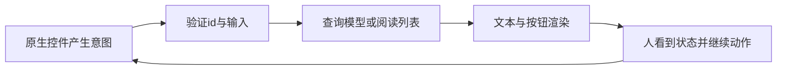

# DOM事件、界面状态与焦点：让人的动作有唯一去向

**查询结果是动态生成的，点击里面的按钮如何只改变一门课程？** 项目把点击监听器放在稳定的结果ul上。对一次冒泡的click，`target`是最初触发位置，`currentTarget`是当前监听器所在ul；点到按钮内部的子元素时，两者也不必相同。沿祖先用 `closest('button[data-action="toggle"]')`找动作按钮，再检查ul包含它，最后按dataset.id找当前课程。只认当前结果中真实存在的id，避免把已经消失的DOM当作数据事实。[DOM派发算法](https://dom.spec.whatwg.org/#concept-event-dispatch)区分路径、捕获、目标与冒泡；本例无Shadow DOM，未覆盖其重定向/composed路径细节。

在普通DOM树中，设置捕获的祖先监听器先获得事件，再到目标，然后在事件可冒泡时回到祖先。委托利用稳定祖先接到后代事件，避免每次查询都重新给每个按钮绑定监听器。不要把“所有事件都会冒泡”作为前提；选择事件类型时要核对 `bubbles`。这里原生按钮的click可用于委托。

## 默认行为和传播是两件事

表单submit监听器同步调用 `preventDefault()`，阻止这次默认导航；它不阻止事件向其他监听器传播。`stopPropagation()`影响继续沿事件路径传播，不取消导航；同一节点的其他监听器仍可能执行，`stopImmediatePropagation()`才还阻止其后续监听器。能否有效取消还受cancelable与passive约束。[DOM事件方法](https://dom.spec.whatwg.org/#dom-event-preventdefault)是核对依据。对async监听器，不能先await请求再希望取消已经开始的默认动作。

**反例：**在click里只调用stopPropagation，以为表单不会提交。若按钮是submit，默认行为仍可启动；本例给加入、移除、取消、重试按钮明确 `type="button"`，只查询按钮提交表单。传播管理也不应该成为隐藏错误数据流的技巧。

## 数据走向决定界面，而不是从界面反推事实

模型包含查询状态与已验证课程；app.js持有阅读列表。事件→读取/验证意图→更新状态→渲染，是单向路径。课程记录 `{id,title,minutes,level}`里id是稳定身份，minutes是1–240的整数分钟，title是显示文本，level是有限枚举；同一响应id唯一，最多100门。渲染用textContent，不把网络标题当HTML执行，输出语境的完整安全解释去读 [[计算机知识/10-编程语言/05-TypeScript/10-系统课程/07-Web边界安全与全栈协议#浏览器安全边界|Web安全主解释]]。

阅读列表不变量是id不重复，总分钟 `T=Σ minutes`只对已选课程求和。点击web-doc后 `{web-doc}`，T=35；再选web-state，T=85；再次点击web-doc是移出，T=50。结果按钮是动作按钮：名称说明下一步“加入阅读列表”或“移出阅读列表”和课程名，点击后名称随下一动作改变；阅读列表和状态消息说明动作结果，不设置 `aria-pressed`。若采用具有pressed状态的切换按钮，应保持名称固定，不能混用这两种方案。[W3C APG按钮模式](https://www.w3.org/WAI/ARIA/apg/patterns/button/)说明此区分。界面文字不是另一份课程数据库，合计始终从列表计算。刷新清空是生命周期约定：页面内存并没有保存到服务端或本地磁盘。

## 焦点也是交付的一部分

查询完成只更新结果和 `role="status"`文字，通常不把焦点从正在编辑的关键词抢走。异步替换结果时，若焦点原来在被替换结果按钮上，按id找替代按钮；没有同id则回结果标题。阅读列表删除当前按钮后，焦点转到原索引的下一项；删末项转前一项；删到空则回阅读列表标题。加入时结果按钮本身保留，只有阅读列表重建，因此键盘还能继续选课。取消和重试把焦点送回关键词，防止停在已禁用或隐藏的按钮上。

`role="status"`配合aria-atomic给“正在查询”“返回2门”“已移除”等简短状态一个程序可辨认的区域；`aria-busy`描述结果区正在更新，不是屏蔽所有交互的锁。这是设计与结构，实际辅助技术是否在所测组合播报仍要观察。[W3C状态消息说明](https://www.w3.org/WAI/WCAG22/Understanding/status-messages.html)把不夺焦点的状态告知与焦点引起的上下文变化分开。添加ARIA不构成WCAG认证。

**练习：**阅读列表有A、B、C，焦点在B的移除按钮。移除B、接着移除C、再移除A，预期位置是什么？答案：C按钮、A按钮、阅读列表标题。若用户正在查询输入框打字时旧请求完成，答案是保留输入框焦点。对应动作必须在真实浏览器里做，模型测试无法证明这些位置。

继续读 [[计算机知识/63-Web平台开发/03-Fetch请求取消与陈旧响应|Fetch请求和陈旧响应]]，解释外部结果何时有权更新状态。人的反馈需求与研究方法由 [[计算机知识/75-软件工程与人机交互/04-交互任务反馈可用性与无障碍|HCI主课]]承担；本课没有真实用户研究。返回 [[计算机知识/63-Web平台开发/00-Web平台开发-MOC|入口]]。
