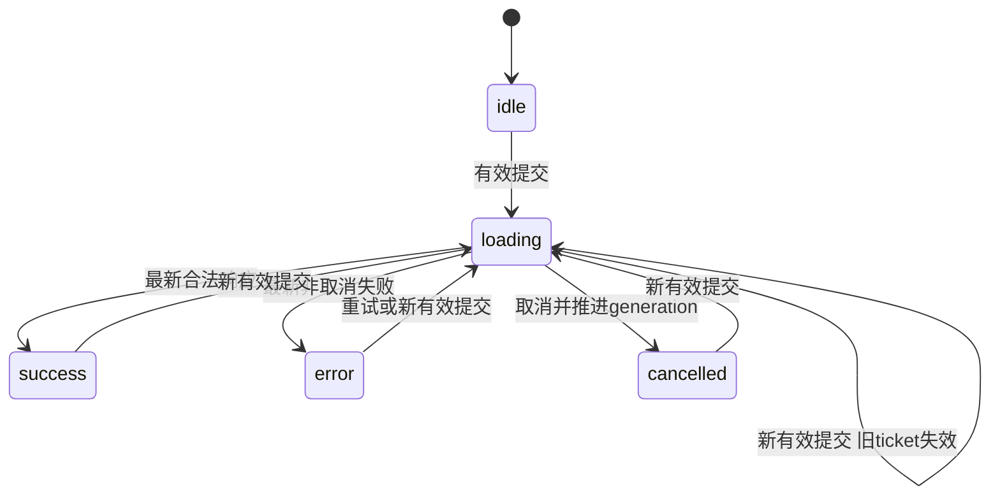

# Fetch请求、取消与陈旧响应：完成不等于可以发布

**先查询Web，接着查询网络，Web却最后回来，界面应该显示谁？** 应显示最后一个有效提交意图的网络结果，不能按响应到达次序猜人的意图。请求模型为每次有效run分配单调递增generation；闭包保留ticket。只有 `ticket===generation`的完成分支有权发布。取消也推进generation，让旧分支失效。此计数只属于当前页面生命周期，不能当服务端版本或跨设备序号。

## 请求要穿过三层成功条件

第一层是Fetch拿到Response；HTTP 404或503通常仍兑现Promise，所以必须检查response.ok，它为200–299状态范围的布尔值。第二层是读取异步响应体：拿到响应头不等于JSON已经可用，取消也可能使体读取失败。第三层是JSON形状符合本项目协议：courses数组最多100项，id合法且唯一、标题非空、分钟整数且在1–240、level属于枚举。200加 `{courses:[{minutes:-1}]}`仍不能发布。[MDN Fetch使用说明](https://developer.mozilla.org/en-US/docs/Web/API/Fetch_API/Using_Fetch)与[Fetch取消算法](https://fetch.spec.whatwg.org/#abort-fetch)用于核对平台行为；这些课程字段限制是本项目自己的协议。

本模型将HTTP状态错误记为http，Fetch或体流读取的连接失败记为network，JSON语法/字段不符记为payload；取消按本次controller的signal判断，不依赖所有异常都名叫AbortError。network是用户层粗粒度类别，不足以诊断DNS、TLS、代理或服务中哪一层出错。外部错误消息不直接显示到页面，给固定说明；意外程序错误在这份小模型中也会落到粗粒度错误，不能据此声称生产诊断完整。

## 状态机明确下一步

loading时清空旧查询结果，同时保留阅读列表；成功时可以是0门，必须显示“返回0门”，不能把空结果叫网络失败。error提供重试上次查询：复用模型保留的query与scenario，而不是悄悄读取用户现在尚未提交的输入；若场景仍是503，再次失败符合实验预期。修正故障场景后重新提交是新意图。非法空白输入只报告字段错误，不推进generation，也不打断正在进行的合法请求。

## 同一时间线推导发布条件

旧请求晚到，不等于升职成最新意图。设初始generation=0。t0提交Web得到ticket=1；t1提交网络，generation=2并对前一个controller调用abort；t2网络合法结果发布；t3旧Web返回，1≠2被忽略。若Web先在t2完成，也因generation已是2被忽略，直到网络完成。这覆盖两种完成顺序，正确性来自每个完成分支都检查ticket，而不是希望“快请求通常先回来”。响应头先到、JSON后到也一样：最终提交前再检查ticket。

取消把generation从2增到3，立即显示cancelled，阅读列表保留。之后任何ticket=2的成功/错误都不能改变界面。AbortController尽力停止受支持API的本地等待与读取；代号过滤即使面对不观察signal的测试transport也能保住状态。两者的职责分别是资源清理与发布权限，不能仅调用abort就省略代号检查。finally只在ticket仍最新时清理controller，避免旧请求清掉新请求的取消句柄。

**反例：**在finally无条件把loading=false，旧请求完成会让正在等的新请求显示“已经结束”；在catch无条件显示error，会让旧连接失败盖掉最新成功。本模型的成功、失败与finally均核对ticket。

## 重试与远端结果未知

此接口是读取合成课程的GET，没有服务端写入，阅读列表操作也只改内存，因而提供显式读取重试。一次请求失败后重试，不承诺课程一定相同或故障自行恢复。若把加入列表改成POST持久化：服务端已提交、响应丢失时，客户端看到network不能断言未加入；取消也不能撤销已经提交的变更。恢复需要业务意图id、幂等语义及查询确认，完整时间线由 [[计算机知识/35-计算机网络/06-DNS-TLS-HTTP与端到端请求#端到端重试的关键反例|端到端重试主解释]]承担，具体HTTP方法/网关状态看 [[计算机知识/35-计算机网络/10-系统课程/06-HTTP_TLS_QUIC与应用协议#练习：如何解释 504|HTTP与504边界]]。本项目未实现服务端写入、幂等记录或未知结果恢复。

**练习：**先拿到Web响应头，再发网络并成功，再让Web.json完成，最后让另一个旧请求失败。最终query和status应为何？答案：网络、success；所有旧成功/失败无权发布。另问：cancelled能证明服务端从未处理GET吗？答案：不能，它只表示本页面已停止等待并拒绝旧结果。

在 [[计算机知识/63-Web平台开发/80-可交互Web小项目与源码|项目和测试]]观察这些路径，去 [[计算机知识/63-Web平台开发/04-Web交付验证与平台边界|交付验证]]分清“证明状态不变量”和“浏览器实际表现”。返回 [[计算机知识/63-Web平台开发/00-Web平台开发-MOC|入口]]。
