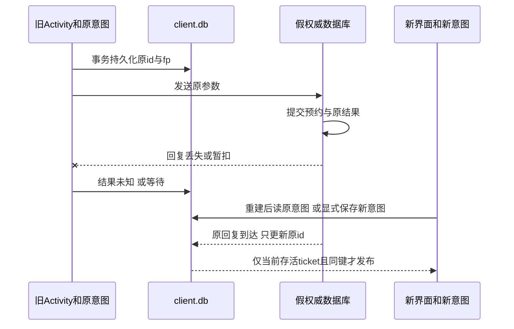

# 生命周期、状态归属与离线同步：屏幕重生以后，仍是同一次预约吗

D把690–720分钟的预约发出。服务已经写入，回复却丢了；D把应用切到后台，进程结束。下次打开，界面还能画出一个绿色勾，但凭什么说预约已被接受？屏幕是新画的，事实要从仍然存在的记录恢复。反过来，屏幕一片空白也不能使已经提交的预约消失。

本单元把这个问题放进一个可构建的原生Android工程。先读懂下表，再沿同一个公开合成意图经历本地排队、未知、换进程、查询和确认。[[计算机知识/75-软件工程与人机交互/82-v2意图恢复与演进实验#唯一业务合同：移动端与流处理共用|SE82]]是业务规格真源；本页承担Android组件、存储与界面发布的连接。工程和正式实测入口在 [[计算机知识/64-移动平台开发/android-intent-demo/README|实践README]]，源码镜像在 [[计算机知识/64-移动平台开发/android-intent-demo/源码与测试|完整源码与测试]]。先学状态归属，再运行，不必先安装一套复杂界面框架。

## 界面、进程与持久状态

同一次操作同时有四种状态，先问“它是谁的事实”，再选保存机制。

| 层 | 本例的对象与拥有者 | 恢复来源 | 它不能承诺什么 |
| --- | --- | --- | --- |
| 输入草稿 | 用户正编辑的原始文本，例如`bad`、`840`；Activity的EditText暂存 | 配置重建可从小Bundle恢复；显式“保存草稿”后从client.db恢复 | 还没通过解析，也没有创建预约 |
| 进行中业务意图 | 客户端已决定尝试的不可变`actor/id/start/end/fingerprint`及queued/unknown等状态 | client.db的事务记录；发送前必须已成功提交 | queued或unknown不是服务接受 |
| 缓存投影 | 当前屏幕、选择的意图、显示文案和已缓存的终局结果 | 重读client.db、检查结果身份后重建 | 内存里的旧绿色勾不创造业务事实 |
| 权威决定 | 服务对原意图的accepted/rejected，以及预约/事件 | 生产应由服务查询；本实践由独立mock-authority.db模拟 | 同设备的假服务不提供远端容灾或真实身份认证 |

**草稿和进行中意图可以不同。** 新意图排队时，把可解析的整数690/720固定进业务记录；后来把开始输入改成`bad`并保存草稿，并不把那条意图的start改成字符串，也不把已有预约撤销。更改需求要创建新意图，原未知意图仍保留，不能拿“新建”冒充“重试”。

Activity是显示与交互组件；本应用的Application、Repository和工作线程住在应用进程中。通常旋转会重建Activity，而进程可以继续存在；进程终止会同时带走这些内存对象。Bundle适合少量可序列化的界面值；ViewModel能跨配置重建保留内存，却不能跨进程死亡。用户完全结束界面与系统恢复任务也不是同一条件。相关平台规则见[保存UI状态的机制比较](https://developer.android.com/topic/libraries/architecture/saving-states)。本工程没有使用ViewModel，用小Bundle加显式数据库把这条边界直接暴露出来。

### 回调告诉你边界，不替你完成提交

本例`onCreate`建立View和小状态，`onResume`重新读持久投影并允许发布，`onPause`使旧ticket失效，`onStop/onDestroy`只做教学轨迹记录。Manifest没有用`configChanges`绕开重建。不要把最后一个回调当保险箱：系统终止缓存进程时，**不保证执行onDestroy**；后台执行本身也会受限。[Activity生命周期](https://developer.android.com/guide/components/activities/activity-lifecycle)与[进程生命周期](https://developer.android.com/guide/components/activities/process-lifecycle)分别规定组件和进程行为，Linux退出知识不自动推出Android一定调用哪个方法。

因此，业务顺序是“用户明确排队 → 工作线程提交SQLite事务 → 报本地待发送 → 才允许发送”，而不是“先发，离开页面时再补写id”。保存失败就保持输入，且不发送。把id的生死托付给onDestroy，像约好失忆以后再记笔记：回调若没来，计划也一并蒸发。后台自动保存、自动重试并非本例已经实现的能力。教学审计也异步排到worker：进程可能先死，故日志缺一行不证明相应回调从未进入；业务提交条件不依赖审计完整。

## 一套能构建的语言、工具与应用结构

固定教学组合为Kotlin **2.1.21**、Android Gradle Plugin **8.7.2**、Gradle Wrapper **8.9**、构建JDK **17**；compileSdk和targetSdk为**35**，minSdk为**26**，Build Tools **34.0.0**。[AGP8.7兼容表](https://developer.android.com/build/releases/agp-8-7-0-release-notes)给出API/Gradle/JDK边界，[Kotlin官方兼容表](https://kotlinlang.org/docs/gradle-configure-project.html)支持这个KGP/AGP/Gradle组合。它是一组固定可复建输入，不声称是最新版本。

compileSdk决定可编译的API面，minSdk给安装下限，targetSdk参与平台行为兼容选择；三者不是一个版本号。JDK17运行构建工具，不等于设备上安装一套桌面Java。`app/build.gradle.kts`把Java/Kotlin字节码目标也定为17，Android构建链再处理设备运行所需的产物。实际设备API35跑过才是API35运行证据；min26写进配置不等于本轮测过API26。

| 文件 | 读代码时要找的责任 |
| --- | --- |
| settings/root/app Gradle脚本与wrapper | 仓库、插件、SDK、测试依赖和固定构建入口 |
| AndroidManifest.xml | Application/Activity入口、导出与launcher；本例无INTERNET、Service或运行时权限 |
| Protocol.kt | 整数分钟、Unicode文本、规范JSON和SHA256指纹 |
| Stores.kt | 客户端意图/草稿事务；假权威预约/结果/事件事务；严格结果检查 |
| IntentApp.kt | Application拥有的单工作线程，顺序数据库操作、故障开关和回调 |
| MainActivity.kt | 原生Views、Bundle草稿、generation/身份发布门、可理解反馈 |
| 主机/设备测试与tools/check_lifecycle.py | 算法、Android SQLite、重建/旋转、真正换进程分别验证 |

Android的`Intent`是启动组件/传递action、category、extra的消息对象；本文“业务意图”则是client.db里有actor/id和固定参数的记录。重新打开组件可以产生新的Android Intent，仍恢复同一业务id；extra也不能代替业务事务。实验清理只移除一次性控制extra，保留launcher消息身份，配置重建不重放实验动作。

Kotlin的`val`固定变量绑定，`data class Pending`把一次意图的字段成组传递；`String?`显式区分缺少终局结果与一个字符串，`Result`携带工作线程失败，`runCatching`捕捉本次操作异常。`Pending`是不可变记录，并不使整个数据库自动线程安全；本例另用一个工作线程序列化仓库访问。`use`关闭Cursor，事务的`finally`结束事务，不能把“用了某个语言特性”误当正确性证明。

这样选原生Views和SQLiteOpenHelper是为了看清边界，收益是依赖少、可以逐行追踪，代价是手动处理状态、迁移和异步回调。规模扩大可用Room、生命周期感知状态流和ViewModel组织代码，仍要保留相同的业务提交条件；换成Compose也不会自动得到幂等服务。

## 先持久化同一意图，再谈重试

本例只调用本地函数/JSON接口，消费SE82协议`wwl-reservation-v2/1`的一个明确子集：固定actor=`D`、policy_version=2、作出新决定的writer_epoch=2。旧种子预约仍有policy1。**本包不实现epoch推进、服务发现、HTTP、身份认证或SE82全部迁移/通知接口**；客户端也只接受此固定epoch的决定，不能拿它连接任意epoch3服务而称通用兼容。协议字符串、业务政策版本、SQLite布局版本和Android版本各管不同对象。

业务键是二元组`(actor,intent_id)`，id是一次用户创建意图的持久身份；UI代号不入键。SE82指纹采用按键排序、紧凑JSON的UTF-8：

```json
{"actor":"D","end":720,"op":"reserve","policy_version":2,"start":690}
```

SHA256为`d644656f03ece17dcce05e3855ec43ae1c4b50186e8b58c631c77ed2f846a867`。指纹**不含id或writer_epoch**，它检测同一个业务键是否偷偷换了请求参数，不是密码或授权凭证。Protocol.kt保留Unicode标量文本、控制字符的规范转义和128码点限制；Android模型的start/end入口是有符号32位整数，业务还要求540≤start<end≤1020，时长30–120分钟。服务拒绝合法整数但不合法区间；原始文本不能解析为整数则先留在UI，不创建意图。

两条区间相容条件为

\[
e+10\le s_{old}\quad\text{或}\quad e_{old}+10\le s.
\]

这里单位是同一天零点后的**分钟**，10是周转缓冲。种子A540–600、B600–630、C650–680是保留的旧政策记录；D690–720可被新政策接受，630–660会冲突。这不是旧版“端点相接就不重叠”的政策。加10时使用Long中间值，避免Int溢出把非法大数误作相容。

客户端`queue`在一个事务里保存不可变参数、fp、queued状态、当前意图索引与对应草稿；返回成功之后才暴露发送。这里排队草稿使用已解析整数的十进制文本，不保留前导零等格式；单独“保存草稿”才逐字保存32字符以内的原始输入。假权威`reserve`先查键：同键同fp返回原决定，即使重放调用来自旧writer参数；同键不同fp报冲突。新决定把预约、意图终局结果和outbox事件放入**同一个假权威事务**，提交前注入失败则一并回滚。[SQLite事务官方语义](https://developer.android.com/reference/android/database/sqlite/SQLiteDatabase#beginTransaction())规定没有成功标记的事务回滚；本例未在两个数据库之间伪造原子事务。

**客户端提交和服务提交不能合成一条数据库事务。** 它们之间允许失效，恢复正是为这段空隙服务：

| 故障切面 | 客户端还能知道什么 | 下一步 |
| --- | --- | --- |
| 客户端queue提交前失败 | 没有持久待发送意图；禁止发送 | 保留草稿，重做显式排队 |
| queue已提交、尚未调用服务 | queued与原参数仍在 | 后续显式发送同id |
| 服务事务提交前故障 | 本次模拟已回滚；通用客户端只见不确定失败 | 标unknown，查询原id；未登记时可按合同重放 |
| 服务已提交、回复丢失 | 客户端无结果，服务有原accepted | unknown；查询/重放同id，不能换新id |
| 回复到内存、客户端结果未落盘就死 | 下次仍可能只有sending/unknown | 重开时sending转unknown，再查原id |
| 客户端终局结果已提交 | 可从本地恢复已核身份的决定 | 重放仍核原结果，不重复创建 |

unknown/not_registered是“此查询尚未找到登记”，不是未来不可能提交的终局拒绝。恢复按钮在本假服务中先query；若未登记，再以**同id、同fp、同原参数**reserve。因为键检查与新决定在同一权威事务内，即使实际查询和另一个原请求交错，重放也只能返回已保存决定或创建一次。本例单工作线程让有限轨迹容易观察，不能据此证明真实多进程、多服务器的锁与隔离合同。

“重试以后预约数还是4”还不够：错误实现每次换新id，服务可能只因区间冲突拒绝新请求，总数也仍是4。必须同时核**原id、fp、原accepted结果、原booking id和事件身份**。冲突替你拦住第二次写入，不等于客户端继承了第一次成功。

## 界面代号与持久意图id

设本次回调携带`t`与业务键`k`，当前Activity的代号为`g`，显示的键为`k_current`。结果发布要同时满足

\[
\text{foreground}\ \land\ \neg\text{isDestroyed}\ \land\ t=g\ \land\ k=k_{current}.
\]

式中foreground是本Activity在onResume/onPause之间维护的发布许可，不是Android全局进程importance/OOM分类。

这继承 [[计算机知识/63-Web平台开发/03-Fetch请求取消与陈旧响应#同一时间线推导发布条件|Web的ticket推导]]，并加上Android界面存活和业务身份。g只属于这一个Activity实例，旋转或换进程可以从0开始；数据库中的业务id不随之重建。对 [[计算机知识/65-分布式系统/05-分布式事务幂等与端到端失败#同一个业务 ID 穿过四个边界|端到端幂等]] 而言，换g不等于换业务键。



Repository可以先把晚到结果写回它自己的原意图，再尝试发布；若界面已经切换到新意图，拒绝发布**不应删除原意图的合法结果**。当前记录与历史记录的职责不同。本例新排队不会抹掉尚unknown的旧记录；界面只显示当前选择的一个，历史全部保留在客户端表/实验快照中，还没有完整的多意图任务列表。仓库也没有跨Activity持续订阅：若新Activity已读取后，旧实例的结果才入库，需要“刷新本地记录”或恢复按钮重新读取；本例不声称已有自动活跃同步。

另一条竞态发生在“新意图异步落盘 → 旧shownId尚在 → 马上点发送”。若不设门，发出的可能是旧意图，发送还会推进g，使新queue回调失效。本工程在新意图保存期间停用业务按钮和输入，函数入口也拒绝立即发送；不只靠按钮看起来灰掉。工作线程返回后解除等待，再按发布条件显示。这条确定回归在同一主线程连续调用queueDraft和attempt，不靠“人的手应该没有那么快”作为同步原语。

## 待同步、未知、冲突与已确认

| 屏幕状态 | 可对用户说的话 | 不能暗示 |
| --- | --- | --- |
| queued | 已保存在本机，尚无服务承诺；可稍后显式发送 | 已占到名额 |
| sending | 正在等待此原意图；离开界面不等于撤销 | 取消界面就是取消预约 |
| unknown | 结果未知，保留原意图和输入，可查询/同意图重放 | 失败=服务从未提交 |
| rejected | 假权威已拒绝此意图，给固定原因，输入保留 | 清空输入就叫错误恢复 |
| accepted | 已保存此原意图的权威确认结果 | 其它新草稿也一并确认 |
| protocol_error | 响应身份/版本/参数不符，保留记录再查 | 收到任意JSON即可绿勾 |

界面不自动擦除错误文本；手工“保存草稿”提交的是原始字符串，不是发送预约。终局结果必须匹配protocol、actor、id、fp、policy、epoch和booking参数；已有终局不能被语义不同的新结果覆盖。JSON字段顺序无关，字段类型不可被`2.0`或字符串`"2"`冒充整数。失败消息和草稿恢复的人的含义回到 [[计算机知识/75-软件工程与人机交互/04-交互任务反馈可用性与无障碍#从人的任务拆出操作与反馈|任务反馈主解释]]；本轮没有真人可用性或读屏效果证据。

## 同一意图的实际轨迹与四层预测

先在 [[计算机知识/64-移动平台开发/android-intent-demo/README#固定输入与运行|固定输入与运行]] 看命令与环境。下面是同一恢复链的判据，正式输出由实际运行保存，不把这张预测表当独立实测回执。

| 动作 | 输入草稿 | 进行中意图 | 界面投影 | 假权威 |
| --- | --- | --- | --- | --- |
| 仅queue690/720 | 当前文本且已同步存入client.db | 原id、fp、queued已提交 | 本地待发送 | 仍是3条种子预约 |
| 配置旋转 | 小Bundle保留编辑值，包括测试注入的bad | 数据库原id/fp不变 | 新Activity重新读取 | 不因重建多发请求 |
| 提交后丢回复 | 输入保留 | unknown、没有终局结果 | 不显示确认 | 第4条预约及原结果/事件已提交 |
| HOME后明确终止，查pid为空 | Bundle可能可恢复，显式保存草稿可从DB取回；不依赖此回调保存业务 | 原id/fp在DB，sending重开后也只转unknown | 旧View与g消失 | 数据文件仍有原决定 |
| 重新启动 | 用Bundle或已保存草稿填值 | 读回原id/原参数 | 新pid读取后仍是unknown | 尚未查询不能替客户端公布成功 |
| query/同意图重放 | 不需要重新读取当前输入造请求 | 存入原accepted结果 | 核身份后确认 | 仍为原booking4、同一事件 |
| 原回复延迟到达，新意图810/840已queued | 新输入保留 | 原结果只入原行，新行queued | 不被旧accepted盖写 | 新行尚未送出，无新预约 |
| bad/840显式保存后force-stop再开 | 从DB恢复bad/840 | 新意图仍是整数810/840 | 显示新queued和错误草稿 | 原accepted不受编辑影响 |

旋转的设备测试包含`ActivityScenario.recreate()`和`requestedOrientation`导致的实际配置方向变化，二者分别标注。完整外部轨迹让同一个FIRST先以wm实际变更配置方向，核同PID、新Activity实例、同id/fp且未发送，再恢复原方向模式，然后才执行HOME和`am kill`；本轮后者返回却保留了previous/LAST进程，因此没有记为终止通过。随后用run-as在该合成应用自身UID下核对PID与/proc中的包名，再SIGKILL，只在旧pid确实为空且新启动pid改变后验恢复。force-stop是另一条显式终止，不叫系统低内存选择。能在模拟器上杀掉一个后台进程，不证明已覆盖所有OEM回收策略、设备掉电、系统重启、App更新或数据删除。具体运行原始JSON、数据库与截图看 [[计算机知识/64-移动平台开发/android-intent-demo/README#结果与证据层次|结果与证据层次]]。

## 变式、反例与完整答案

先预测，再用相应层的输入检查；不把未实现的网络/权限接口悄悄塞进本地函数。

1. **旋转时把id放进Activity字段，重新onCreate再生成UUID。** 服务端去重还可靠吗？  
   答：不可靠。同一用户意图换了键，旧提交与新提交无法按同键归并。即使区间冲突阻止重复写，第二次返回rejected也没有恢复第一次accepted。id与规范参数必须先持久化；新Activity从记录恢复。
2. **只用ViewModel，旋转测试全过。** 能推出am kill以后还能找到原id吗？  
   答：不能。ViewModel跨配置重建的内存保留不跨进程死亡。要单独验证数据库已提交、旧pid确已消失和新pid从原记录恢复，不能用recreate替换这条证据。
3. **服务query返回unknown/not_registered。** 能让用户安心改新id吗？  
   答：不能。它不是终局拒绝，原请求可能尚在路上。保留同id/fp重放由权威去重；要改变业务需求另起新意图，同时保留旧未知并显式处理两者。生产的查询一致性与保留期必须另订合同。
4. **把630–660提交给本假服务，或让690–719排队再发送。** 分别如何反馈？  
   答：前者虽长30分钟，却违反10分钟缓冲且与种子重叠，终局`conflict_with_buffer`；后者只有29分钟，终局`invalid_interval`。整数解析成功可排队，不等于业务验证接受；两种拒绝均保留文本/原意图。
5. **新意图保存期间立刻发送，或者让旧成功晚于新queue到达。** 两道门各防什么？  
   答：savingIntent防保存尚未完成时用旧shownId发送；它不替服务去重。保存完成以后，generation/前台/同键发布门防旧回调覆盖新界面；原结果仍可写入原行，它不等于撤销旧业务。
6. **用户编辑bad以后直接重试旧意图。** 发送参数应来自哪里？  
   答：来自旧持久意图的整数参数与fp，而非当前未提交的草稿。否则同键换参数应触发IntentConflict。若要提交新要求，先解析并显式持久化新意图。
7. **换API26真机、权限被拒绝，或网络不可用。** 哪些结论可迁移？  
   答：状态分层、先持久后发送和同键重试仍是设计条件；实际安装/系统API、布局/输入、权限和后台行为要在目标版本核。当前无INTERNET/危险权限，不把故障按钮当断网测试；真实HTTP适配要给超时/认证/响应校验和断线恢复接口，权限拒绝不能被解释成服务撤销。
8. **两台离线设备都看到最后一个名额并queued。** 合并两个本地列表能保证容量1吗？  
   答：不能。每个queued都是本地意图，不是容量承诺；要用服务协调或已约定的预分配资格。回到 [[计算机知识/65-分布式系统/02-复制一致性与可见性历史#同一空时段为什么还能被接受两次|复制与容量反例]]，本单设备mock未实现双设备同步，也不能凭最终收敛宣布不超订。

## 下一段真正剩什么

本包建立Android首个可构建、可终止并恢复的意图闭环。继续读 [[计算机知识/64-移动平台开发/02-双客户端网络身份与容量冲突|双客户端、网络身份与容量冲突]]：把权威移出两个私有客户端，实际HTTPS断链后恢复原决定，不能把两边queued合并为两个成功。后续仍需权限与设备输入、后台执行与网络/电量预算，以及发布签名/安装/更新与兼容性；本轮debug APK构建/安装不是整个分发课程。这些是 [#175原课程](https://github.com/EunsonZ/WWL/issues/175) 的具体剩余项，本首包不关闭整课。不同生命周期证据已经做了什么、哪些还没做，按实践回执分别读取；不存在一个“旋转通过所以移动平台完成”的快捷键。

从源码看设备身份与Manifest边界，返回 [[计算机知识/Kali/05-密码无线与专门领域/07-AndroidADBJadx与移动应用分析#设备、应用包和运行时分别回答什么|Android分析页]]；从本页能构建自己的合成包，不代表已完成JADX/Frida安全分析。业务并发/迁移证明返回SE82，显示反馈返回HCI，避免每个客户端复制一套新的业务规格。

从“进程还在吗”继续到“平台还准许它做什么”：[[计算机知识/64-移动平台开发/03-权限设备输入与后台资源#四种许可，谁有权作出哪一种决定|权限与资源许可]]不改原accepted；再用 [[计算机知识/64-移动平台开发/04-构建签名与更新迁移#同一数据穿过安装链的判据|同签升级与迁移]]检查原id穿过新APK。上述首包剩余说明保留其阶段含义，新单元的实际范围分别以对应实践记录为准。
